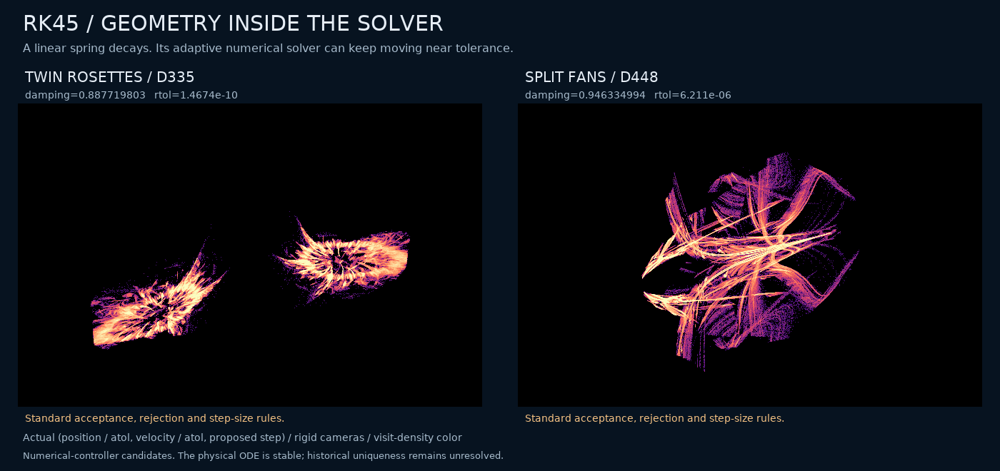
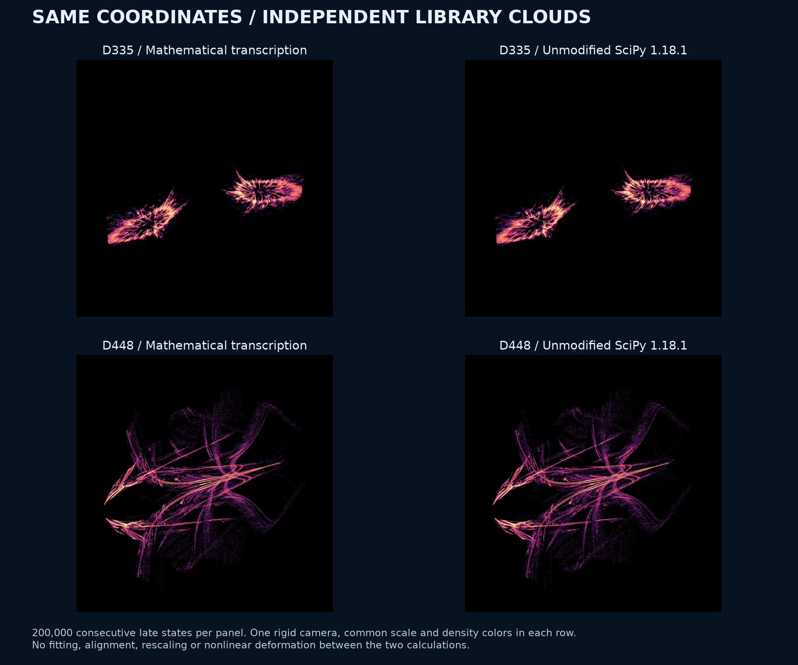
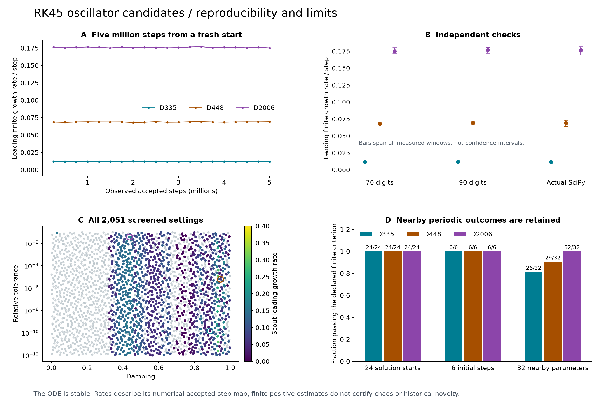
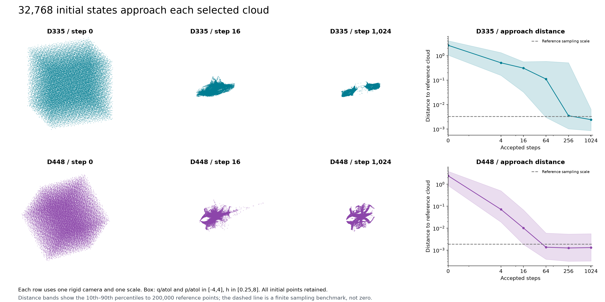

# Twin rosettes and folded fans in the standard RK45 solver

**Status:** strong finite numerical candidates in an existing algorithm. Historical uniqueness, asymptotic chaotic attraction and a new invariant-set equivalence class remain unresolved. The physical oscillator is stable.



<!-- drawing-date -->
*First recorded portrait: **2026-11-01**.*
<!-- /drawing-date -->

[Large portrait](assets/rk45-oscillator-geometry.png) · [Initial-volume approach](assets/rk45-oscillator-approach.png) · [Independent evidence](assets/rk45-oscillator-evidence.png) · [Actual-library geometry](assets/rk45-library-clouds.png) · [Exact map and solution bounds](rk45-controller-structure.md) · [Prior-art and equivalence audit](rk45-priority.md)

[Research manuscript (PDF)](../papers/rk45-controller/manuscript.pdf) · [Editable text, figures and review](../papers/rk45-controller/README.md)

## Why these two cases are interesting

D335 forms two intricate rosettes and retains **two positive finite growth estimates** in every long, independent high-precision and actual-library window. D448 forms strongly folded fans and retains one positive estimate in every corresponding check. These descriptive names are visual labels, not claims of a new attractor class.

The unexpected-looking object lives inside the numerical solver. We integrate only `q'=p`, `p'=-q-2*zeta*p`; every physical solution decays to zero. The extra state is the proposed numerical step. The method, its coefficients, safety factors, componentwise scales, RMS norm and rejection policy are the existing SciPy RK45 implementation. Earlier numerical-analysis work already studies adaptive feedback, unstable controller equilibria and tolerance-scale oscillations.

## Exact settings and five-million-step evidence

| Case | Damping | Relative tolerance | Mean full finite spectrum | Minimum leading window |
| --- | ---: | ---: | --- | ---: |
| D1890 | 0.031785028979182242 | 0.082986351779766543 | 0.156809174, -0.003689701, -2.195910760 | 0.156160783 |
| D335 | 0.88771980300731956 | 1.4674009503231292e-10 | 0.011805102, 0.004237863, -0.081454566 | 0.011566681 |
| D448 | 0.94633499445579949 | 6.2109969081040111e-06 | 0.068721031, -0.053776634, -0.453422098 | 0.068035973 |
| D508 | 0.72953052181378009 | 1.9650578839342289e-06 | 0.004575154, -0.016718209, -0.486630290 | 0.004560016 |
| D2006 | 0.43700747704692183 | 0.03663624012810815 | 0.175838357, -0.078293071, -0.673105628 | 0.175085190 |
| D726 | 0.4301832093652338 | 0.0083341459326946692 | 0.129986957, -0.086104750, -0.440498802 | 0.128631559 |

Each run starts afresh at normalized `(q,p,h)=(1,0,0.1)`, discards 100,000 accepted steps and measures five million in twenty equal windows. A full three-column QR calculation uses the analytic branch Jacobian in `(q,p,log h)`. The sum of the window rates matches the independently accumulated log determinant within 9.1e-14. No selected tail closes within the declared 1–512 lag test at tolerance 1e-9. This finite test is not proof of aperiodicity.

D508 and D726 are retained secondary cases. Their five-million-step checks do not substitute for independent precision and library checks, which were performed for D1890, D335, D448 and D2006.

## Independent arithmetic and the actual library

The 70/90-digit implementation evaluates all seven Dormand–Prince stages with rational method coefficients. It imports neither the production polynomial map nor its Jacobian. After 100,000 warm-up and 5,000 alignment steps, it measures 100,000 steps in ten windows using two finite-separation directions in actual `(q,p,h)` coordinates. Separations are 1e-30 and 1e-40; parameters and controller constants are exact lifts of the declared binary64 values.

The unmodified SciPy 1.18.1 runs each take 400,000 accepted steps from physical `(q,p)=(1,0)`, `atol=1e-6`, first step 0.1. They retain the floating-point clock. After 100,000 warm-up and 10,000 tangent-alignment steps, 29 windows remain. Tangents describe the mathematical map evaluated on library states, not the derivative of floating-point rounding. Maximum one-step residuals are below 9.4e-9 in normalized solution/log-step coordinates.

An additional unaligned comparison uses 200,000 late states per method. Median actual-library-to-reference distances are 0.00250248 (D335) and 0.00132266 (D448), versus reference half-cloud medians 0.00325826 and 0.00188043. Maximum distances remain nonzero (0.35591 and 0.18432); no identical-invariant-set or shadowing claim follows.



| Case | Minimum leading rate, 70 digits | 90 digits | Actual SciPy |
| --- | ---: | ---: | ---: |
| D335 | 0.010076657 | 0.010662494 | 0.010387770 |
| D448 | 0.064908056 | 0.066071235 | 0.064083876 |
| D1890 | 0.154855251 | 0.153333051 | 0.153583974 |
| D2006 | 0.172018758 | 0.171891769 | 0.169631221 |

For D335, the minimum **second** rate is 0.003728918, 0.001968641, 0.001327831, 0.002438311 in the five-million-step, 70-digit, 90-digit and actual-library checks respectively. All are positive. This is numerical support for hyperchaos, not a theorem about infinite-time Lyapunov exponents.



## Two rosettes, one orbit

The original map has exact reflection symmetry `(q,p,h)->(-q,-p,h)`. In all 7,999,999 consecutive pairs of the dense D335 portrait, velocity changes sign; its smallest absolute value is about 0.17918. The two visible pieces are therefore exchanged by one sampled trajectory. They are not two coexisting attractors or a new object created by reflection. The finite check does not certify a global band decomposition.

In actual D335 library steps, the median angular distance from a half-turn is 0.031778 radians. This matches the known interpretation discussed by [Humphries and Christodoulou, Section 5.2](https://math.mcgill.ca/humphries/research/papers/psthetarep.pdf), not a newly discovered mechanism.

All portraits use eight million actual consecutive states after warm-up, with no nonlinear deformation or smoothing. The animation rotates a fixed consecutive million-point tail through 72 rigid orthographic cameras. Every frame retains every point and uses equal units; color represents visit density. The view rotates, rather than the dynamical set changing shape.

## Initial states and nearby parameters

| Case | Positive / 24 solution starts | Positive / 6 initial steps | Positive / 32 neighbors | Neighbors with two positive rates |
| --- | ---: | ---: | ---: | ---: |
| D335 | 24 / 24 | 6 / 6 | 26 / 32 | 0 / 32 |
| D448 | 24 / 24 | 6 / 6 | 29 / 32 | 0 / 32 |
| D2006 | 24 / 24 | 6 / 6 | 32 / 32 | 0 / 32 |
| D1890 | 24 / 24 | 6 / 6 | 32 / 32 | 0 / 32 |

The 252 runs include four radii (0.01, 1, 100, 1e6) at six phases, six alternative first steps (0.001, 0.01, 1, 3, 10, 100), 32 scrambled Sobol parameter neighbors within relative log width ±0.02, and exact zero for each setting. They use 100,000 warm-up and 300,000 measured steps in ten windows. Positive means every leading window exceeds 0.001 and no tested numerical period is detected; the two-positive column additionally requires every second window to exceed zero. Full regular, weak and failed results remain in the archive.

At exact zero, proposed steps grow tenfold until the declared state cutoff is reached. This expected control excludes a compact global attractor for the unrestricted full-state map.



For each main portrait, 32,768 scrambled Sobol starts fill actual `q,p in [-4,4]`, `h in [0.25,8]`. All 65,536 complete 1,024 steps. Median distance to an independent 200,000-point reference falls from 2.65124 to 0.00242786 for D335, and from 2.42906 to 0.00131081 for D448. Reference half-cloud medians are 0.00325826 and 0.00188043. These are distances to finite samples, not certified distances to an invariant set or basin-volume estimates.

## Changing the norm: a deliberately different algorithm

A conjugate complex equation with a complex absolute-value error rule has phase symmetry. We compare its amplitude/step quotient, starting at amplitude `1/sqrt(1-zeta^2)`, with the same polynomial pair and controller factors. This replaces the error rule; it is not a change of coordinates applied to the complete original algorithm. Norm dependence is established prior work.

| Case | Mean quotient spectrum | Tested quotient period (0 = none found) |
| --- | --- | ---: |
| D335 | -0.000485184, -0.333884266 | 0 |
| D448 | 0.003728579, -0.196592226 | 0 |
| D1890 | -0.008481935, -3.800710507 | 1 |
| D508 | -0.005444743, -0.005442922 | 1 |
| D2006 | 0.001161290, -0.574569422 | 0 |
| D726 | -0.037910996, -0.158074881 | 111 |

These fresh comparisons measure a million steps in twenty windows after 100,000 warm-up. D335 has negative finite quotient rates but no period within 512: it is not labeled a proven regular attractor. D448 retains a weak positive quotient estimate. D2006 also has a small positive mean, with a minimum leading window below the original 0.001 screening threshold. The quotient has an additional exact neutral phase direction when lifted to the full complex state. A quotient period is not necessarily a closed full orbit.

## Complete search, exclusions and reproducibility

### Declared damping slices through D335

| Slice | Settings | Leading criterion | Two positive | Periodic |
| --- | ---: | ---: | ---: | ---: |
| wide | 257 | 211 | 4 | 41 |
| narrow | 257 | 194 | 125 | 63 |

Each slice contains 257 fresh starts at the same relative tolerance, with damping widths ±0.018 and ±0.0005 around D335. The protocol uses 100,000 warm-up and 400,000 measured steps in twenty windows. Both grids were fixed before execution, and the exact base setting is repeated as a deterministic control. Two-positive means every second window exceeds zero. The retained points do not certify an open hyperchaotic interval or its boundaries.

The scout contains 2,048 Sobol settings plus three declared controls, seed 2026110181, damping in [0.001,0.999] and relative tolerance from 1e-12 to 1e-1. It measures 50,000 steps after 20,000 warm-up. Of 2,051 settings, 2,050 complete and 1,061 pass the leading-window criterion. D802 leaves the declared solution magnitude cutoff 1e10 during warm-up; this is an observed cutoff exit, not proof of divergence.

Every one of the 1,061 flags receives a fresh million-step follow-up: 1061 complete, 1051 retain the criterion, and 13 retain two rates above 0.001 in every window. Detected period counts: `{"100": 1, "180": 1, "24": 1, "32": 1, "36": 1, "47": 1, "62": 2, "8": 2}`. No outcome is omitted because it is inconvenient.

The production Jacobian matches 256 central-difference checks within 1.88e-9 and actual one-step SciPy evaluations within 9.57e-13. The norm-control Jacobian and polynomial stage formulas have their own 512 checks. Exact rational certificates give accepted-solution bounds for D335, D448 and D2006; the sufficient condition fails for D1890 and no bound is claimed for it. These do not establish a full-state trapping region.

The [frozen packet](../results/rk45-controller/) contains all screen/follow outcomes, all 24 initial gallery clouds and the 13 complete two-positive follow-up portraits, six long runs, eight precision runs, four actual-library trajectories, all controls, volume histories, exact portrait histograms, animation tails, source snapshots and SHA-256 manifests. Raw eight-million-state portrait arrays remain local with hashes and regeneration information. Duplicate blocks were compared with their public aggregate before omission. A pre-execution reporting syntax error and the initial conservative symbolic draft are preserved.

```sh
python research/verify_rk45_controller.py --root results/rk45-controller --assets docs/assets
python research/audit_rk45_structure.py --cases results/rk45-controller/source/structure/input-cases.json --out rk45-audit.json
```

Production runs use Python 3.12, NumPy, SciPy 1.18.1 and Numba. The independent replay uses mpmath; the exact audit uses SymPy 1.14. Installed source bytes are archived because an online manual may describe another release.

The [priority review](rk45-priority.md) states what was read and what remains inaccessible. The strongest defensible contribution is the documented geometry and validation of these specific numerical regimes. A claim that nobody has seen an equivalent attractor would exceed the evidence.
