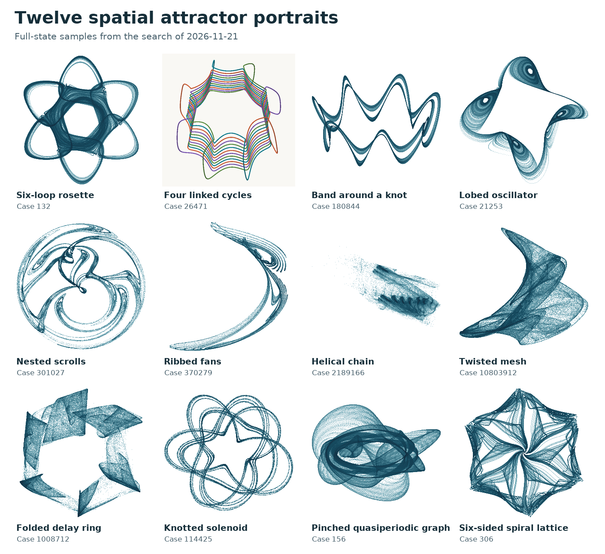
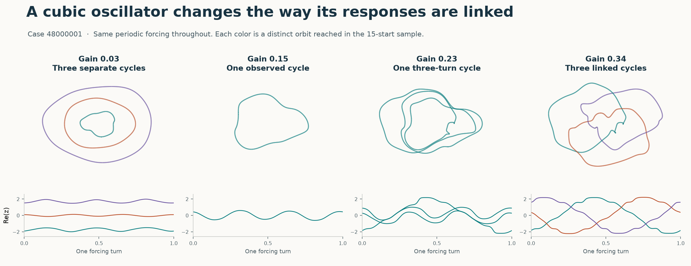
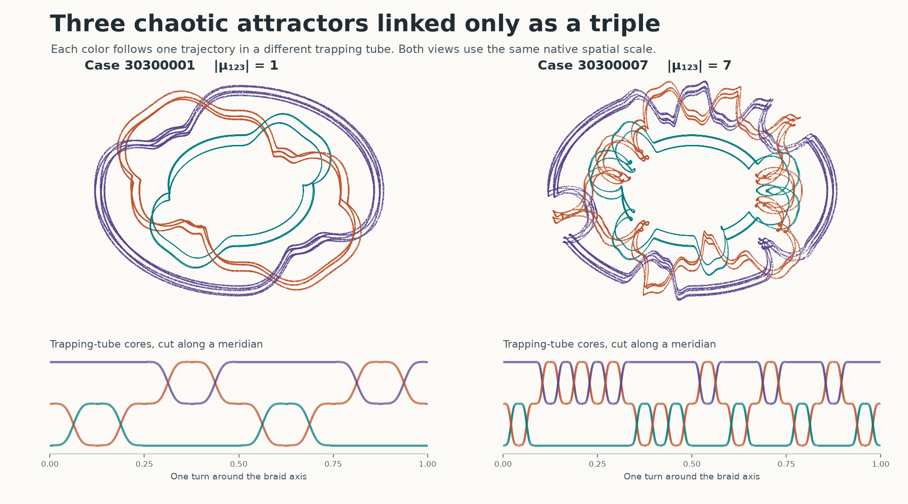
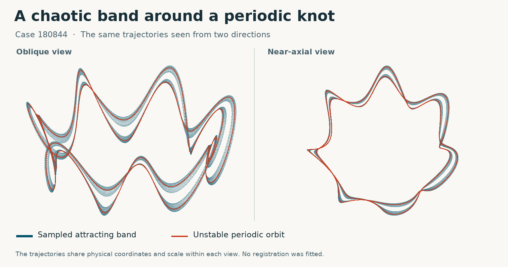
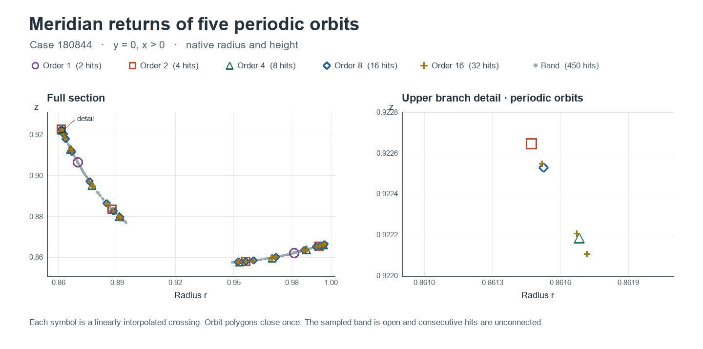
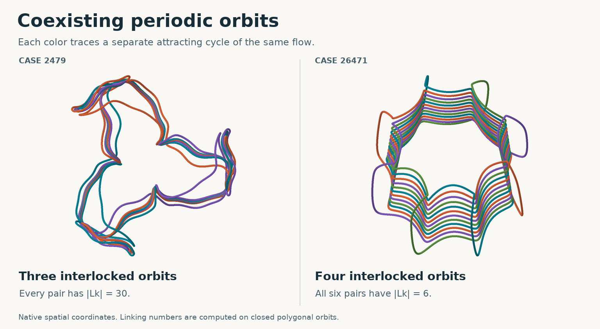
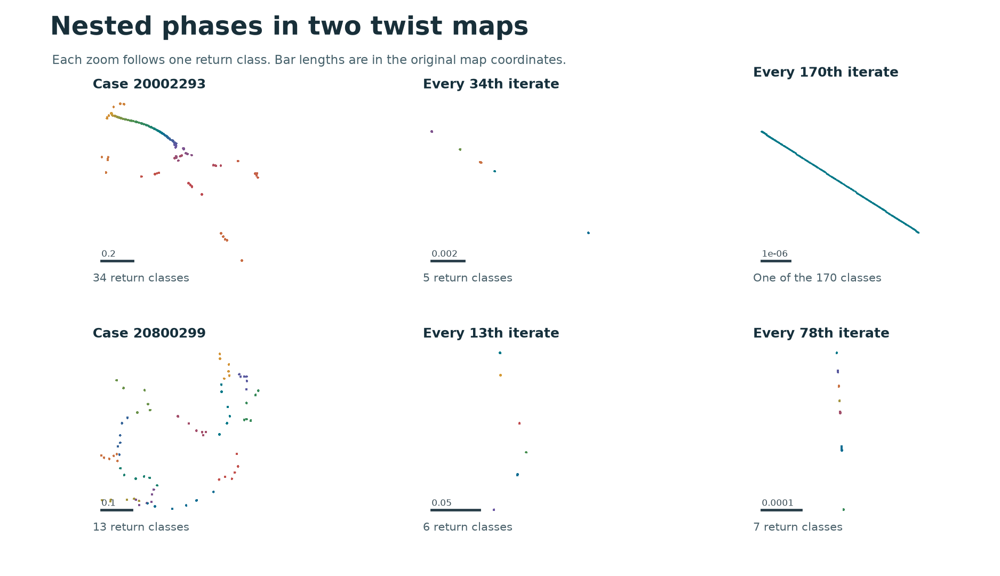
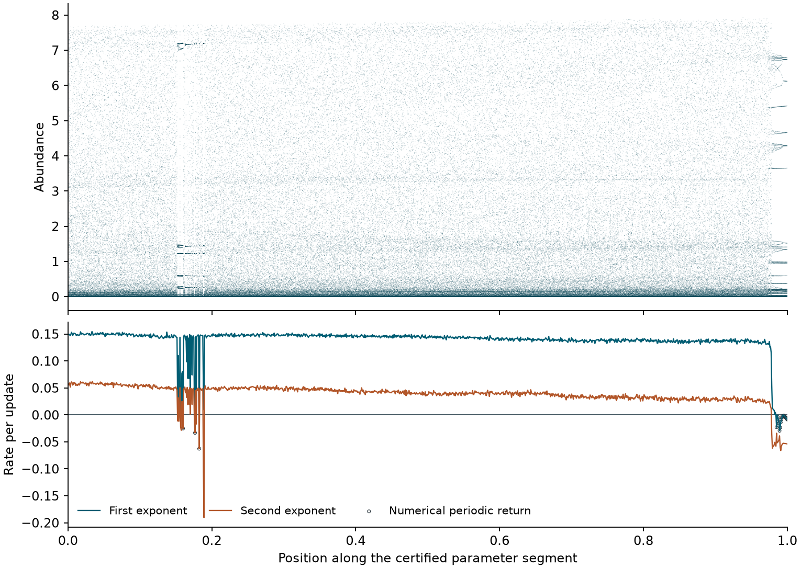

# Spatial attractor search on 2026-11-21

This campaign extends the atlas at revision `57869986`. A **case** denotes a parameter set within a family. Its curves may represent one time history, several coexisting orbits, or a certified subset of the full dynamics. The case records identify the coordinates, initial conditions, verification method and file hashes.



<!-- drawing-date -->
*Drawn: **2026-11-21**.*
<!-- /drawing-date -->

## Four follow-up experiments

**A cubic oscillator ties three attracting cycles into the Borromean rings.** Case 48000001 uses the same three-harmonic force in both regimes. At response gain 0.03 the three periodic orbits form an unlink. At 0.34 each pair can still be separated, yet the triple is inseparable. Moving-disk bounds on 65,536 phase intervals certify both sets of attracting orbits and their link types. In an associated discrete map, an expanding phase produces three chaotic solenoids on the same cubic sheets. [Equations, proof and reproduction](../results/shape_search_20261121/frontiers/cubic/README.md)



<!-- drawing-date -->
*Drawn: **2026-11-21**.*
<!-- /drawing-date -->

**A binary shift inside a ten-component attractor.** In Case 2300491, every bi-infinite binary sequence occurs under the twentieth iterate on a compact invariant subset. All ten components have topological dimension one. The full attractor has Hausdorff dimension strictly above 1.018256 and at most 1.6, throughout a specified ten-parameter neighborhood. [Covering and dimension certificates](../results/shape_search_20261121/frontiers/maps/README.md)

**Five excursions explain 791 same-side pairs.** Most iterates of Case 2298665 alternate between two half-spaces. All 791 exceptions in the original run belong to five excursions. Three reset the alternating phase. Across 25 starts, high-precision replay confirmed the local signs in all 3,067 windows. A spatial precursor predicted 18 of 22 held-out excursions within 200 updates, with 106 false alarms among 124 alerts. [Event traces and prediction controls](../results/shape_search_20261121/frontiers/projection/README.md)

**An eighth attracting set remains a possibility.** Near seven attracting cycles in flow Case 180844, 96 long runs starting on the candidate chaotic set avoided capture for a combined 17.28 million model-time units. Every point on a grid of 69,649 returned inside the chosen neighborhood after five section returns. A trapping proof for the full neighborhood remains open. [Poincaré sections, interval boxes and basin tests](../results/shape_search_20261121/frontiers/flows/README.md)

<!-- campaign-totals -->
## Search totals

The campaign screened at least **4,312,081 distinct parameter settings** across six search tracks. The archive contains **636 checked three-coordinate samples** with 74,325,988 stored points. It includes geometry controls, periodic skeletons and multiple coexisting sets at the same parameters. All 30 gallery input files were regenerated from the recorded parameters and matched their archived SHA-256 checksums byte for byte. [Design audit](../results/shape_search_20261121/design-counts.json) · [Cloud counts](../results/shape_search_20261121/cloud-totals.json) · [Gallery replay](../results/shape_search_20261121/gallery-replay.json) · [Independent array checks](../results/shape_search_20261121/replay-audit.json)

| Search family | Screened settings | Archived samples |
| --- | ---: | ---: |
| Toroidal projections | 3,801,088 | 89 |
| Three-axis twists | 175,104 | 40 |
| Continuous flows | 70,356 | 220 |
| Fourier solid-torus maps | 159,997 | 219 |
| Delayed population maps | 104,000 | 32 |
| Pinched graphs | 1,536 | 36 |

The Fourier count merges proportional coefficient lists before normalization and gives a lower bound. Local sweeps used solely to locate bifurcations and replicate trajectories are excluded from the design total.
<!-- /campaign-totals -->

## Follow-up search

The next 17-minute run continued from revision `6610acc`. The follow-up archive includes 80 constructed solenoid triples, 78 projection clouds, nine three-axis twist clouds and eight flow samples. Each new sample was checked against its source checksum, the previous 636 samples and 177 labeled references. The table above describes the first two hours. [Follow-up geometry counts](../results/shape_search_20261121/extension/geometry-totals.json) · [Nearest geometric matches](../results/shape_search_20261121/extension/geometry-comparison.json.gz)

### Seven attracting cycles and a new doubled orbit

Continuation of the symmetry-breaking branch in Case 180844 found a saddle-node near e = −0.356574826410, followed by period doubling near −0.356571312071. Across this interval of width approximately 0.00000351434, seven rotated copies of one numerical cycle attract nearby starts. At the original chaotic coefficient the partner branch adds seven further distinct periodic orbits, bringing the numerical lower bound from twelve to **nineteen**. Two further steps on the original period-doubling path produced attracting orbits of orders 32 and 64. Their periods are 853.85685 and 1707.71796, with transverse multipliers about +0.34439 and +0.37162. The full observed sequence runs from 1 through 64 by successive doublings. The flow bifurcations and orbit counts are numerical. [Flow branch and solver checks](../results/shape_search_20261121/extension/flows/README.md)

### Additional rigorously separated components

Independent interval arithmetic verified local attracting sets with each of the exact component counts **8 through 14** across nine cases. For all nine parameter sets, an independently isolated orbit of twice the return period forces at least two distinct points in every component. Thus all components are nontrivial connected compact sets. For Case 2000254 the recorded initial state enters the certified 14-way trap at step 57. [Trapping and separation certificates](../results/shape_search_20261121/extension/maps/traps) · [Noncollapse certificates](../results/shape_search_20261121/extension/maps/noncollapse)

The nine trapping proofs concern previously screened coefficients. A separate search of 1,920 parameter vectors verified as new against all 175,104 previous twist designs isolated attracting cycles at 26 new vectors. Fourteen have at least two distinct certified sinks. Examples include pairs of least periods (4, 348) and (29, 232). The lower bound on the Hausdorff dimension of the original five-component Case 2503155 now exceeds 1.041063 throughout the same ten-parameter block. [Twist follow-up and results](../results/shape_search_20261121/extension/maps/README.md)

### Alternating lobes in hyperchaotic candidates

Two additional projection families screened **2,359,296** configurations on the GTX 1080: 1,572,864 for affine deformations and 786,432 with an added quadratic shear. Seventy-eight passed the independent numerical selection for three positive exponents. In Case 409700 the smallest third exponent across twenty five-million-step windows was 0.01642. In Case 2298665 the 250,000-point portrait alternates strictly between two half-spaces. A longer run found 791 consecutive pairs in the same half-space among 49,999,999 transitions. The half-space alternation held for 99.9984% of those transitions. [Projection cases and spectra](../results/shape_search_20261121/extension/projection/README.md)

### Three chaotic sets linked only as a triple

Eighty explicit maps have three coexisting solenoidal attractors. Removing any one allows the remaining two to be separated by a sphere. With all three present, no sphere in their complement separates one from another. An integer derived from the Milnor triple invariant of their trapping tubes distinguishes at least **68 ambient homeomorphism types of the limiting compact triples**. The three internal dynamics and their individual Hausdorff dimensions, approximately 1.30755, 1.48745 and 1.71410, stay fixed across all cases. The search enumerated 217,690 balanced braid words, then added a family of integer lattice paths. [Proof, code and results](../results/shape_search_20261121/extension/brunnian/README.md)



<!-- drawing-date -->
*Drawn: **2026-11-21**.*
<!-- /drawing-date -->

## A knotted chaotic band

Case 180844 is a three-dimensional autonomous flow. Five numerical starts led to a band surrounding a periodic orbit of the same equation and parameters. Two trajectories each ran for 100,000 time units. The largest finite-time Lyapunov exponent remained between 0.08797 and 0.09466 in all 40 windows. In the primary cloud, the 95th-percentile distance to the polygonal orbit was 3.90% of the cloud's root-mean-square radius. Independent adaptive RK45 and DOP853 samples reproduced that distance within 0.03 percentage points. The figure uses both trajectories in their original coordinates. [Flow results, equations and controls](../results/shape_search_20261121/flows/README.md)



<!-- drawing-date -->
*Drawn: **2026-11-21**.*
<!-- /drawing-date -->

The full 32,768-vertex quantized polygon of the core was reduced by isotopy-preserving triangle moves and identified as T(2,7), up to mirror image. The core orbit has period 26.65375 and a transverse multiplier of approximately −47.0037. Varying a single coefficient traces its numerical continuation back to the stable knotted orbit of Case 28756. Intermediate parameter values yielded stable cycles with approximately two, four, eight and sixteen times the original period. This establishes a numerical route to the observed band. The polynomial and crossing calculations refer to the sampled polygons. A knot classification for the entire chaotic set remains open. Analysis of unstable periodic knots in three-dimensional chaos dates to the work of Birman and Williams. [Continuation data](../results/shape_search_20261121/flows/band-continuation.json) · [Birman and Williams](https://www.math.columbia.edu/~jb/bw-KPO-I.pdf) · [Periodic-orbit templates](https://arxiv.org/abs/chao-dyn/9907029)

At the final parameters of Case 180844, four additional unstable periodic orbits have periods near two, four, eight and sixteen times the core period. The 95th-percentile distance from the same chaotic cloud to these four orbits decreases to 2.35%, 1.09%, 0.855% and 0.827% of its RMS radius. The longest orbit has period 427.0582. These distances quantify how much of the observed band each orbit traces. [Orbit parameters, return tests and replay commands](../results/shape_search_20261121/flows/nested-skeletons.json)

At a fixed meridian the core and the four higher-period polygons have respectively 2, 4, 8, 16 and 32 distinct forward crossings per full traversal. These counts were checked with exact arithmetic on the stored vertices. The plot compares their section points with 450 linearly interpolated returns of the chaotic trajectory. [Exact section counts](../results/shape_search_20261121/flows/section-crosscheck.json)



A sixth periodic orbit at the same coefficients resolves an apparent discrepancy in the linking numbers. There are two nearby orbits of approximately twice the core period. The first has period 53.38847 and a transverse multiplier near +220.09. A second, found by imposing the sevenfold spatial symmetry, has period 53.39513 and a multiplier near −236.51. Their sampled polygons have linking numbers −90 and −91 with the same four-period orbit, in the chosen orientation. The first orbit breaks the sevenfold symmetry. Its seven rotated copies have distinct meridian sections in all 21 pairwise comparisons using two solvers. Counting the other five symmetric orbits gives at least twelve numerically distinguished periodic orbits at a single parameter setting, represented by six shapes up to rotation. [Independent section, period and linking checks](../results/shape_search_20261121/flows/final-link-crosscheck.json)

Earlier work constructed horseshoes in tubes around prescribed braids and classified the effect of the core knot on genus-one chaotic embeddings. Finite sequences of torus-knot cablings in period-doubling flows were constructed by Crawford and Omohundro in 1984. [Song, Banks and Diaz](https://arxiv.org/abs/0706.2416) · [Romanazzi, Lefranc and Gilmore](https://arxiv.org/abs/0705.3470) · [Crawford and Omohundro](https://www.sciencedirect.com/science/article/pii/0167278984902756)

The four parent–child polygon pairs sampled along the continuation have absolute linking numbers 21, 91, 357 and 1,435. Dividing by seven gives 3, 13, 51 and 205, the adjacent-pair entries for periods 2/4 through 16/32 in Gilmore’s horseshoe table. This arithmetic match specifies a known pattern for these four samples. A conjugacy with the horseshoe for the full attracting set remains open. [Pair records](../results/shape_search_20261121/flows/doubling-pairs.json) · [Gilmore, Table V](https://journals.aps.org/rmp/abstract/10.1103/RevModPhys.70.1455)

## Several stable knots in one flow

Case 2479 has three coexisting numerical periodic orbits, and Case 26471 has four. Each orbit attracts its own initial conditions. Exact integer calculations on their polygonal approximations give absolute pairwise linking number 30 for each of the three pairs in Case 2479, and 6 for all six pairs in Case 26471. The values persisted over three projections and two polygon resolutions. Independently differentiated Poincaré returns give largest transverse multiplier moduli near 0.0546 and 0.00000145, respectively. Further cases show pairwise linking numbers 10 and 12. Differential equations with knotted and linked periodic orbits have known constructions. The results here identify explicit parameter sets, numerical basins and linking matrices in the searched families. [Evidence for the flows](../results/shape_search_20261121/flows/README.md) · [Ghrist and Holmes on knotted orbits](https://www2.math.upenn.edu/~ghrist/preprints/silnikov.pdf)



<!-- drawing-date -->
*Drawn: **2026-11-21**.*
<!-- /drawing-date -->

Other flow shapes include the six-loop rosette of Case 132 and the six-sided spiral lattice of Case 306, visible along the cyclic coordinate axis. The adaptive solver gives leading rates near 0.0575 and 0.0935 per time unit. Case 967 has a numerically attracting cycle of period 215.27 whose closed polygon has Alexander determinant 243. [Per-case manifest](../results/shape_search_20261121/flows/manifest.json)

## Attracting sets with different numbers of components

The three-axis twist family contains examples with exactly 3, 4, 5, 6 and 7 connected components. Strict trapping of a box under the appropriate iterate, separation of its phase images and injectivity establish the component count for each specified local attracting set. These sets are pairwise non-homeomorphic when their counts differ. For Case 2303801 the four-component result persists under simultaneous independent perturbations of all ten parameters by up to $`2^{-22}`$ in either direction. [Proofs and independent interval checks](../results/shape_search_20261121/maps/README.md)

Case 2503155 combines five separated components with symbolic dynamics inside the local trap. Two strips for the fifth iterate give a topological entropy bound of at least $`\log(2)/5`$ per update. In a different twist map, Case 20002293, long trajectories visit 170 empirically separated phase classes. Case 20800299 has 546 classes organized as 13 × 6 × 7. A separate binary64 check found 680 classes in Case 20601073. The latter is an observation on sampled trajectories. [Twist case records and finite-time checks](../results/shape_search_20261121/maps/manifest.json)

A separate argument bounds the Hausdorff dimension of the entire five-component local attractor of Case 2503155 strictly above 1.039 and at most 1.45. Each component has topological dimension one. The lower bound comes from realizing all binary pasts in every transverse slice. The upper bound comes from verified singular-value contraction. Both estimates hold while each of ten map parameters varies independently by up to $`2^{-24}`$ around its stored value. Three finite-scale pair-correlation slopes for sampled trajectories were 0.921–0.929 over radii from 0.00001 to 0.001 times the cloud RMS radius. These describe the concentration of sampled mass. [Correlation measurements](../results/shape_search_20261121/five-component-correlation.json) [Proof and interval bounds](../results/shape_search_20261121/maps/dimension-proof.md)



<!-- drawing-date -->
*Drawn: **2026-11-21**.*
<!-- /drawing-date -->

## Toroidal projection maps

A Gaussian posterior mean on a finite site set and a torus reflector generate the nested scrolls in Case 301027 and the ribbed fans in Case 370279. Their five-million-iterate double-precision QR runs give leading rates near 0.113 and 0.158 per iteration. Case 1291273 has two positive numerical rates around 0.539 and 0.172. Interval methods independently identify positive-entropy invariant subsets in all three projection geometries. The bounds include $`\log(2)/104`$ for the single torus in Case 394727, $`\log(2)/26`$ for hard switching in Case 1161974 and $`\log(2)/295`$ for the smooth mixture in Case 2189166. For each of the 16 certified cases, two contracting inverse branches give an invariant Cantor set on which a return map is conjugate to the full one-sided binary shift. Identifying a certified subset with the long trajectory in a rendered cloud remains open. [GPU searches and spectra](../results/shape_search_20261121/projection/README.md) · [Symbolic dynamics verifiers](../results/shape_search_20261121/projection/snapback/README.md)

Among the 88 retained primary parameter sets, 31 had three positive exponents in long binary64 and independent high-precision tests. For four of these parameter sets, further runs measured 100 million iterates each. The smallest third exponent seen in the twenty five-million-step windows was 0.05153 for Case 6802681, 0.02557 for the horned cup and 0.02036 for the forked sail. In Case 3014945 two distant clouds coexist at identical parameters. One has three positive rates and the other has one. A sample of 32,768 initial conditions found both, with 26,811 and 5,957 classified into the respective sets. [Three-rate candidates and basin controls](../results/shape_search_20261121/projection/three/README.md)

## Constructed solenoids, pinched graphs and delayed maps

| Family | Result | Evidence |
| --- | --- | --- |
| Fourier solid-torus maps | 219 explicit trapped embeddings. Their first tube cores realize at least 165 distinct knot types, even after identifying mirror images. Six winding degrees give six distinct entropy values. For 213 embeddings, knot-genus growth obstructs realization as an attractor of a global homeomorphism of three-space. | [Exact diagram checks and theorem](../research/shape_search_20261121/braids/README.md) |
| Pinched quasiperiodic graphs | 36 plotted geometries from a 1,536-case family. A dense set of pinches and attraction to an almost-everywhere discontinuous graph give an analytic example of irregular geometry with zero largest typical exponent. | [Analytic argument and numerical checks](../research/shape_search_20261121/pinched/README.md) |
| Delayed population maps | 104,000 screened parameter settings. Case 1025516 has three positive numerical exponents. A four-dimensional parameter rectangle has a connected local attracting set with entropy at least $`\log((1+\sqrt5)/2)`$ per update. Stable cycles coexist with the symbolic subsystem at multiple points in that rectangle. | [Parameter bounds, period certificates and sampling](../research/shape_search_20261121/delay/README.md) |

At one corner of the delay rectangle, all 12,288 sampled starting points approached a rigorously isolated period-39 sink. The positive-entropy subsystem at those same parameters lies away from that cycle. Across the certified parameter rectangle the isolated sinks have ten different least periods, reaching 4,992. At another parameter three trajectories retained positive numerical growth in eight 100,000-step windows and subsequently approached a period-7 sink. Parameter changes across this rectangle can change which dynamics are visible from typical initial conditions.



## Comparison and reproduction

The geometry check compares each saved object to 177 labeled reference samples, including the catalog of 108 named trajectories, historical README portraits and independently archived long runs. The reference list includes multiple cases or projections from the same model. The comparison uses pair-distance histograms, radial distributions and covariance spectra after rigid normalization and after covariance whitening. Close sampled distributions can come from inequivalent dynamics. The extended comparison with stored trajectories does not settle historical priority. A separate persistent-homology comparison of the 31 triple-positive projection maps could not separate any from all 108 named references under its conservative criterion. [Reference sources and checksums](../results/shape_search_20261121/reference-receipts.json) · [All distance results](../results/shape_search_20261121/comparison.json.gz) · [Local alignment results](../results/shape_search_20261121/selected-comparison.json.gz)

The external KnotInfo comparison includes 12,965 tabulated prime knots of at most 13 crossings plus the unknot. For 170 of 219 Fourier braid cases, the combined Alexander and Jones invariants rule out every entry in that list. For 45 of 174 numerical periodic flow polygons, the Alexander polynomial alone rules out every listed entry. We also enumerated 452 multisets of prime factors whose crossing numbers sum to at most 13 and allowed independent mirrors. Even after this extra check, 167 Fourier cases (145 distinct combined signatures) and 45 flow cycles (20 signatures) have no match. More complex composite and higher-crossing knots remain possible. [Comparison receipts](../results/shape_search_20261121/knot-census.json) · [KnotInfo](https://knotinfo.org/) · [Pinned data snapshot](https://github.com/soehms/database_knotinfo/tree/219c2d982b89fb92b6ab0c556f28cdd766a18734)

| Geometry | Independent topological comparison |
| --- | --- |
| Fourier core 91625 | The exact closed braid is the torus knot T(3,4). Its unique matching prime entry through 13 crossings is 8_19. |
| Fourier core 152655 | The Alexander polynomial agrees with T(3,4). The Jones invariant excludes T(3,4) and leaves no match in the prime or tested composite census. |
| Fourier core 72574 | The Alexander polynomial has breadth 60, giving a knot-genus lower bound of 30. |
| Periodic flow polygon 23050 | Its Alexander polynomial has breadth 42, giving the sampled knot a genus lower bound of 21. |
| Periodic flow polygon 26471 | The reduced polygon has a two-strand braid representative of trefoil type. The tabulated prime match is 3_1. |

For each of 30 gallery samples, local point-cloud alignment to the nearest reference selected by the distance histogram had a larger residual than the same procedure on a split of the sample itself. The median ratio was 4.21 with rigid normalization and 3.26 after affine whitening. These comparisons use fixed sample sizes and a local registration search. [Alignment controls](../results/shape_search_20261121/comparison-summary.json)

The main README has paired static images and 24-second rigid rotations. Static images use the full registered sample. Rotations use up to 60,000 consecutive states per panel, or every component when comparing coexisting linked cycles. Raw clouds are stored outside Git in `D:/Codex/chaos-attractor-cache/shape-search-20261121`. The relative cloud index maps each family and case to an archive path. The committed parameters and per-track scripts regenerate the samples. [Cloud index](../results/shape_search_20261121/comparison-inputs.json) · [Portrait inputs](../results/shape_search_20261121/presentation.json)

From the repository root, the following commands regenerate all 30 gallery inputs in a fresh external directory and build the portraits. Replace RUN with the directory you want to use. The replay checks the archived SHA-256 of each file. All 30 files were reproduced on Windows x86-64 with CPython 3.11.15, NumPy 2.4.6, SciPy 1.17.1 and Numba 0.68.1. [Verified replay](../results/shape_search_20261121/gallery-replay.json)

```text
python research/shape_search_20261121/replay_portraits.py --out RUN --workers 4
python research/shape_search_20261121/build_portraits.py --runs RUN
```

Individual cases can also be regenerated directly.

```text
python research/shape_search_20261121/flows/replay_case.py --case 180844 --out RUN/band.npz
python research/shape_search_20261121/flows/replay_case.py --case 180844 --skeleton --out RUN/knot.npz
python research/shape_search_20261121/flows/replay_case.py --case 26471 --linked --out RUN/linked.npz
python research/shape_search_20261121/maps/replay.py 2503155 --output RUN/twist.npz
python research/shape_search_20261121/projection/reproduce.py --record results/shape_search_20261121/projection/case-2189166.json --out RUN/helix.npz
```

The projection, twist and continuous-flow reports specify all controls and interval dependencies. The three other family reports give their exact search commands, finite-time windows and verification procedures. To reconstruct the combined archive comparisons, see the [campaign indexer](../research/shape_search_20261121/index_campaign.py) and [comparison code](../research/shape_search_20261121/compare.py).
