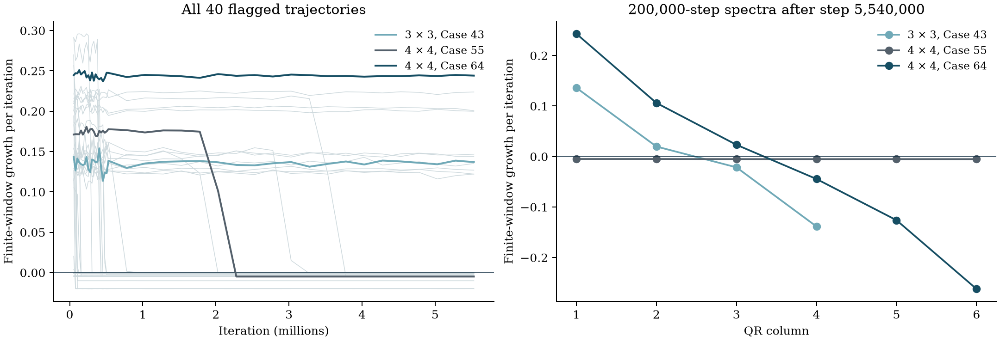

# Overrelaxed Sinkhorn: persistent growth and long transients

A 576-case screen of the published matrix-scaling iteration produced 40 positive
finite-growth flags. All 40 were continued to iteration 5,530,000. Eleven still
have substantial positive growth; 21 exhibit nontrivial periodic recurrence,
four exhibit fixed-state recurrence, and four remain weak or drifting cases.
The sampled projections are diffuse clouds. No new portrait is promoted, and
neither asymptotic chaotic attraction nor historical novelty is established.

[Numerical packet and reproduction](../results/sinkhorn-screen/README.md) ·
[Research index](../README.md#research-index)

## Published map and coordinates

For a strictly positive matrix K and positive equal-mass marginals a and b,
the multiplicatively overrelaxed update is

```math
u^{+}=u^{1-\omega}\circ\left(\frac{a}{Kv}\right)^{\omega},
\qquad
v^{+}=v^{1-\omega}\circ\left(\frac{b}{K^{\mathsf T}u^{+}}\right)^{\omega}.
```

Products, powers and division are componentwise. This is equation (2) of
[Lehmann et al.](https://arxiv.org/html/2012.12562v2), without an adaptive
safeguard. Their equation (7) explicitly works in the product of two projective
spaces. Removing one scale from each vector therefore preserves the published
quotient dynamics.

Let L be the entrywise logarithm of K. We choose a and b as the row and column
sums of K, so the solution is exactly u = v = 1. Dividing K, a and b by their common
total mass gives probability marginals and leaves the update unchanged. Define
anchored logarithms, with zero-based indices,

```math
x_i=\log(u_i/u_0),\quad y_j=\log(v_j/v_0),\quad x_0=y_0=0,
\qquad d=m+n-2.
```

The stored state omits both zero coordinates. Set

```math
\begin{aligned}
f_i(y)&=\log a_i-\log\sum_j e^{L_{ij}+y_j},
&F_i(y)&=f_i(y)-f_0(y),\\
g_j(x)&=\log b_j-\log\sum_i e^{L_{ij}+x_i},
&G_j(x)&=g_j(x)-g_0(x).
\end{aligned}
```

For nonreference coordinates the implemented map is

```math
x^{+}=r x+\omega F(y),\qquad
y^{+}=r y+\omega G(x^{+}),\qquad r=1-\omega.
```

Stable log-sum-exp evaluation avoids overflow. The tangent update differentiates
these expressions analytically. No clipping, noise or trajectory normalization
is added. The finite binary64 entries of L and the relaxation parameter define
the retained inputs; arbitrary-precision checks convert them through exact
integer ratios and recompute all marginals.

## Boundedness and volume change

Each coordinate of F lies in an interval independent of y. Write
the differences between row i and reference row 0 as follows:

```math
\Delta L_{ij}=L_{ij}-L_{0j},\qquad
\Delta a_i=\log a_i-\log a_0.
```

The ratio of the two row sums is a weighted average of
the positive numbers $`e^{\Delta L_{ij}}`$. Consequently,

```math
\Delta a_i-\max_j\Delta L_{ij}
\ \leq\ F_i(y)\ \leq\
\Delta a_i-\min_j\Delta L_{ij}.
```

The same argument applies to G using column differences. Let M collect the
larger absolute endpoint of each resulting interval. For every coordinate,

```math
|z_k^{+}|\leq |r|\,|z_k|+\omega M_k,
\qquad
B_k=\frac{\omega M_k}{1-|r|},\qquad 0\lt\omega\lt 2.
```

Thus the box with radii B is invariant. The scalar recurrence bounds every
orbit, and every box with radii B plus a positive common margin is absorbing
and maps strictly into itself. This proves boundedness and the existence of a
compact maximal attracting set in such a box. It does not identify a chaotic
component of that set or establish attraction to the sampled cloud.

The two block updates are triangular shears with constant diagonal r, giving

```math
\det D T_{\omega}(z)=r^{m+n-2}.
```

For nonzero r the map is a global diffeomorphism: recover y from the second
update using the known new x, then recover x from the first update. At
$`\omega=2`$ it preserves volume; above 2 it expands volume. These cases cannot
admit a bounded open region whose closure maps strictly inside that region.
The screen therefore stays below 2. At $`\omega=1`$ the map is singular.

## Complete screen and continuations

There are 192 declared inputs for each square size 2, 3 and 4. Four kernel
families are used: normal log entries, a diagonally dominant log kernel,
Gaussian-distance kernels, and uniform log entries. Contrasts, starts, seeds
and every matrix are retained in the packet. Relaxation values range from 1
to 1.999. A case number identifies an input within its matrix size; for
example, 3 × 3 Case 64 and 4 × 4 Case 64 are different inputs.

The pilot uses 10,000 warmup iterations and a 20,000-step observation window.
It stops early when every anchored coordinate is below 1e-11 in absolute value;
314 runs reach that numerical threshold. Their partially accumulated growth
values are explicitly excluded from the completed-window comparison. Among
the 262 completed windows, 40 exceed a growth rate of 1e-5 per iteration.
No 2 × 2 case crosses that threshold.

Every flagged case receives another 500,000 and then 5,000,000 iterations.
Growth is recorded in blocks of 25,000 and 250,000 steps, respectively.
The final 250,000-step rates still above 0.01 are:

| Matrix | Case | Relaxation | Growth per iteration |
| --- | ---: | ---: | ---: |
| 3 × 3 | 43 | 1.999 | 0.13696 |
| 4 × 4 | 12 | 1.999 | 0.12219 |
| 4 × 4 | 36 | 1.999 | 0.14402 |
| 4 × 4 | 38 | 1.999 | 0.14671 |
| 4 × 4 | 59 | 1.999 | 0.12695 |
| 4 × 4 | 64 | 1.990 | 0.24412 |
| 4 × 4 | 86 | 1.995 | 0.19987 |
| 4 × 4 | 119 | 1.995 | 0.22380 |
| 4 × 4 | 124 | 1.999 | 0.12211 |
| 4 × 4 | 162 | 1.999 | 0.13523 |
| 4 × 4 | 187 | 1.995 | 0.20064 |



The left panel connects block estimates at their ending iteration; a line
segment is not a resolved transition history. The right panel uses 200,000
observations after a further 10,000-step tangent warmup. These are finite-window
QR estimates, not certified asymptotic Lyapunov exponents.

| Matrix and case | Full finite-window QR rates |
| --- | --- |
| 3 × 3, Case 43 | 0.13604, 0.01982, −0.02138, −0.13848 |
| 4 × 4, Case 12 | 0.12281, 0.04421, 0.01088, −0.01308, −0.04538, −0.12545 |
| 4 × 4, Case 64 | 0.24309, 0.10612, 0.02327, −0.04445, −0.12608, −0.26225 |
| 4 × 4, Case 55 | −0.00486, −0.00487, −0.00505, −0.00509, −0.00508, −0.00513 |

Every 10,000-step spectrum block satisfies the exact volume-sum identity
within 2.59e-14. The large-dimensional finite-growth patterns and diffuse
projections give no compelling low-dimensional portrait in this sample.

## A long transient survives a short precision check

For 4 × 4 Case 55, both 70- and 100-digit runs from the checkpoint at step
530,000 retain positive growth over 20,000 observations after 2,000 warmup
steps: 0.17517 and 0.18001 per iteration. Nevertheless, its binary64 continuation
later settles into a three-step recurrence; the block ending at 2,280,000 has
negative growth. Its final full spectrum is negative in every column.
The three-step return residual evaluated independently at 100 digits is
9.85e-14 at the stored approximate cycle. Four perturbed endpoint controls
also retain negative growth. Precision alone did not settle the lifetime question.

Across the 40 continuations, the final 4,096 states are compared with all
lags through 2,048, using a tolerance of 1e-9 times one plus the maximum
absolute coordinate in the retained window. There are 21 nontrivial recurrences
with least tested lags 3, 5, 7, 8, 15, 27 or 33, and four fixed-state recurrences.
These are numerical recurrence classifications, not least-period certificates.
Two fixed-state cases are far from the exact solution and nearly neutral;
they must not be interpreted as additional exact fixed points. They expose
the loss of resolvable progress in ill-conditioned problems.

## Independent controls and remaining limits

For 4 × 4 Case 64, restarting from step 5,530,000 at 70 and 100 digits gives
positive 20,000-step rates of 0.25031 and 0.23060. This verifies positive growth
in both short precision windows, not equality of their statistics or infinite
persistence. Four nearby starts retain positive growth over 200,000 observations.
A small start near the exact fixed point instead approaches it to about 1.5e-14,
and ordinary Sinkhorn from the original distant start reaches numerical zero.
Case 12 has the same qualitative controls. The ill-conditioned 3 × 3 Case 43
does not reach the fixed-point threshold in its ordinary-update control.

Implementation checks compare the log update with an independent
probability-domain formulation, directional finite differences, and the
determinant identity. On 20 actual retained states, independent 100-digit
one-step calculations differ by at most 2.15e-13 in state and 4.42e-14 in the
directional derivative. The inverse round trip differs by at most 5.69e-14;
the centered finite-difference derivative differs by at most 4.49e-10.
All inputs, selected states and individual errors are recoverable from the
linked packet or its explicitly described external windows.

Longer transients, basin boundaries and statistical convergence remain
unresolved. The absorbing-box proof does not distinguish a chaotic saddle
from a chaotic attractor within the box. No historical-uniqueness probability
is assigned.

## Prior art and equivalence scope

- [Thibault et al., 2021, §4.1](https://arxiv.org/html/1711.01851v2) explicitly
  report possible failure of the unsafeguarded fixed-relaxation method to
  converge. Their adaptive Lyapunov-based method is a different iteration.
  Nonconvergence itself is therefore prior art.
- [Lehmann et al., 2021 preprint / 2022 article](https://doi.org/10.1007/s11590-021-01830-0)
  establish local convergence below relaxation 2 and a sufficient, generally
  smaller global interval based on the Birkhoff contraction ratio. Our
  observations do not contradict that interval.
- [Modin, 2024](https://doi.org/10.3934/jcd.2024006), equation (11) and Remark 1.4,
  identify the same relaxed log iteration with a Trotter–Euler discretization.
  Calling these trajectories numerical integration dynamics would not produce
  a new mechanism.
- [Soma and Uschmajew, 2026](https://doi.org/10.1007/s10107-026-02361-1) study
  noncommutative operator scaling. [Eisenmann et al., 2026](https://arxiv.org/abs/2603.12955)
  examine numerical stability of that extension. Those operator problems are
  distinct from this classical matrix-scaling screen.

Searches on 2026-11-01 combined Sinkhorn, matrix scaling, overrelaxation,
chaos, periodic orbit, hidden attractor and nonconvergence. No matching
attractor classification was identified in the examined material. This is a
bounded literature check, not an exhaustive priority claim or an obstruction
to equivalence with a known dynamical system.
