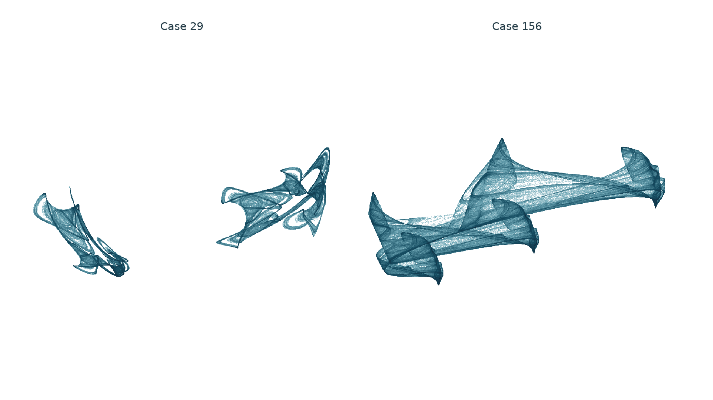

# Folded spatial regimes from Gaussian averaging and a circle

**Status, 2026-11-01:** numerical candidates in a reflection iteration with
a known Gaussian posterior-mean operator. Cases 29 and 156 retain positive
finite-time growth over five million steps, 33 initial states and independent
70/100-digit checks. Their geometry is more coherent than the fragmented
hard-projection controls. Case 156 now has a [trapping and eleven-step entry
certificate](soft-constellation-trapping.md), followed by a [positive-entropy
and mixed-index cycle certificate](soft-symbolic-dynamics/manuscript.md)
inside that attracting invariant set. Equality with the pictured ribbon,
transitivity and historical uniqueness remain unresolved.



<!-- drawing-date -->
*First recorded portrait: **2026-11-01**.*
<!-- /drawing-date -->

The [rotation](assets/portraits/soft-constellations.webp) uses fixed states and
a rigid camera. Each static panel contains two million consecutive iterates
in the actual three-dimensional state space. Only centering and orthogonal
rotations are applied; spatial units are equal within a panel and scales
differ between panels. Apparent strands are sampling density, not line
segments joining successive map iterates. No image synthesis is used.

Case numbers identify parameter sets in **this temperature sweep**, not
physical measurements or identifiers from earlier surveys.

## Model and known ingredients

Let A be the unit circle in the xy-plane and `b_i` the finite sites. For
`tau>0`, define the posterior weights and mean

```math
p_i(x)=\frac{e^{-\|x-b_i\|^2/\tau}}{\sum_j e^{-\|x-b_j\|^2/\tau}},
\qquad m(x)=\sum_i p_i(x)b_i.
```

Writing `v=2m(x)-x`, `r=sqrt(v_x^2+v_y^2)` and
`u=(v_x/r,v_y/r,0)`, the experiment iterates

```math
F(x)=\beta x+\beta u+(1-2\beta)m(x),\qquad 0<\beta<1.
```

Equivalently, `F=beta/2*(R_A R_m+I)+(1-beta)*m`, where `R_m=2m-I`.
At positive temperature, `m` is not Euclidean projection onto the finite
set. This is a modified reflection model, not standard finite-set RAAR.
At `tau=0` the code calls the original nearest-site map as a separate
control. The positive-temperature mean is smooth everywhere; the composed
map is smooth only where `r>0` and is not globally defined as a unique
circle projection.

The averaging formula is known as Gaussian mean shift, finite-prior MMSE
denoising, and biased softmax attention. It also has an exact nonconvex
proximal representation. The [equivalence and priority review](soft-constellation-priority.md)
derives these identifications and documents earlier denoising/reflection
work. Neither the formula nor substituting a nonprojector in RAAR is claimed
as new.

For `D=Dm=(2/tau) Cov_p(b)` and `t=(-u_y,u_x,0)`, the implemented Jacobian is

```math
DF=\beta I+\frac{\beta}{r}tt^T(2D-I)+(1-2\beta)D.
```

Stable shifted exponentials and centered covariance are used. The scalar
high-precision control instead uses inner-product logits and nested
reflections. Every stored parameter and site coordinate specifies its exact
binary64 real value; ideal algebraic polyhedral symmetry is not assumed.

Since the mean is a convex combination of the sites,

```math
\|F(x)\|\le\beta\|x\|+\beta+|1-2\beta|\max_i\|b_i\|.
```

This bounds trajectories that remain defined. It does not certify avoidance
of the circle-projection singularity or prove an attracting chaotic set.

## Controlled temperature sweep

The six input configurations are Cases 124, 611, 896, 1504, 1725 and 1873
from the [finite-point survey](raar-constellations.md). For each, the screen
uses one hard control and 32 logarithmically spaced temperatures from
`1e-5` to `1`, multiplied by the smallest squared distance between sites.
Thus there are 198 cases; all complete. The initial state is
`(0.317,-0.211,0.419)`.

The scout discards 5,000 steps and measures 15,000 in ten windows. Its 157
flags, including all six hard controls, exceed 0.005 in every leading-growth
window. All flags receive fresh 500,000-step follow-ups after 30,000 discarded
steps. Of these, 156 retain the criterion; Case 181 approaches a detected
period-126 orbit. The original scout report calls its hard-control check
"spectra"; precisely, the six sets of ten **leading-rate windows** reproduce
the original hard scout bitwise, not full three-exponent spectra.

All 157 [follow-up portraits](assets/experimental/soft-constellation-first-look/render.json)
were inspected. Six shapes at appreciable smoothing and one two-expanding-direction
comparison were then selected for five-million-step checks after 100,000
discarded steps. Rates below are per iteration, in QR order.

| Case | Original configuration | Temperature tau | Three mean rates | Smallest leading window |
|---|---:|---:|---|---:|
| 27 | 124 | 0.12618135 | 0.248704, 0.007972, -0.270128 | 0.247520 |
| **29** | **124** | **0.26520140** | **0.026398, -0.014289, -0.289561** | **0.025766** |
| 59 | 611 | 0.23717050 | 0.231839, -0.120913, -0.554874 | 0.229348 |
| 92 | 896 | 0.53541791 | 0.312953, -0.349689, -0.767315 | 0.311179 |
| 122 | 1504 | 0.17836868 | 0.382086, 0.001141, -0.735825 | 0.379670 |
| **156** | **1725** | **0.03731678** | **0.277052, -0.152073, -2.556700** | **0.275400** |
| 191 | 1873 | 0.54979393 | 0.194283, -0.130125, -0.621515 | 0.192423 |

Case 27 has two positive rates in every long-run window. Case 122 does
not: its smallest second window is -0.000156. A positive average alone
does not justify describing every window as expanding in two directions.
Cases 29 and 156 are the selected main-page portraits; the others remain
comparison runs in the archive.

## The two selected regimes

Case 29 uses four sites and `beta=0.9851239318186418`. Its two separated
folded lobes alternate at every observed step. A split fitted to the terminal
100,000-state long-run sample was tested against all two million states in
the rendering run: there are exactly one million visits to each lobe and
no same-lobe transition. The observed empty interval in the split coordinate
is approximately `[-0.24514,0.16723]`. This is a sampled decomposition, not
a certified invariant partition. It is **not a two-point cycle**: observed
two-step displacements range from 0.04328 to 0.50412.
Alternating chaotic bands are already known, including for the Hénon map;
see the [explicit precedent](soft-constellation-priority.md#alternating-lobes-are-established-dynamics).
This feature alone does not distinguish a new dynamical class.

Case 156 uses six sites and `beta=0.970660805775784`. It forms an elongated
folded band with several widened sections. The smallest sampled circle
radius in the long run, including the discarded portion, is 0.29133; the
corresponding value for Case 29 is 0.04322. These finite minima are not
uniform bounds over an invariant set.

Smoothing materially affects both regimes. The largest posterior weight
is below 0.99 in 92.38% of measured steps for Case 29 and 51.10% for Case
156; average maximum weights are 0.84604 and 0.88493. These are not merely
near-zero-temperature hard-map controls.

For each case, the original start plus 32 scrambled Sobol starts in
`[-4,4]^3` receive 100,000 discarded and 500,000 measured steps. All 66
runs complete with positive leading growth in every window. The smallest
window is 0.022816 for Case 29 and 0.263595 for Case 156. Finite samples
cannot establish a complete basin or a unique invariant measure.

The independently expressed 70/100-digit implementation uses 10,000
discarded and 50,000 measured steps with renormalized finite separations
of `1e-30` and `1e-40`. All ten windows in each of the four runs are positive.
The means are 0.025731/0.025283 for Case 29 and 0.279116/0.275290 for
Case 156. This supports numerical sensitivity; it is not an interval proof.

For comparison, standalone iteration of the very same Gaussian mean from
all 33 starts reaches a step residual below `1e-12` within at most 113
iterations for Case 29 and four iterations for Case 156. Its known descent
structure is explained in the [priority review](soft-constellation-priority.md).
Irregular behavior appears in the composed reflection process, while the
averaging control settles rapidly in these tests.

## Reproduction checks

The [completed verification receipt](../results/soft-constellations/verification/report.json)
checks all 241 original inventory hashes. All seven five-million-step runs
reproduce their states, growth windows and ancillary statistics bitwise;
all six two-million-state renderings and their histograms also reproduce
bitwise in the recorded environment. An independent LAPACK QR calculation
over 2,048 steps per case differs from the implemented accumulated rates
by at most `5.23e-12`; the largest discrepancy between the summed rates and
mean log absolute Jacobian determinant is `7.11e-15`. These checks concern
numerical implementation and accounting, not interval certification.

## Certified attracting region for Case 156

A subsequent [outward interval certificate](soft-constellation-trapping.md)
checks a union of 35,784 exact dyadic cubes and establishes
`F(Q)+[-2^-35,2^-35]^3 subset Q`. The map stays away from the circle
singularity throughout this region. The nested intersection of its forward
images is a nonempty compact invariant set that attracts a neighborhood.
The original start, including a coordinate neighborhood of radius `2^-35`,
is certified to enter `Q` after eleven steps.

This proves attraction to an invariant set in the region containing the
sampled folded band. The subsequent [symbolic-dynamics article](soft-symbolic-dynamics/manuscript.md)
proves positive entropy on that attracting set and locates periodic points
with one and two unstable directions. Equality with the rendered cloud and
historical uniqueness remain open. Case 29 still has numerical attraction
evidence only.

## Geometry comparison and remaining claim

The two terminal clouds were compared with the existing 108-regime reference
atlas, before and after covariance whitening. The nearest descriptor match
for Case 29 is Bouali2 before whitening and Halvorsen afterwards; their
best found local alignment residuals are 0.20213 and 0.22934, compared with
0.01660 and 0.03793 between separate temporal halves of Case 29. For Case
156, the corresponding matches are SprottE and WindmiReduced, with residuals
0.14188 and 0.23238, versus 0.02100 and 0.03571 between its temporal halves.

Descriptor rank and alignment residual are different metrics: these are
the best descriptor matches, not claimed global minima over all models.
The [complete comparison](../results/soft-constellations/runs/soft-constellation-catalog01/report.json)
includes three local fits per representation and four resamples. As in the
[earlier shape audit](attractor-novelty-audit.md), sampled comparisons do
not establish historical uniqueness, a new topological class, or absence
of nonlinear conjugacy. In particular, other parameters of known maps
and their return maps have not been exhausted.

The present result is a reproducible pair of visually distinctive
three-state numerical regimes, with explicit known-operator identifications
and controls. Case 156 additionally has certified attraction, positive
entropy and mixed-index cycles. Connectedness and opposite orientation signs
also force failure of local injectivity on its attracting set, excluding
ambient neighborhood conjugacy to locally injective models. Intrinsic
equivalence remains open. A broader dynamical and historical comparison is still
required before making a uniqueness claim.

[Run inventory, exact parameters and reproduction](../results/soft-constellations/README.md)
· [Prior art and equivalent terminology](soft-constellation-priority.md).
