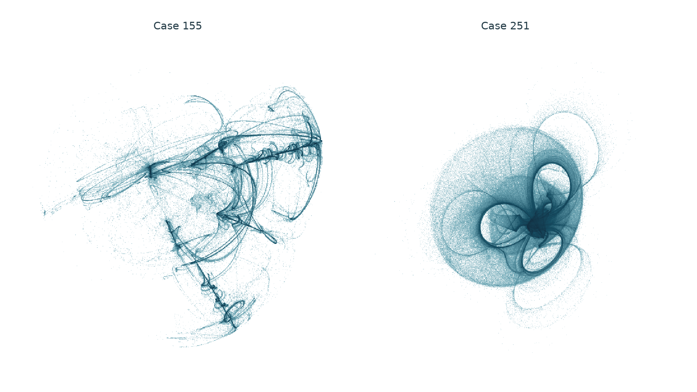

# Folded spatial regimes from a Gaussian posterior mean and a sphere

**Numerical research article · 2026-11-01.** Historical priority and the
existence of an asymptotic chaotic attractor remain unresolved.

## Abstract

We examine a reflected iteration combining a finite-prior Gaussian posterior
mean with projection onto the unit sphere in three dimensions. A controlled
temperature sweep contains 429 parameter sets, including thirteen exact
hard-projection controls. All 138 short-time positive flags receive longer
follow-ups; 46 approach numerically detected finite cycles. Seven visually
selected regimes retain positive leading tangent growth over five million
observed iterations. Two spatial candidates, Cases 155 and 251, exhibit
folded strands and three prominent curled lobes, respectively. Their positive
growth survives 33 initial states and independently expressed calculations
at 70 and 100 decimal digits. We preserve the full selection history,
competing regular outcomes and a finite comparison with 108 reference
regimes. The component operators and substitution principle are established;
these observations do not establish a new general mechanism or historical
uniqueness.

## 1. Geometry and scope



<!-- drawing-date -->
*Drawn: **2026-11-01**.*
<!-- /drawing-date -->

The accompanying [24-second rotation](../assets/portraits/soft-sphere.webp)
shows the actual three-dimensional state coordinates. Each static panel
contains two million consecutive iterates. Centering and orthogonal camera
rotations preserve shape; units are equal within each panel, while scales
and density saturation differ between panels. Apparent strands are sampling
density. No line interpolation or synthetic states are used. Each animation
uses a fixed terminal subset of 250,000 consecutive states and a rigid camera.

**Case numbers are local to this sphere-temperature sweep.** They identify
stored parameter sets, not physical measurements or cases in the earlier
circle study. In particular, the rigorous result for
[circle Case 156](../soft-symbolic-dynamics/manuscript.md) does not transfer
to this map.

The sphere is a natural normalization constraint. Replacing a nearest-site
decision by a posterior mean supplies a smooth temperature parameter, but
changes the algorithm. This is an experimental reflection model with known
ingredients, not a claim that standard finite-set RAAR has these smooth
orbits or that this substitution is a newly invented algorithm.

## 2. Map, derivative and elementary bound

For fixed sites $`b_i\in\mathbb R^3`$ and temperature $`\tau>0`$, put

```math
p_i(x)=\frac{e^{-\|x-b_i\|^2/\tau}}{\sum_j e^{-\|x-b_j\|^2/\tau}},
\qquad m(x)=\sum_i p_i(x)b_i.
```

With $`v=2m(x)-x`$, $`r=\|v\|`$, and $`u=v/r`$, the iteration is

```math
F(x)=\beta x+\beta u+(1-2\beta)m(x),\qquad 0<\beta<1.
```

Equivalently, for the sphere projector $`P_A(v)=v/\|v\|`$ and reflections
$`R_A=2P_A-I`$, $`R_m=2m-I`$,

```math
F=\frac{\beta}{2}(R_A R_m+I)+(1-\beta)m.
```

The posterior mean is smooth everywhere. The composition is smooth on
the open set $`r>0`$; the sphere projection is not uniquely defined at zero.
At zero temperature the implementation explicitly calls the original
nearest-site sphere map as a separate control. It does not evaluate a
zero-temperature exponential formula.

For the weighted covariance matrix, set

```math
D=Dm(x)=\frac{2}{\tau}\sum_i p_i(x)(b_i-m(x))(b_i-m(x))^T.
```

The derivative used for tangent growth is

```math
DF(x)=\beta I+(1-2\beta)D+
\frac{\beta}{r}(I-uu^T)(2D-I).
```

The implementation uses shifted exponentials and centered covariance.
Independent local checks compare the nested-reflection formula, finite
differences and LAPACK QR. Since the mean is a convex combination,

```math
\|F(x)\|\le\beta\|x\|+\beta+|1-2\beta|\max_i\|b_i\|.
```

This elementary inequality bounds trajectories that remain defined. It
does not prove avoidance of the singular set, a trapping neighborhood,
positive entropy or attraction to the pictured clouds. All stored binary64
parameters and coordinates specify their exact real values; ideal algebraic
polyhedral symmetry is not assumed.

## 3. Complete selection protocol

The input configurations are the union of all seven flags from the earlier
[hard-sphere screen](../spherical-constellation-search.md) and all six bases
from the [circle-temperature experiment](../soft-constellations.md):
124, 611, 668, 896, 1086, 1119, 1346, 1504, 1694, 1725, 1788, 1790 and 1873.
Each receives one hard control and 32 logarithmically spaced temperatures
from `1e-5` to `1`, multiplied by its minimum squared intersite distance.
The thirteen hard-control leading-rate windows match their earlier values
bitwise. The common initial state is `(0.317,-0.211,0.419)`.

The screen discards 5,000 iterations and measures 15,000 in ten windows.
All 429 cases complete. The 138 cases with leading growth above 0.005 in
every window receive fresh runs discarding 30,000 steps and observing
500,000. Of these, 92 retain the criterion; 46 have detected periods between
1 and 512 at a scale-adjusted `1e-8` terminal return tolerance. These are
finite detections, not periodic-orbit existence proofs.

All twelve pages of the [complete follow-up preview](../assets/experimental/soft-sphere-first-look/render.json)
were inspected before selecting Cases 155, 196, 250, 251, 253, 388 and 389
for fresh runs discarding 100,000 steps and observing five million. Selection
favored visible loops, separated curved pieces and folded shells. Every
selected outcome is retained. The preview metadata's legacy `leading_xy`
field denotes the leading **full three-dimensional** rate in this study.

| Case | Base | Relaxation beta | Temperature tau | Mean QR rates | Smallest leading window |
| --- | --- | --- | --- | --- | --- |
| 155 | 1086 | 0.957377939824015 | 0.012757228142451395 | 0.22967, -0.38329, -0.62199 | 0.22707 |
| 196 | 1119 | 0.9076405974514783 | 0.0316701644554851 | 0.23095, -0.09073, -0.31008 | 0.22962 |
| 250 | 1504 | 0.9328500449163839 | 0.040379163390726544 | 0.70303, -0.26025, -0.74194 | 0.69829 |
| 251 | 1504 | 0.9328500449163839 | 0.05853931540315792 | 0.79008, -0.03820, -0.84515 | 0.78650 |
| 253 | 1504 | 0.9328500449163839 | 0.12303488973335253 | 0.36414, -0.11796, -0.98132 | 0.35807 |
| 388 | 1790 | 0.9970150632821023 | 0.05567104852742042 | 0.13076, -0.64770, -0.75667 | 0.07765 |
| 389 | 1790 | 0.9970150632821023 | 0.08070858321248979 | 0.18837, -0.56502, -0.71217 | 0.18679 |

Rates are per iteration, estimated from twenty windows of 250,000 steps.
They are not certified asymptotic Lyapunov exponents. Case 388 changes
substantially from its 500,000-step leading mean of 0.32393, despite retaining
positive windows. Cases 388 and 389 have very small third covariance
fractions in their terminal clouds; a visually elaborate projection alone
does not imply a substantial three-dimensional geometry.

## 4. Fresh starts and precision controls

The four cases 155, 196, 251 and 389 receive the original start plus 32
scrambled Sobol starts in `[-4,4]^3`, with seed `2026110121`. Each discards
100,000 steps and observes 500,000. Cases 155, 196 and 251 retain positive
leading growth in every window from all 33 starts; their respective minimum
windows are 0.21820, 0.22370 and 0.77296. This is finite basin sampling,
not a unique-measure or global-attraction theorem.

Case 389 has a different outcome: only ten starts retain the positive-window
criterion. Four approach fixed points, fifteen approach detected period-four
orbits, and four approach detected period-27 orbits. Its attractive visual
appearance therefore coexists with strong regular alternatives. These
outcomes are preserved in the [structure analysis](../../results/soft-sphere/runs/soft-sphere-structure01/report.json).

Scalar high-precision calculations use inner-product posterior logits and
nested reflections, independently of the production derivative. Exact
binary64 inputs are lifted into 70- and 100-digit arithmetic. After 10,000
discarded steps, renormalized finite separations are measured for 50,000
steps in ten windows, with separations `1e-30` and `1e-40`, respectively.
For Case 155 the minimum windows are 0.22144 and 0.21553; for Case 251 they
are 0.77711 and 0.76545. This supports numerical sensitivity beyond ordinary
rounding, without certifying infinite-time behavior.

As a control, iterating the posterior mean alone from every cohort start
reaches a `1e-12` stopping residual within 4, 175, 4 and 7 steps for Cases
155, 196, 251 and 389, respectively. This is consistent with established
mean-shift descent. The reflected composition does not inherit that descent
inequality merely because it contains the same averaging map.

For Case 196, three gaps along the first principal direction of the terminal
long-run sample define four labels. Applying the fixed thresholds to the
separate two-million-state render gives exactly 500,000 states per label
and only the transitions `0 -> 3 -> 2 -> 1 -> 0`. Each labelled piece
contains many distinct states; this is not a four-point orbit. Cyclic
chaotic bands are an established phenomenon. The observation supplies a
comparison target, not a new mechanism or an invariant-partition proof.

## 5. Prior art and equivalent formulations

The posterior mean is exactly equal-weight isotropic Gaussian mean shift,
finite-prior MMSE denoising and a biased softmax-attention update. It also
admits an exact nonconvex proximal representation. The
[shared priority review](../soft-constellation-priority.md) derives these
identifications and records the inspected scopes of the primary sources.
Its denoising/reflection precedents apply to the sphere substitution as well.
The earlier [projection-dynamics audit](../raar-priority.md) already excludes
a first-discovery claim for chaos in nonconvex reflection algorithms.

The convergence results of
[Teodoro, Bioucas-Dias and Figueiredo (2018)](https://arxiv.org/pdf/1801.00605)
use fixed mixture weights and convex penalties; our state-dependent weights
and sphere indicator do not meet those conditions.
[Shoushtari et al. (2023 preprint)](https://arxiv.org/html/2310.00133v1)
allow nonconvex data fidelity and expansive MMSE denoisers, but require
continuously differentiable data fidelity. The sphere indicator fails that
assumption. Our experiment does not contradict these convergence theorems.
The shared review records the bounded reading scopes; a full audit of all
proofs, applications and parameter regimes is not claimed.

The finite shape comparison uses 108 frozen reference regimes. It removes
translation, rotation and uniform scale, then separately tests covariance
whitening to remove affine distortion. Each local point-cloud fit uses
1,500 sampled states, 48 principal-axis initializations and twenty alignment
steps, allowing reflections. The three nearest descriptor matches are fitted;
four independently sampled rankings are also retained.

| Candidate | Representation | Closest descriptor reference | Fitted RMS to that reference | Same-case temporal-half RMS |
| --- | --- | --- | --- | --- |
| 155 | Similarity | Shimizu–Morioka | 0.25731 | 0.05051 |
| 155 | Affine-normalized | Sprott L | 0.22217 | 0.05720 |
| 251 | Similarity | dysts `ZhouChen` | 0.32493 | 0.12084 |
| 251 | Affine-normalized | dysts `ZhouChen` | 0.30433 | 0.15453 |

These residuals are the best fits found by local optimization, not certified
global minima. The atlas samples only particular models and parameters.
Whitening changes shape and is used only in the comparison, never in the
main portraits. The separation from these reference samples does not prove
topological inequivalence, exclude nonlinear coordinate changes or return
maps, or establish historical uniqueness.

There is a bibliographic caveat for the closest Case 251 reference.
The frozen [dysts source](../../results/attractor-novelty/reference/dysts-flows.py)
defines its `ZhouChen` label by

```math
\dot x=ax+by+yz,\qquad
\dot y=cy-xz+dyz,\qquad
\dot z=ez-xy.
```

The atlas metadata links that label to the 2004 three-layer paper, but this
identification has not been verified against its full primary text. The
different printed equations quoted in Section 2 of
[Wang, Sun and Cang (2011)](https://www.actaphys.uj.edu.pl/R/42/2/235/pdf)
make that verification necessary. Our table compares the exact archived
software trajectory, not an asserted reproduction of that paper.
Wang and coauthors also report a long-transient correction to the earlier
three-layer example and a separate spherical-shaped chaotic model. Reviewed
their abstract and Sections 2–3 through the description of Figure 7;
their numerical conclusions were not independently reproduced. Spherical
appearance alone is therefore not an originality claim.

The present contribution is a reproducible set of visually distinct numerical
regimes and negative controls in this particular realization. A new general
operator, a new chaos mechanism, and a uniquely new attractor are **not**
established. Rigorous attraction, invariant structure and an expanded
equivalence comparison remain necessary before stronger claims.

## 6. Reproduction and verification

The [evidence packet](../../results/soft-sphere/README.md) retains exact inputs,
executed source snapshots, complete selection records, compact numerical
summaries and commands. Large unthinned trajectories remain in the declared
external cache, with hashes and recomputation instructions. The stored
hexadecimal input values remove ambiguity from rounded table entries.

The replay checks all 429 screen outputs, accounts for every follow-up flag,
repeats all seven five-million-step runs and all five two-million-state
renderings, and reconstructs their histograms. LAPACK QR and determinant
accumulation provide separate local arithmetic checks. The environment and
the distinction between numerical replay and mathematical certification are
recorded with the [verification result](../../results/soft-sphere/runs/soft-sphere-verification01/report.json).
