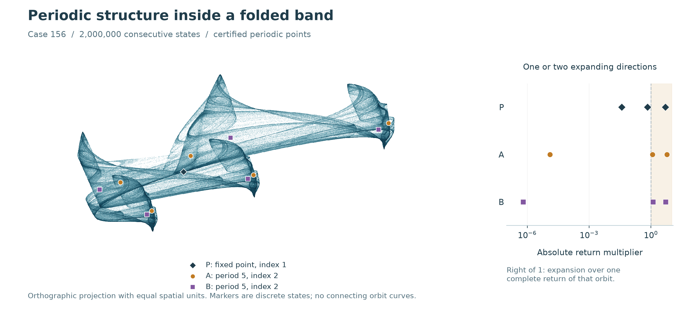
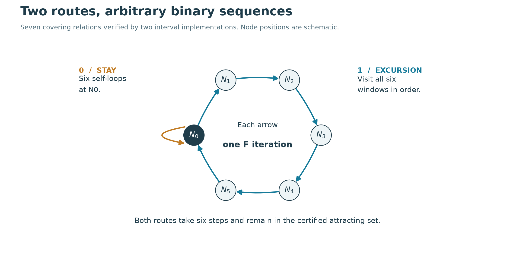

# Positive entropy and mixed-index periodic points in a Gaussian-posterior reflection map

**Computational research article · 2026-11-01**

## Abstract

We study a three-dimensional discrete map obtained by combining a finite-prior
Gaussian posterior mean with reflection in a circle. For one explicit six-site
instance, a previously certified strict trapping region defines a compact
attracting invariant set K. Here we certify seven one-step covering relations
and prove $`h_{\mathrm{top}}(F|_K)\ge\log(2)/6>0.11552`$ per iteration. Two interval
implementations independently verify the crossings. Separate 200-digit
certificates locate a fixed point with one unstable direction and two
least-period-five orbits with two unstable directions, all in K. Their
return determinants, together with an exact connectedness certificate,
force failure of local injectivity at a point of K. This excludes ambient
neighborhood topological conjugacy to locally injective maps, including
invertible three-dimensional Hénon maps. The multipliers give additional
C1 obstructions. The numerical portrait is a folded spatial band.
Equality of its sampled closure with K, transitivity, and historical priority
remain unresolved. Gaussian averaging, reflected iterations, covering
relations and mixed unstable dimensions all have prior literature.



<!-- drawing-date -->
*First recorded portrait: **2026-11-01**.*
<!-- /drawing-date -->

**Figure 1.** Case 156, an identifier for the stored parameter set rather than a
physical parameter. The background contains two million consecutive computed
states, projected through an orthogonal principal-axis basis and an orthographic
camera with equal spatial units. Markers show rounded representatives of
certified periodic-state boxes. A five-cycle consists of five discrete points;
no orbit segments are interpolated. The right panel shows the absolute
multipliers of each complete return, not per-step Lyapunov exponents. Index
means the number of multipliers outside the unit circle. The
[main-page rotation](../../README.md#numerical-algorithms) shows the spatial
geometry with a fixed scale.

## 1. Model and exact instance

For six fixed sites $`b_i\in\mathbb{R}^3`$, temperature $`\tau>0`$,
and $`0<\beta<1`$, define

```math
p_i(x)=\frac{\exp(-\|x-b_i\|^2/\tau)}{\sum_j\exp(-\|x-b_j\|^2/\tau)},
\qquad m(x)=\sum_i p_i(x)b_i.
```

Let A be the unit circle in the xy plane. With $`v=2m(x)-x`$ and
$`r=\sqrt{v_x^2+v_y^2}`$, put

```math
u(x)=P_A(v)=(v_x/r,v_y/r,0),\qquad
F(x)=\beta x+\beta u(x)+(1-2\beta)m(x).
```

The map is smooth where r > 0. Equivalently it is
$`\beta(R_A\circ(2m-I)+I)/2+(1-\beta)m`$, where $`R_A=2P_A-I`$.
At positive temperature m is generally not a projector, so this is not the
standard finite-set RAAR iteration. The
[operator comparison](../soft-constellation-priority.md) identifies m exactly
as Gaussian mean shift, a finite-prior MMSE denoiser, a biased softmax update,
and a proximal map of a generally nonconvex penalty.

The instance uses `β=0.970660805775784` and `τ=0.03731678183231506`.
These decimals and all six site coordinates denote the exact real lifts of
the stored binary64 values. The complete defining inputs are retained in
[input.json](../../results/soft-symbolic-dynamics/runs/soft-covering-certificate01/input.json)
and the earlier [region archive](../../results/soft-trapping/runs/soft-trapping-proposal06/proposal.npz).
The checks require bitwise agreement between the model in both archives.

Write D = Dm and t = (-u_y,u_x,0). The primary interval engine uses

```math
D=\frac{2}{\tau}\sum_i p_i(b_i-m)(b_i-m)^T,
\qquad DF=\beta I+(1-2\beta)D+\frac{\beta}{r}tt^T(2D-I).
```

The second engine differentiates the original Gaussian-distance expression
automatically, independently of this covariance formula.

## 2. The attracting set

The [trapping certificate](../soft-constellation-trapping.md) supplies a union
Q of 35,784 closed dyadic cubes of side 1/256 and proves

```math
F(Q)+[-2^{-35},2^{-35}]^3\subset Q,\qquad r(x)>0.6697\quad(x\in Q).
```

Consequently

```math
K=\bigcap_{n\ge0}F^n(Q)
```

is nonempty, compact and satisfies F(K)=K. Since F(Q) lies in the interior
of Q, a neighborhood of Q is mapped into Q. The nested compact images
approach K uniformly in the sense that
$`\sup_{x\in F^n(Q)}\mathrm{dist}(x,K)\to0`$; otherwise a convergent subsequence
outside a fixed neighborhood of K contradicts their intersection.
Thus K attracts a neighborhood. This is the attracting-set convention used
here; no transitivity is included in the definition.

**Connectedness.** An exact face-adjacency computation connects every cube
of Q by a spanning tree with 35,783 edges. An independent audit checks each
edge and complete coverage; a separate union-find calculation confirms one
component and 88,171 undirected face adjacencies. Thus Q is connected.
Every continuous image F^n(Q) is compact and connected, and these images
are nested. Their intersection K is therefore connected. The
[connectivity and orientation packet](../../results/soft-local-injectivity/README.md)
retains the complete tree and both verification methods.

The exact stored start `(0.317,-0.211,0.419)`, together with a coordinate box
of radius `2^-35`, enters Q after eleven steps. This entry result is inherited
from the earlier certificate. It does not identify a single physical measure
or prove that the displayed trajectory is dense in K.

## 3. Seven certified crossings

Define six windows $`N_i=c_i+S_i[-1,1]^3`$, with one distinguished exit
coordinate and two entry coordinates. The centers and basis/radius factors
are exact binary64 values; $`S_i=B_i\mathrm{diag}(r_i)`$ and its inverse are formed
over the rationals. The full rational matrices are stored in input.json.
No inverse computed in ordinary floating point is treated as exact.

The certified directed graph is

```math
N_0\longrightarrow N_0,\quad
N_0\longrightarrow N_1\longrightarrow N_2\longrightarrow N_3
\longrightarrow N_4\longrightarrow N_5\longrightarrow N_0.
```

Each arrow denotes one application of F. In target coordinates, every source
volume cell maps either strictly outside the exit interval `[-1,1]`, or
strictly inside both entry intervals `(-1,1)`. The two exit faces map strictly
to opposite exterior sides, in the stored orientation. These stronger
conditions imply the horizontal-crossing and entry-avoidance hypotheses
of Theorem 16 of Zgliczynski and Gidea [1]. All windows are in the smooth
domain of F.

**Complete validation.** The first engine uses outward binary64 arithmetic,
a range-reduced Taylor enclosure for the exponential, the covariance
Jacobian, and mean-value bounds. The exponential remainder was separately
checked by exact rational arithmetic in the trapping study. The second engine
uses 80-digit mpmath intervals, direct Gaussian squared distances, the nested
reflection expression, and forward automatic differentiation. It revisits
every first-engine leaf in reverse order and subdivides further when its
different enclosure is wider. Both engines retain every final leaf.

| Edge | Binary64 leaves | 80-digit AD leaves |
| --- | ---: | ---: |
| 0 → 0 | 655 | 2,132 |
| 0 → 1 | 107 | 186 |
| 1 → 2 | 1,317 | 1,979 |
| 2 → 3 | 217 | 377 |
| 3 → 4 | 3 | 52 |
| 4 → 5 | 319 | 524 |
| 5 → 0 | 2,119 | 4,668 |
| Total | 4,737 | 9,918 |

Counts include the volume and both exit faces. Independent exact-rational
audits check complete binary subdivision trees, absence of duplicate or
missing leaves, all strict inequalities, matrix inverses and file hashes.
The smallest normalized inequality margins exceed `4.30e-5` and `6.03e-5`,
respectively. These are coordinate margins, not parameter robustness radii.

The same audit proves $`N_0\cap N_1=\varnothing`$ using an exact separating
coordinate. The rectangular hull of N_0 meets only eight grid cubes, all
belonging to Q. Hence $`N_0\subset Q`$. Other windows need not be separately
proved subsets of Q for the periodic-orbit argument below.



**Figure 2.** The graph is schematic. Symbol 0 takes six self-loops at N_0;
symbol 1 takes the six-edge excursion. Both routes return after six original
iterations. Their periodic realizations belong to K.

## 4. Positive entropy within K

**Theorem.** For the exact instance above, K contains a compact invariant
subset C with

```math
h_{\rm top}(F|_K)\ \geq\ h_{\rm top}(F|_C)
\ \geq\frac{\log2}{6}>0.11552.
```

**Proof.** Concatenate the two six-step routes according to any binary word
of length n. The resulting closed covering chain has length 6n. Theorem 9
of [1] gives a point in N_0 fixed by $`F^{6n}`$, with the prescribed visits.
Since N_0 lies in Q and Q is forward invariant, its entire periodic orbit
lies in Q. Periodicity supplies arbitrarily long predecessors in Q, so
every point of the orbit belongs to every F^j(Q), and therefore to K.

Set $`\delta=\mathrm{dist}(N_0,N_1)>0`$. If two words first differ in block k, at time
6k+1 their realizations lie in N_0 and N_1. Thus the 2^n selected initial
points are $`(6n,\delta/2)`$-separated. They are distinct initial points, not
necessarily 2^n distinct periodic orbits.

Let C be the closure of the union of all these periodic orbits. It is a
compact subset of K. Continuity gives forward invariance. Taking a
convergent subsequence of periodic predecessors in the compact set K
also gives C subset F(C); hence F(C)=C. The separated-set definition of
topological entropy gives the stated bound. ∎

Periodic realizations of increasingly long prefixes also yield a realization
of every one-sided binary sequence, by compactness and continuity. Unique
coding is not asserted. In particular, the construction does not prove a
uniformly hyperbolic Smale horseshoe, a transverse homoclinic orbit, or
that C itself attracts a neighborhood. Attraction belongs to K.

The finite strict trapping and covering inequalities persist under
sufficiently small perturbations of the map on their compact domains.
Thus this argument is not tied to a single isolated parameter value.
No explicit admissible parameter interval is certified here.

## 5. Periodic points with different unstable dimensions

A numerical scout tested 640 initial guesses across periods 1–16 and
retained 65 distinct proposed cycles. All attempts are recorded. Three
selected cycles subsequently received existence, least-period, multiplier
and trapping-membership certificates.

| Label | Stored cycle ID | Least period | Return multipliers, rounded | Unstable directions |
| --- | ---: | ---: | --- | ---: |
| P | 0 | 1 | −5.076094266; +0.674489464; −0.038745369 | 1 |
| A | 5 | 5 | −6.045967086; −1.182206786; −0.000012489156 | 2 |
| B | 6 | 5 | +5.188834590; −1.258408427; −0.000000626128 | 2 |

The first certificate uses 200-digit interval Krawczyk inclusions in boxes
of coordinate radius `1e-100`, with contraction norms below one. Proper
divisors of the proposed periods are excluded by interval differences.
Three disjoint real brackets, with opposite signs of the characteristic
cubic at their endpoints, locate all three multipliers and classify them
strictly relative to the unit circle. Every phase box lies in Q.

An independent 200-digit calculation uses the automatic-differentiation
map expression and larger boxes of radius `1e-90`. These boxes contain
the primary root boxes and independently contain unique roots. It checks
the determinant $`\det(\lambda I-DF^p)`$ directly at wider bracket endpoints, and
uses exact rational grid membership. The two certificates therefore concern
the same three roots. Periodicity again puts every phase in K.

Different unstable dimensions rule out constant-index uniform
hyperbolicity on K and, in particular, a uniformly hyperbolic transitive
basic-set description. Since K is connected, a continuous invariant
hyperbolic splitting on all of K could not assign different stable ranks
to different components either. We have not proved that these
cycles lie in the same transitive component, that both indices are dense,
or that heterodimensional connections exist.

## 6. Failure of local injectivity and equivalence obstructions

These conclusions use connectedness and the certified derivatives, not
the appearance of Figure 1.

### 6.1 An obstruction under continuous changes of ambient coordinates

**Theorem.** At some point of K, F is not injective on any open neighborhood.
Consequently no topological conjugacy on neighborhoods of K can transform
F into a map locally injective at every point of the corresponding set.

**Proof.** Exact rational interval determinants of the stored return
matrices give the following signs in both derivative implementations:

| Orbit | Return determinant, rounded | Certified sign |
| --- | ---: | --- |
| Fixed point P | 0.13265531426405539 | Positive |
| Five-cycle A | −0.00008926728175455644 | Negative |

An independent check multiplies the three disjoint certified multiplier
brackets and obtains the same signs. The negative determinant of the
five-step return is the product of five one-step determinants. Hence every
phase of A is regular and at least one phase has negative one-step
determinant. The fixed point has positive one-step determinant. Both
witnesses belong to K.

Suppose F were locally injective at every point of K. Invariance of domain
makes each such restriction a homeomorphism onto an open image [4]. The
union of the injective neighborhoods is an open neighborhood U of K on
which F is a local homeomorphism. Its local orientation sign is locally
constant on U and equals the sign of det DF at regular points. Its
restriction to the connected set K must therefore be constant, contrary
to the two witnesses. Local injectivity is preserved by conjugacy through
ambient homeomorphisms, proving the consequence. ∎

The continuity of det DF also forces a critical point in K. Singularity
alone would not prove the theorem: the one-dimensional map x ↦ x³ is locally
injective despite its vanishing derivative at zero. The orientation
argument supplies the stronger conclusion.

For example, the three-dimensional Hénon map studied by Gonchenko and
coauthors [5] is

```math
H(x,y,z)=(y,z,M_1+Bx+M_2y-z^2),\qquad \det DH=B.
```

For B ≠ 0 it has an explicit global inverse, so the theorem excludes
ambient neighborhood conjugacy to it. The same applies to the quadratic
diffeomorphisms studied by Hampton and Meiss [6], smooth flow time maps,
and regular Poincaré maps when the compared domains have equal dimension.
This is a dynamical neighborhood obstruction; it does not classify the
shape of a set without its map.

In particular, no collision between two points of K has been proved.
Colliding points in arbitrarily small ambient neighborhoods may lie
outside K. Whether F restricted to K is injective, and hence whether an
intrinsic conjugacy to an invertible system is possible, remains open.
The certificate also does not locate a Whitney fold or establish its
normal form. Noninvertible comparison systems remain to be examined.

### 6.2 Additional smooth obstructions from periodic multipliers

A C1 conjugacy defined on neighborhoods of a periodic orbit makes its
return derivatives similar and preserves their multipliers.

**Dissipative planar Hénon map with a contracting extra coordinate.**
Consider $`H(u,v)=(1-au^2+bv,u)`$ with $`0<|b|<1`$, and a C1 skew product
$`G(u,v,z)=(H(u,v),g(u,v,z))`$ satisfying $`|\partial g/\partial z|\le q<1`$ along the
cycle. The return derivative is block triangular. Its planar determinant
has modulus $`|b|^p<1`$, so at most one planar multiplier can have modulus
greater than one. The fiber multiplier has modulus at most $`q^p<1`$.
Thus every hyperbolic periodic orbit has at most one unstable direction.
Either certified five-cycle contradicts C1 neighborhood conjugacy to this
class, including contracting fibers that need not themselves be invertible.
This multiplier argument alone does not cover general three-dimensional
Hénon-like maps, noncontracting fibers, or a conjugacy defined only on a
fractal set. Section 6.1 separately excludes locally injective models.

**Fixed-time sampling of an autonomous three-dimensional flow.** Suppose
F were C1 conjugate near a certified five-cycle to a time-T map $`\varphi_T`$ of a
C1 autonomous vector field V, for $`T\ne0`$. A point of least period five for
$`\varphi_T`$ is not an equilibrium. The identity
$`D\varphi_{5T}(x)V(x)=V(\varphi_{5T}(x))=V(x)`$ supplies a nonzero eigenvector with
multiplier one. All three certified multipliers avoid one, a contradiction.
This excludes that precise fixed-time representation already near either
five-cycle. This multiplier argument alone does not exclude a Poincaré
return map or state-dependent return times; Section 6.1 supplies the
separate obstruction for regular local return maps near all of K.
Higher-dimensional realizations are not excluded.

These exclusions narrow familiar comparison classes. They do not
establish inequivalence to all previously described attractors.

## 7. Prior work and the remaining novelty question

The [bounded operator review](../soft-constellation-priority.md) records the
Gaussian mean-shift, Bayesian denoising, softmax, proximal and reflected-map
equivalences. It also records prior chaotic projection algorithms. The
present result is not the discovery of any of those ingredients.

Mixed unstable dimensions are established phenomena. Viana and Grebogi [2]
study unstable-dimension variability in coupled chaotic maps. Saiki,
Takahasi and Yorke [3] give explicit hetero-chaotic maps: their definition
requires periodic points of different unstable dimensions to be dense,
together with a dense trajectory. Our three located cycles and a positive
entropy subset do not establish those stronger properties. Their baker-map
examples remain relevant noninvertible comparisons. Invertible Hénon-like
precedents are excluded as ambient neighborhood models by Section 6.1;
equivalence restricted to invariant sets is still unresolved.

The contribution established here is an explicit six-site posterior/circle
instance with a reproducible connected attracting positive-entropy set,
certified mixed-index cycles, failure of local injectivity on K, and stated
equivalence obstructions. The orientation argument is an application of
standard topology, not a new general method. Searches
under Gaussian posterior mean, mean shift, reflected dynamics, RAAR,
unstable-dimension variability and hetero-chaos located no exact match
among the returned sources. This limited search is not proof of historical
priority. Intrinsic coordinate changes, noninvertible discrete models and
higher-dimensional realizations remain open comparisons.

## 8. Reproducibility and limits

The [evidence packet](../../results/soft-symbolic-dynamics/README.md) retains
the 640 root attempts, tangent-return scout, all 39 window proposals, both
complete covering certificates, both exact audits, both cycle certificates,
and the figure revisions. Large exploratory arrays remain in the external
hash-addressed cache. All inputs needed for the principal certificates are
small and retained in full; no long-trajectory download is needed to check
the entropy or periodic-point claims.

The separate [connectivity and orientation packet](../../results/soft-local-injectivity/README.md)
contains five run files totaling less than 170 KiB, together with the exact
hashes of the frozen trapping and cycle inputs. It independently checks
the finite connectivity and determinant statements used in Section 6.1.
The topological deduction is a written proof, not a machine formalization.

The return scout starts on a straight tangent segment at the fixed point.
It does not validate an unstable manifold, and its intersections with a
linear plane do not prove homoclinic returns. Those heuristic steps only
propose the windows. The complete interval crossings supply the proof.

The earlier five-million-step spectra, 33-start experiments and 70/100-digit
orbit controls remain numerical evidence about the pictured regime.
The current proof establishes attraction and positive entropy for K,
not equality of K with the rendered cloud, ergodicity, a physical measure,
transitivity, or historical uniqueness. The manuscript has not undergone
external peer review.

## References

[1] P. Zgliczynski and M. Gidea, *Covering relations for multidimensional
dynamical systems*, Journal of Differential Equations 202 (2004), 32–58.
[doi:10.1016/j.jde.2004.03.013](https://doi.org/10.1016/j.jde.2004.03.013).
Theorems 9 and 16 in the [author preprint](https://ww2.ii.uj.edu.pl/~zgliczyn/papers/wts/cov.pdf),
printed pages 11 and 17, were checked for this application.

[2] R. L. Viana and C. Grebogi, *Unstable dimension variability and
synchronization of chaotic systems*, Physical Review E 62 (2000), 462–468.
[Author-hosted paper](https://fisica.ufpr.br/viana/artigos/2000/mky.pdf).
The abstract and introduction were reviewed; the full model analysis was
not independently audited here.

[3] Y. Saiki, H. Takahasi and J. A. Yorke, *Piecewise-linear maps with
heterogeneous chaos*, Nonlinearity 34 (2021), 5744–5761.
[doi:10.1088/1361-6544/ac0d45](https://doi.org/10.1088/1361-6544/ac0d45);
[revised author text](https://arxiv.org/html/1811.01009v4).
The abstract, introductory definitions, baker-map discussion and stated
density results were reviewed; no complete proof replication is claimed.

[4] A. Hatcher, *Algebraic Topology*, Cambridge University Press, 2002.
[Author-hosted text](https://pi.math.cornell.edu/~hatcher/AT/AT.pdf).
Theorem 2B.3, printed page 172, and the local-orientation discussion on
printed pages 233–235 were reviewed for Section 6.1.

[5] S. V. Gonchenko, I. I. Ovsyannikov, C. Simó and D. Turaev,
*Three-dimensional Hénon-like maps and wild Lorenz-like attractors*,
International Journal of Bifurcation and Chaos 15 (2005), 3493–3508.
[Author-hosted paper](https://www.ma.imperial.ac.uk/~dturaev/mypapers/bc2005.pdf).
The abstract, introductory model (1), and constant-Jacobian statement on
printed page 3494 were checked; no replication of the attractor proofs is claimed.

[6] A. E. Hampton and J. D. Meiss, *Visualizing attractors of the
three-dimensional generalized Hénon map*, Chaos 32 (2022), 113127.
[doi:10.1063/5.0103436](https://doi.org/10.1063/5.0103436);
[author manuscript](https://arxiv.org/html/2206.07855v1).
The abstract and introductory equations (1)–(2), including the nonzero
constant Jacobian, were reviewed. Their bifurcation and visual atlas was
not exhaustively compared here.
