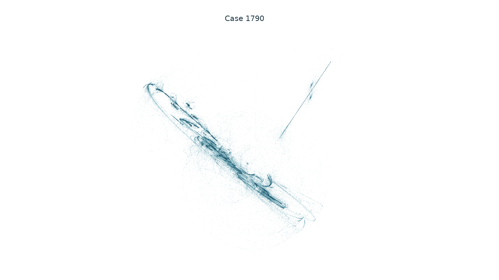
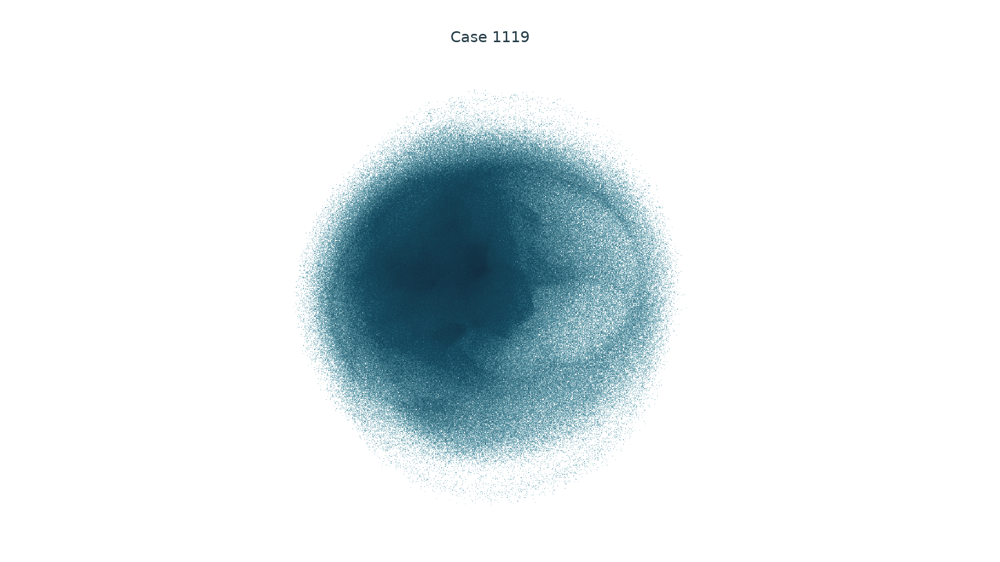

# Unit-sphere RAAR: a paired search and a long transient

Replacing the unit circle by a unit sphere did not improve the visual candidate
selection in this paired survey. The most structured three-dimensional example,
Case 1790, eventually approaches a period-two state after more than a million
iterations. Its intricate earlier portrait is a **transient**, not evidence of
a persistent strange attractor. An exact calculation identifies a normally
attracting circle of period-two points for these parameters.

## Paired numerical experiment

The 2,048 parameter sets and finite spatial point sets are bit-for-bit identical
to the [circle survey](raar-constellations.md). Only the first constraint changes:
`A={x in R3: |x|=1}` replaces the unit circle in the xy plane. With `b=P_B(x)`,

$$
u=\frac{2b-x}{|2b-x|},\qquad
F(x)=\beta x+\beta u+(1-2\beta)b.
$$

This remains the known RAAR operator `beta/2*(R_A R_B+I)+(1-beta)*P_B`.
The full state is the native three-dimensional iterate. The finite sets are
numerically rotated, scaled and translated tetrahedron, octahedron, cube or
icosahedron vertices, rather than their convex hulls. Exact model coefficients
are the exact real values of the stored binary64 inputs.

On a fixed nearest-site branch, with `r=|2b-x|`,

$$
DF=\beta\left[I-\frac{I-uu^T}{r}\right],\qquad
\det DF=\beta^3(1-1/r)^2.
$$

The scout stops at the same relative nearest-site gap and projection-singularity
thresholds as the circle survey. The elementary bound
`|F(x)| <= beta*|x|+beta+|1-2*beta|*max_b|b|` applies where the projection is
defined. Boundedness does not remove the Voronoi discontinuities or prove chaos.

After 5,000 discarded and 15,000 measured iterations, seven cases exceed 0.005
in every one of ten growth windows, versus 72 for the circle constraint. All
2,048 calculations complete. Every flag receives a fresh 30,000/500,000-step
follow-up, visual inspection, and then a fresh 100,000/5,000,000-step run.
The final measured interval is divided into twenty windows.

| Case | Five-million-step spectrum | Smallest leading window | Outcome |
|---|---|---:|---|
| 668 | 0.014347, -0.412223, -0.479326 | 0.014320 | Thin, numerically planar fragments |
| 1086 | approximately 0, -0.021779, -0.021779 | approximately 0 | Detected period 2 |
| 1119 | 0.435861, 0.364653, 0.207778 | 0.434873 | Volumetric cloud; three positive local rates |
| 1346 | 0.102066, -0.318584, -0.453122 | 0.101338 | Thin, numerically planar fragments |
| 1694 | 0.010507, -0.218772, -0.283854 | 0.010294 | Thin, numerically planar fragments |
| 1788 | -0.045477, -0.045477, -0.087964 | -0.045480 | Detected period 3 |
| 1790 | 0.028030, -0.035141, -0.064464 | approximately 0 | Long irregular transient, then detected period 2 |

The positive average for Case 1790 conceals its eventual capture. Only the first
five of twenty measured windows retain positive leading growth. The remainder
are zero to numerical precision. A whole-run mean would be a misleading
selection criterion here. Case identifiers name parameter sets, not rate values.

The nested-reflector formula agrees with the implemented formula within
`2.50e-16` on 64 test states; the relative central-difference Jacobian discrepancy
is at most `1.85e-10`. Reorthogonalized QR agrees with independent LAPACK QR
within `1.87e-14` on 64 matrices. The sum of measured QR rates is checked against
the analytic log determinant. These controls validate implementation and finite
calculations; no asymptotic Lyapunov or historical-novelty theorem is asserted.

The [replay audit](../results/spherical-constellations/verification/report.json)
checks all 59 run-file hashes, exact agreement of the paired inputs, bitwise
reproduction of all seven long runs, and both dense state sets and histograms.

## The visually promising false positive

<!-- drawing-date -->
*Drawn: **2026-11-01**.*
<!-- /drawing-date -->

This portrait contains two million consecutive states after 100,000 discarded
iterations. It mixes transient motion with the later two-point capture. The
camera is orthogonal, spatial units are equal and no synthetic states or
smoothing are used. It is retained to document the rejected candidate.

In this binary64 trajectory, site 6 is selected without interruption from
iteration 1,127,358 through the end of the rendered run. The final 2,048 states
have a period-two residual below `9.8e-15`. This finite observation does not
certify the exact initial condition's future itinerary.

For comparison, Case 1119 retains three positive finite-time rates throughout
the long run but gives a largely unstructured volume:

<!-- drawing-date -->
*Drawn: **2026-11-01**.*
<!-- /drawing-date -->

Neither result is promoted as a new visual finding. The
[complete seven-case preview](assets/experimental/spherical-constellation-first-look/page-01.png)
and all unsuccessful outcomes remain available.

## Exact period-two family

Fix a site `b!=0`, assume `0<beta<1`, and define

$$
R=\frac{\beta}{1+\beta},\qquad
a^2=R^2-\frac{|b|^2}{4}>0,\qquad
C=\left\{\frac32b+w:\ w\cdot b=0,\ |w|=a\right\}.
$$

For every `x in C`, `|2b-x|=R`. If `b` is the unique nearest site throughout
`C`, direct substitution gives

$$
F(x)=3b-x,\qquad F^2(x)=x.
$$

Since `a>0`, every point has least period two. The circle describes a family
of antipodal pairs; a single trajectory alternates between two points rather
than travelling around the circle.

To verify site admissibility uniformly, put `d=c-b` for each competing site and

$$
A_c=|c|^2-|b|^2-3b\cdot d,\qquad
q_c=|d|^2-\frac{(b\cdot d)^2}{|b|^2}.
$$

The minimum squared-distance advantage over the entire circle is
`A_c-2*sqrt(a^2*q_c)`. For Case 1790 and site 6, exact rational arithmetic proves
this exceeds **0.245 for every competing site**. The checks use
`A_c-0.245>0` and `(A_c-0.245)^2>4*a^2*q_c`; no rounded square roots are needed.
Thus the full circle lies strictly inside one smooth nearest-site region.

The tangent multiplier of `DF^2` is 1. Write

$$
\gamma=\frac{|b|^2}{2R^2}-1,\qquad
\tau=(1+\beta)^2\gamma^2-2\beta,\qquad
\delta=\beta^2.
$$

The two normal multipliers have characteristic polynomial
`t^2-tau*t+delta`. Since `-1<gamma<1`,

$$
1-\delta>0,\quad
1-\tau+\delta=(1+\beta)^2(1-\gamma^2)>0,\quad
1+\tau+\delta=(1-\beta)^2+(1+\beta)^2\gamma^2>0.
$$

The quadratic Schur criterion puts both normal multipliers strictly inside
the unit disk. Rotational symmetry about the b-axis reduces the normal motion
to a smooth two-dimensional map with an attracting fixed point. Near `C`,
the transverse direction reverses at every step and is unchanged after two
steps. Local fixed-point stability in the normal coordinates therefore proves
that `C` attracts a neighborhood. The positive site margin makes this argument
valid for the full finite-site map, not just a formal isolated branch.

For the stored Case 1790 inputs, `beta=0.9970150632821023`,
`|b|` is approximately 0.9663471861 and `a` is approximately 0.1256840798.
The exact checks also give `tau^2-4*delta<0`, so both normal two-step multipliers
have modulus beta. The observed slow terminal contraction is consistent with
this calculation. We do not claim a new period-two mechanism or certify that
the original exact starting point reaches this local basin.

The [rational witness](../results/spherical-constellations/runs/spherical-constellation-cycle01/report.json)
contains all input fractions and positive inequality differences.

## Prior-art scope and reproduction

RAAR, nonconvex projection dynamics and periodic failures are established
literature; see the [circle priority audit](raar-priority.md). The additional
[quantized-feedback comparison](quantized-feedback-comparison.md) checks
overflow filters and sigma-delta terminology and gives a limited affine
non-equivalence argument. No historical uniqueness conclusion follows from
this sphere survey or its elementary period-two calculation.

[Run inventory, sources and reproduction commands](../results/spherical-constellations/README.md).
