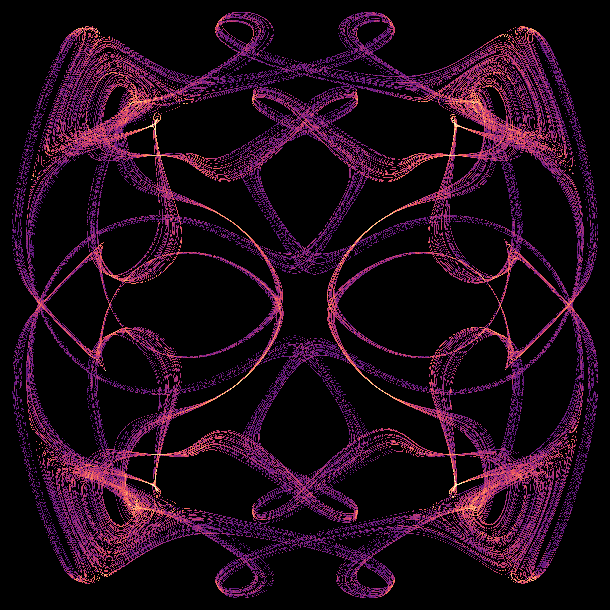

# A tetrahedral flow around a stable center

**A strong numerical candidate, with historical uniqueness still unresolved.** One trajectory produces the ribbons and loops below. The image contains 3.2 million actual states of a smooth autonomous three-dimensional flow. There is no symmetry replication, noise, artificial reinjection, nonlinear projection or image synthesis.



[Rotate the same cloud](assets/tetrahedral-flow.gif) · [Oblique view](assets/tetrahedral-flow-oblique.png) · [Second candidate](assets/tetrahedral-vortex-565.png) · [Separate algorithmic discovery track](anderson-memory.md)

## Construction

Let `T` contain the twelve matrices `diag(s1,s2,s3) P^j`, where `s_i` are signs with product `+1`, `j=0,1,2`, and `P` cyclically permutes the coordinates. For unit vectors `c,u`, put `c_G=G c`, `u_G=G u`, and define

```text
dx/dt = -gamma x + sum(G in T)
        [u_G cross (x-c_G)] exp(-|x-c_G|^2/(2 sigma^2)).
```

This is a constructed velocity field, not a derived fluid experiment or a Navier–Stokes solution. The group average makes the equation exactly equivariant under the proper tetrahedral rotation group. It does not by itself make an individual attractor symmetric.

| Parameter | Primary row 421 | Companion row 565 |
|---|---|---|
| `c` | `(0.8769147566112935, 0.09402153599204394, 0.47136022361571045)` | `(0.8977573044196864, 0.08480352409607292, 0.4322501413093873)` |
| `u` | `(0.9240596655762272, 0.18186634412120997, 0.33621178939938545)` | `(0.8575828868421683, 0.5053735092247597, -0.09565149433910847)` |
| `sigma` | `0.3042492946330458` | `0.4062874343432486` |
| `gamma` | `0.016931384507344594` | `0.04234070462564754` |
| Initial state | `(-0.1818382680416107, 0.05152458027005195, 1.0345324896275996)` | `(1.152040397375822, 0.898293936252594, 0.56929023116827)` |

The stored arrays are authoritative for numerical reproduction; the table gives their shortest round-trip decimal representations.

## Analytical facts and their limits

Each localized vortex is divergence-free, so `div f = -3 gamma` and the time-t flow contracts volume by `exp(-3 gamma t)`. Also,

```text
d|x|/dt <= -gamma |x| + 12 sigma exp(-1/2).
```

Every ball with radius strictly above `12 sigma exp(-1/2)/gamma` is forward invariant and absorbs bounded sets. The field has a bounded derivative and generates a complete flow. A compact global attractor exists and has zero three-dimensional volume. These facts do not prove that the pictured component is chaotic or attracting.

Equivariance gives `f(0)=0`. Its derivative commutes with the irreducible tetrahedral representation and is scalar; the trace identity then gives `Df(0)=-gamma I`. Thus **the origin is always a locally attracting equilibrium**. Outer complex motion is compatible with a calm center. Schur's lemma constrains the linearization, not all nonlinear dynamics away from the origin.

There is also a limited equation-level distinction from polynomial ODEs: `f(x)+gamma x` tends to zero at infinity and is nonzero. A polynomial with that decay would vanish identically. Hence this field cannot be transformed globally into a polynomial vector field by an invertible affine coordinate change and constant time rescaling. This is not a proof that its attractor has a new topology or is not nonlinearly conjugate to a known attractor.

## Numerical evidence

The search evaluated 1,024 Sobol parameter rows. The exploratory gate retained 127. A declared selection of 36 rows underwent longer integration; 26 retained positive growth in every window. Rows **896, 110, 746, 797, 161, 873, 144, 145, 80 and 341 failed** that gate. Their data and images remain in the packet. In particular, attractive scout images can become regular loops after a longer transient.

Full three-vector variational equations were then integrated for rows 421, 565, 705 and 117, restarting from the original initial conditions. Each run discards 3,000 time units and observes 10,000, using ten disjoint windows. All four retain positive leading exponents at RK4 steps `0.05`, `0.025` and `0.0125`. Their middle exponents are close to zero, as expected for nonstationary flow trajectories.

| Candidate | RK4 leading exponent at `h=.0125` | Smallest 1,000-unit window | Independent DOP853 leading exponent |
|---|---:|---:|---:|
| 421 | 0.011454 | 0.009340 | 0.010997 |
| 565 | 0.041214 | 0.035933 | 0.040855 |
| 705 | 0.021836 | 0.012700 | Not run |
| 117 | 0.029137 | 0.022769 | Not run |

DOP853 uses a separately implemented NumPy field and Jacobian, tolerances `1e-10/1e-12`, a maximum step of `0.5`, and QR every two time units. It discards 2,000 units and observes 6,000. The spectrum-sum discrepancy from `-3 gamma` is below `5.3e-13`. Analytic Jacobians also agree with finite differences to `4.0e-10`. Chaotic trajectories need not coincide pointwise between solvers; the comparisons concern long-time statistics.

For each of 421 and 565, fresh-start checks give **15/16 positive volume starts, 8/8 positive local perturbations, and 8/8 small-origin starts converging to the origin**. The remaining volume start also approaches the origin. These are finite basin samples, not a certified basin boundary or a proof of asymptotic chaos.

The final portraits discard 3,000 units and retain every step of a further 40,000 at `h=.0125`. Row 421's four 10,000-unit growth estimates are **0.01145, 0.01196, 0.01190 and 0.01217**. Row 565's are **0.04121, 0.04279, 0.04131 and 0.04298**.

The same individual trajectories visit all twelve nearest-center direction sectors. Comparing disjoint temporal halves, the largest rotated-cloud nearest-neighbor discrepancy is only **1.019 times** the identity discrepancy for 421, and **1.070 times** for 565. This supports a single orbit sampling the full tetrahedral structure, rather than a plot assembled from twelve disconnected copies. It does not certify exact symmetry of an infinite-time invariant measure. The diagnostic, sector counts and finite sampling imbalance are retained.

## Prior art and the novelty boundary

Tetrahedral attractor pictures are established prior work: **C. A. Reiter, “Chaotic attractors with the symmetry of a tetrahedron,” Computers & Graphics 21 (1997), 841–848**, [DOI](https://doi.org/10.1016/S0097-8493(97)00062-9), [author's bibliography](https://webbox.lafayette.edu/~reiterc/publist.html). His later [dodecahedral construction](https://webbox.lafayette.edu/~reiterc/dodec/dodec02_pp.pdf) explicitly uses group-averaged polynomial maps and parameter search. Neither group averaging nor polyhedral symmetry is claimed here as new.

Swift and Barany's 1991 work also concerns chaos with tetrahedral symmetry. The equations reproduced in [Ashwin and Chossat's primary account](https://empslocal.ex.ac.uk/people/staff/pashwin/PAPERS/AshCho_1998_pre.pdf), Section 1.1, are a Hopf normal form on **C³**, hence six real state dimensions, rather than the present three-real-state autonomous flow. That dimensional difference is not a historical priority proof.

The public [Attractor Atlas](https://sakeeb91.github.io/attractors/) reports failed searches for polyhedral chaotic flows and advances a broad obstruction based on the central linearization. Its search is useful negative evidence about the families it tested; the stated local argument does not establish a global impossibility theorem. Our finite results do not amount to a rigorous counterexample theorem either.

We compared both candidates with **108 frozen reference regimes plus six earlier repository candidates**, allowing rigid rotation/reflection and scale, then repeating after covariance whitening to remove nonsingular affine distortions. For row 421 the nearest descriptor match changes from Atlas-Mobula to SprottO. Their best local alignment discrepancies are `0.1845` and `0.2120`, compared with temporal-half controls `0.0512` and `0.0578`. For 565 the nearest changes from Atlas-Mobula to our earlier Vortex-233, with discrepancies `0.1865` and `0.1812`, versus controls `0.0781` and `0.0801`.

These are finite empirical geometric differences under the stated metrics. The descriptor need not find the globally closest shape; ICP uses 48 local initializations and is not a certified global optimization. Time reparameterization, invariant-measure changes and nonlinear coordinate changes remain outside the comparison. **The 108-regime catalog does not contain Reiter's tetrahedral maps or the Swift–Barany normal form.** Full equation-and-image comparison with that prior work remains open. No “99% never seen before” probability is justified.

## Reproduction and evidence

The [frozen packet](../results/unexpected-search/README.md) retains all parameter surveys, failures, long trajectories, independent solver checks, basin samples, geometric comparisons, histograms, source snapshots and hashes. The original scratch calculations were on drive D. Dense rendering arrays are regenerated rather than committed; their exact byte hashes and 100,000-point samples are retained.

[Portable research scripts](../research/unexpected_search/README.md) reproduce each stage into a separately chosen output directory. Run `python research/verify_unexpected_search.py` to verify the archived packet and the stated numerical checks. This checkpoint strengthens the evidence for an interesting attractor; it does not close the historical novelty search.
