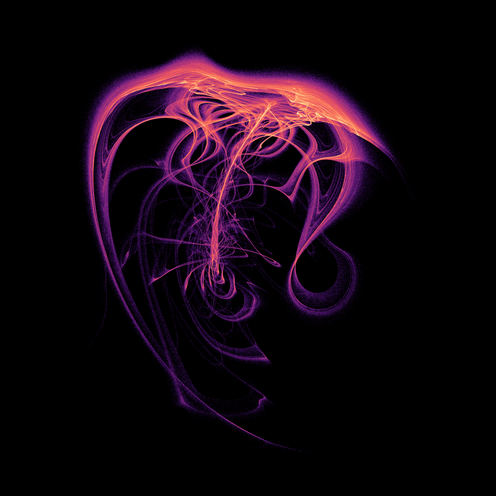

# Geometry search in a dissipative three-axis twist map

The question in this experiment is visual: can a small, explicitly defined dynamical system produce an intricate three-dimensional attracting shape? We constructed a family of smooth maps, searched its parameters, inspected dense trajectories, and then checked the selected forms. These are mathematical constructions, without a claimed physical realization. The names below describe appearances, not established attractor classes.

## Folded sail — candidate 1709


[Full-resolution PNG](assets/twist-folded-sail.png) · [Rotating view](assets/twist-folded-sail.gif)

The folded envelope contains nested sheets, openings in projection, and a narrow lower appendage. These are points of one trajectory in the map's three state coordinates. No interpolation between successive iterates, nonlinear coordinate embedding, geometric smoothing, or artificial connecting lines are used. Apparent crossings and holes in a projection do not determine the set's topology.

## Medusa — candidate 3254



[Full-resolution PNG](assets/twist-medusa.png) · [Rotating view](assets/twist-medusa.gif)

This second form has a denser upper envelope and many interior folds. It retains positive expansion for all 32 sampled initial states and all 33 sampled nearby parameter choices. The folded sail has a competing three-cycle and a more sensitive parameter neighborhood.

## Definition and exact structural properties

For a state `z = (x,y,z)` and `0 < r < 1`, first apply

```text
z <- r*z + (1-r)*(1,0,0).
```

Then perform three rotations, in the ordered coordinate planes `xy`, `yz`, `zx`. For each plane `(i,j)`, let `w` be the remaining coordinate at that stage and set

```text
t = a + k*w + h*w^3
(z_i,z_j) <- (cos(t)*z_i - sin(t)*z_j,
             sin(t)*z_i + cos(t)*z_j).
```

Updates within a pair are simultaneous. Each angle uses the current intermediate state. The coefficients are fixed throughout a trajectory; the system has no stochastic forcing, clipping, or numerical time step. Full binary64 parameter values are in [candidates.json](../results/twist-geometry/candidates.json). Rounding them is a separate experiment.

Every rotation preserves the Euclidean norm and has determinant one: its angle depends only on its unchanged axis coordinate. Reversing their order and angles gives the inverse, followed by undoing the affine step. Consequently the map is a smooth diffeomorphism and

```text
||F(z)|| <= r*||z|| + 1-r,        det DF(z) = r^3.
```

Every ball of radius `R > 1` is strictly forward invariant and absorbs every bounded set. The nested intersection of its forward images is a compact global attractor. Its invariant maximum radius satisfies `M <= r*M + 1-r`, hence it lies in the closed unit ball. Moreover `volume(F^n(B_R)) = r^(3n)*volume(B_R)`, so that global attractor has zero three-dimensional volume. These statements concern the whole global attractor, which can include several invariant components. They do **not** establish that either pictured component is asymptotically chaotic.

## Search and numerical checks

A scrambled ten-dimensional Sobol design generated 4,096 parameter rows: `r in [0.35,0.93)`, angles in `[-pi,pi)`, linear twists in `[-12,12)`, and cubic twists in `[-8,8)`. The first 2,048 rows have zero cubic terms. Each scout used 5,000 discarded and 12,000 observed iterates. A broader second filter retained 1,832 rows; farthest-point selection on moment and occupancy features produced a [96-form gallery](../results/twist-geometry/gallery/). Six visually selected forms received million-step previews. Three received the full checks below, with 1709 and 3254 chosen for the main images. This final visual selection was subjective.

Each full spectrum uses 100,000 discarded and 4,000,000 observed iterates, with tangent orthonormalization every iteration. All 80 disjoint 50,000-step windows retain positive leading exponents.

| Candidate | Full Lyapunov spectrum per iterate | Leading-window range | Kaplan–Yorke estimate |
| --- | --- | --- | --- |
| 1709, folded sail | `(0.104002, -0.036225, -0.883911)` | 0.100483–0.108001 | 2.07668 |
| 3254, medusa | `(0.261420, -0.094189, -0.681539)` | 0.254665–0.267463 | 2.24537 |
| 307, thin folded comparison | `(0.397947, -0.797942, -2.681290)` | 0.389396–0.405121 | 1.49872 |

The dimension column is inferred from finite-time exponents; it is not a measured or proved fractal dimension. The sum of exponents agrees with `3*log(r)` to less than `3.3e-14` in these long-run windows.

For each candidate, 32 fresh states were sampled from `[-2,2]^3`, followed by 100,000 discarded and 500,000 observed iterations. Candidate 1709 has 18 positive runs and 14 numerical period-three outcomes. Those cycles have a computed monodromy spectral radius about 0.81531. Candidates 3254 and 307 have 32 positive runs each. Positive tails lie near the reference geometry: the worst sampled 99th-percentile nearest-reference distance is under 0.61% of the reference bounding-box diagonal. This is a one-sided finite-sample comparison, not a proof of equal invariant sets or basin coverage.

The local cohort perturbs each active coefficient by at most 0.001, using 32 Sobol offsets, then adds a version rounded to three decimal places. It gives 15/33 positives for 1709 and 33/33 for 3254. The rounded 1709 run is regular from the specified initial state. A regular outcome can reflect a different basin; this experiment does not establish disappearance of its chaotic component. The rounded 3254 spectrum remains approximately `(0.26356, -0.09421, -0.68527)`.

An independently written scalar map was checked against the compiled evaluator and used for complex-step Jacobians. Inverse, determinant and radial-bound controls pass. Removing all coordinate-dependent twists gives the exactly predicted three exponents `log(r)`. Separate finite-separation calculations at 70 and 90 decimal digits, with separation `1e-30`, retain positive growth:

| Candidate | 70 digits | 90 digits |
| --- | --- | --- |
| 1709 | 0.103213 | 0.106058 |
| 3254 | 0.264734 | 0.263893 |

These runs discard 10,000 and observe 30,000 iterates; all six 5,000-step windows in each run are positive. The parameters are exact high-precision promotions of the archived binary64 values. Chaotic trajectories at different arithmetic precisions are compared statistically, not point by point. Finite observations cannot exclude eventual periodic capture.

## Rendering and reproducibility

Each still uses 8,000,000 successive iterates after 100,000 discarded iterations, starting at `(0.1,0.2,0.3)`. A rigid PCA rotation, camera translation, and orthographic projection position the object. Both projected axes have the same spatial scale. The 2,400 × 2,400 histogram includes every point; no spatial points are clipped. The magma palette encodes log visit count, with gamma 0.72 and saturation at the 99.95th percentile of occupied-bin log counts. Color is a display choice, not an additional dynamical variable. Animations rotate a fixed final 800,000-point subset with fixed bounds and intensity scale. They do not depict temporal deformation of the attractor.

[render.json](../results/twist-geometry/render.json) records every camera, count, color setting, and the SHA-256 of the complete rendering trajectory. Histograms, unthinned validation tails, all fresh starts and parameter outcomes are archived. Three larger exploratory arrays remain on local disk and are hash-indexed in [provenance.json](../results/twist-geometry/provenance.json). The full search is reproducible from its seed; no omitted scout trajectory is needed to regenerate the final images.

Run locally from the repository root with a Python 3.12 environment and [requirements-twist.txt](../requirements-twist.txt):

```powershell
python research/study_twist.py
python research/check_twist.py --precision
python research/analyze_twist.py
python research/render_twist.py
python research/verify_twist_packet.py
```

For a fresh exploratory replay, use a new output directory on D:

```powershell
python research/search_twist.py --output D:/Codex/twist-replay/scout
python research/gallery_twist.py --input D:/Codex/twist-replay/scout/pilot.npz --output D:/Codex/twist-replay/gallery
```

The verifier checks archived bytes. Numerical recomputation on a different platform can change chaotic trajectories, and therefore their hashes, while preserving their statistical behavior. Preserve the original packet when comparing a new run. All work in this experiment ran locally; no GitHub Actions were added or used.

## Prior work and scope of novelty

Automatic searches for visually varied attractors are established; see J. C. Sprott's [author-hosted *Strange Attractors: Creating Patterns in Chaos*](https://sprott.physics.wisc.edu/fractals/booktext/SABOOK.HTM). Composing twists in three dimensions also has a substantial precedent, including Christov et al.'s [bi-axial spherical-tumbler linked-twist model](https://arxiv.org/abs/1404.4660). A dissipative kicked-top paper already reports three-dimensional strange attractors: [*Kicked top with pumping and dissipation. Classical results* (1988)](https://doi.org/10.1016/0375-9601(88)90503-8); only its bibliographic record and abstract were inspected here. More generally, [Gonchenko, Gonchenko and Shilnikov (2012)](https://nd.ics.org.ru/nd1201001/) study several routes to strange attractors in three-dimensional diffeomorphisms.

These precedents prevent calling the broad construction principle new. The present contribution is a reproducible set of selected geometries, explicit equations, and numerical controls. The bounded source search does not establish exact-model priority, a new topological class, or the universal claim that nobody has ever seen these shapes. Proving persistent chaotic attraction and comparing invariant structures with known maps remain separate research tasks.
