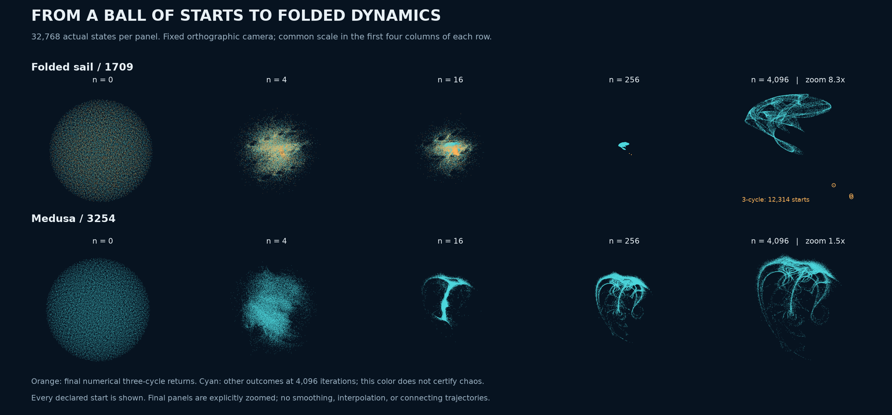
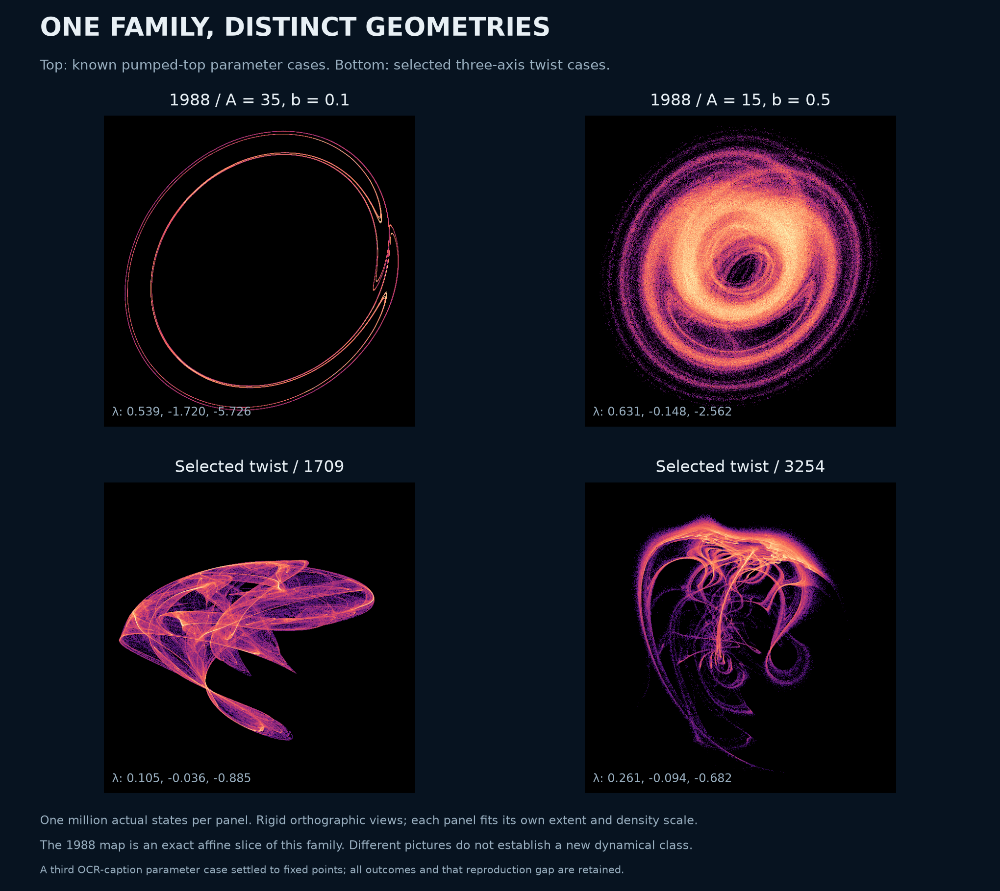

# Twist-map follow-up: a known special case, attraction and mechanism checks

The folded sail and medusa remain expressive, reproducible numerical chaos candidates. The broader construction is **not a new dynamical principle**: the pumped kicked-top map of Pepłowski and Stefański (1988) embeds into this family by an explicit affine change of coordinates. The selected tuples use additional twists, but a different tuple or picture does not establish a new attractor class. Their global invariant structure and historical priority remain unresolved.

This follow-up makes that distinction concrete, shows how a common cloud of initial states approaches the observed regimes, and tests two familiar candidate mechanisms. It adds a separate [71-file evidence packet](../results/twist-followup/manifest.json); the [original search packet](../results/twist-geometry/) is unchanged.

## Watching many initial states approach



Each row starts with the same 32,768 scrambled Sobol points distributed through the unit-ball volume. Every point is retained at eleven saved iterations through `n = 4096`; the figure shows five of those snapshots. The camera is the same rigid orthographic view used for the original portraits. The first four panels in each row share a scale. The final zoom is explicitly labeled.

For the sail, 12,314 starts have a maximum three-step return discrepancy below `1e-8` across their final 24 states. Their three-point limit is colored orange, including their earlier positions. The remaining starts collect near the reference sail: their largest final nearest-reference-cloud distance is below `0.00181`. The orange count is an outcome for this finite cohort, not a certified basin measure. Cyan means that the numerical three-cycle criterion was not met; it does not by itself certify chaos.

For the medusa, none of the 32,768 starts closes at periods one, two or three under that rule. Most final states lie near the archived reference cloud, but 52 are farther than `0.02`. All 52 were followed separately for another 20,000 discarded and 500,000 observed iterations. Every one of their ten 50,000-step leading-exponent windows is positive; the smallest is `0.252620`. The largest 99th-percentile tail distance to the reference is `0.010617`. Their original unusual endpoints and full continuations are retained. This finite follow-up found no distinct persistent regime among those outliers; it does not prove a unique attractor or exhaustive basin coverage.

## An explicit connection to the 1988 pumped kicked top

The [1988 paper](https://doi.org/10.1016/0375-9601(88)90503-8) studies pumping and dissipation added to a kicked top. Its [author-linked public full-text OCR](https://www.academia.edu/113918730/Kicked_top_with_pumping_and_dissipation_Classical_results) exposes Eq. (3). For equal damping factors, the transcribed map is

```text
G(X,Y,Z) = (
  b*(Y*cos(X) - Z*sin(X)),
  -b*X,
  A*(1-b) + b*(Y*sin(X) + Z*cos(X))
),                 0 < b < 1.
```

The paper already reports helical geometries, coexistence with regular regimes, and two-positive-exponent examples. Thus neither rotating-and-contracting construction nor three-dimensional pumped-top chaos is new. The typeset PDF download was restricted and was not bypassed; the public full text, rather than the page's generated abstract, supplied the equations. A figure-caption reproduction gap is recorded below.

Here is the coordinate calculation. Let

```text
S(X,Y,Z) = (Z,-Y,X),       T(w) = b*w + (1-b)*(1,0,0),
C(X,Y,Z) = T^{-1}(S(X,Y,Z)/A),                 A != 0.
```

After the rotation and scaling `S/A`, the source map is `T` after a nonlinear rotation composition. Conjugating by `T` moves that affine step to the beginning. Direct substitution gives

```text
C ∘ G = F ∘ C,
F parameters = (b, 0, -pi/2, 0, 0, 0, A, 0, 0, 0).
```

The parameter order is `(r, a_xy,a_yz,a_zx, k_xy,k_yz,k_zx, h_xy,h_yz,h_zx)`, as in the [map definition](twist-geometry.md). The first rotation is the identity, the second a constant quarter turn, and the third a linear state-dependent twist. This is an exact algebraic family inclusion. Independent state and complex-step derivative checks cover 1,024 states at each of five `(b,A)` pairs; their maximum scaled discrepancies are `1.03e-14` and `1.44e-14`.

The sail and medusa parameters are not on this simple slice. That does **not** rule out another affine, smooth or topological equivalence of their dynamics. No exhaustive conjugacy test has been performed.



All four panels contain one million actual iterates, with rigid PCA and orthographic cameras, equal scale on both image axes, and no interpolation or clipping. Each panel fits its own extent and log-density color range. The two upper cases have finite spectra `(0.538674,-1.719994,-5.726435)` and `(0.630941,-0.147968,-2.562414)`. This is a visual comparison within a family with a known predecessor, not evidence that a visually different lower panel defines a new class.

**Unresolved reproduction detail.** The public OCR reads the first source figure's caption as `A = -5, b = 0.5`. Our declared start at that pair reaches a fixed point. A separate check of that start and 32 fresh unit-ball starts, each with 100,000 discarded and one million observed iterations, gives 33 fixed-point outcomes and no positive leading windows. We therefore do not claim to reproduce that figure. Its typeset caption and original starting conditions were not inspected; OCR, basin selection and finite-time differences remain possible issues. All six initial comparison outcomes and the 33-start check are archived, including the first comparison's superseded unqualified caption. The reviewed image above selects the two expanding prior cases and the two main candidates explicitly.

## Periodic structures and familiar local mechanisms

A non-exhaustive root search uses 1,488 declared initial guesses per candidate for fixed points and period-three orbits. Every solver status and residual is saved. Acceptance requires residual below `1e-10` and radius at most `1+1e-8`; equivalent cyclic shifts are deduplicated. The sail yields 27 fixed points and three period-three orbits, one attracting. The medusa yields one fixed point and two unstable period-three orbits. These are roots found, not certified global counts.

For each main candidate we select the found fixed point nearest the archived trajectory cloud, before testing its outgoing linear unstable seeds:

| Candidate | Numerical fixed point | Multipliers | Local interpretation only |
| --- | --- | --- | --- |
| 1709 | `(-0.113975,0.130851,-0.080689)` | `-0.067504 ± 1.343251i`, `0.244426` | Saddle-focus with two unstable directions |
| 3254 | `(0.423594,0.369440,0.396187)` | `-3.955291`, `0.919023`, `-0.164488` | One unstable direction; discrete-Lorenz multiplier pattern |

The complex unstable pair makes the sail's local structure compatible with a discrete Shilnikov scenario. The medusa satisfies the familiar necessary local inequalities for a discrete Lorenz scenario: a negative expanding multiplier, positive weak contraction, stronger negative contraction, and expanding area in the leading plane. These are established mechanisms in [Gonchenko et al. (2014)](https://arxiv.org/abs/1412.0293) and [Gonchenko and Gonchenko (2016)](https://arxiv.org/abs/1510.02252), whose relevant equations and comparison figures were inspected. A multiplier pattern does not prove a homoclinic connection, identify the whole attractor, or establish pseudohyperbolicity.

At each selected fixed point, 128 seeds are placed in its linear unstable eigenspace at each of two radii, `1e-6` and `1e-8`. The sail uses circles in the unstable plane; the medusa uses both signs along its unstable line. All 512 trajectories retain positive leading expansion in every 10,000-step window of a 50,000-step observation after 4,096 discarded steps, and their tails approach the corresponding reference clouds. The smallest leading windows are `0.094736` for the sail and `0.238833` for the medusa. These are linear seeds near a numerical root, not validated points on an exact invariant manifold. No homoclinic proof follows.

## A check against overclaiming robust chaos

We also estimate the leading two-dimensional tangent plane and strongest contracting line along 200,000 iterates, with 10,000-step padding at each end. A forward inverse-transpose iteration supplies the plane normal; a backward inverse iteration supplies the stable line. The saved quantities include their angle, one-step logarithmic area change in the plane, and logarithmic length change on the line.

| Candidate | Smallest sampled angle | Mean log area change | Smallest mean area change over 100 steps | Over 1,000 steps |
| --- | --- | --- | --- | --- |
| Sail | `0.000510°` | 0.069275 | -0.156641 | 0.000821 |
| Medusa | `0.002904°` | 0.168108 | -0.104401 | 0.077424 |

The sampled directions nearly touch in some locations, and short blocks can contract area even though long averages expand. These findings do not certify a uniform invariant splitting or robust chaotic attraction. They also do not disprove such properties: a small finite angle is not a zero angle, and an asymptotic uniform bound may involve a larger block and constants. Establishing those bounds requires a separate validated argument. Positive exponents and a convincing picture alone are insufficient.

## Two exact structural comparisons

The original map has the exact identity

```text
||F(z)|| = ||r*z + (1-r)*(1,0,0)||.
```

Consequently every fixed point lies on the sphere

```text
(x-r/(1+r))^2 + y^2 + z^2 = 1/(1+r)^2.
```

This follows by expanding the two squared norms at a fixed point. All numerically found fixed points satisfy the identity within their root accuracy. It is a useful algebraic control, not a historical novelty claim.

Also, the map grows at most linearly at infinity. Any global affine conjugate retains that growth bound. A genuinely nonlinear real polynomial map has superlinear growth along some ray, so this family cannot be **globally affine-conjugate** to a quadratic three-dimensional Hénon map. This limited distinction does not exclude smooth or topological equivalence on an attracting set, nor a shared local bifurcation mechanism.

Other kicked-spin precedents must be compared with their actual state spaces. The mean-field model in [Passarelli et al. (2025)](https://arxiv.org/html/2406.16585v4) preserves spin length and evolves on a sphere. The adaptive kicked-top construction of [Prasad et al. (2026)](https://arxiv.org/html/2604.19874v1) combines twist dynamics with stochastic control and normalized motion toward a target. These establish closely related ingredients, but they are not literally the deterministic three-dimensional radial-reset composition used here. Merely displaying three spin coordinates would not make a sphere model three-dimensional.

## Supported contribution and next decision

The current contribution is a reproducible collection of intricate geometries, attraction experiments, explicit equations and source comparisons. The strongest new information in this follow-up is the concrete connection that prevents a broad novelty claim. A claim that these particular invariant sets form a previously undescribed class is still unsupported.

The [archive](../results/twist-followup/) retains every ensemble point and its final 24 states, all 52 outlier continuations, all 512 linear-seed histories, root attempts, failed reproduction details and figure provenance. Only the state and direction arrays in the splitting experiment are thinned by ten, with the endpoint retained; all 200,000 scalar angles and expansion logs remain complete. Original and archived hashes are mapped separately. Source PDFs used locally for comparison are hash-indexed, not redistributed.

```powershell
python research/verify_twist_followup.py
python research/check_twist_kicked_top.py --output D:/Codex/twist-replay/prior-embedding
python research/check_twist_approach.py --source results/twist-geometry --output D:/Codex/twist-replay/approach
```

Exact follow-up protocols and source snapshots accompany each experiment. Future searches should prioritize an unexpected setting or an invariant structural difference, rather than treating another coordinate view or parameter tuple as a new discovery.
