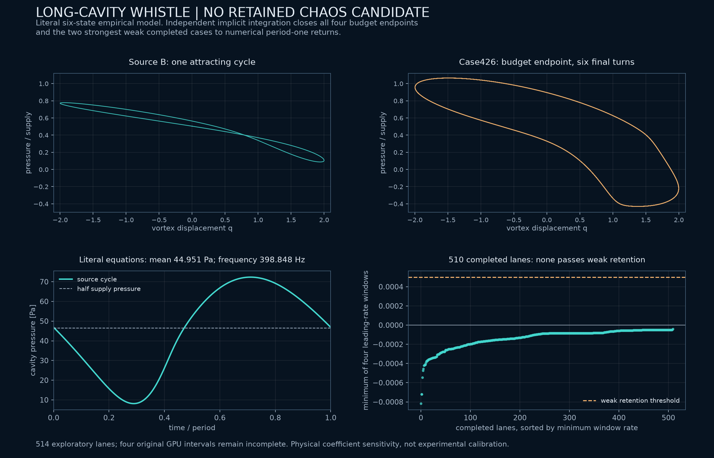

# Long-cavity whistling: no retained chaotic candidate

An exploratory screen of the six-state long-cavity whistle model produces **no retained chaos candidate**. Of 514 trajectories, 510 finish and none keeps even the weaker positive-rate threshold in all four windows. Four step-budget exits remain incomplete; their saved endpoints, and the two strongest weak completed cases, close to numerical period-one returns under an independent implicit solver.



The top panels show two literal observables at common axis limits. Their projections do not determine the dimension of the underlying flow. The final plot includes every completed lane, sorted by its minimum window estimate. [Rendering provenance](../results/whistle-screen/whistle-figure02/render.json).

## Source and interpretation

[Da Silva et al. (2026), JSV 642, 119952](https://doi.org/10.1016/j.jsv.2026.119952) couple two neck flows and cavity pressure to vortex circulation and a van der Pol displacement/velocity pair. We read the [author-uploaded full text](https://www.researchgate.net/publication/406907915_Self-sustained_whistling_in_long-cavity_Helmholtz_resonators_with_bias_flow_Experimental_characterization_and_analytical_modelling); the institutional PDF was unavailable. The implementation retains the printed chamber-pressure sign and Table 3 coefficients, including its tabulated `alpha` convention. Nearby prose gives an inconsistent dimensional description of that coefficient; we do not silently reinterpret it.

The chamber equation is implemented literally as

```math
\dot p_c=-\frac{\rho c^2}{V}(Q_2-Q_1+C_v\Gamma).
```

The circulation lifetime depends exponentially on pressure magnitude and on neck velocity. Absolute-value terms give a continuous, piecewise smooth field. The vortex frequency comes from the source's empirical Strouhal fit. We hold the B geometry, 93 Pa supply and 8.16 m/s jet speed fixed; that fit is not extrapolated to other operating conditions. Ambient constants and the otherwise unspecified initial chamber pressure are declared in the [source protocol](../results/whistle-screen/whistle-source/protocol.json).

## Independent control

The normalized field agrees with a separately coded dimensional formulation to scaled error `2.12e-15` on the tested states. A five-point Jacobian control gives `4.61e-7`; dimensional Radau and normalized DOP853 state integrations agree within `1.75e-11` over 100 acoustic time units. A further 30,000-unit dimensional-source history approaches a periodic regime.

Full six-state shooting gives period `5.66070308381` in `tau=omega_H*t`, corresponding to **398.84769 Hz**. Independent dimensional Radau closes the orbit within `3.00e-14`. The largest nonflow multiplier has magnitude `0.9922653`; all five nonflow multipliers lie numerically inside the unit circle. The very small strongly contracting multiplier is not relatively accurate. [Cycle data and analysis](../results/whistle-screen/whistle-source-cycle/analysis.json).

This is a numerical attracting-cycle control, not exact experimental reproduction. The frequency is 1.51% above the source's 392.9 Hz observation and partly inherited from the empirical frequency fit. The calculated mean cavity pressure is 44.951 Pa, while half the supply pressure is 46.5 Pa; the latter is described as the DC pressure in the source prose. We preserve and report this difference.

## Declared sensitivity experiment

There are 256 six-dimensional Sobol coefficient tuples plus the source tuple, each with two prescribed vortex phases and the acoustic DC equilibrium. Multipliers of Table 3 values are:

| Coefficient | Multiplier range |
| --- | --- |
| Vortex/acoustic coupling `Cv` | .25–4 |
| Base circulation lifetime `tau0` | .25–4 |
| Pressure lifetime coefficient `gamma` | .5–2 |
| Velocity lifetime coefficient `beta` | .5–2 |
| van der Pol growth `mu` | 1–4 |
| Pressure/vortex coupling `kappa` | .25–4 |

These ranges are exploratory empirical-coefficient sensitivity, not a calibrated family of physical resonators. The other source parameters remain fixed. Five tuples pass independent dimensional Radau/DOP853 and GPU state/tangent controls at two tolerances before the screen.

Each lane uses 1,000 warm-up and 4,000 observed `tau` units. The primary rule requires all four 1,000-unit leading estimates above `.002`; the weaker rule uses `.0005`. Both retain **zero** completed lanes. All 514 declared starts, coefficients, endpoint states, rate windows and statuses are included in the [frozen packet](../results/whistle-screen/).

The four step-budget cases are 330, 331, 426, 427: two parameter tuples with both starts. The independent follow-up also includes 102 and 134, the two completed lanes with the highest minimum window estimate. Dimensional-source Radau continues each endpoint for 1,000 units. Every run records 177 upward `q=0` crossings. Over the final 20 consecutive returns, maximum full-state scaled differences range from `9.18e-12` to `4.12e-9`, below the declared `1e-7` rule. Their periods lie between 5.660680 and 5.660713. The original four incomplete intervals are **not** retroactively counted as complete or globally classified. [Return protocol and results](../results/whistle-screen/whistle-returns/analysis.json).

## Earlier equivalents and limits

[Bourquard, Faure-Beaulieu and Noiray (2021)](https://doi.org/10.1017/jfm.2020.984) already model cavity/acoustic feedback through coupled nonlinear oscillators and study intermittent behavior with noise. This is a close modeling precedent, not an established exact equivalence to this six-state system. [Bhavi, Pavithran and Sujith (2024)](https://doi.org/10.1016/j.jsv.2024.118606), with [an accessible preprint](https://arxiv.org/abs/2306.06412), report whistling frequency shifts through intermittency or abrupt cycle transitions. Experimental aperiodicity and stochastic intermittency must not be equated automatically with a deterministic strange attractor.

The present result lowers this particular coefficient family's search priority. It neither proves global absence of chaos nor clears historical novelty elsewhere. Broadening a pressure-feedback coefficient arbitrarily until a complicated picture appears would require a separate physical justification.

The archive retains the initial failed GPU-control attempt, its correction, all independent checks, and the superseded figure. The large source history is represented by its first and final 1,000-unit segments at original sampling, with the complete local history's SHA-256 recorded. All one-period and return histories are included in full. [Manifest](../results/whistle-screen/manifest.json) · [Scope and corrections](../results/whistle-screen/scope-and-corrections.json).
