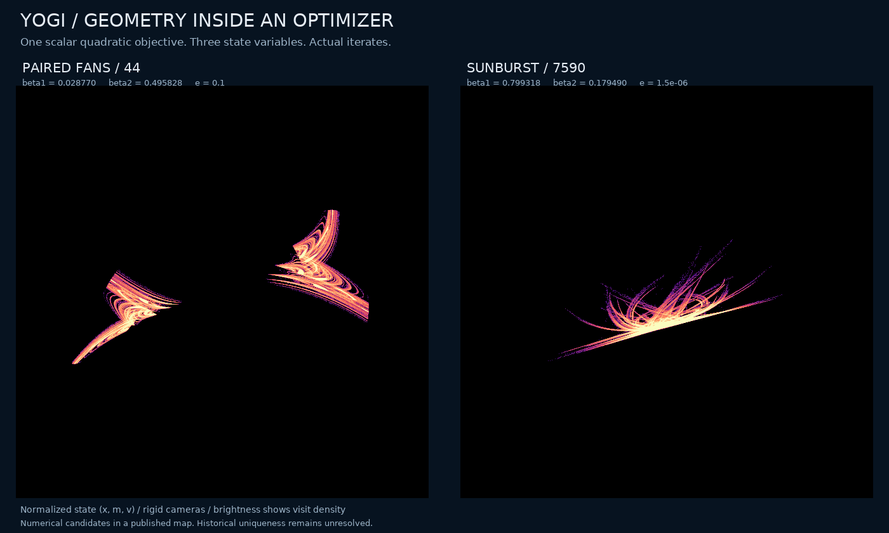
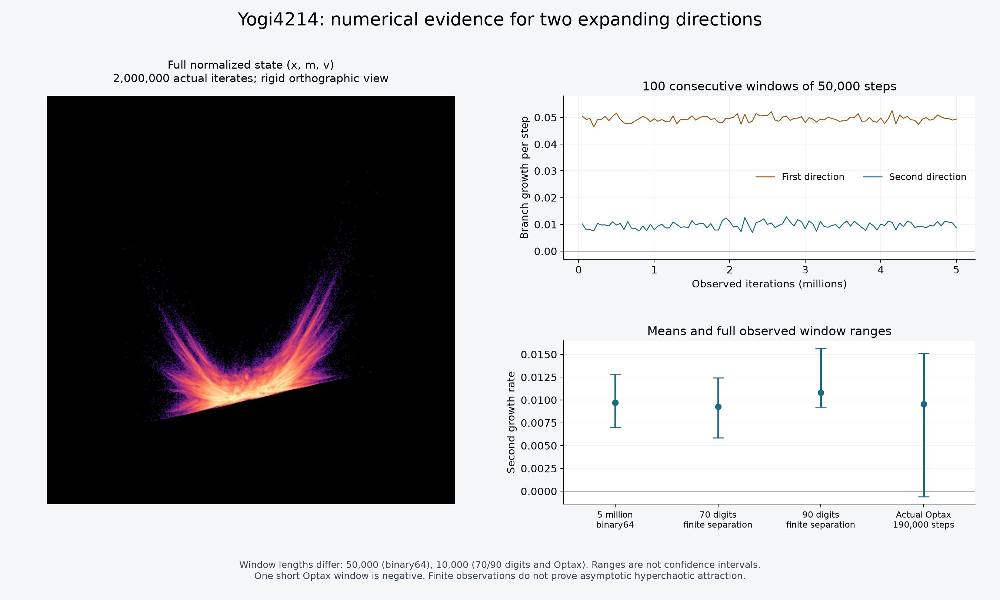

# Fans, a sunburst, and two expanding directions inside Yogi

**Research status, 1 November 2026:** reproducible numerical candidates in a published optimizer. In this initial packet, the most distinctive portraits are cases 44 and 7590; the strongest evidence for two expanding directions is case 4214. The [subsequent grid study](yogi-parameter-plane.md) adds a feathered arc and a stronger two-direction candidate. No new optimization algorithm, proven strange attractor, or historical uniqueness is claimed. The [priority audit](yogi-priority.md) explains what is already known and what remains open.



Each panel is a real trajectory of the same optimizer on the scalar objective `f(theta)=theta^2/2`. The full state contains the parameter and two memory variables. The camera rotates; the point clouds are fixed. These are discrete iterates, not closed curves or a time animation. The [large portrait](assets/yogi-geometry.png) contains eight million consecutive states per case; the rotation uses the last one million without thinning.

## The map and the question

We specialize Algorithm 2 of [Zaheer et al., *Adaptive Methods for Nonconvex Optimization* (2018)](https://proceedings.neurips.cc/paper/2018/file/90365351ccc7437a1309dc64e4db32a3-Paper.pdf). Let `alpha=0.01`, `x=theta/alpha`, `m=M/alpha`, `v=V/alpha^2`, and `e=epsilon/alpha`. With `b=beta1`, `c=beta2`, the autonomous update is

```text
s = sign(v - x*x), with sign(0) = 0
M = b*m + (1-b)*x
V = v - (1-c)*s*x*x
X = x - M/(sqrt(V) + e)
(x,m,v) <- (X,M,V)
```

The displayed paper algorithm has no bias correction. Our actual-library check separately uses Optax's bias correction on every step. The normalized third coordinate uses a different dimensional factor from the first two; this is declared model normalization. After that choice, all views use only translations, proper orthogonal rotations, and a common spatial scale within a panel. There is no `sqrt(v)` display transform, independent axis stretching, smoothing, or interpolation between points. Brightness represents logarithmic visit density.

The map is discontinuous at `v=x^2` for nonzero `x`. This matters both dynamically and numerically: infinitesimal branch derivatives do not measure finite jumps across that surface. The [structure note](yogi-structure.md) derives the branch determinant, inverse overlap and fixed line. A subsequent [scalar first-exit proof](scalar-optimizer-boundedness.md) establishes boundedness for every legal finite initial state and all the stated memory parameters, including bias correction. The question is whether this particular memory update supports persistent, unusual attracting dynamics, and whether those dynamics have already been described in another language.

## Selected observations

All four principal autonomous runs start at `(x,m,v)=(0.73,0,0)`, discard 100,000 steps, and observe 5,000,000 more in 100 consecutive windows of 50,000. Rates are natural logarithmic growth per update, computed from the full three-dimensional branch derivative with repeated orthogonalization.

| Case / role | `(b,c,e)` | Mean branch spectrum | Minimum first / second window |
|---|---|---|---|
| 44 / paired fans | `(0.028770145056769253, 0.4958280871436, 0.1)` | `(+0.146405, -0.145794, -3.549029)` | `+0.113010 / -0.174645` |
| 7590 / sunburst | `(0.7993178686406464, 0.17948984372805632, 1.4848448093079407e-6)` | `(+0.294483, -0.074506, -0.443974)` | `+0.287797 / -0.078196` |
| 4214 / two-direction candidate | `(0.9674843403231352, 0.2785769798150225, 9.301461332493893e-5)` | `(+0.049422, +0.009733, -0.092211)` | `+0.046433 / +0.007004` |
| 5174 / weaker second-direction evidence | `(0.9405664966907352, 0.12412327756728203, 3.9831923199035055e-6)` | `(+0.098622, +0.002916, -0.162811)` | `+0.095072 / -0.000714` |

Exact values, all windows, the last 100,000 states, switching margins, and return residuals are in the [frozen packet](../results/yogi-geometry/README.txt). Case 4214 has two positive rates in all 100 windows. Case 5174 does not pass that stronger condition. No selected tail closes at a lag of 1–128 under the declared tolerance. Finite tests cannot exclude a very long transient or a longer period.



The identity `det DF=b` on each smooth branch supplies a separate implementation check: window sums agree with `log(b)` to better than `1e-9`. This does not prove chaos. It verifies that the three directions and the implemented derivative are mutually consistent.

## Independent numerical controls

An independent scalar recurrence, without importing the production map or analytic Jacobian, evolves two nearby trajectories at 70 and 90 decimal digits. It uses two orthogonalized finite-separation directions, separations `1e-30` and `1e-40`, 100,000 warmup steps, 5,000 alignment steps, and 100,000 observed steps. Case 4214's second means are `+0.009258` and `+0.010796`; all ten 10,000-step windows are positive, with minima `+0.005860` and `+0.009244`. Cases 44 and 7590 retain positive leading growth at both precisions. Case 5174 again has mixed-sign second windows.

The actual Optax 0.2.8/JAX 0.12.0.1 implementation was run on CPU with 64-bit arithmetic, the original scalar objective, and continuous bias correction. Its installed release initializes **both** memories to `1e-6`; the separately inspected main-branch implementation initializes the first memory to zero. We read the installed state rather than assuming these versions are identical. The first 20 steps match an independent reference to `4.54e-15`.

After 100,000 library warmup steps, 200,000 actual states were retained. The tangent analysis uses 10,000 for alignment and 190,000 for 19 windows. Case 4214 gives `(+0.049637,+0.009554,-0.092247)`, but **one second-direction window is negative**, reaching `-0.000586`. The sunburst parameters retain leading growth `+0.294712`. Case 44 instead settles to the fixed line under this library initialization. That outcome is retained; the paired fans are not advertised as a universal cold-start library result. All checked autonomous one-step residuals along the late library histories are below `5.8e-16`.

The original library-reference attempt failed its initial-state assertion before the long calculation. An initial tangent analysis also used a coordinate-aligned frame that gave misleading ordering on the fixed line. Both attempts and the corrections are archived. The accepted analysis starts from a generic orthogonal frame and checks fixed-line rates against the exact linear eigenvalues.

## A discontinuity caught by the precision check

The visually selected scout case 7591 shares case 7590's parameters but starts with `v0=fl(0.73^2)`. Binary64 arithmetic evaluates its initial switching margin as exactly zero. Exact promotion of all three stored coordinates instead gives

```text
v0 - x0^2 = -4.4764192352886312...e-17 < 0.
```

The two interpretations therefore take different first branches of a discontinuous map. Exact promotion of the stored point settles to a fixed state at both 70 and 90 digits. Explicitly defining `v0=x0*x0` at the working precision restores positive leading means `+0.299067` and `+0.297774`. These are distinct specifications of an initial condition, not numerical disagreement about the same exact real point.

The published sunburst anchor is consequently **case 7590 with zero initial memory**, which passes both precision checks and its own five-million-step run. The exact rational margin, both interpretations of 7591, and the negative outcomes remain in the packet. This example is a reason to retain failed checks, not to silently replace them with a successful image.

## Selection, other starts, and competing outcomes

The scout contains 8,202 runs: 4,096 Sobol parameter rows and five controls, each with zero-memory and squared-gradient-memory starts. It uses 10,000 warmup and 20,000 observed steps, split into four windows. The selection rule requires every leading window above 0.005, visible tail extent, and no return at lags 1–32. It flags 268 histories; 7,901 histories already have near-zero parameter/momentum tails. All 268 flags were continued for one million steps: 266 retain the finite screening rule, while 135 and 4454 collapse. These counts are not counts of distinct attractors.

A 24-case gallery was selected for finite geometric diversity, then inspected visually; eight rigid views of each shortlisted portrait were retained. Four candidates received 472 declared robustness runs, each with 100,000 warmup and 200,000 observed steps:

| Case | Positive leading growth: 22 cold starts | 32 nearby settings | 64 full-state box starts | Two-positive-direction passes in those groups |
|---|---:|---:|---:|---|
| 44 | 14 | 17 | 29 | `0 / 0 / 0` |
| 7590 | 22 | 31 | 48 | `0 / 0 / 0` |
| 4214 | 22 | 32 | 62 | `22 / 32 / 62` |
| 5174 | 22 | 32 | 57 | `16 / 19 / 34` |

Cold starts use `m=v=0` and signed amplitudes from `1e-6` through 100, plus `±0.73`; reflected pairs are symmetry-related. Nearby settings multiply `(1-b,1-c,e)` by factors between approximately 0.98 and 1.02. Box starts sample the full observed three-dimensional bounding box expanded 10%, with positive lower `v`. The second-direction rule additionally requires every 50,000-step second rate above 0.001. All runs finish; every detected periodic outcome is period 1. One nearby case 44 run is neither a detected fixed state nor a positive-rule pass. The table reports this finite design, not basin probabilities or a proven open hyperchaotic region.

## What this contributes, and what it does not

The concrete contribution is a reproducible set of full-state geometries and unusually strong two-direction evidence in the specific Yogi recurrence, accompanied by precision-sensitive initialization analysis and explicit competing outcomes. Optimizer chaos on a scalar quadratic is already known; neither that broad phenomenon, a fan-like outline, nor hyperchaos in a discontinuous map is new by itself. [The priority audit](yogi-priority.md) records inspected sources, equivalent terminology, and remaining access gaps.

For an article claiming a new dynamical class, the missing steps remain substantial: asymptotic attraction/expansion, invariant-set equivalence tests, a mechanism beyond a familiar nonsmooth bifurcation, and a more exhaustive priority review. The present data support further investigation, not the phrase “an attractor nobody has ever seen.”

## Reproduction

The [archive](../results/yogi-geometry/README.txt) retains every declared scout, all 268 follow-ups, all 24 gallery clouds, all selected spectra, all 472 cohort tails, all independent precision checks, actual-library histories, failed/superseded attempts, executed source snapshots, and image provenance. Full two/eight-million-state portrait arrays remain external and are inventoried by hash; the repository includes density histograms, camera metadata, and both complete one-million-state animation clouds. Published PDFs are cited and hashed, not redistributed.

```bash
python research/verify_yogi_packet.py --root results/yogi-geometry
python research/check_yogi.py --source results/yogi-geometry/scout/scout.npz --ids 4214 --observed 5000000 --output /fresh/output
python research/check_yogi_precision.py --source results/yogi-geometry/scout/scout.npz --ids 4214 --output /fresh/precision
```

The verifier checks the frozen numerical evidence and manifests without resimulating the full search. Recomputations require NumPy, SciPy, Numba, Pillow and Matplotlib; high precision additionally requires mpmath. The actual-library experiment has its own recorded Optax/JAX versions.
