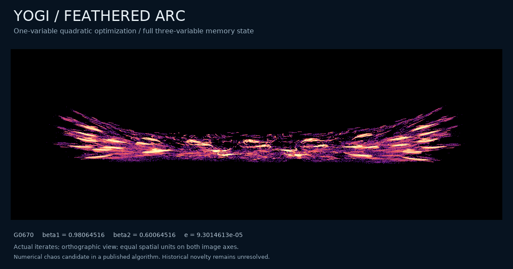
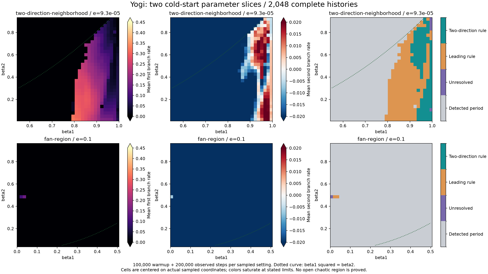
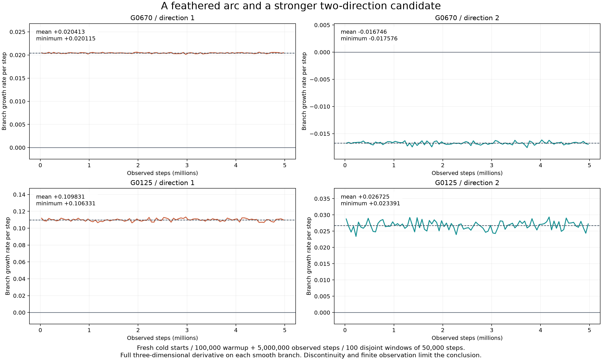

# A feathered arc and stronger two-direction expansion in Yogi

The next search finds a thin arc built from repeated fan-like structures, and a separate candidate with more pronounced expansion in a second direction. Both occur in the same published Yogi optimizer on `theta^2/2`; no new update equation is introduced. Long trajectories, independent 70/90-digit calculations and actual Optax executions support persistence. Historical uniqueness and asymptotic chaotic attraction remain unresolved.



[Full portrait](assets/yogi-feathered-arc.png) · [Parameter plane](assets/yogi-parameter-plane.png) · [Windowed evidence](assets/yogi-grid-directions.png) · [Original equations and conventions](yogi-geometry.md) · [Prior-art audit](yogi-priority.md)

## A declared grid, including the unsuccessful settings

Two independent 32-by-32 grids start at `(x,m,v)=(0.73,0,0)`. Every setting receives 100,000 warmup updates and 200,000 observed updates, with a full three-direction branch calculation in four disjoint windows of 50,000 steps. There is no continuation from a neighboring parameter value.

| Slice | First-memory range | Second-memory range | Normalized epsilon | Leading-rule passes | Two-direction passes | Detected periodic outcomes |
| --- | --- | --- | --- | --- | --- | --- |
| High first memory | 0.55–0.995 | 0.02–0.92 | 0.00009301461332493893 | 354 / 1,024 | 123 / 1,024 | 665 / 1,024 |
| Fan region | 0.005–0.5 | 0.05–0.95 | 0.1 | 2 / 1,024 | 0 / 1,024 | 1,021 / 1,024 |

The leading rule requires every first-direction window above 0.005, a retained `x` span above `1e-4`, and no detected return at lags 1–128. The two-direction rule additionally requires every second-direction window above 0.001. It is a finite screening rule, not a chaos theorem. Of the 1,686 periodic outcomes, 1,685 are detected fixed states and one has detected period 66. Six other settings satisfy neither the periodic detector nor the leading rule. All 2,048 histories are finite and retained.



Cells show individual sampled settings, with saturated rate scales as indicated. Their area does not certify an open region of hyperchaos. The dotted curve is only `beta1^2=beta2`, a familiar hypothesis boundary in related Adam estimates, not a derived Yogi bifurcation curve.

A deterministic farthest-feature selection chooses 24 diverse continuations from all 356 leading-rule passes. Every selected cloud is retained in four gallery pages. Visual inspection then chooses six cases for longer checks. The `G` prefix identifies this new grid; `G0670` is not original scout case 670.

## Longer checks and the visual selection

The six follow-ups restart from the original cold state, discard 100,000 updates and observe five million more. Rates below are per update; all three directions are computed.

| Grid case | Mean first rate | Mean second rate | Mean third rate | Minimum first window | Minimum second window |
| --- | ---: | ---: | ---: | ---: | ---: |
| G0670, feathered arc | +0.0204133 | −0.0167464 | −0.0232115 | +0.0201154 | −0.0175755 |
| G0125, stronger two-direction case | +0.1098308 | +0.0267253 | −0.1708470 | +0.1063313 | +0.0233913 |
| G0798 | +0.0359692 | +0.0181315 | −0.0736453 | +0.0341962 | +0.0173036 |
| G0028 | +0.1624675 | +0.0093064 | −0.2210319 | +0.1582385 | +0.0051956 |
| G0063, weak autonomous outcome | +0.0079138 | −0.0006035 | −0.0123228 | −0.0000450 | −0.0020303 |
| G1506 | +0.1619365 | −0.1615334 | −3.2989857 | +0.0879168 | −0.2045779 |

Each minimum covers all 100 disjoint 50,000-step windows. No selected tail passes the return detector at lags 1–128. G0063 fails the persistent-positive-window criterion and is not promoted as a verified visual candidate.



The feathered arc uses `(beta1,beta2,e)=(0.9806451612903226,0.6006451612903226,0.00009301461332493893)`. Its portrait contains eight million later states, and the animation rotates the last one million consecutive states. Both use the complete normalized `(x,m,v)` state, a rigid orthographic camera and equal spatial units on the image axes. The rectangular field of view retains every point; no nonlinear coordinate deformation, axis stretching, smoothing, or connecting line creates the feathers. The normalization itself, including the different dimensional scaling of `v`, is defined in the original report.

Eight-camera comparisons are retained for G0670, G0125, G0798 and G0028. The other three are less distinctive visually: a plume, a very thin loop-like cloud, and another plume. Positive rates alone do not make their silhouettes unique. The arc's later eight-million-state cloud also has no detected return at lags 1–512; its smallest maximum return residual is about 0.09434 in the stated normalized Euclidean coordinates.

## Independent arithmetic and actual-library outcomes

The scalar recurrence is reimplemented independently with finite separations, without the production map or its analytic derivative. Each run uses 100,000 warmup steps, 5,000 alignment steps and 100,000 observed steps in ten windows. Binary64 coefficients and the zero-memory initial coordinates are promoted exactly to 70 or 90 decimal digits.

| Case | Precision | Mean first rate | Mean second rate | Smallest first window | Smallest second window |
| --- | --- | ---: | ---: | ---: | ---: |
| G0670 | 70 digits | +0.0204084 | −0.0164969 | +0.0197821 | −0.0175425 |
| G0670 | 90 digits | +0.0204928 | −0.0166291 | +0.0202061 | −0.0176714 |
| G0125 | 70 digits | +0.1082452 | +0.0266871 | +0.1015162 | +0.0206004 |
| G0125 | 90 digits | +0.1104822 | +0.0253009 | +0.1054974 | +0.0205471 |

Actual Optax 0.2.8 with JAX 0.12.0.1 supplies a separate six-case control: its own nonzero initial memories, continuous bias correction, float64 arithmetic, 100,000 warmup steps and 200,000 observed states. The first 20 updates match the normalized reference to at most `2.61e-15`. After 10,000 tangent-alignment steps, G0670 retains positive leading rates in all 19 windows; G0125 retains two positive rates in all windows, with means approximately `(+0.109975,+0.027651)` and smallest second window `+0.022502`.

G0798 and G0028 also retain two positive directions throughout all windows of this library control. G0063 has a stronger expanding library history than its weak autonomous follow-up; this finite difference does not determine whether there are distinct asymptotic basins or a long transient. G1506 settles to a fixed state in Optax despite its expanding autonomous cold-start history. Initialization and bias-corrected early updates are therefore material parts of the experiment, and all six outcomes remain available.

## An exact result alongside the numerical search

The [scalar first-exit proof](scalar-optimizer-boundedness.md) establishes boundedness of every legal finite initial state for the stated Yogi, Adam and Adamax scalar-quadratic recurrences, for positive epsilon and every stated memory parameter. It also covers continuously corrected moments and nonzero initial memories. This removes a parameter restriction from the repository's earlier sufficient estimates. For Adamax it makes the finite-sheet, dimension-at-most-two omega-limit result apply to all legal finite initial states.

The proof is separate from 1,024 exact rational algebra controls and 384 finite stress runs of 100,000 steps. Those controls check the hypotheses and implementations; they are not an infinite-time proof. The note compares its assumptions with recent primary results of Fong–Yang, Dereich–Do–Jentzen and Dimitrieski et al. and makes no priority claim for the general bounding technique.

Boundedness does not prove chaos, and a discontinuous map requires care even when discussing invariance of an accumulation set. The [priority audit](yogi-priority.md) remains the boundary on claims of novelty: the published optimizer, scalar-objective chaos, fountain-like portraits and general discontinuous-map hyperchaos all have predecessors. The candidate contribution is the particular Yogi evidence, its reproducibility distinctions and the stated structural results. Inequivalence to every known attractor is not established.

## Reproduction

The [frozen extension](../results/yogi-plane/README.txt) contains every grid result, the 24 gallery clouds, six long runs, four high-precision runs, six library histories, source metadata, numerical controls, figure data and executed scripts. Earlier figure compositions and the reasons for correction are retained. No published full-text PDF is redistributed.

```powershell
python research/verify_yogi_plane.py --root results/yogi-plane
```

The verifier checks frozen hashes, all grid classifications and block aggregation, long/precision/library summaries, the determinant sum identity, retained negative outcomes, figure point counts and asset identity. Full multi-million-point `.npy` portrait clouds are inventoried locally; the repository retains complete image histograms and unthinned animation tails. Source paths in protocols refer to the original execution workspace and are mapped to archived copies in `copy-provenance.json`.
