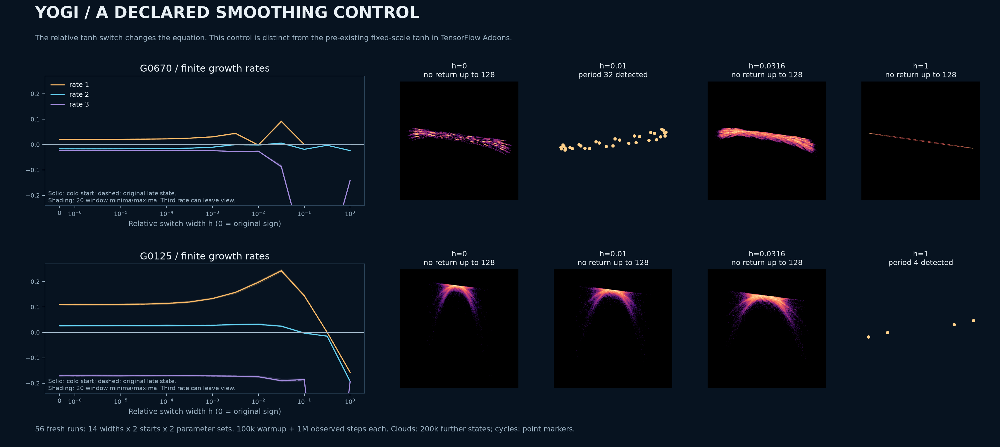

# What survives when the Yogi switch is smoothed?

The two-direction numerical regime survives small, explicitly declared smoothing of the signed memory update. Smoothing can also produce ordinary cycles. This is a mechanism control on a modified equation, **not a new optimizer or a proof that the original and modified attractors are equivalent**.



<!-- drawing-date -->
*First recorded drawing: **2026-11-01** ([record](https://github.com/Griboedow/chaos-attractor-lab/blob/94ba114329065336fe19783583bc90708ac2e265/docs/assets/yogi-smoothing-control.png)).*
<!-- /drawing-date -->

## Distinguish two smooth equations

For the original normalized [Yogi map](yogi-structure.md), put `b=beta1`, `c=beta2`, `e=epsilon/alpha`, and `M=b*m+(1-b)*x`. The original second-memory update uses `sign(v-x^2)`. Here we deliberately replace it by

\[
T_h(x,v)=\tanh\frac{v-x^2}{h(v+x^2+e^2)},\qquad
V=v-(1-c)T_h(x,v)x^2,\qquad
X=x-\frac{M}{\sqrt V+e}.
\]

The control at `h=0` uses the original sign convention, including `sign(0)=0`. Every positive `h` changes the map.

**Smooth Yogi itself is prior implementation work.** [TensorFlow Addons v0.22.0](https://github.com/tensorflow/addons/blob/v0.22.0/tensorflow_addons/optimizers/yogi.py) already offers `activation="tanh"`. Its dense update uses `tanh(10*(g^2-v))`, without the state-dependent denominator above. On `theta^2/2`, normalization gives `tanh(k*(x^2-v))`, where `k=10*alpha^2`. The full constructor, slot creation, dense/sparse updates and bias correction were read. The existing fixed-scale variant and this relative-width control must not be conflated; neither a tanh substitution nor the word “smooth” establishes novelty.

## Declared experiment and results

There are **56 independent runs**: the [grid cases G0670 and G0125](yogi-parameter-plane.md), fourteen widths `0,10^-6,10^-5.5,...,1`, and two starts per width. The starts are `(0.73,0,0)` and the corresponding original map's fixed five-million-step endpoint. A width does not inherit the preceding width's endpoint. Each run has 100,000 warmup steps and 1,000,000 observed steps, partitioned into twenty 50,000-step full-spectrum windows. All 56 complete; all outcomes are retained.

Representative **cold-start** means are:

| Case | Width | Three finite growth rates | Tail return through lag 128 |
|---|---:|---|---|
| G0670 | 0 | `(+0.020406,-0.016688,-0.023263)` | None detected |
| G0670 | 0.001 | `(+0.030331,-0.010211,-0.023921)` | None detected |
| G0670 | 0.01 | `(-0.001833,-0.001832,-0.026040)` | Period 32 |
| G0670 | 0.0316228 | `(+0.091506,+0.005724,-0.086607)` | None detected |
| G0125 | 0 | `(+0.110076,+0.026669,-0.171036)` | None detected |
| G0125 | 0.001 | `(+0.133277,+0.027902,-0.171184)` | None detected |
| G0125 | 0.01 | `(+0.197431,+0.031434,-0.174522)` | None detected |
| G0125 | 0.0316228 | `(+0.242890,+0.024579,-0.189880)` | None detected |
| G0125 | 1 | `(-0.157251,-0.193105,-0.193105)` | Period 4 |

For G0125, every declared width from zero through `0.0316228` retains two positive directions in all twenty windows at both prescribed starts. At `h=0.01`, the cold-start second rate has minimum `+0.029835`; at `h=0.0316228`, its minimum is `+0.022861`. G0670 gains a second positive direction at the sampled width `0.0316228`, with cold-start minimum `+0.003115`, after the sampled period-32 outcome at `h=0.01`. These discrete samples do not locate or classify a bifurcation.

Some larger widths have leading means close to zero without a short return. We do not label these as proven invariant circles or tori. The plot uses an explicitly limited vertical range to keep the two leading rates readable; all three complete spectra are in the data. The portraits use rigid cameras and equal spatial units. Detected cycles are shown with point markers; cloud panels use 200,000 further actual iterates.

## Exact local identities and a boundedness consequence

Let `D=v+x^2+e^2`, `z=(v-x^2)/(h*D)`, and `q=1-tanh(z)^2`. Direct differentiation gives

\[
z_x=-\frac{2x(2v+e^2)}{hD^2},\qquad
z_v=\frac{2x^2+e^2}{hD^2},
\]
\[
V_x=-(1-c)(2xT_h+x^2qz_x),\qquad
V_v=1-(1-c)x^2qz_v,\qquad
\det DF=bV_v.
\]

Unlike the hard map's constant smooth-branch determinant `b`, this determinant can change sign. The sum of the three finite rates agrees with the separately accumulated average `log(abs(b*V_v))` in every saved window to the declared tolerance `10^-7`. Four hundred independent complex-step controls have maximum scaled derivative error `1.29e-14`. The direct determinant check has a larger cancellation error `2.88e-8`, below its separately declared `10^-7` tolerance. These are numerical implementation controls, not a substitute for the algebra.

For `0<=b<1`, `0<c<1`, `e>0`, and any fixed `h>0`, every finite legal initial state has a bounded forward orbit. This follows from the [scalar first-exit lemma](scalar-optimizer-boundedness.md), without a memory-ordering restriction. To verify its denominator hypothesis, set

\[
\sigma_h=\sqrt{\min\{c,1/2,(1-c)\tanh(1/(5h))\}}>0.
\]

If `|x|<e`, then `sqrt(V)+e>=e>|x|>=sigma_h*|x|`. Otherwise split the nonnegative second memory into three ranges. For `v>=x^2`, `V>=c*x^2`; for `x^2/2<=v<x^2`, `V>=x^2/2`; for `v<x^2/2`, the argument has magnitude at least `1/(5h)`, so `V>=(1-c)*tanh(1/(5h))*x^2`. Also `V>=0`, since a negative update can only occur when `v>=x^2`. Thus both denominator bounds hold. Once `|x|<=B`, the second memory satisfies `v_t<=max(v_0,(2-c)*B^2)`: it decreases above `x^2` and cannot cross that bound from below. This proves boundedness, not chaotic attraction or historical priority.

## Reproduction and limits

[Frozen data and exact executed sources](../results/yogi-smoothing/) include all 56 histories, full window spectra, both initial states, derivative controls, figure clouds and rendering metadata. The first figure composition used density coloring for cycles and made their isolated points too faint; `figure02` changes only their display to markers. Both compositions remain archived.

```powershell
python research/check_yogi_smoothing.py --source results/yogi-plane/plane-five-million/histories.npz --output outputs/yogi-smoothing
python research/render_yogi_smoothing.py --source outputs/yogi-smoothing --output outputs/yogi-smoothing-figure
python research/verify_yogi_smoothing.py --root results/yogi-smoothing
```

The [prior-art audit](yogi-priority.md) remains applicable. Finite robustness to a specified perturbation is useful evidence about the mechanism; it does not prove structural stability, asymptotic chaos, a new topological class, or absence of equivalent prior results.
