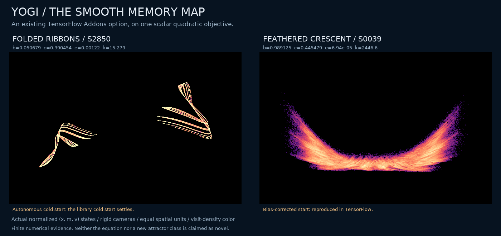
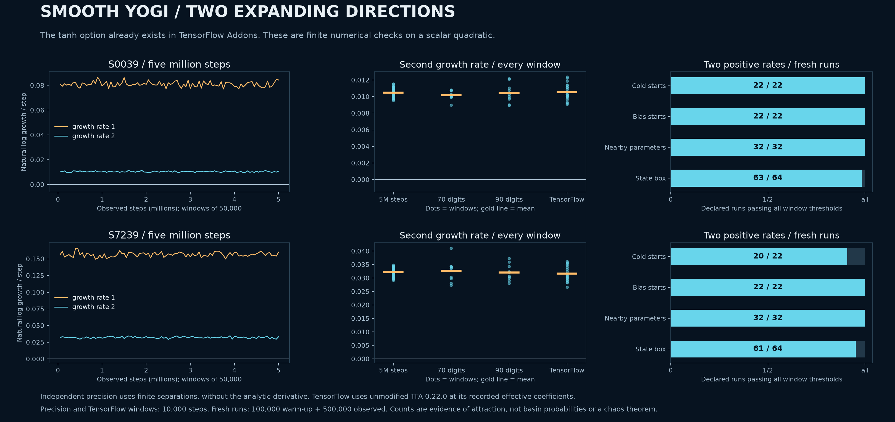

# Folded ribbons and two-direction expansion in the existing smooth Yogi optimizer

The pre-existing TensorFlow Addons `Yogi(activation="tanh")` option produces intricate full-state clouds while minimizing the single-variable objective `theta^2/2`. Two selected regimes retain two positive finite growth rates through five million observed steps, independent 70- and 90-digit calculations, and actual unmodified TensorFlow Addons executions. Nearby-parameter and fresh-start tests support attraction, with competing regular outcomes retained.

**The algorithm is known. Historical uniqueness of these regimes, non-equivalence to all previously described attractors, and asymptotic chaotic attraction are not established.** The numerical evidence is stronger than an attractive picture, but it is not a proof of a new attractor class.



<!-- drawing-date -->
*First recorded portrait: **2026-11-01**.*
<!-- /drawing-date -->

[Large portrait](assets/yogi-tanh-geometry.png) · [Numerical evidence](assets/yogi-tanh-evidence.png) · [Exact structure and boundedness](yogi-tanh-structure.md) · [Frozen data](../results/yogi-tanh/manifest.json)

The left ribbons, S2850, arise from the autonomous zero-memory start. The standard library cold start instead settles on the fixed line. The right crescent, S0039, survives the prescribed bias-corrected start and an actual library run. The camera rotates a fixed cloud; the animation is not time evolution. Each portrait uses eight million actual normalized `(x,m,v)` states, orthogonal changes of basis and equal spatial units. No coordinate stretching, nonlinear warp or curve interpolation is used.

## The equation was already in the library

The [pinned TensorFlow Addons source](https://github.com/tensorflow/addons/blob/d208d752e98c310280938efa939117bf635a60a8/tensorflow_addons/optimizers/yogi.py) already implements both `sign` and `tanh` activations. The latter uses `tanh(10*(g^2-v))` in physical coordinates. The inspected v0.22.0 release has the same source text as the pinned master file. The installed file agrees apart from one extra terminal newline in the fetched copy; both hashes are recorded.

For `alpha=sqrt(k/10)`, `epsilon=alpha*e` and normalized coordinates `x=theta/alpha`, `m=M_physical/alpha`, `v=V_physical/alpha^2`, the late autonomous recurrence is

$$
M=bm+(1-b)x,\qquad
V=v-(1-c)\tanh(k(v-x^2))x^2,\qquad
X=x-\frac{M}{\sqrt V+e}.
$$

During the library transient, multiply `M` in the position update by `sqrt(1-c^t)/(1-b^t)`. Keep epsilon outside the uncorrected square root. The library initializes physical `m=0`, `v=1e-6`, hence normalized `v=1e-5/k`. This convention differs from the Optax implementation used for the earlier sign-Yogi study. On a quadratic of curvature `h`, the equivalent normalization has `k=10*(alpha*h)^2` and `e=epsilon/(alpha*h)`; changing curvature and learning rate accordingly does not create a different map.

## Declared search and longer checks

The scout contains **8,256 runs**: 4,096 Sobol parameter rows plus 32 controls, each with an autonomous zero-memory start and a library-style bias-corrected start. Every run completed 20,000 warm-up and 50,000 observed steps. A flag required all five leading-rate windows above 0.005, a nontrivial final position span, and no detected return of lag 1–32. There were 488 flags: 263 autonomous and 225 bias-corrected.

Every flag was restarted from its original initial state and followed for 100,000 warm-up plus one million observed steps with the full three-dimensional derivative. Of 488 completed follow-ups, 471 retained the leading-rate criterion; 110 also had every second-rate window above 0.001. The 17 weaker or regular outcomes remain in the archive, including fixed states and detected periods 6, 22, 30 and 78. These counts are outcomes of a deliberately biased search, not prevalence estimates or counts of inequivalent attractors.

Eight selected cases then received five million observed steps in 100 windows of 50,000. Seven retained the leading criterion and five retained the second-rate criterion. S7974, an initially appealing branched cloud, weakened to a near-zero leading rate and is not promoted as a chaotic result.

| Case | `b` | `c` | `e` | `k` | Five-million-step mean rates |
| --- | ---: | ---: | ---: | ---: | --- |
| S0039 | 0.9891246411297471 | 0.4454789482569322 | 0.0000693550097565182 | 2446.6273997990243 | `(0.080935, 0.010461, -0.060338)` |
| S7239 | 0.9664813547404483 | 0.1086456582462415 | 0.001926981470950336 | 3341.6126406806993 | `(0.156549, 0.032158, -0.168623)` |
| S2850 | 0.05067918724846095 | 0.39045379066839814 | 0.00122058437219709 | 15.279463603263238 | `(0.525138, -0.978251, -2.970686)` |

Exact binary64 parameters, initial states and all windows are in the [long-run archive](../results/yogi-tanh/five-million/histories.npz). The `S` identifiers belong to this smooth-variant scout, independently of the earlier `G` parameter grid and original sign-Yogi identifiers.

## Independent precision and actual library execution



The independent mpmath driver imports neither the production recurrence nor its derivative. It evolves two finite-separation directions, with 70 and 90 decimal digits, after the original prescribed warm-up. It promotes the saved binary64 input values exactly; it does not silently replace them with nearby decimal coefficients. All six declared precision runs completed.

| Case | Minimum second rate: 100 binary64 windows | Minimum: 70 digits | Minimum: 90 digits | Minimum: actual TensorFlow |
| --- | ---: | ---: | ---: | ---: |
| S0039 | 0.009550 | 0.008971 | 0.008947 | 0.009087 |
| S7239 | 0.029162 | 0.027309 | 0.028068 | 0.026603 |

The precision and actual-library windows each contain 10,000 steps, so their spread should not be compared as if all window lengths were identical. S2850 retains a positive leading rate at both precisions but, as noted above, its actual library cold start settles.

Actual execution uses TensorFlow 2.14.1 and TensorFlow Addons 0.22.0, float64 states, continuous bias correction and 300,000 updates per case. Ten complete histories are retained. The first 20 steps are checked independently in physical coordinates. Late derivative analysis then uses 9,999 alignment transitions followed by 19 complete 10,000-step windows. One-step discrepancies along actual histories are below `1e-10`; the sum of the three rates is independently checked against the average log absolute determinant.

An upstream detail matters: the public Python-float `beta1` argument is stored by Keras as float32 and then promoted, even with float64 state. The exact effective coefficient is recorded and used for the actual-history derivative, rather than claiming an identical coefficient to the scout. For example, S7239 uses `b=0.9664813280105591` in the library. Two failed setup attempts and a failed first analysis driver are preserved. No upstream optimizer code was patched.

## Fresh starts, neighbors and competing regular motion

Each of S0039, S7239 and S2850 has 140 declared fresh tests: 22 autonomous cold starts, 22 library-style cold starts, 32 nearby parameter settings and 64 full-state box starts. Each uses 100,000 warm-up and 500,000 observed steps. The parameter changes multiply `(1-b,1-c,e,k)` by factors within approximately 2%; the full-state box is the observed reference-tail box expanded by 10%.

| Case | Autonomous cold starts | Library-style cold starts | Nearby parameters | Full-state box |
| --- | ---: | ---: | ---: | ---: |
| S0039, two positive rates | 22/22 | 22/22 | 32/32 | 63/64 |
| S7239, two positive rates | 20/22 | 22/22 | 32/32 | 61/64 |
| S2850, positive leading rate | 2/22 | 0/22 | 32/32 | 40/64 |

All 420 histories completed; the remaining listed outcomes have detected periodic tails. Library-style tests here are independent transcriptions at scout coefficients, not additional TensorFlow executions. Opposite starts are related by the exact symmetry `(x,m,v)->(-x,-m,v)` and do not count as separate discoveries. Neither these selected boxes nor their success fractions define a basin probability.

## Exact statements and the novelty boundary

The [structure note](yogi-tanh-structure.md) proves boundedness of every finite legal forward orbit, including the time-dependent bias factors, and gives the critical sheets where the smooth map folds. It also derives an exact stability interval for a symmetric two-cycle. Crucially, the cycle's local Jacobian is identical to Adam's under an explicit parameter substitution wherever the effective Adam memory coefficient is legal. That equivalence is stated, not hidden under a new name.

| Possible claim | Current status |
| --- | --- |
| New optimizer or new `tanh` option | False: the library source already contains it. |
| First optimizer chaos on a scalar quadratic | False as a broad claim: Adam and RMSProp prior work already covers this setting. |
| First symmetric two-cycle or new local mechanism throughout the stability interval | Unsupported: the Adam cycle and an exact local Jacobian equivalence apply. |
| Reproducible two-direction expansion in the specified smooth-Yogi regimes | Supported numerically by the frozen finite runs, precision checks and actual library histories. |
| Every legal orbit of this normalized map is bounded | Proved in the companion structure note using the scalar first-exit theorem. Priority of the proof technique is not claimed. |
| A rigorously chaotic attractor, a new topological class, or historical uniqueness | Open. Finite positivity and a distinctive projection do not settle these questions. |

The [existing priority audit](yogi-priority.md) records Adam/RMSProp chaos, memristor embeddings, piecewise-map equivalences and unresolved primary-source gaps. Additional relevant work includes [Tang, Chen and Liu, *Beyond Quadratic Loss*](https://arxiv.org/html/2609.18314v2), which studies Adam memory-parameter phase diagrams, scalar-quadratic oscillations and superquadratic boundaries. Its inspected sections do not identify this tanh-Yogi map, but that bounded comparison is not a non-equivalence certificate. The [source audit records](../results/yogi-tanh/source/) state precisely what was read.

## Reproduction and visual provenance

The archive preserves all scout rows, selected follow-ups, long checks, precision runs, cohorts, ten actual-library histories and failed setup/control drafts. The 36 gallery clouds are split losslessly into per-case files to stay below GitHub's file-size limit. Large raw preview and eight-million-point render arrays remain local with SHA-256 hashes; the repository contains their generation protocols, exact portrait histograms and the consecutive million-state animation inputs. Duplicate scout/follow-up block arrays were compared elementwise with the archived aggregates before omitting redundant copies.

The gallery's screen vertical direction is reflected relative to its stored camera because its plotting call uses `origin='lower'` on an already flipped density image. This affects screen orientation only. The published main portrait and rotation use the declared camera directly. Every main portrait and every frame passes exact point-accounting checks: eight million points per portrait and one million per animation panel, without clipping. Initial and revised layouts remain separately documented.

```bash
python research/verify_yogi_tanh.py --root results/yogi-tanh
python research/check_yogi_tanh_structure.py --output outputs/tanh-structure-recheck
python research/search_yogi_tanh.py --output outputs/tanh-scout-recheck
python research/follow_yogi_tanh.py --source results/yogi-tanh/scout/scout.npz --output outputs/tanh-follow-recheck
python research/check_yogi_tanh_precision.py --source results/yogi-tanh/scout/scout.npz --output outputs/tanh-precision-recheck --ids 39 7239 2850
```

The ordinary numerical tools require NumPy, SciPy, Numba, Matplotlib and Pillow; symbolic controls additionally require SymPy, independent precision requires mpmath, and actual-library replay requires the recorded compatible TensorFlow/Addons environment. Protocol files give seeds, thresholds and all initial-state conventions.
