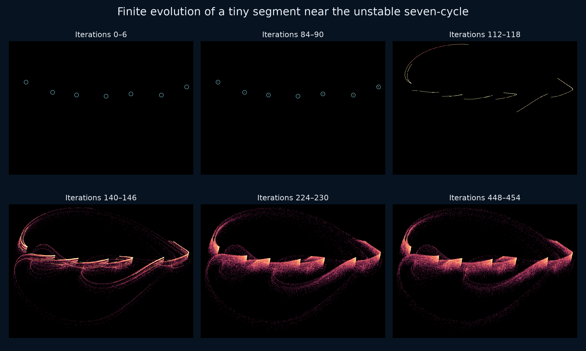
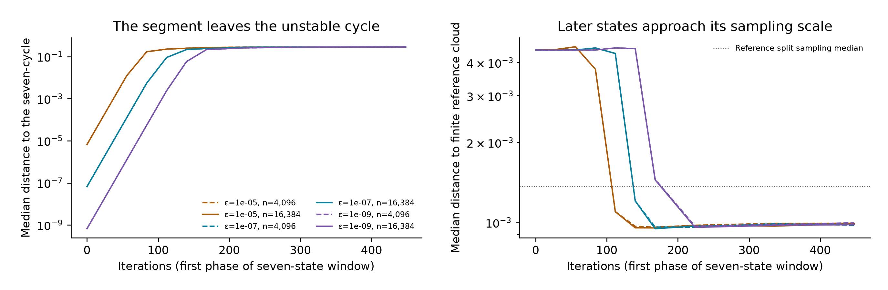
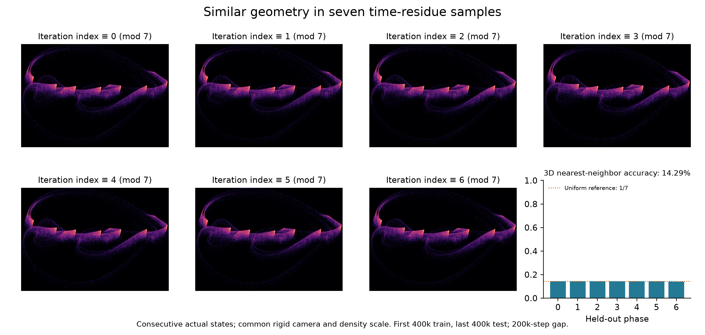
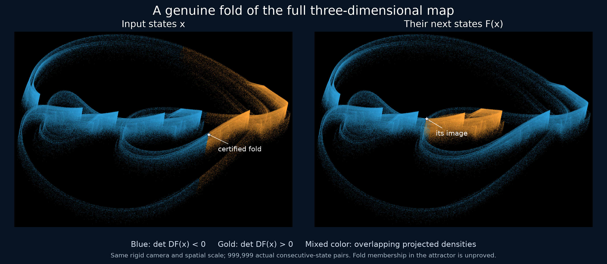

# From a tiny segment to a serrated arch

Folding in spatial-circle RAAR Chaos Attractor Lab | Research companion note | 1 November 2026

**Abstract.** We study how a small straight segment near a certified unstable seven-cycle evolves under an existing relaxed averaged alternating reflections (RAAR) map between two disjoint spatial circles. Six declared radius/resolution experiments retain every trajectory and develop the selected arch geometry. A separate interval-Sturm calculation completely classifies the regular-domain inverse images of 25 exact targets: 18 have two preimages and seven have four. Independent nested-reflector interval calculations verify all 64 preimages. A further certificate identifies a smooth fold near the finite reference cloud. These results do not establish an invariant unstable manifold, asymptotic chaotic attraction, or historical uniqueness of the selected attractor candidate.

**Figure 1.** Actual phase windows of 16,384 seeds, with initial radius 10−7. Each panel contains all seven successive phase offsets; it is not one continuous orbit. The camera, spatial scale and density scale are fixed. Blue rings locate initially subpixel clusters and are annotations. Points are not connected. The corresponding 65-frame animation is linked in the repository.

## 1. Controlled finite evolution

Let A be the unit xy circle and B(γ)=c+r(cos γ, cos θ sin γ, sin θ sin γ). The existing ordered RAAR map [1] is F(x)=βx+βPA(2PBx−x)+(1−2β)PBx, where P denotes nearest-point projection onto a circumference. We use β=0.9708823579074815, r=1.9886915469542146, θ=0.9028818255996501 and c=(−0.1435409113764763, 0.5745496526360512, −0.7745124697685242). Exact binary64 rational lifts define all certified parameters and targets; interval sine and cosine define the exact tilted circle.

The companion cycle study [2] certifies a least-period-seven orbit with one multiplier in (−2.571,−2.569) and two inside the unit disk. Here the initial set is x*+tv, with evenly spaced t in [−ε,ε], a rounded cycle center x* and a numerical unit unstable eigenvector v of DF⁷. Even seed counts omit t=0. This is a tangent segment, not a validated chart of the unstable manifold.

**Figure 2.** All six declared controls. Smaller radii delay departure from the cycle. Later median distances approach the scale of a finite reference sample. The dotted comparison uses 500,000 reference states queried against the other half; seed states use the full million-point reference. Unequal sample densities prevent interpreting this comparison as a test of set equality.

| Radius | Seeds / completed | Final median reference distance |
| --- | --- | --- |
| 1e-05 | 4,096 | 0.00099353 |
| 1e-05 | 16,384 | 0.00098972 |
| 1e-07 | 4,096 | 0.00097658 |
| 1e-07 | 16,384 | 0.00098206 |
| 1e-09 | 4,096 | 0.00099755 |
| 1e-09 | 16,384 | 0.00098203 |

All 61,440 seed trajectories complete. Stored snapshots are at seven-step returns 0, 4, 8, 12, 16, 20, 24, 32, 48 and 64, with phase offsets 0–6, reaching iteration 454. The original million-state cloud and its camera are frozen in [3]. A rendering replay exactly reproduces all ten state snapshots and every original histogram after 2×2 pixel aggregation. No points are clipped. The final GIF displays the cropped high-resolution histogram at native pixel size.

## 2. Complete inverse-image counts

**Proposition 1.** For the 25 exact targets obtained from reference indices linspace(10000,989999,25,dtype=int), the map has exactly two or four preimages in its regular domain. Eighteen targets have two; seven have four. The four-preimage indices are 254999, 499999, 540832, 826665, 867499, 908332 and 949165. These are complete counts for the specified exact targets, not statistics for all possible targets.

**Figure 3.** Four distinct certified inputs map to the same target y, index 254999. The two panels use rigid cameras and common equal-unit scale. Arrows encode a single discrete update, not a continuous trajectory. Gray points show the actual finite reference cloud. Three extra inputs lie away from that sample; their membership in an asymptotic attracting set is not claimed.

The first numerical search used nearby predecessors in the reference cloud and found one preimage per target. A subsequent global search added 128 Sobol starts per target in an analytically bounded cube and found the additional branches. Both searches, including every failed root attempt, are retained. Numerical searches propose roots; completeness follows from the interval argument in Section 3.

A 100-digit interval-Sturm calculation isolates every real root of the degree-eight inverse polynomial, classifies all sign branches, excludes the missing half-angle point and the exceptional zero-length case, and verifies pairwise disjoint preimage boxes. An independent 200-digit nested-reflector implementation applies the Krawczyk operator directly to F(x)−y for all 64 branches. Each strict inclusion has contraction bound below one, positive projection-axis distances and a box strictly inside its matched Sturm box. The common interval-arithmetic library remains part of the trusted computation; this is not a proof-assistant formalization.

## 3. Inverse reduction and verification

Write b=B(γ), a=PA(2b−x), d=(bx−yx,by−yy) and L=‖d‖. From F(x)=y and 2b−x=a+(b−y)/β, every regular preimage with L>0 has

$$
a=\sigma(d_x,d_y,0)/L,\quad x=[y-\beta a-(1-2\beta)b]/\beta,\quad \sigma\in\{-1,1\}.
$$

Let u=(cos γ, cos θ sin γ, sin θ sin γ), and let τ=u′. Projection onto A is valid precisely when qA=1+σL/β>0. Projection onto B additionally requires τ·(x−c)=0 and qB=u·(x−c)>0. Substitution gives fL−βσe=0, where

$$
f=\tau\cdot[y-(1-\beta)c],\qquad e=\tau_{xy}\cdot d.
$$

Put t=tan(γ/2), D=1+t², S=2t, C=1−t², k=cos θ and h=sin θ. Define polynomial numerators

$$
X=(c_x-y_x)D+rC,\qquad Y=(c_y-y_y)D+rkS,
$$

$$
f_n=-[y_x-(1-\beta)c_x]S+[k(y_y-(1-\beta)c_y)+h(y_z-(1-\beta)c_z)]C,
$$

$$
e_n=-(c_x-y_x)SD+k(c_y-y_y)CD-rh^2SC.
$$

Then f=fn/D, e=en/D² and L²=(X²+Y²)/D². Squaring the angular equation produces a polynomial of degree eight:

$$
P(t)=f_n^2(X^2+Y^2)-\beta^2e_n^2.
$$

**Completeness.** Interval polynomial division gives a Sturm sequence with strictly determined leading-coefficient and endpoint signs. The variation difference at ±∞ equals the number of isolated roots in disjoint finite intervals. On every root interval, f and e have nonzero signs, so the only possible branch is σ=sign(f)sign(e). The signs of qA and qB then accept or reject that branch. Thus squaring introduces no unclassified roots.

The exact target is excluded from the projected B ellipse by a strict sign of ((yx−cx)/r)²+((yy−cy)/(r cos θ))²−1; hence L never vanishes. At γ=π, which the finite half-angle chart omits, fL−βσe is strictly nonzero for both signs. These two checks close the exceptional cases. All retained boxes are regular and mutually disjoint.

The independent Krawczyk checks use a 10−100 radius around each refined center. The small boxes concern exact stored inputs; their width does not represent physical measurement accuracy. Standard interval verification methods, rather than a new proof technique, supply the existence and uniqueness guarantees [4].

## 4. Equivalence boundary and prior art

**Corollary.** No injective coordinate change defined on two distinct certified preimages and their common image can intertwine these relations with an injective map G. Indeed, h∘F=G∘h would give G(h(x₁))=G(h(x₂)) with h(x₁)≠h(x₂). Consequently the full regular map is noninjective, and cannot be globally conjugate to an invertible map on a domain containing those points.

This does **not** classify the dynamics on the attracting set. The additional preimages are away from the finite reference cloud, and multiple-preimage membership in an invariant attractor has not been proved. An invertible restriction to a smaller invariant set remains possible. Nor does noninjectivity distinguish this example from the many established noninvertible chaotic maps. The cycle companion gives a separate, local smooth ODE-map exclusion; neither result establishes a new topological class.

Elser [7] already presents strange-attractor portraits in Figure 14, using a 32-component inconsistent Fourier-modulus/histogram problem and sections of four phase angles. Elser, Rankenburg and Thibault [5] develop the broader projection-search interpretation; their main article has now been inspected, while its supplement remains unreviewed. Luke and Martins [6] analyze two planar-circle RAAR examples. General projection chaos, the RAAR algorithm, periodic-orbit organization and noninvertibility are not new claims here. Differences between these models do not prove attractor inequivalence.

The supported contribution is a reproducible spatial-circle case study: an unusual actual-state geometry, finite evolution controls, certified periodic structure and complete inverse counts at specified exact targets. No exact published match has been located in the bounded review. Historical uniqueness remains unresolved. A certified invariant region avoiding the projection axes, a chaos/attraction proof and a broader equivalence/priority review are still required for a stronger discovery claim.

### Reproduction and references

The packet results/raar-folding retains all six seed runs, both inverse searches, every certificate revision and all rendering revisions. Its manifest records exact bytes and hashes. Run research/verify_raar_folding.py to audit the packet. Edit manuscript.md directly. Source scripts, editable prose, independent certificates, figures and historical page-review records are included. Python 3.12.14; NumPy 2.5.4, SciPy 1.18.1, Numba 0.68.1; mpmath 1.3.0 for interval proofs.

[1] D. R. Luke, Relaxed averaged alternating reflections for diffraction imaging, Inverse Problems 21 (2005), 37–50. [arXiv:math/0405208](https://arxiv.org/abs/math/0405208).

[2] Chaos Attractor Lab, Periodic structure behind a serrated spatial RAAR cloud (2026). Repository: papers/raar-cycle-structure. [3] Chaos Attractor Lab, Serrated arches and layered loops in relaxed reflections between spatial circles (2026). Repository: papers/raar-circles.

[4] S. M. Rump, Verification methods: rigorous results using floating-point arithmetic, Acta Numerica 19 (2010), 287–449, Section 13. [Author-hosted text](https://www.tuhh.de/ti3/rump/intlab/ActaNumerica2010.pdf).

[5] V. Elser, I. Rankenburg and P. Thibault, Searching with iterated maps, PNAS 104 (2007), 418–423. [doi:10.1073/pnas.0606359104](https://doi.org/10.1073/pnas.0606359104).

[6] D. R. Luke and A.-L. Martins, Convergence Analysis of the Relaxed Douglas–Rachford Algorithm, SIAM Journal on Optimization 30 (2020), 542–584, Section 5. [doi:10.1137/18M1229638](https://doi.org/10.1137/18M1229638).

[7] V. Elser, Phase retrieval by iterated projections, JOSA A 20 (2003), 40–55. [Preprint (2001), Section 8 and Figure 14](https://arxiv.org/abs/math/0111080v1).

## Appendix A. Time-residue diagnostic

The seven visible tips and the nearby seven-cycle could suggest seven distinct clouds visited in a fixed temporal order. We check this specific interpretation using the already frozen million consecutive, unthinned R1051 states. Label each state by its iteration index modulo seven. Each residue sample contains 142,857 or 142,858 points; every state is used.

**Figure 4.** All seven residue classes, with a common rigid camera, spatial scale and density scale. The last panel shows phase-prediction accuracy within each held-out class. The plots use actual coordinates; no registration of individual classes is performed. This finite diagnostic does not establish asymptotic connectedness or ergodicity.

A three-dimensional nearest-neighbor rule is trained on states 0–399999 and evaluated on states 600000–999999, leaving a 200,000-step gap. The prediction is the modulo-seven label of the nearest training state. The resulting accuracy is **0.1429225**, compared with the uniform reference 1/7≈0.1428571. Every row of the retained 7×7 confusion matrix is spread across all predicted phases. The seven finite density portraits are similar.

This provides no evidence for seven spatially separable time-residue clouds at the selected setting and resolution. It is compatible with a periodic orbit organizing local geometry after earlier band structures have merged, but it does not prove that mechanism. Chance-level finite classification is not a proof of mixing, absence of measurable components, or topological equivalence to any known attractor.

The separate results/raar-phase-classes packet retains all distance arrays, labels, histograms, the confusion matrix and all three visual revisions. Its verifier checks exact agreement of numerical arrays between revisions, all counts and the reported accuracy. The new primary-source review is in results/raar-priority-extension; it adds the explicit 2001 portrait, the Marchesini circle-union example, and RRR terminology, while retaining the unread 2025 global-behavior chapter as a review gap.

## Appendix B. A certified smooth fold

**Proposition 2.** The exact segment joining reference states 857629 and 993053 contains a smooth fold of the full map. It lies in the reported interval around t=0.88908888045532816, for x(t)=a+t(b−a), and is less than 0.000042 from sample 993053. Both projection-axis distances are strictly positive. This is a point near a numerical sample; membership in an asymptotic attracting set remains unproved.

**Figure 5.** All 999,999 consecutive-state pairs, colored by input det DF sign and followed through one update. Stars mark the fold and its image. Mixed colors show projected density overlap, not equal full-state images. Camera and scale are fixed.

**Verification.** The closest opposite-sign pair among the million reference states is separated by 0.0003784256. For exact endpoints and parameters, set g(t)=det DF(x(t)). A 200-digit interval-Newton inclusion N=t₀−g(t₀)/g′(T)⊂int(T), with g′(T) excluding zero, certifies a unique root in the radius-10−100 interval T. Endpoint determinant signs are enclosed as negative and positive.

A Jacobian minor lies in (0.8825,0.8826), establishing rank two at the root. Let v be the cross product of the two specified independent Jacobian rows. Then v spans its kernel. The certificate encloses

$$
\nabla\det DF\cdot v\ \in\ (-0.05230,-0.05228).
$$

Consequently the critical set is locally a smooth hypersurface and the kernel is transverse to it. This is the standard equidimensional fold criterion [8], with local normal form (u₁,u₂,u₃)↦(u₁,u₂,u₃²) under separate smooth source and target coordinate changes. Such left-right equivalence is not a dynamical conjugacy.

Analytic projector Hessians supply the determinant gradient; all 27 components agree with independent nested-reflector numerical differentiation to within 10−150. The interval inequalities certify the fold. The results/raar-fold-certificate packet retains every sampled determinant and all proposal, proof and figure revisions. This familiar local singularity neither establishes a new mechanism nor identifies the cause of the whole arch.

[8] R. Montgomery, Who’s Afraid of the Hill Boundary?, SIGMA 10 (2014), 101, Appendix B and Section 3.1. [doi:10.3842/SIGMA.2014.101](https://doi.org/10.3842/SIGMA.2014.101).
