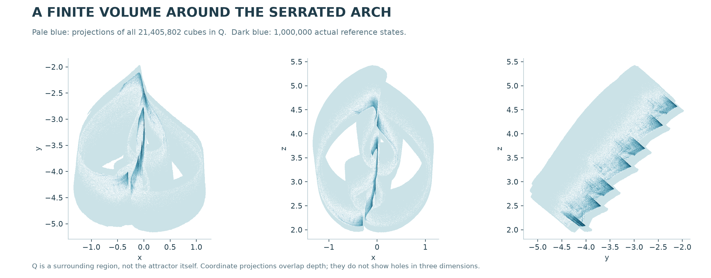

# An attracting positive-entropy set in spatial-circle RAAR

CHAOS ATTRACTOR LAB · RESEARCH PREPRINT · 1 NOVEMBER 2026

**Abstract.** We give a computer-assisted construction of a compact attracting invariant set for an exact three-dimensional instance of the established relaxed averaged alternating reflections (RAAR) algorithm. The two constraints are ordinary noncoplanar circles. An explicit union Q of 21,405,802 cubes avoids both projection singularities and satisfies F(Q) + [−ε,ε]3 ⊂ Q, with ε = 2−35. Exhaustive outward-rounded enclosures verify this inclusion. Seven previously certified covering windows lie in Q, transferring an entropy bound log(2)/49 to the attracting invariant set. We prove the compactness and attraction implications and explain the finite computational accounting.

The motivating numerical orbit forms a serrated arch in its actual state coordinates. We do not prove that this finite cloud equals the entire attracting set, that the latter is transitive, or that it represents a historically new attractor class. The contribution is an explicit regular trapping region and positive-entropy attracting set in this particular geometric instance of a known algorithm.

**Figure 1.** Gold points show the same 2,048 sampled starts in Q after 0, 16 and 256 iterations. The pale reference contains one million consecutive states. The camera is a rigid orthographic projection shared by all panels. These are discrete states, with no interpolated trajectories. The proof below concerns the maximal invariant set in Q; this illustration does not identify it with the reference cloud.

This note supplements the repository’s symbolic-dynamics study [3]. That study proves a compact invariant positive-entropy set; the new trapping computation supplies the missing attraction statement for a containing invariant set.

## 1. Exact model and statement

Let A be the unit circumference in the xy plane, and let B(γ) = c + r(cos γ, cos θ sin γ, sin θ sin γ). The ordered RAAR map of Luke [1] is

$$
F(x)=\beta x+\beta P_A(2P_B(x)-x)+(1-2\beta)P_B(x).
$$

The nearest-circle projectors are smooth away from their axes. All stored parameter and grid entries denote their exact binary64 rational values; θ enters the real sine and cosine functions, enclosed independently by arbitrary-precision intervals.

| Parameter | Exact binary64 input |
| --- | --- |
| beta | 0.9708823579074815 |
| r | 1.9886915469542146 |
| theta | 0.9028818255996501 |
| c_x | -0.1435409113764763 |
| c_y | 0.5745496526360512 |
| c_z | -0.7745124697685242 |

Define o = (−1.635, −5.16, 1.71), h = 0.005 and d = (128,128,128), again using exact binary64 lifts. For each occupied integer index i, its closed cube is o + h(i−d+[0,1]3). Q is the union of precisely the indices specified by the frozen packed mask. Storage dimensions (879,939,999) are indexing bounds, not a filled rectangular region.

**Theorem.** Subject to the stated arithmetic assumptions, F is smooth on a neighborhood of Q and F(Q) + [−2−35,2−35]3 ⊂ Q. The set K = ∩n≥0 Fn(Q) is nonempty, compact, F(K)=K, and attracts a neighborhood of Q. Moreover, htop(F|K) ≥ log(2)/49 > 0.01414.

The computation gives a uniform projection-axis lower bound 0.0118 on every accepted source leaf. The volume of Q is approximately 2.67572525, obtained from the exact expression 21,405,802 h3. This is the volume of the surrounding region, not a positive-volume claim about K.

## 2. A geometric enclosure

For n(v)=v/‖v‖, put u=v/‖v‖ and write w=a u+b with b perpendicular to u. Direct differentiation gives

$$
\|D^2n(v)[w,w]\|^2=\frac{4a^2\|b\|^2+\|b\|^4}{\|v\|^4}\leq\frac{4\|w\|^4}{3\|v\|^4}.
$$

The inequality follows because the numerator of the difference, after multiplying by 3, is (2a2−‖b‖2)2. Taylor’s integral remainder is therefore at most ‖w‖2/(√3 smin2). We use the larger exact coefficient 3/5.

Let X be an outward box for a source leaf, m a selected binary64 point inside X and |δ|≤ρ a symmetric box containing X−m. Let ΠB project onto the plane of B. A positive lower bound q on ‖ΠB(x−c)‖ over X ensures regularity along every segment from m to x. The B-projector remainder obeys

$$
P_B(m+\delta)=P_B(m)+D P_B(m)\delta+e_B,
$$

$$
\|e_B\|\leq E_B=\frac{3r}{5q^2}\max_{|\delta_j|\leq\rho_j}\|\Pi_B\delta\|^2.
$$

The maximum of the convex squared norm is bounded at the eight box vertices. Put a0 = ‖ΠA(2PB(m)−m)‖, and bound the change of this reflected A-plane argument by

$$
D=\max_{|\delta_j|\leq\rho_j}\|\Pi_A(2D P_B(m)-I)\delta\|+2E_B.
$$

When a = a0−D > 0, the entire straight segment in the A-plane argument avoids zero. A second Taylor bound gives EA = 3D2/(5a2). Put

$$
J_A=D P_A(2P_B(m)-m),\qquad M=2\beta J_A+(1-2\beta)I.
$$

The exact nonlinear remainder of F is βeA+M eB. To bound its component i, multiply EB by the Euclidean norm of row i of M, then add βEA for the first two coordinates only. The third coordinate of eA is zero.

We choose finite binary64 approximations f and L for F(m) and DF(m). Interval evaluations of the exact center value and Jacobian explicitly bound their mismatch. Adding these errors and the positive margin ε produces an enclosing zonotope f + L diag(ρ)[−1,1]3 + [−R,R]. Thus the ordinary numerical evaluator chooses the enclosure’s center and generators; its rounding errors are not assumed absent.

## 3. Exhaustive grid verification

Every occupied source cube is processed. Integer dyadic addresses split an uncertain cube into all eight children, preserving the exact original grid. A leaf is accepted when its image enclosure, already enlarged by ε, lies in the occupied union. Axis failure or an unresolved domain escape at maximum depth causes a failed run; neither is silently discarded.

First, an outward axis-aligned bound checks whether all intersected target cubes are occupied. Otherwise, outward separating-axis tests reject disjoint unoccupied target cubes. Their directions may be arbitrary finite binary64 vectors: only an outward dot product and support bound can establish separation. An unresolved target triggers subdivision. At the maximum depth, every remaining possible target is added to the mask and recorded for further processing. The successful run adds none.

| Exhaustive computation | Count |
| --- | --- |
| Source cubes | 21,405,802 |
| Accepted dyadic leaves | 23,055,541 |
| Eight-way splits | 235,677 |
| New target cubes required | 0 |
| Positive image margin | 2−35 |

**Figure 2.** Literal xy, xz and yz projections. Pale blue counts occupied columns of Q; darker detail comes from the million-state numerical reference. All 21,405,802 cubes contribute to each projection. Projection overlaps do not determine three-dimensional topology.

A separate auditor reconstructs the mask-to-key correspondence, checks the four source ranges cover every key exactly once, verifies every chunk’s input hash, checks leaf counts = source counts + 7 × split counts, and confirms that every returned new-cell list is empty. Exact rational window bounds lie wholly in Q. This is an independent accounting audit, not an independent implementation of all interval enclosures.

## 4. Attraction and entropy

**Compactness and invariance.** Q is a finite nonempty union of closed cubes. Positive axis bounds make F continuous near Q. The positive margin implies F(Q)⊂int Q, so the nonempty compact sets Fn(Q) are nested. Their intersection K is nonempty and compact. Continuity gives F(K)⊂K. Conversely, for y∈K choose xn∈Fn(Q) with F(xn)=y. A subsequential limit belongs to every Fj(Q), hence to K, and maps to y. Thus F(K)=K.

**Attraction.** For every neighborhood U of K, some FN(Q) lies in U. Otherwise, points outside U chosen in successive nested compact sets would have a limit in K outside U. Therefore the distance of Fn(Q) to K tends uniformly to zero. Since F(Q)⊂int Q, continuity also supplies a neighborhood of Q that enters int Q in one step. This neighborhood is attracted to K. The argument does not assume invertibility.

**The symbolic set is inside K.** The seven windows N0,...,N6 from [3] all lie in Q. For G=F7, the certified edges are 0→0 and 0→1→2→3→4→5→6→0. Covering theory [2] supplies periodic realizations of any closed chain. Encode 0 by seven self-loops and 1 by the full excursion: each symbol takes 49 F-steps.

A binary word of length n yields an F49n-fixed point starting in N0⊂Q. Forward invariance of Q keeps all its phases in Q. The closure C of all these periodic orbits is compact and F(C)=C, so C=Fn(C)⊂Fn(Q) for every n. Hence C⊂K.

The exact window audit gives dist(N0,N1)=δ>0. Two words differing in block k have realizations separated by at least δ at time 49k+7. Thus K contains 2n distinct (49n,δ/2)-separated initial points. The standard definition of topological entropy gives

$$
h_{\mathrm{top}}(F|_K)\geq\frac{\log2}{49}>0.01414.
$$

**Qualitative persistence.** The trapping margin, regularity bounds and finite covering inequalities are strict. Joint continuity in state and parameters therefore preserves them throughout some sufficiently small open parameter neighborhood. The same entropy lower bound holds for a corresponding attracting invariant set there. No explicit parameter radius is computed.

**A narrow equivalence exclusion.** The certified base seven-cycle box lies in N0, hence its entire periodic orbit now belongs to K. Its previously certified full-period determinant is negative. A C1 coordinate conjugacy defined on a neighborhood of this cycle cannot identify F with a fixed-time solution map of a C1 ODE on R3: such solution maps have positive Jacobian determinant, whereas a periodic-orbit conjugacy preserves it. This excludes neither arbitrary return maps nor known noninvertible maps or topological conjugacies.

**Claim boundary.** An attracting set containing a positive-entropy invariant subset need not be a transitive attractor. The proof does not say every orbit in K is chaotic, identify a physical measure, prove equality with the numerical cloud, or classify K up to conjugacy.

## 5. Reproduction and priority

**Arithmetic assumptions.** The computation assumes ordinary IEEE-754 binary64 arithmetic with correctly rounded basic operations and square root, preserved by the stated Python/Numba runtime. Each relevant elementary result is expanded with nextafter; no fastmath or parallel reduction is used. Exact-parameter sine/cosine intervals are generated at 100 digits and separately checked at 120 digits. All outward kernels compile without cache. This is a computer-assisted proof under these software and arithmetic assumptions, not a proof-assistant formalization.

**Reproduction.** The frozen packet contains the losslessly compressed exact mask, reconstructible sorted input keys, source snapshots, all complete chunk records and implementation checks. The README gives restoration, accounting-audit and full-enclosure-replay commands. Checking hashes and accounting alone does not recompute the enclosures. Selected exact-rational and high-precision implementation checks supplement, rather than replace, exhaustive interval execution. Failed proposals and incomplete runs are distinguished from proof inputs; large proposal-only arrays are explicitly listed as local omissions.

**Prior work.** RAAR is Luke’s existing algorithm [1]. Projection-search strange attractors were explicitly pictured by Elser [5], and planar two-circle RAAR examples precede this work [6]. Fannjiang and Zhang [4] prove boundedness for Gaussian-DRS iterates and discuss possible nontrivial and strange attractors in imaging. Their high-dimensional imaging setting is not the present pair of spatial circles; this difference is not an inequivalence proof. We inspect the relevant statements and discussion, not every proof or figure of that paper.

The new repository result is the explicit trapping construction and its combination with the existing covering certificate at these exact spatial-circle parameters. A bounded literature search did not locate this exact result. It does not establish historical priority. The unread Elser 2007 supplement and full 2025 global-behavior chapter remain explicit gaps; nonlinear equivalence to prior attractors is unresolved.

### References and evidence

[1] D. R. Luke. Relaxed averaged alternating reflections for diffraction imaging. *Inverse Problems* 21 (2005), 37–50. doi:10.1088/0266-5611/21/1/004. arXiv:math/0405208.

[2] P. Zgliczynski and M. Gidea. Covering relations for multidimensional dynamical systems. *Journal of Differential Equations* 202 (2004), 32–58. doi:10.1016/j.jde.2004.03.013. Theorems 9 and 16 in the author preprint.

[3] Chaos Attractor Lab. *Certified symbolic dynamics in a spatial-circle RAAR map* (2026). Repository preprint, papers/raar-symbolic-dynamics; frozen input and two enclosure implementations in results/raar-symbolic-dynamics.

[4] A. Fannjiang and Z. Zhang. Fixed point analysis of Douglas–Rachford splitting for ptychography and phase retrieval. *SIAM Journal on Imaging Sciences* 13 (2020), 609–650. doi:10.1137/19M128781X. Theorem 4.6, Section 7 opening and concluding discussion.

[5] V. Elser. Phase retrieval by iterated projections. *Journal of the Optical Society of America A* 20 (2003), 40–55. doi:10.1364/JOSAA.20.000040. arXiv:math/0111080, Figure 14.

[6] D. R. Luke and A.-L. Martins. Convergence analysis of the relaxed Douglas–Rachford algorithm. *SIAM Journal on Optimization* 30 (2020), 542–584. doi:10.1137/18M1229638.

Evidence and complete commands: github.com/Griboedow/chaos-attractor-lab, results/raar-trapping and papers/raar-trapping. Third-party publication PDFs are not redistributed.
