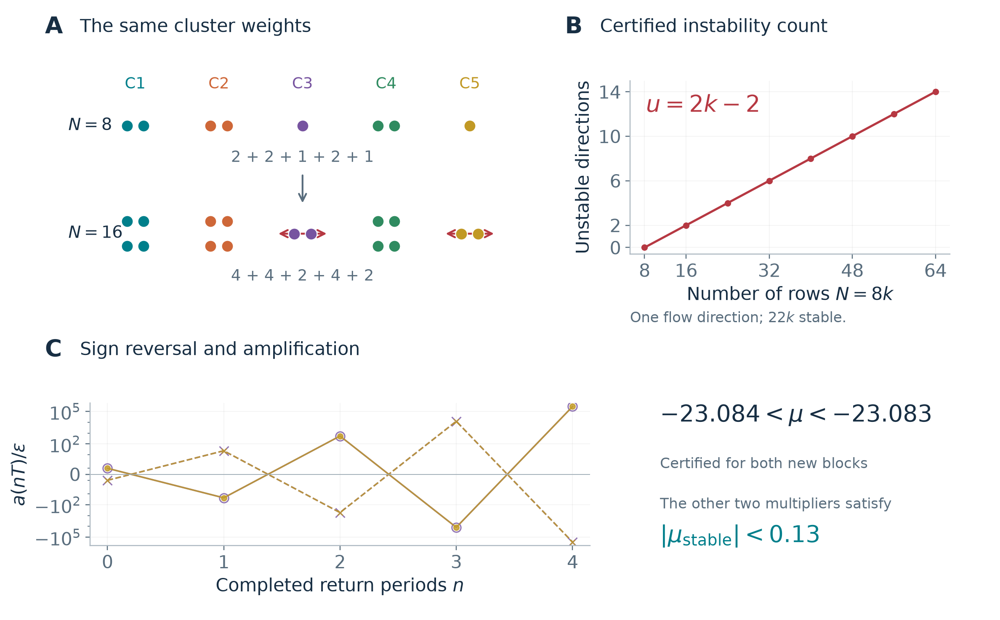
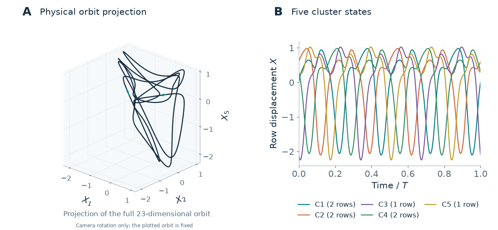

# Replication-induced instability of a certified five-cluster motor cycle

**[Read the manuscript (Markdown)](manuscript.md)** · [Figures](figures/) · [Exact index certificate](../../results/motor-replication-article/exact-index-recheck.json)

The eight-row molecular-motor model has an attracting periodic orbit with five groups of sizes **2 + 2 + 1 + 2 + 1**. Exact replication preserves that motion, but makes it unstable. For every integer `k >= 1`, the `N = 8k` replica has exactly **`2k - 2` unstable, one neutral and `22k` stable directions**. Two groups that were singletons acquire internal differences; each new block has a real multiplier near **-23.083469**, so its unstable perturbation changes sign and amplifies at each return.



This manuscript develops a specific result within established cluster-synchronization theory. It contains a complete analytic tangent-space decomposition, the interval existence and spectral proof, a qualitative parameter-persistence corollary, nonlinear illustrations and reproducibility details. The earlier lower bound of `2(k-1)` unstable directions is sharpened here to an **exact complete count**, with all stable multipliers below modulus `0.13`.

## What distinguishes this result

The contribution is the **explicit certified motor cycle and the complete stability classification of all its balanced replicas**. Network inflation, transverse cluster stability, the absence of singleton splitting modes and finite-precision merging are established background. The revised introduction credits those results directly and includes a comparison table. The [priority audit](priority-and-positioning.md) distinguishes exact model equivalence from related mechanisms; the [search record](literature-search-log.md) identifies the inspected locations and remaining gaps. The model-specific proof specializes existing theory rather than proposing a new general instability mechanism.

## Visual material



The animation rotates the camera around a fixed numerical rendering; it does not animate physical time. [Figure 1](figures/figure-1-cycle.png) shows the orbit and group waveforms. [Figure 2](figures/figure-2-dynamics.png) compares full-state attraction with growth of new contrasts. [Figure 3](figures/figure-3-replication.png) explains the mechanism, exact count and alternating sign. Every static figure has an editable SVG and a high-resolution PNG. The [existing evolution animation](../../docs/assets/motor-cycle-attraction.gif) separately shows actual trajectories approaching the orbit.

## Claim-to-evidence map

| Manuscript claim | Decisive evidence | Scope |
| --- | --- | --- |
| Exact normalized source equations | [Model/source audit](../../docs/motor-rows-source-audit.md), manuscript Appendix A | Constant total transition rate and sinusoidal potential/forcing; no added network interaction |
| Existence and full-space attraction at `N=8` | [512-bit cycle record](../../results/motor-five-cycle-proof/recheck-01.json), [report](../../docs/motor-five-cycle-certificate.md) | Strict multiple-shooting inclusion; all 22 nonflow multipliers below `0.13` |
| Exact replication spectrum | Proposition 2 and its proof in [manuscript.md](manuscript.md) | Analytic invariant direct sum for arbitrary integer replication |
| New block index `(1,0,2)` | [New 640-bit integration](../../results/motor-replication-article/reintegration-640.json), [768-bit spectral replay](../../results/motor-replication-article/exact-index-recheck.json) | Strict negative-root bracket plus quadratic Jury inequalities; retains all interval radii |
| Same conclusion from the earlier integration | [Independent replay of earlier matrices](../../results/motor-replication-article/exact-index.json) | Different variational integration settings; same proof method/library |
| Complete count `(2k-2,1,22k)` | Theorem 1, invariant decomposition and both replay records | Every `k >= 1` at fixed normalized parameters and cluster weights |
| Persistence near the exact parameters | Corollary 3 | Qualitative implicit-function and spectral-continuity consequence; no certified numerical parameter radius |
| Six nearby trajectories approach | [Frozen attraction data](../../results/motor-cycle-attraction-visual/local-0p03/analysis.json) | Full23D numerical integrations; phase-minimized full24D distance; no basin probability |
| New differences amplify and reverse sign | [Eight-start protocol](../../results/motor-replication-article/nonlinear/protocol.json), [all outcomes](../../results/motor-replication-article/nonlinear/analysis.json) | Full47D numerical trajectories; two amplitudes, signs and blocks; different-solver control |

The numerical eigenvectors used for the illustrations propose starting directions only. No midpoint eigenvalue is used as a premise of the interval theorem. The two matrix integrations share the same integrator and arithmetic library; neither is described as an independent proof implementation.

## Reproduction

Run commands from the repository root and choose unused output folders. The proof environment needs only `python-flint==0.9.0`; the article environment uses [requirements-article.txt](../../requirements-article.txt) for numerical trajectories and figures. The checked environment versions are recorded in [review.json](review.json).

```bash
python -m venv .venv-proof
# Activate that environment, then:
python -m pip install -r requirements-proof.txt
python research/check_motor_five_proof.py --output outputs/article-controls.json
python research/validate_motor_five_cycle.py --verify-input results/motor-five-cycle-proof/attempt-01.json --newton 0 --bits 512 --steps 160 --order 50 --output outputs/article-cycle.json
python research/check_motor_five_replication.py --input results/motor-five-cycle-proof/recheck-01.json --bits 640 --steps 192 --order 54 --output outputs/article-replication.json
python research/certify_motor_replication_index.py --input outputs/article-replication.json --output outputs/article-index.json
```

The replication checker deliberately reads the frozen cycle certificate. To chain a newly recomputed cycle instead, give its path to `--input` in the integration command and also to `--cycle` in the index command. The index checker verifies the exact cycle-input hash.

For the figures, use the simulation environment:

```bash
python -m pip install -r requirements-article.txt
python research/illustrate_motor_replication.py --output outputs/article-nonlinear
python research/render_motor_replication_article.py --animate --output outputs/article-figures
```

The renderer reads the **archived** nonlinear packet, not the newly generated `outputs/article-nonlinear` folder. This keeps the published figure provenance fixed. Compare a fresh simulation packet with the archived analysis before substituting data. The renderer also produces historical export formats in its output directory. Publish the PNG/SVG figures and GIF, retaining their provenance; keep generated PDF exports outside Git.

The complete text is edited directly in [manuscript.md](manuscript.md). Run `python tools/check_manuscripts.py` after editing. The original build, review and manifest records describe the historical publication edition; see [editing and archive instructions](../../docs/manuscript-editing.md). Frozen numerical verifiers may require the explicitly restored files described there.

The [revision record](revision.json) and [first review packet](revisions/v1/README.md) retain their original provenance. Replaying those publication audits requires the corresponding historical checkout. Numerical proof commands above remain unchanged.

## Scientific and editorial status

**Complete pre-submission research manuscript; suitable for mathematical and author review.** It is not an accepted or externally peer-reviewed article. Author names and affiliations have deliberately not been inferred from Git metadata.

The manuscript makes no claim to a new general mechanism or to being the first observation of chaos in motor models. The equivalent-terminology audit found direct precedents for the underlying mechanism and numerical pitfall, which are now explicitly attributed. The inspected sources did not identify this exact certified motor result. Historical priority remains unresolved; the full Anello (2025) and Levillain (2024) thesis chapters are specific remaining gaps, not an exhaustive list of possible prior work. See the [literature comparison](priority-and-positioning.md). Setting authorship and journal style also remains editorial work before submission.

The displayed period is a certified positive return period, not a proved least period. Basin size, nonlinear destinations after replication, a global bifurcation connection and asymptotic chaos are outside the theorem. The [research programme](research-programme.md) keeps the hyperchaos and switching questions separate, with concrete completion criteria.
