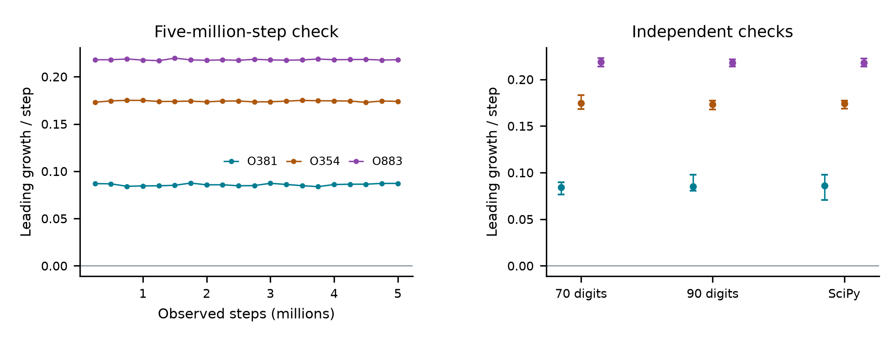
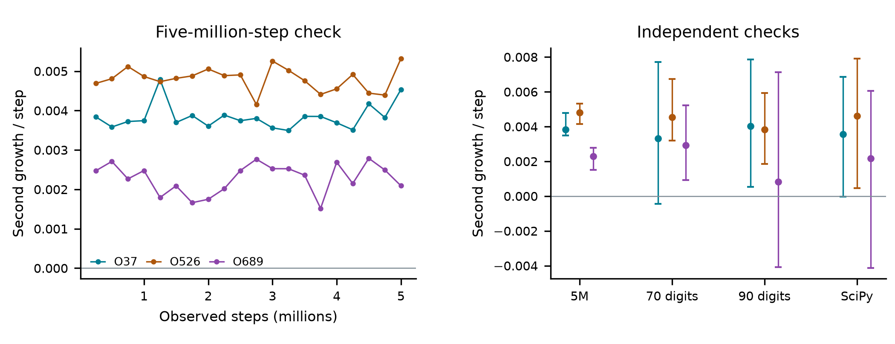
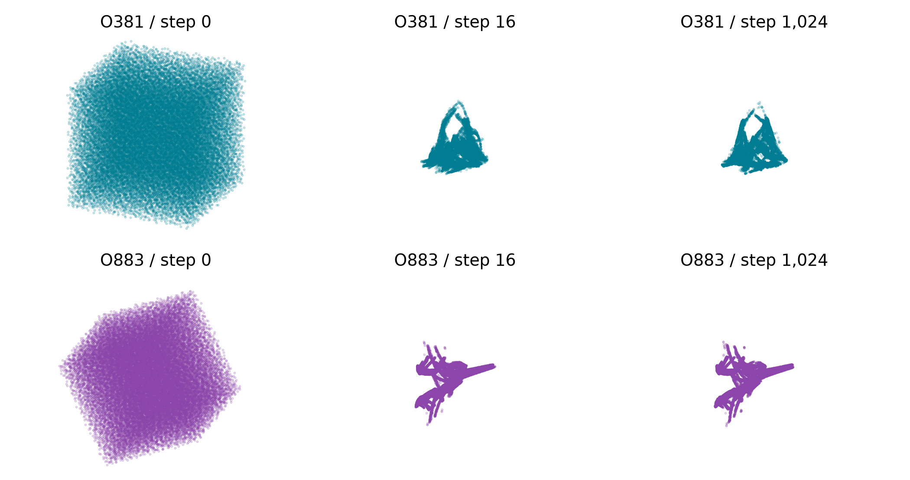

# Tolerance-scale geometry and numerical hyperchaos in an adaptive Runge-Kutta solver

A stable linear oscillator and the standard RK23 acceptance policy

Chaos Attractor Lab | Research manuscript | 1 November 2026

## Abstract

A linearly damped spring has no physical chaotic attractor. Nevertheless, the accepted-step dynamics of its adaptive numerical solver can produce intricate bounded sampled clouds near the requested absolute tolerance. We study the existing Bogacki-Shampine 3(2) pair with the standard SciPy RK23 error norm and rejection policy. A declared parameter screen, follow-up of every flag, five-million-step trajectories, independent 70- and 90-digit calculations, and unmodified-library runs support sustained finite expansion in folded triangular and wing-shaped regimes. A separate setting retains two positive finite growth estimates in every independent measurement window. We prove an explicit bound for accepted solution values under a sufficient tolerance condition and give an exact-rational refinement covering the two-direction case. A controlled error-norm change makes all six selected amplitude/step quotients regular. Prior work already establishes controller instability, tolerance-scale numerical oscillations and coordinate dependence. Asymptotic chaotic attraction, a new topological class and historical uniqueness remain unresolved.

<!-- drawing-date -->
*First recorded portrait: **2026-11-01**.*
<!-- /drawing-date -->

**Figure 1.** O381, folded triangle (left), and O883, scissor wings (right). Each portrait contains eight million actual accepted-step states (position/atol, velocity/atol, proposed step), with a rigid camera and equal spatial units. Color indicates visits per image bin. The repository includes a rotating view of the fixed data. These are states of the numerical algorithm, not a chaotic physical spring.

## 1. Model, conventions and scope

Consider the real linear equation, with 0 < ζ < 1,

$$
\dot q=p,\qquad \dot p=-q-2\zeta p,\qquad \dot y=Ay,\quad y=(q,p)^T.
$$

The eigenvalues have real part -ζ. Every exact solution tends to zero. For the existing Bogacki-Shampine 3(2) pair [1], advancing the third-order formula and estimating its local error with the embedded pair gives

$$
v=R(hA)y,\qquad e=E(hA)y,
$$

$$
R(z)=1+z+\frac{z^2}{2}+\frac{z^3}{6},\qquad E(z)=\frac{z^3(1+z)}{48}.
$$

The signed error polynomial matches the inspected SciPy implementation; its sign disappears in the error norm. Let τ=atol > 0 and ρ=rtol ≥ 0. The original-coordinate error scales and norm are

$$
s_i=\tau+\rho\max(|y_i|,|v_i|),\qquad w=\left[\frac{1}{2}\sum_{i=1}^{2}\left(\frac{e_i}{s_i}\right)^2\right]^{1/2}.
$$

A trial is accepted when w < 1. The next proposal is h times min(10,0.9 w-1/3); following one or more rejections, this factor is additionally capped at one. A rejected trial multiplies h by max(0.2,0.9 w-1/3) and retries the same y. Zero estimated error selects the maximum growth factor. These are existing SciPy rules [2], not a newly proposed controller.

The normalized solution u=y/τ removes τ from the ideal recurrence. We compute in (u1,u2,log h) and render (u1,u2,h). The mathematical map omits endpoint clipping, the floating-point clock subtraction and the minimum-clock-step test. Unmodified SciPy runs retain those operations, with a remote final time. Thus exact formulas, high-precision arithmetic and library execution are separate experiments.

### Claim boundary

The proof below concerns solution-coordinate bounds. Positive growth rates, attraction to sampled clouds and numerical periods are finite observations. We do not prove a trapping region in the full three-dimensional state, a physical invariant measure, a strange attractor, or inequivalence to all previously studied invariant sets.

## 2. Relation to earlier work

Hall [3] extends equilibrium analysis of adaptive Runge-Kutta algorithms to complex dominant eigenvalues. Hall and Higham [4] study coupled solution/step polynomial recurrences, their stability-boundary equilibria and a transformed norm. Their conclusions explicitly distinguish normal from nonnormal linear problems and the practical effect of Euclidean versus transformed error norms. That framework and that coordinate dependence are prior work.

Aves, Griffiths and Higham [5] show that error control need not suppress stable spurious fixed points, even at arbitrarily small tolerances. Higham, Humphries and Wain [6] describe tolerance-scale numerical oscillation near stable equilibria and propose phase-space error control. Humphries and Vigneswaran [7] develop a related phase-space/stability criterion. Consequently, failure of an adaptive solver to settle at a stable physical equilibrium cannot be claimed as our discovery.

Ranocha and Giesselmann [8] give a closely related modern formulation of step-size control dynamics, including complex linear test equations, embedded third-order Runge-Kutta methods and I/PI/PID controllers. Their limiter differs from the hard acceptance/rejection policy studied here. The present complex-scalar quotient is compared with that established framework rather than presented as a new reduction. Automated controller-parameter searches are also established, including the recent Bayesian design of DSP controllers by Izgin-Melnikov and Ranocha [9].

### The narrow result under investigation

Our contribution for assessment is a concrete, implementation-specific empirical description: selected original-coordinate RK23 regimes, visually distinctive full-state clouds, independent arithmetic and library checks, all declared screening outcomes, and explicit solution bounds. A separate norm control makes the role of numerical feedback visible. Whether this combination includes a previously unclassified invariant set or mechanism remains open. A new parameter value, more polished rendering or visual nickname is insufficient to establish novelty.

### Limits of the priority review

The bounded review did not locate an exact published match to the selected original-coordinate clouds. This is not a priority certificate. The publisher abstract of Hall [3] was inspected, but the attempted full PDF route denied access. R. J. Wain's 1998 Dundee thesis, *Long Term Dynamics of Adaptive Algorithms for the Numerical Solution of Ordinary Differential Equations*, appears in the primary reference chain and was not obtained. The older numerical-dynamics literature and reduced maps have not been classified exhaustively. The repository priority note records source-specific reading scopes and access gaps.

## 3. Declared computational study

The main screen uses 1,024 scrambled Sobol pairs plus three controls, with seed 2026110175, ζ in [0.001,0.999], and log-uniform ρ between 10-12 and 10-1. Every setting starts at normalized (q,p,h)=(1,0,0.1). A scout flag requires a leading estimate greater than 0.001 in every measurement window. Every flag is followed from a fresh start; failed or periodic outcomes are retained.

| Stage | Runs | Warm-up / alignment | Measured steps / windows |
| --- | --- | --- | --- |
| Scout | 1,027 | 20,000 | 50,000 / 10 |
| Every flag | 396 | 100,000 | 1,000,000 / 20 |
| Selected long checks | 6 | 100,000 | 5,000,000 / 20 |
| Independent precision | 12 | 100,000 / 5,000 | 100,000 / 10 |
| Actual SciPy | 6 | 100,000 / 10,000 | 290,000 / 29 |
| Starts and neighbors | 189 | 100,000 | 300,000 / 10 |

All 1,027 scouts finish; 396 are flagged. The million-step follow-up retains 393 under the declared criterion. Three settings instead have detected periods 14, 19 and 172. Three followed cases have two positive growth estimates in every window. Twenty-four geometrically diverse flagged settings are screened visually before selecting O381, O354 and O883 for deeper geometry checks. The second-direction cases O37, O526 and O689 are checked separately.

| Case | Damping | Relative tolerance |
| --- | --- | --- |
| O381 | 0.4435243054088 | 3.337961687324e-10 |
| O354 | 0.4803776211888 | 0.001164694167597 |
| O883 | 0.9588936367407 | 3.716848096666e-12 |
| O37 | 0.3691010416541 | 3.356587531098e-12 |
| O526 | 0.1717106344756 | 0.03929059404001 |
| O689 | 0.1774223265387 | 1.601932929634e-12 |

Full spectra use three tangent columns and two-pass modified Gram-Schmidt. Independently accumulated logarithmic determinants check the sum of the three rates. A 256-state central-difference check gives a maximum Jacobian discrepancy below 1.68 x 10-9; 256 one-step comparisons with unmodified SciPy, including rejected trials, differ by less than 6.00 x 10-15. Period scans test every lag from 1 through 512 against the retained late states with a maximum coordinate residual threshold of 10-9.

## 4. Visual candidates and independent reproduction

**Figure 2.** Leading finite growth estimates for the three visual candidates. Left: twenty 250,000-step windows after a 100,000-step warm-up. Right: means and minimum-to-maximum measurement-window ranges from independent 70/90-digit implementations and actual SciPy trajectories. These ranges are not confidence intervals.

| Case | Mean full spectrum | Minimum leading window |
| --- | --- | --- |
| O381 | 0.085762 / -0.109390 / -0.182760 | 0.083727 |
| O354 | 0.174079 / -0.121821 / -0.302704 | 0.172882 |
| O883 | 0.217953 / -0.272192 / -0.407174 | 0.216943 |

Independent precision runs use explicit four-stage Bogacki-Shampine formulas with rational method coefficients. They import neither the production recurrence nor its analytic Jacobian. Two finite-separation directions are orthogonalized in actual (q,p,h), with separations 10-30 at 70 digits and 10-40 at 90 digits. Parameters and controller constants are lifted from their exact binary64 values. Every leading window is positive for the three visual cases.

Unmodified SciPy 1.18.1 starts from physical (q,p)=(1,0), atol=10-6 and proposed h=0.1. It records 400,000 accepted steps, including its floating-point clock. After 100,000 warm-up and 10,000 tangent-alignment steps, all 29 measured leading windows are positive. Tangents are those of the mathematical map evaluated on actual states, not derivatives of floating-point rounding. Maximum normalized solution/log-step one-step residuals are below 2.55 x 10-10.

The O381 trajectory was saved before a compilation failure in its analysis driver. It was reused byte for byte after correction; its function-evaluation count had not been recorded and remains unknown. A later input-path error occurred before any solver run. Both failures and their recovery are retained, rather than silently replacing the experiment.

## 5. Two expanding directions: evidence and exceptions

**Figure 3.** Left: the second growth estimate in twenty long windows for O37, O526 and O689. Right: second-rate means and full window ranges for the five-million-step, 70-digit, 90-digit and actual-library checks. Negative short windows in O37 and O689 are displayed. O526 retains a positive second estimate in every independent window.

| Minimum second rate | 5M | 70 digits | 90 digits | SciPy |
| --- | --- | --- | --- | --- |
| O37 | 0.003494 | -0.000440 | 0.000539 | -0.000027 |
| O526 | 0.004153 | 0.003191 | 0.001849 | 0.000466 |
| O689 | 0.001518 | 0.000926 | -0.004088 | -0.004142 |

O526 has mean five-million-step spectrum (0.024016,0.004799,-0.034250). Its smallest second estimate is 0.004153 in the long check, 0.003191 and 0.001849 in the independent 70/90-digit checks, and 0.000466 across actual SciPy windows. This is the strongest two-direction candidate in the declared selected set, but remains finite numerical evidence.

O37 and O689 retain two positive estimates in every long 250,000-step window and have positive overall second means in every independent run. Their shorter independent windows are mixed: O37 has negative second windows at 70 digits and in actual SciPy; O689 has negative windows at 90 digits and in actual SciPy. They do not pass the stricter all-independent-window criterion. Averaging those windows away would overstate the evidence.

The appearance of the two-direction candidates is less distinctive than the main portraits. We keep visual selection separate from dynamical evidence. Neither two positive finite estimates nor their absence provides a topological classification or proof of novelty.

## 6. Initial volumes and nearby periodic regimes

**Figure 4.** For each row, 32,768 scrambled Sobol starts occupy q/atol,p/atol in [-4,4] and h in [0.25,8]. Snapshots at steps 0, 16 and 1,024 use one rigid camera and one scale per row. Every point is retained. The compact late cloud is a numerical approach observation, not a certified basin.

All 65,536 volume trajectories complete 1,024 steps. Their median distance to a separate 200,000-point cloud falls from about 2.14 to 0.00153 for O381 and 0.00189 for O883. Splitting the reference cloud in half gives median cross-sample distances 0.00228 and 0.00275. These nonzero sampling scales prevent interpreting a small nearest-neighbor distance as exact convergence to a certified invariant set.

| Case | 24 solution starts | 6 initial steps | 32 nearby parameters |
| --- | --- | --- | --- |
| O381 | 24 / 24 | 6 / 6 | 16 / 32 |
| O354 | 24 / 24 | 6 / 6 | 32 / 32 |
| O883 | 24 / 24 | 6 / 6 | 24 / 32 |

The solution starts combine radii 0.01, 1, 100 and 106 with six declared phases. Alternative initial step proposals are 0.001, 0.01, 1, 3, 10 and 100. Nearby parameters vary independently within exp(± 0.02) of the selected pair. Each run uses 100,000 warm-up and 300,000 measured steps. All unflagged neighbors above are periodic, with periods from 3 through 56. These results do not establish structural stability across a neighborhood.

## 7. A bound for accepted solution values

Let P have diagonal entries 1 and off-diagonal entries ζ, and define the P-norm by ||y||P=sqrt(yTPy). Its eigenvalues are 1-ζ and 1+ζ. Direct multiplication gives ATP+PA=-2 ζ P. Since A+ζ I is skew-adjoint in the P inner product and its square equals -(1-ζ2)I, every real-coefficient polynomial f satisfies

$$
f(hA)^TPf(hA)=|f(h\lambda)|^2P,\qquad \lambda=-\zeta+i\sqrt{1-\zeta^2}.
$$

**Theorem 1.** Put c=128 sqrt(2). If ρ < (1-ζ)/c, then every sequence of accepted RK23 steps satisfies

$$
\|y_n\|_P\leq\max\left\{\|y_0\|_P,\frac{c\tau\sqrt{1-\zeta}}{1-\zeta-c\rho}\right\}.
$$

The conclusion is independent of the step-proposal policy: acceptance under the stated error norm is sufficient. It bounds position and velocity, not the step coordinate. The estimate is deliberately conservative and is not claimed as a new general technique.

### Proof: small accepted steps reduce the radius

Write r=||y||P. The polynomial identity gives rnew=|R(h λ)| r and ||e||P=|E(h λ)| r. Direct expansion yields

$$
|R(h\lambda)|^2-1=-2\zeta h\left(1-\zeta h+\frac{2}{3}\zeta^2h^2\right)
$$

$$
\qquad +\left(\frac{2}{3}\zeta^2-\frac{1}{12}\right)h^4-\frac{\zeta h^5}{6}+\frac{h^6}{36}.
$$

For 0 < h ≤ 1, use 1-a+(2/3)a2 ≥ 5/8, ζ2 h4 ≤ ζ h, and h6 ≤ h4. The right side is at most -(7/12) ζ h-h4/18, which is strictly negative. Thus such steps reduce r.

### Large steps have a bounded solution/error ratio

For h ≥ 1, put ω=sqrt(1-ζ2). The coefficient triangle bound and |1+h λ|2=(h-ζ)2+ω2 imply

$$
|R(h\lambda)|\leq\frac{8}{3}h^3,\qquad |E(h\lambda)|\geq\frac{h^3\omega}{48},\qquad \frac{|R|}{|E|}\leq K:=\frac{128}{\omega}.
$$

## 8. Completing the bound and an exact refinement

Acceptance w < 1 gives ||e||2 ≤ sqrt(2) max si, hence

$$
|E|r\leq a\tau+b\rho\max(r,r_{\rm new}),\qquad a=\sqrt{2(1+\zeta)},\quad b=\sqrt{\frac{2(1+\zeta)}{1-\zeta}}.
$$

This follows by comparing the Euclidean and P-norms using the extremal eigenvalues of P. If a step increases r, then h > 1 and multiplication by |R|/|E| ≤ K gives rnew ≤ Ka τ+Kb ρ rnew. Since Kb=c/(1-ζ), the hypothesis is exactly Kb ρ < 1. Rearranging gives the displayed bound. Every accepted step either decreases the radius or lands below that constant; induction completes the proof.

### Exact-rational certificate for O526

The broad threshold covers the three main portraits and O37/O689, but not O526. A sharper choice of the small-step interval supplies a certificate for that case. Use its exact binary64 parameter values

$$
\zeta=\frac{386657974719873}{2251799813685248},\qquad \rho=\frac{707796418711107}{18014398509481984},\qquad H=\frac{23}{10}.
$$

The rational polynomial Q(h)=(|R(h λ)|2-1)/h has no root on the closed interval [0,H], by an exact Sturm count, and Q(0) < 0. Therefore 0 < h ≤ H reduces the radius. The complete rational coefficients and endpoint values are archived. For h ≥ H, replace K with

$$
K_H=\frac{48\left(H^{-3}+H^{-2}+(2H)^{-1}+1/6\right)}{\sqrt{1-2\zeta H+H^2}}.
$$

The numerator decreases with h and the denominator increases for h ≥ H > ζ. The exact rational squared condition (KHb ρ)2 < 1 holds; its decimal value is approximately 0.785621322. The same induction gives ||yn||P ≤ max(||y0||P,C τ), with C=KHa/(1-KHb ρ), approximately 180.655179. The symbolic audit checks the polynomial identities, Sturm count and squared gain inequality exactly.

### What the certificate does not establish

At the exact zero solution, the ideal controller has zero error and multiplies h by ten forever. There is no compact global attractor on the unrestricted full state domain. Our bounds do not prove a lower solution radius, an upper step bound, a full-state trapping region or chaotic attraction. The observed step bounds remain finite-data statements.

## 9. Error norms, equivalence and reproduction

The real accepted-step map has reflection symmetry (q,p,h) to (-q,-p,h). Absolute-tolerance scaling and reflection-related clouds do not define separate discoveries. A linear change of physical coordinates must transform the complete error rule to preserve the numerical algorithm. To expose this dependence, set

$$
z=q-i\frac{p+\zeta q}{\sqrt{1-\zeta^2}},\qquad \dot z=(-\zeta+i\sqrt{1-\zeta^2})z.
$$

We deliberately replace the original componentwise RMS rule with the complex absolute-value error divided by 1+ρ max(|zold|,|znew|). The initial amplitude is 1/sqrt(1-ζ2), corresponding to physical (q,p)=(1,0). This changes the adaptive numerical algorithm for a conjugate linear equation. A fresh million-step comparison gives:

| Case | Quotient period | Mean quotient spectrum |
| --- | --- | --- |
| O381 | 3 | -0.016995 / -0.116763 |
| O354 | 23 | -0.017457 / -0.068499 |
| O883 | 1 | -0.212297 / -0.212297 |
| O37 | 3 | -0.044500 / -0.052529 |
| O526 | 30 | -0.044378 / -0.087734 |
| O689 | 29 | -0.012290 / -0.013337 |

The phase-rotation symmetry supplies a neutral direction. A periodic amplitude/step quotient need not be a closed full complex-state orbit. This control is consistent with the established role of error norms [4,8]; it is not a new coordinate-dependence theorem or a proof of invariant-set inequivalence.

### Reproducibility and exclusions

The public packet retains all 1,027 oscillator scouts, all 396 follow-ups, six long selected runs, twelve independent precision runs, six actual-library trajectories, 189 start/neighbor controls and 65,536 initial-volume histories. It also retains the preliminary complex RK23 and custom guarded Heun/Euler PI screens, with regular and unsuccessful outcomes. The custom PI experiment is explicitly not a full SUNDIALS replay. Source snapshots, failure records, figure protocols and SHA-256 manifests are included.

Large eight-million-state raw portrait arrays and non-promoted preliminary gallery clouds are retained locally with hashes and regeneration information. Exact portrait histograms and consecutive animation states are public. The PI follow-up is split losslessly into row blocks. Scripts independently verify archive bytes, classifications, window summaries and rendering counts. No prior-paper PDFs are redistributed.

## References and remaining questions

The unresolved questions are substantive: prove or refute asymptotic chaotic attraction, identify the invariant-set organization across switching surfaces, and compare any resulting reduced description with the numerical-dynamics literature. The present work supplies reproducible candidates and boundedness calculations; it does not answer those classification or priority questions by visual inspection.

[1] P. Bogacki and L. F. Shampine. A 3(2) pair of Runge-Kutta formulas. *Applied Mathematics Letters* 2(4), 321-325 (1989). [doi:10.1016/0893-9659(89)90079-7](https://doi.org/10.1016/0893-9659(89)90079-7).

[2] SciPy. RK23 documentation and installed scipy.integrate._ivp.rk implementation, version 1.18.1, inspected 1 November 2026. [Official method documentation](https://docs.scipy.org/doc/scipy/reference/generated/scipy.integrate.RK23.html). Installed source is frozen in the data packet; the online manual can describe a different release.

[3] G. Hall. Equilibrium states of Runge-Kutta schemes: part II. *ACM Transactions on Mathematical Software* 12(3), 183-192 (1986). [doi:10.1145/7921.7922](https://doi.org/10.1145/7921.7922). Publisher abstract inspected; full-text access gap recorded.

[4] G. Hall and D. J. Higham. Analysis of stepsize selection schemes for Runge-Kutta codes. *IMA Journal of Numerical Analysis* 8, 305-310 (1988). [doi:10.1093/imanum/8.3.305](https://doi.org/10.1093/imanum/8.3.305).

[5] M. A. Aves, D. F. Griffiths and D. J. Higham. Does error control suppress spuriosity? *SIAM Journal on Numerical Analysis* 34(2), 756-778 (1997). [doi:10.1137/S0036142994276980](https://doi.org/10.1137/S0036142994276980).

[6] D. J. Higham, A. R. Humphries and R. J. Wain. Phase space error control for dynamical systems. *SIAM Journal on Scientific Computing* 21(6), 2275-2294 (2000). [doi:10.1137/S1064827597331400](https://doi.org/10.1137/S1064827597331400).

[7] T. Humphries and R. Vigneswaran. Phase space stability error control with variable time-stepping Runge-Kutta methods for dynamical systems. *Applied Numerical Analysis and Computational Mathematics* 1(3), 469-488 (2004). [doi:10.1002/anac.200410010](https://doi.org/10.1002/anac.200410010).

[8] H. Ranocha and J. Giesselmann. Stability of step size control based on a posteriori error estimates. (2024). [doi:10.1007/s44207-024-00001-0](https://doi.org/10.1007/s44207-024-00001-0); [arXiv:2307.12677v3](https://arxiv.org/html/2307.12677v3).

[9] T. Izgin-Melnikov and H. Ranocha. Using machine learning to design time step size controllers for stable time integrators. *Journal of Scientific Computing* 109, article 78 (2026), published 8 October. [doi:10.1007/s10915-026-03496-1](https://doi.org/10.1007/s10915-026-03496-1).

Reproduction, rotating figures and source-specific reading scopes: [github.com/Griboedow/chaos-attractor-lab](https://github.com/Griboedow/chaos-attractor-lab/blob/main/docs/rk23-oscillator.md). Evidence commit: d67a116. This manuscript is a research report, not a claim of completed peer review or established historical priority.
