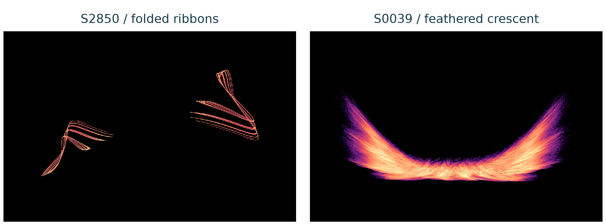

# Bounded memory and numerical hyperchaos in scalar quadratic optimization

**[Research manuscript (PDF)](manuscript.pdf)** · [Editable text](content.py) · [Figures](figures/) · [Detailed experiment report](../../docs/yogi-tanh.md) · [Priority audit](../../docs/yogi-priority.md)

The 11-page manuscript combines a complete scalar boundedness proof with finite numerical evidence for two expanding directions in the **existing** smooth Yogi optimizer. It derives an exact local cycle-stability interval and explicitly identifies the known Adam cycle's local Jacobian equivalence.

The left ribbon is initialization-dependent: its standard library cold start settles. The right crescent is reproduced by actual TensorFlow. The [rotation](../../docs/assets/yogi-tanh-rotation.gif) changes only the camera.

## What is proved, and what remains numerical

| Result | Status |
| --- | --- |
| Scalar boundedness under a positive denominator floor and d >= sigma abs(x) | Complete first-exit proof, with no ordering of momentum and second-memory parameters |
| Every finite legal smooth-Yogi orbit is bounded, including bias correction | Consequence of that theorem with an explicit denominator constant |
| Critical fold sheets and global noninjectivity | Exact algebraic consequences of the known map |
| Strict exponential stability interval of the symmetric two-cycle | Proved; its equivalence to the known Adam local Jacobian is explicit |
| Two expanding directions in S0039 and S7239 | Five-million-step numerical checks, independent 70/90-digit calculations, actual unmodified library execution and fresh-start cohorts |
| Asymptotic chaotic attraction or a historically new attractor class | Unresolved |

The algorithm, optimizer chaos on scalar quadratics, and the symmetric-cycle family are prior work. The manuscript does not claim priority of the bounding technique. Its references, inspected source versions and remaining coverage gaps are explicit. No author identities or affiliations were inferred.

## Reproduction

The build reads the frozen results/yogi-tanh packet. It does not resimulate a selected trajectory to make the figures. Numerical plot lines and labels remain vector objects in the PDF; the visit-density portraits are raster images of exact archived histograms.

    python research/build_yogi_manuscript.py --output output/pdf/yogi-memory-manuscript.pdf
    python research/audit_yogi_manuscript.py

The first command creates a review build and a figure subdirectory beside it, leaving the published packet unchanged. It requires the ordinary numerical environment plus ReportLab and pypdf. The published manuscript.pdf is a copy of the visually checked build. Its manifest and review record remain tied to that copy; a fresh build is a new review artifact.

The independent scientific verifier remains:

    python research/verify_yogi_tanh.py --root results/yogi-tanh

Every page was rendered with Poppler and inspected, including mathematical notation, table boundaries, chart labels and footers. The [review record](review.json) identifies the exact PDF and rendered-page hashes. The file manifest covers the manuscript, editable text, figures and build metadata. This is a research draft for scientific and author review, not an accepted or externally peer-reviewed publication.
