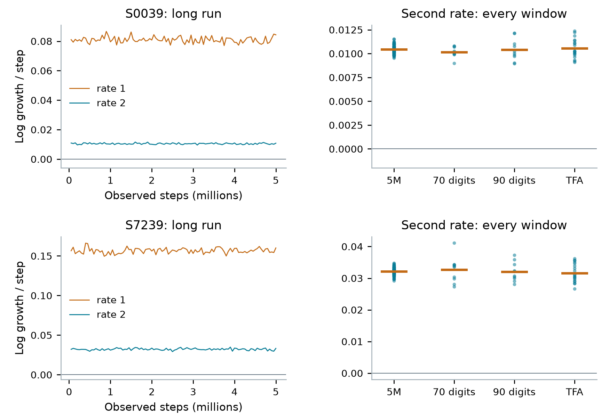

# Bounded memory and numerical hyperchaos in scalar quadratic optimization

An investigation of the existing smooth Yogi update

Chaos Attractor Lab | Research manuscript | 1 November 2026

## Abstract

A scalar convex objective can generate complicated dynamics in an optimizer's internal memories. We study the pre-existing tanh activation of TensorFlow Addons Yogi on a quadratic. We prove an elementary scalar boundedness theorem requiring a positive denominator floor and a lower bound proportional to the current position; no ordering between the two memory coefficients is needed. It applies to the smooth Yogi map, its bias-corrected transient, and several standard scalar adaptive updates. A declared search and follow-up retain two expanding finite-time directions in selected smooth-Yogi regimes through five million steps, independent 70- and 90-digit calculations, and unmodified library execution. We also derive the exact local stability interval of a symmetric two-cycle and identify its local equivalence to Adam. The algorithm, optimizer chaos and the symmetric-cycle mechanism are credited as prior work. Asymptotic chaotic attraction, a new topological class and historical uniqueness remain open.


<!-- drawing-date -->
*First recorded portrait: **2026-11-01**.*
<!-- /drawing-date -->

**Figure 1.** Folded ribbons (left, S2850) and a feathered crescent (right, S0039). Each image uses eight million actual normalized states, a rigid camera and equal spatial units. S2850 is conditional on initialization: its standard library cold start settles. S0039 is reproduced in actual TensorFlow. The repository supplies a rotating view of the fixed clouds.

**Scope.** The mathematical results concern boundedness, folds and local exponential stability. The chaotic-regime evidence is numerical and finite. No visual resemblance or absence of a search hit is used as a proof of novelty.

## 1. Equation, convention and prior work

Let the objective be f(θ) = h θ<sup>2</sup>/2, with h > 0. The dense Yogi implementation [1,2] maintains first and second memories. In the existing tanh option, the second-memory increment uses tanh(10(g<sup>2</sup>-v)) in physical units. With learning rate α, use the normalization

$$
\theta=\alpha x,\quad m_{\rm phys}=\alpha h m,\quad v_{\rm phys}=(\alpha h)^2v,\quad e=\epsilon/(\alpha h),\quad k=10(\alpha h)^2.
$$

For 0 ≤ b < 1, 0 < c < 1, e > 0 and k > 0, the late autonomous state map is

$$
T=\tanh(k(v-x^2)),\qquad M=bm+(1-b)x,
$$

$$
V=v-(1-c)Tx^2,\qquad F(x,m,v)=\left(x-\frac{M}{\sqrt{V}+e},M,V\right).
$$

The legal domain is v ≥ 0. The actual library transient multiplies M in the position update by r<sub>t</sub> = sqrt(1-c<sup>t</sup>)/(1-b<sup>t</sup>), with updates numbered from t = 1. Epsilon stays outside the uncorrected square root. For h = 1, the default physical slots m = 0 and v = 10<sup>-6</sup> become m = 0 and v = 10<sup>-5</sup>/k. The experiments also declare autonomous starts with both memories zero. These starts need not approach the same set.

Curvature and learning rate enter through α h. Re-expressing a large learning rate on a unit-curvature objective as a smaller rate on a stiffer quadratic is a change of units, not a distinct discovery. Our observed parameters are not typical training defaults.

### What is already known

Yogi itself was introduced in 2018 [1]; the smooth option is present in the inspected TensorFlow Addons release [2]. Bock and Weiss [3] already study Adam cycles and chaotic portraits on scalar quadratics. Fong and Yang [4] give an antipodal cycle in an epsilon-outside convention. Loh et al. [5] develop RMSProp trapping and nonlinear dynamics, including circles, tori and chaos, with an Adam extension. These precedents rule out a broad claim that optimizer chaos on a simple convex objective is new.

Tang, Chen and Liu [6] provide further Adam phase-diagram context. Related boundedness statements [4,7,8] impose memory or step assumptions that do not directly cover all the fixed-step high-first-memory cases here. Our first-exit argument supplies the stated scalar conclusion under its explicit denominator hypotheses. We do not claim priority of the general bounding technique.

The contribution presented for assessment is therefore a concrete combination: an all-parameter scalar bound, an exact model-specific stability calculation with its known equivalence exposed, and a reproducible numerical study of the specified smooth-Yogi regimes. A complete classification up to dynamical equivalence is not supplied.

## 2. A scalar boundedness theorem

**Theorem 1.** Let e > 0, σ > 0 and 0 ≤ b < 1. Suppose real sequences satisfy

$$
u_{t+1}=a_tu_t+(1-a_t)x_t,\qquad x_{t+1}=x_t-u_{t+1}/d_t,
$$

$$
0\leq a_t\leq b,\qquad d_t\geq e,\qquad d_t\geq \sigma |x_t|.
$$

Then every finite initial pair (x<sub>0</sub>,u<sub>0</sub>) generates bounded sequences. The denominator may depend on the preceding history; neither monotonicity nor an upper bound for it is required. Choose a positive integer L and define

$$
\kappa=\frac{\min(e,1)}{8},\quad L\geq1:\ b^L\leq\kappa,\quad K=\frac{1}{\sigma\kappa},\quad R_0=\max(|x_0|,|u_0|).
$$

$$
B=\max\left\{2(1+1/e)^L R_0,\ \frac{8LK}{e},\ 4(L+1)K\right\}.
$$

Then |x<sub>t</sub>| ≤ B and |u<sub>t</sub>| ≤ B for every t ≥ 0. For b = 0, take L = 1. This deliberately loose bound can be enormous; it is not an estimate of the plotted cloud's diameter.

### Proof: exclude the first exit

Set S = κ B and R<sub>t</sub> = max(|x<sub>t</sub>|,|u<sub>t</sub>|). Suppose N is the first index with |x<sub>N</sub>| > B. Convexity bounds |u<sub>t</sub>| by B up to u<sub>N</sub>. The growth bound R<sub>t+1</sub> ≤ (1+1/e)R<sub>t</sub> gives |x<sub>t</sub>| ≤ B/2 for 0 ≤ t ≤ L, hence N > L.

Whenever t < N and |x<sub>t</sub>| > S, the step obeys

$$
|x_{t+1}-x_t|\leq\frac{B}{\sigma S}=K. \tag{1}
$$

Next, a point with |x<sub>t</sub>| ≤ S cannot be followed by a point of magnitude greater than B/2. For t < L this follows from the initial bound. Otherwise, work backward through the last L gradient inputs. A predecessor is either within [-S,S], or (1) bounds its distance from its successor by K. Every input in these L updates thus has magnitude at most S+LK.

Unrolling the momentum recurrence leaves an old-momentum weight q, the product of L coefficients a<sub>j</sub>, with q ≤ b<sup>L</sup> ≤ κ. All remaining weights are nonnegative and sum to 1-q. Therefore

$$
|u_{t+1}|\leq qB+S+LK\leq2\kappa B+LK.
$$

For a state inside [-S,S], the preceding estimate gives

$$
|x_{t+1}|\leq\kappa B+\frac{2\kappa B+LK}{e}\leq\frac{3}{8}B+\frac{1}{8}B=\frac{1}{2}B. \tag{2}
$$

Here κ(1+2/e) ≤ 3/8 follows separately for e ≤ 1 and e ≥ 1, while LK/e ≤ B/8 follows from B's definition. A proposed positive exit x<sub>N</sub> > B must therefore have x<sub>N-1</sub> > B-K. Its predecessor cannot lie inside [-S,S], since (2) would put x<sub>N-1</sub> below B/2. Iterating this reasoning backward gives

$$
x_{N-j}>B-jK\geq\frac{3}{4}B,\qquad j=1,\ldots,L.
$$

Unrolling momentum over these positive inputs yields

$$
u_N\geq(1-q)\frac{3}{4}B-qB\geq\left(\frac{3}{4}-\frac{7}{4}\kappa\right)B>0.
$$

The next position must then move inward: x<sub>N</sub> = x<sub>N-1</sub>-u<sub>N</sub>/d<sub>N-1</sub> < x<sub>N-1</sub> ≤ B, a contradiction. Reflection of (x,u) excludes a negative first exit. Convexity gives the bound for u. This proves Theorem 1.

## 3. Consequences for adaptive memory

### Smooth Yogi

For v ≥ x<sup>2</sup>, the second-memory update satisfies V ≥ v-(1-c)x<sup>2</sup> ≥ cv. For v < x<sup>2</sup>, it satisfies V ≥ v. The legal half-space is invariant, and V > 0 unless x = v = 0. A valid denominator constant is

$$
\sigma=\min\left\{e\sqrt{k},\sqrt{c},\frac{1}{\sqrt{2}},\sqrt{(1-c)\tanh(1/2)}\right\}.
$$

For |x| < 1/sqrt(k), the floor e suffices. For larger |x|, split v into v ≥ x<sup>2</sup>, x<sup>2</sup>/2 ≤ v < x<sup>2</sup>, and v < x<sup>2</sup>/2. In these ranges V is bounded below by c x<sup>2</sup>, x<sup>2</sup>/2, and (1-c)tanh(1/2)x<sup>2</sup>, respectively. Theorem 1 bounds x and m for every b < 1. Once |x| ≤ B, v ≤ max(v<sub>0</sub>,(2-c)B<sup>2</sup>): above B<sup>2</sup> it cannot increase, and below it one update cannot exceed (2-c)B<sup>2</sup>.

Since 0 < r<sub>t</sub> ≤ 1/(1-b), the bias-corrected update has effective denominator d/r<sub>t</sub> with floors (1-b)e and (1-b)σ|x|. The same theorem applies, including nonzero finite initial first memory.

### Other scalar quadratic updates

For the autonomous epsilon-outside conventions, valid constants are sqrt(1-c) for Adam's V = cv+(1-c)x<sup>2</sup>, 1 for Adamax's U = max(cu,|x|), and sqrt(min(c,1-c)) for sign-Yogi. Their second memories are bounded once x is. These are corollaries of the explicit hypotheses, not claims of a new optimizer.

### Representative smooth-Yogi parameters

| Case | b | c | e | k |
| --- | --- | --- | --- | --- |
| S0039 | 0.9891246411 | 0.4454789483 | 6.935501e-5 | 2446.627400 |
| S7239 | 0.9664813547 | 0.1086456582 | 0.001926981471 | 3341.612641 |
| S2850 | 0.05067918725 | 0.3904537907 | 0.001220584372 | 15.27946360 |

**Table 1.** Parameters rounded for display. Exact stored binary64 coefficients and starts are archived. S0039 and S7239 retain their prescribed bias-corrected starts; S2850 uses the autonomous cold start.

For these experiments h = 1 and α = sqrt(k/10). Thus S0039 has α approximately 15.6417 and physical epsilon approximately 0.00108483; S7239 has α approximately 18.2801 and epsilon approximately 0.0352254. These deliberately unusual effective step sizes are outside ordinary small-step training settings. The map itself is an existing library option.

The first-exit bound is uniform in time for each finite initial state, but not uniform over the unbounded fixed line. It supplies orbitwise boundedness, not one compact set attracting all possible memories. The zero-position fixed states also explain why different initialization conventions can have different outcomes.

## 4. Smooth folds and a known cycle family

The smooth map is continuous on v ≥ 0 and analytic on v > 0. Boundedness therefore gives a nonempty compact invariant omega-limit set for each autonomous orbit: take convergent subsequences of forward images and predecessors. This does not prove chaotic attraction. The unbounded fixed line (0,0,v) excludes a compact global attractor attracting every finite legal state.

Writing V<sub>v</sub> for the derivative of the new second memory, the derivative determinant is

$$
\det DF=bV_v=b\left[1-(1-c)kx^2\,{\rm sech}^2(k(v-x^2))\right].
$$

For b > 0 the critical sheets are

$$
v=x^2\pm k^{-1}{\rm arcosh}\sqrt{(1-c)kx^2},\quad (1-c)kx^2\geq1,\quad v\geq0.
$$

The map is globally noninjective. Choose x with (1-c)kx<sup>2</sup> > 1. The derivative of v to V is negative at v = x<sup>2</sup> and positive for large v. Hence two legal memory values have the same V. Setting m = -(1-b)x/b makes M = 0, so the full images also agree. When b = 0, the update already forgets m. This excludes global conjugacy to an invertible map on the whole domain, but not equivalence on an invariant subset.

### Symmetric two-cycle

Assume 0 < b < 1. Set A = (1-b)/(1+b), d = A/2 and a = d-e > 0. Then

$$
z_+=(a,-Aa,a^2),\qquad z_-=(-a,Aa,a^2)
$$

form a two-cycle: T = 0, V = a<sup>2</sup>, and the position step is 2a. This is the familiar antipodal Adam family [3,4] transferred to this map, not a new broad mechanism. We do not assert that every two-cycle is symmetric. Define

$$
r=a/d\in(0,1),\qquad q=(1-c)ka^2>0.
$$

With R = diag(-1,-1,1) and L = R DF(z<sub>+</sub>), reflection symmetry gives DF<sup>2</sup>(z<sub>+</sub>) = L<sup>2</sup>. Direct differentiation gives the characteristic polynomial p(z) = z<sup>3</sup>+a<sub>1</sub>z<sup>2</sup>+a<sub>2</sub>z+a<sub>3</sub>, where

$$
a_1=-b-2+q(1+2r),\qquad a_2=1+2b+q(2br-b-1),\qquad a_3=b(q-1).
$$

The symbolic controls verify this calculation against the derivative of the original map, rather than only a separately entered matrix. The next section derives the complete strict exponential-stability interval.

## 5. Exact local stability and its equivalence

**Proposition 2.** The symmetric cycle is locally exponentially stable if and only if

$$
\max(0,q_-)<q<q_+,\qquad q_-=\frac{4br-(1-b)^2}{b(1-b+2r)},\quad q_+=\frac{2(1+b)}{1+b+r(1-b)}.
$$

**Proof.** For a real monic cubic, let p*(z) = z<sup>3</sup>p(1/z). If |a<sub>3</sub>| < 1, define Q(z) = [p(z)-a<sub>3</sub>p*(z)]/z = Uz<sup>2</sup>+Wz+H, with

$$
U=1-a_3^2,\quad W=a_1-a_3a_2,\quad H=a_2-a_3a_1.
$$

Put Q*(z) = z<sup>2</sup>Q(1/z). Rouche's theorem on the unit circle shows that p is Schur stable exactly when Q is: one direction uses p-a<sub>3</sub>p*, the other Up = zQ+a<sub>3</sub>Q*. A stable monic cubic necessarily has |a<sub>3</sub>| < 1 from its root product. The substitution z = (1+s)/(1-s) reduces the quadratic to the real left-half-plane criterion, giving U-H > 0 and U+H > |W|. Thus the cubic conditions are

$$
|a_3|<1,\quad p(1)>0,\quad -p(-1)>0,\quad 1-a_2+a_1a_3-a_3^2>0.
$$

For the displayed coefficients these expressions factor as

$$
p(1)=2qr(1+b),\quad -p(-1)=4(1+b)-2q[(1+b)+r(1-b)],
$$

$$
1-a_2+a_1a_3-a_3^2=q[(1-b)^2-4br+b(1-b+2r)q].
$$

They yield the claimed interval; q<sub>+</sub> ≤ 2 makes |b(q-1)| < 1 automatic inside it. The interval is nonempty because

$$
q_+-q_-=\frac{(1-b)(1+r)((1+b)^2-4br)}{b(1-b+2r)(1+b+r(1-b))}>0.
$$

The eigenvalues of the full two-step derivative are squares of those of L, proving the strict exponential-stability statement. Nonhyperbolic boundary behavior is not decided by this criterion.

### Exact local equivalence that must be credited

At the cycle, V<sub>x</sub> = 2qa and V<sub>v</sub> = 1-q. These are exactly the derivatives of Adam's memory V = (1-q)v+qx<sup>2</sup>. With the same epsilon-outside position update, the entire local Jacobian agrees. For 0 < q < 1 this is ordinary Adam at second-memory coefficient 1-q. For q > 1 that coefficient is negative and outside standard Adam. In particular, q<sub>-</sub> > 1 exactly when b > 1/(1+2r).

At q = q<sub>+</sub>, L has eigenvalue -1 but DF<sup>2</sup> has eigenvalue +1; this is not automatically a period-doubling of the two-cycle. A unit-modulus pair at q<sub>-</sub> likewise does not by itself prove a nonlinear torus bifurcation. The cycle and its Adam-equivalent local mechanism are not presented as novel.

## 6. Numerical protocol and all selected outcomes

The smooth-Yogi scout has 4,096 scrambled Sobol parameter rows and 32 declared controls. Each is tested at x = 0.73, m = 0 with v = 0 autonomously, and with v = 10<sup>-5</sup>/k under continuous library-style bias correction. The seed, parameter design and all starts are frozen. The 8,256 histories each use 20,000 warm-up and 50,000 observed updates.

A primary flag requires every one of five 10,000-step leading-rate windows to exceed 0.005, final position span above 10<sup>-4</sup>, and no tail return with lag 1-32 at the declared tolerance. All 488 flags were restarted from their original starts for a full three-direction derivative calculation. No flag was silently dropped after visual inspection.

| Stage | Declared runs | Warm-up | Observed / windows |
| --- | --- | --- | --- |
| Scout | 8,256 | 20,000 | 50,000 / 5 x 10,000 |
| Every scout flag | 488 | 100,000 | 1,000,000 / 20 x 50,000 |
| Long selected checks | 8 | 100,000 | 5,000,000 / 100 x 50,000 |
| Independent precision | 6 | 100,000 + 5,000 alignment | 100,000 / 10 x 10,000 |
| Fresh-start cohorts | 420 | 100,000 | 500,000 / 10 x 50,000 |
| Actual TensorFlow | 10 | 100,000 + 9,999 transitions | 190,000 / 19 x 10,000 |

**Table 2.** Complete declared cohorts and observation windows.

The full derivative calculations use a generic initial orthogonal frame, two-pass reorthogonalization, natural logarithms, and all three rates. Their sum is checked independently against the mean log absolute determinant in every window. The scout's analytic derivative was also tested at 512 states with complex-step differentiation; the largest scaled discrepancy was below 7.5 x 10<sup>-15</sup>. These numerical controls do not certify an infinite-time exponent.

The one-million-step follow-up retains the leading criterion in 471 of 488 cases and two positive directions in 110. The remaining 17 include fixed states, detected periods 6, 22, 30 and 78, and weak rates. Eight selected five-million-step checks retain seven leading positives and five two-direction positives. S7974, visually promising in an earlier cloud, weakens to a near-zero leading rate and is not promoted as chaos.

### Independent calculation

The mpmath replay uses a separately written scalar recurrence and two finite-separation directions. It imports neither the production map nor its analytic derivative. Each run uses 100,000 warm-up, 5,000 alignment and 100,000 observed steps. At 70 digits the separation is 10<sup>-30</sup>; at 90 digits it is 10<sup>-40</sup>. Saved binary64 coefficients and initial values are promoted exactly. Bias powers are set to zero only after their subtraction has rounded to one at working precision. All six declared runs complete.

These checks seek persistence under changed arithmetic and an independent derivative method. They do not demand pointwise agreement of long chaotic trajectories. Selected cases and thresholds describe the experimental protocol, not a random sample of all optimizer behavior.

## 7. Two expanding directions across implementations



**Figure 2.** Left: all 100 successive 50,000-step windows for the first two growth rates. Right: every second-rate window from the long binary64 calculation, independent 70/90-digit finite separations and actual TensorFlow histories. Gold bars are means. The latter three methods use 10,000-step windows. All displayed second rates are positive; this remains finite-time evidence.

| Minimum second rate | 5M binary64 | 70 digits | 90 digits | TensorFlow |
| --- | --- | --- | --- | --- |
| S0039 | 0.009550 | 0.008971 | 0.008947 | 0.009087 |
| S7239 | 0.029162 | 0.027309 | 0.028068 | 0.026603 |

**Table 3.** Minimum second growth rate over every recorded window of each method.

The mean full spectrum is (0.080935, 0.010461, -0.060338) for S0039 and (0.156549, 0.032158, -0.168623) for S7239. The positive sums are compatible with a bounded noninvertible map. Folding can map several regions into the same region; an invertible-map dimension formula must not be applied without checking its hypotheses.

Actual library execution uses unmodified TensorFlow 2.14.1 and TensorFlow Addons 0.22.0. Ten cases are retained, including negative outcomes. Each has 300,000 updates with the library's own slot initialization and bias correction. The first 20 updates are checked independently in physical coordinates. Late analysis uses 9,999 tangent-alignment transitions and 190,000 observed transitions; one-step normalized residuals are below 10<sup>-10</sup>.

## 8. Attraction evidence and negative controls

Each of S0039, S7239 and S2850 receives 140 fresh tests: 22 autonomous cold starts, 22 library-style cold starts, 32 nearby parameter settings and 64 full-state box starts. All 420 histories complete 100,000 warm-up and 500,000 observed steps. Nearby settings multiply (1-b,1-c,e,k) by Sobol factors within approximately 2%; the state box expands the reference tail's coordinate ranges by 10%.

| Case / criterion | Autonomous cold | Library-style cold | Nearby parameters | Full-state box |
| --- | --- | --- | --- | --- |
| S0039 / two | 22 / 22 | 22 / 22 | 32 / 32 | 63 / 64 |
| S7239 / two | 20 / 22 | 22 / 22 | 32 / 32 | 61 / 64 |
| S2850 / leading | 2 / 22 | 0 / 22 | 32 / 32 | 40 / 64 |

**Table 4.** Counts passing every declared window threshold. S0039 and S7239 require both leading and second rates; S2850 requires only the leading rate. Remaining outcomes have detected periodic tails. Opposite cold starts are reflection-equivalent, not independent discoveries.

These results support a numerically substantial set of starts approaching expanding regimes, but do not prove an open basin or a physical invariant measure. The chosen box is not a uniform measure on all legal states. Library-style cohorts use the independent transcription at scout coefficients; they are distinct from the ten actual TensorFlow histories.

Keras stores a public Python-float beta1 argument as float32 even when states are float64. The actual effective coefficient is recorded and used for its derivative calculation. We therefore claim reproduction at the recorded library parameters, not bitwise equality with the scout coefficients.

### The most delicate visual candidate

The thin folded ribbons S2850 retain a positive leading rate through five million steps and both independent precision settings, starting from the declared autonomous zero-memory state. Yet every library-style cold test settles, as does the actual TensorFlow run. The main portrait labels this difference explicitly. Treating a favorable late state as evidence for standard initialization would conceal a material limitation.

S7974 is a second negative control: an attractive early branched cloud becomes weak in the longer calculation and fails the all-window leading threshold. The archive includes the actual histories, all rejected follow-ups, setup failures, and initial render layouts. Finite survival is never substituted for an asymptotic theorem.

### What the visual shows

Portraits are visit-density images of real states in all three normalized coordinates. PCA is used only as an orthogonal camera basis; all spatial units have equal scale. Eight million points enter each main portrait and a consecutive one-million-state tail enters each animation panel. Exact histogram counts confirm no clipping. Rotating the camera around a fixed cloud shows geometry; it does not show the trajectory moving or demonstrate attraction by itself.

The repository also retains a 36-case gallery and earlier sign-Yogi attraction-volume experiments. The smooth gallery's screen vertical direction is reflected relative to its stored camera because of an image-origin convention; this is documented. The main portrait and animation use their recorded camera directly.

## 9. Claim boundaries and reproducibility

| Claim | Status |
| --- | --- |
| All legal scalar orbits bounded under Theorem 1 hypotheses | Proved; no historical-priority claim for the technique. |
| Smooth-Yogi symmetric cycle and strict local stability interval | Proved; known Adam family and local equivalence are explicit. |
| Two expanding directions in S0039 and S7239 | Supported by finite long-run, independent precision and actual-library checks. |
| New optimizer, first quadratic optimizer chaos or first symmetric cycle | Not claimed; predecessors are credited. |
| Asymptotic chaotic attraction or a new class inequivalent to all prior attractors | Open; not established by this manuscript. |

The source audit checks more than names: the tanh option is an existing equation; the symmetric-cycle Jacobian agrees locally with Adam over part of its legal parameter range; curvature/learning-rate renormalizations are identified; and global noninvertibility is not confused with invariant-set non-equivalence. Known memristor embeddings and other piecewise-map precedents remain in the companion audit. The inaccessible full text of one related 2021 memristive-optimization paper remains an explicit coverage gap.

The first-exit theorem and local-stability proof are self-contained. Algebraic controls verify the characteristic polynomial, Schur factorization, cycle equations and Adam Jacobian identity symbolically, with 1,024 additional numerical root/cycle tests. An earlier exact-rational control packet for Theorem 1 is preserved separately. Tests supplement the arguments rather than replacing them.

### Reproducible record

The repository stores all 8,256 scout rows, all 488 selected follow-ups, eight long runs, six independent precision runs, 420 cohorts, ten actual-library histories, 36 gallery clouds, source inspection records and failed setup/control drafts. Each frozen file has a SHA-256 hash. Gallery arrays are split losslessly per case. Duplicate scout/follow-up blocks were compared elementwise with the archived aggregates before redundant copies were omitted.

Large raw preview arrays and eight-million-point render inputs remain local with recorded hashes. Regeneration protocols, initial states, complete render sources, exact portrait histograms and consecutive animation inputs are public. This distinction is explicit: the repository does not claim to contain every large intermediate array.

The numerical environment uses NumPy, SciPy, Numba, Matplotlib and Pillow; independent precision uses mpmath, symbolic checks use SymPy, and library replay uses the recorded compatible TensorFlow/Addons versions. The archive verifier checks hashes, every declared classification, determinant sums, actual-history controls and render point accounting. The manuscript's figures read the frozen arrays rather than rerunning a selected trajectory.

```text
python research/verify_yogi_tanh.py --root results/yogi-tanh
python research/check_yogi_tanh_structure.py --output outputs/structure-recheck
```

## References

[1] M. Zaheer et al. Adaptive Methods for Nonconvex Optimization. NeurIPS, 2018. Algorithm 2, Section 3.2 and the author's Appendix B. [Author version](https://www.satyenkale.com/papers/yogi.pdf).

[2] TensorFlow Addons contributors. Yogi optimizer, v0.22.0; inspected source also matches commit d208d752e98c310280938efa939117bf635a60a8 apart from the fetched copy's terminal newline. [Pinned release source](https://github.com/tensorflow/addons/blob/v0.22.0/tensorflow_addons/optimizers/yogi.py).

[3] S. Bock and M. G. Weiss. Non-Convergence and Limit Cycles in the Adam optimizer. arXiv:2210.02070, 2022; related 2019 publication, DOI 10.1007/978-3-030-30484-3_20. [Primary record](https://arxiv.org/abs/2210.02070). Positive epsilon is inside the square root in that paper's recurrence.

[4] Y. Fong and H. Yang. Adam at the Edge of Stability: Adaptive Feedback, Provable Oscillation, and Gradient Reversal. arXiv:2608.20638v2, 2026. Proposition 3.1 and Lemma H.3. [Primary record](https://arxiv.org/abs/2608.20638v2).

[5] K. Loh, J. D. Mireles James, Z. Xu and M. Tao. The Dynamics of RMSProp Beyond the Stability Threshold. arXiv:2610.30078v1, 2026. [Primary record](https://arxiv.org/abs/2610.30078v1).

[6] G. Tang, H. Chen and Z. Liu. Beyond Quadratic Loss: The Stability Phase Diagram of Adam. arXiv:2609.18314v2, 2026. [Primary text](https://arxiv.org/html/2609.18314v2).

[7] S. Dereich, T. Do and A. Jentzen. Uniform a priori bounds and error analysis for the Adam stochastic gradient descent optimization method. arXiv:2603.18899v2, 2026. Corollary 2.7, including the strict memory ordering and decaying-learning-rate hypotheses. [Versioned primary record](https://arxiv.org/abs/2603.18899v2).

[8] S. Dereich, A. Graeber, A. Jentzen and A. Riekert. Asymptotic stability properties and a priori bounds for Adam and other gradient descent optimization methods. arXiv:2509.10476v1, 2025. Theorem 1.3 and Proposition 2.8. [Primary record](https://arxiv.org/abs/2509.10476v1).

### Version and inspection scope

Code, data, rotating graphics and detailed reports: [github.com/Griboedow/chaos-attractor-lab](https://github.com/Griboedow/chaos-attractor-lab). The numerical packet was committed as c612e8b. This manuscript is a research draft for scientific review; it is not an accepted or externally peer-reviewed article.

Literature and source audit date: 1 November 2026. The repository records exact inspected sections, source hashes, normalization conventions and unresolved access gaps. The recent papers above are cited at the versions checked, not treated as timeless statements without hypotheses. An absent keyword or a visually different projection is not evidence that no equivalent result exists.

No author names or affiliations have been inferred from repository metadata. Scientific authorship, external review, the final submission venue and any strengthened novelty claim remain to be established.
