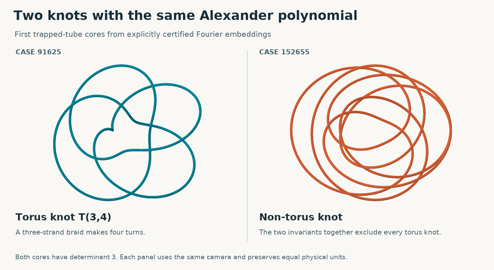

# Fourier braids in a solid torus

The search certified 219 embeddings of a solid torus into its interior. Their first-image core curves realize at least **165 different knot types, even after identifying mirror images**. The Alexander polynomial separates 164 types. A second invariant raises the count to 165 and proves that at least 135 of the types exclude every torus knot, including the unknot. The invariant sets are expanding solenoids. At a fixed winding degree all the examples have conjugate dynamics. The knot count measures the geometry of their first trapping tubes.

| Winding degree | Certified examples | Distinct core polynomials at this degree | Polynomials excluding all torus knots |
| ---: | ---: | ---: | ---: |
| 2 | 6 | 6 | 0 |
| 3 | 10 | 10 | 1 |
| 4 | 31 | 31 | 19 |
| 5 | 45 | 45 | 34 |
| 6 | 59 | 59 | 42 |
| 7 | 68 | 68 | 55 |

Some polynomials recur at different degrees. Cases 9699 and 91876 illustrate why the full polynomial matters. Both have degree three and a core determinant of five. Their normalized Alexander polynomials have coefficients **(1, −1, 1, −1, 1)** and **(1, −3, 1)** in ascending order. They therefore have different first core knots. Both maps have topological entropy log 3 per iterate.

## Map and trapping region

Write the state as an angle and a complex fiber coordinate in the closed unit disk. Each case specifies integer Fourier coefficients, a positive integer scale, contraction factor and fiber twist. Angles are in radians.

```math
\begin{aligned}
C(\theta)&=s^{-1}\sum_k (u_k+i v_k)e^{ik\theta},\\
f(\theta)&=p\theta+0.14\sin(p\theta)+0.137\pmod{2\pi},\\
F(\theta,z)&=\big(f(\theta),\,C(\theta)+\rho e^{i(m\theta+0.31)}z\big).
\end{aligned}
```

The figure uses the same solid-torus embedding for every case.

```math
(\theta,z)\longmapsto
\big((1.15+\operatorname{Re}z)\cos\theta,\,
     (1.15+\operatorname{Re}z)\sin\theta,\,
      \operatorname{Im}z\big).
```

The base map factors as multiplication by the integer winding degree followed by an orientation-preserving circle diffeomorphism. Distinct angles with the same image differ by multiples of $`2\pi/p`$. The certificates bound the maximum of $`|C|+\rho`$ by 0.956278 and the minimum gap between equal-angle branch disks by 0.048432 over the 219 cases. Thus every image disk is in the interior and any two disks above the same base angle are disjoint. Positive fiber radius gives injectivity within each disk. The map embeds the solid torus $`T`$ into its interior.

The compact intersection $`A=\bigcap_{n\geq 0}F^n(T)`$ attracts the trapping torus. The nested compact images eventually lie in every neighborhood of their intersection. Each inverse history of the base gives a nested sequence of fiber disks with radii tending to zero. Conversely each point of the intersection has a unique backward history by injectivity. This identifies the dynamics on the intersection with the natural extension of the degree-$`p`$ circle covering.

A lift of the base differs from multiplication by $`p`$ by a bounded periodic function, so $`H(t)=\lim_{n\to\infty}\tilde f^n(t)/p^n`$ converges uniformly and has degree one. It is strictly increasing because the lift expands every interval by at least $`0.86p>1`$ and $`H(t)-t`$ is bounded. This gives conjugacy with angle multiplication. Its natural extension has entropy $`\log p`$. These are properties of the invariant set. A finite plotted orbit samples it.

## Exact geometry check

The seeded search drew 160,000 parameter sets. The preliminary clearance filter retained 30,392 with resolved screening diagrams. Polynomial grouping retained the representative with the largest screened clearance for each observed pair of degree and polynomial. All 219 representatives passed the subsequent exact checks.

The checker encloses the first unit root of a uniform angular grid using Machin's formula and rational Taylor remainders. It propagates the root with scaled integers and an explicit rounding-error bound. A derivative bound from the Fourier coefficients controls the distance from each true strand to its rational polygonal interpolant. A small deterministic vertex displacement makes the crossing diagram generic. Its full size is included in the enclosure. At every longitude the straight homotopy to the polygons stays in the disk and maintains branch separation.

The crossing positions and heights of the resulting polygons are compared as rational numbers. The stored braid word describes the first-image core. The increasing longitude reparametrization in $`f`$ preserves its knot type in the standard torus. The Alexander coloring relations propagate across that word. Fraction-free polynomial elimination yields a normalized integral polynomial. A separate closed-diagram implementation labels arcs between undercrossings and checks integer minors at four arguments. All 876 evaluations agree up to Laurent units. The trefoil and figure-eight diagrams are explicit controls in the source. [Coloring matrices](https://arxiv.org/abs/1910.08044)

For a torus knot with coprime positive indices $`a,b`$, the polynomial has span $`(a-1)(b-1)`$. Enumerating the finitely many possible indices at each observed span and testing the exact torus-knot formula gives the exclusions. A matching polynomial leaves the knot type open. [Torus-knot formula](https://web.math.princeton.edu/`petero/GridHomologyBook.pdf)

## An ambient obstruction for 213 examples

A nonconstant core polynomial proves that the first-image solid torus has positive knot genus. This holds in 213 of the 219 examples. Write $`T_n=F^n(T)`$. Each successive solid torus winds $`p`$ times around its predecessor. The satellite genus inequality gives $`g(T_{n+1})\geq p\,g(T_n)`$, hence $`g(T_n)\geq p^{n-1}`$ for $`n\geq1`$ in these cases. The conclusion is independent of the fiber framing.

The nested smooth tori form a natural neighborhood basis. Each inclusion has nonzero winding and the intersection has first Čech cohomology $`\mathbb Z[1/p]`$. Equivalently one may use arbitrarily close polyhedral versions of the smooth tubes. The toroidal genus is therefore infinite. By the finite-genus theorem for attractors of global homeomorphisms of three-space, these 213 compact subsets cannot be realized as attractors of a homeomorphism of all of $`\mathbb R^3`$ in the given embeddings. They do attract for the explicit local solid-torus maps above. The obstruction does not identify the 213 compact sets as pairwise inequivalent. [Barge and Sánchez-Gabites, Theorems 13 and 23 and Lemma 14](https://arxiv.org/pdf/1806.11151)

## Two cores with the same Alexander polynomial

Case 91625 closes the three-strand word (2, 1) repeated four times. This is the torus knot T(3,4), up to mirror convention. Case 152655 has the same Alexander coefficients (1, −1, 0, 1, 0, −1, 1), determinant 3, and a different Jones invariant even after mirror identification. T(3,4) and its mirror are the only torus-knot possibilities compatible with that Alexander polynomial. Consequently Case 152655 is a non-torus first core.



The verifier closes each certified braid using Temperley–Lieb pairings and normalizes the Kauffman bracket by the writhe. It evaluates both mirror conventions in three prime fields. Unequal unordered residue tuples prove distinction. Matching tuples provide candidates for equivalence. For every word the verifier also checks the knot determinant at an eighth root of unity, cyclic permutation of the word and positive and negative Markov stabilization. The torus comparison enumerates the candidates allowed by the Alexander polynomial and evaluates their torus Jones formula. [Exact case evaluations](../../../results/shape_search_20261121/braids/jones.json) · [Kauffman's bracket construction](https://webhomes.maths.ed.ac.uk/~v1ranick/papers/kauffmanjones.pdf)

## Scope and reproduction

Knotted solenoids and Fourier descriptions of braids have published precedents. The contribution here is an explicit set of coefficients, trapping margins, certified first-core diagrams and matched portraits within one fixed coordinate convention. Historical priority for the individual embeddings remains unresolved. [Tame embeddings of solenoids](https://arxiv.org/abs/math/0611900) · [Fourier parametrizations of braids](https://research-information.bris.ac.uk/files/178391054/Constructing_polynomial_any_knot_or_link_ACCEPTED_vsn_typos_corrected.pdf)

From the repository root, substitute an external scratch directory for RUN. The search and sampling use NumPy and Numba. The exact polynomial and independent diagram steps use python-flint 0.8.0. The checks must run with Python assertions enabled.

```text
python research/shape_search_20261121/braids/search.py --count 160000 --out RUN/full
python research/shape_search_20261121/braids/refine.py RUN/full --out RUN/leaders.json
python research/shape_search_20261121/braids/certify.py RUN/leaders.json --out RUN/certificates.json
python research/shape_search_20261121/braids/alexander.py RUN/certificates.json --out RUN/core-knots.json
python research/shape_search_20261121/braids/check_diagrams.py RUN/certificates.json RUN/core-knots.json --out RUN/independent-diagrams.json
python research/shape_search_20261121/braids/jones.py RUN/certificates.json RUN/core-knots.json --out RUN/jones.json
python research/shape_search_20261121/braids/sample.py RUN/certificates.json --steps 60000 --out RUN/clouds
```

The public-size results contain the parameters, rational bounds, full crossing words and polynomials. Three initial states were sampled after 1,000 discarded steps per case. The cloud file uses the first start. [Certificates](../../../results/shape_search_20261121/braids/certificates.json) · [Polynomials](../../../results/shape_search_20261121/braids/core-knots.json) · [Closed-diagram checks](../../../results/shape_search_20261121/braids/independent-diagrams.json)
