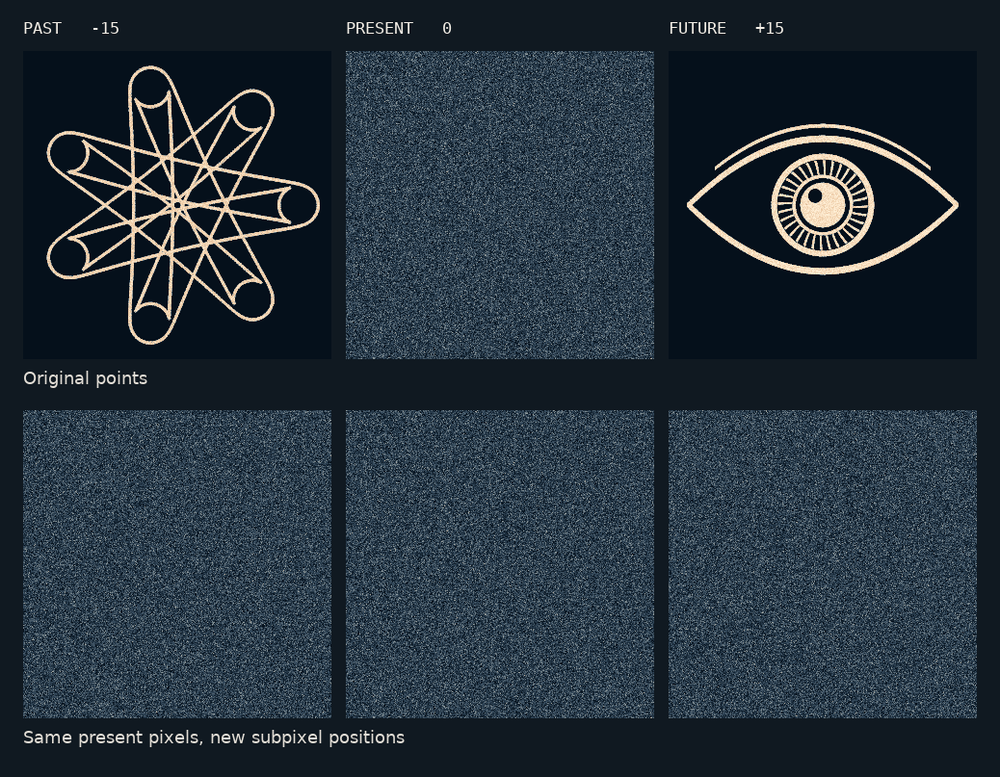
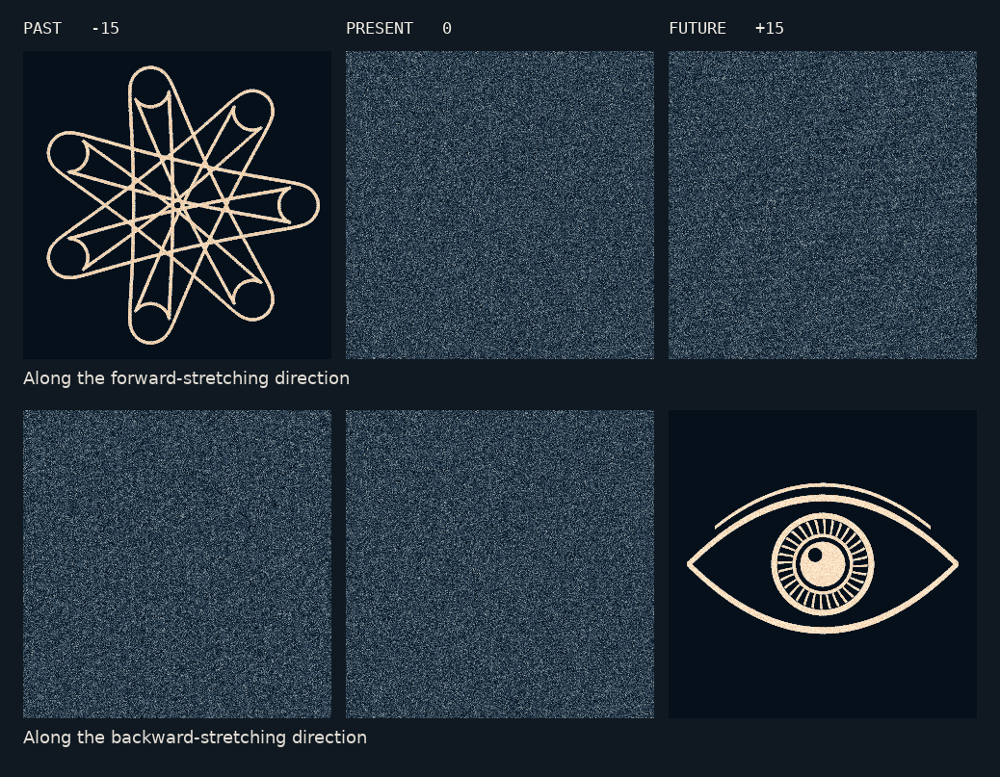

# One photograph, two histories

The two middle panels are identical, pixel for pixel. Run the top photograph’s particles fifteen steps backward and they draw a seven-lobed rosette. Run them fifteen steps forward and they draw an eye. The bottom photograph contains the same number of particles in every pixel. Its particles disperse in both directions.



[Erase one direction of time](#erase-one-direction-of-time)

## How to hide both pictures

The clock is Arnold’s cat map on an integer grid with $`p=2^{31}-1`$ sites per axis. One tick multiplies each position by the matrix below, reducing both coordinates modulo $`p`$. Its inverse runs the same clock backward exactly.

```math
A=\begin{pmatrix}2&1\\1&1\end{pmatrix},
\qquad A^{-1}=\begin{pmatrix}1&-1\\-1&2\end{pmatrix}.
```

We selected the two endpoint images in advance. The past mask follows the two fold curves of the [archived rosette](../rosette/README.md#where-the-fourteen-cusps-come-from). The eye is a drawing made from two lids, an iris and a pupil. Both masks use 1,280 × 1,280 cells.

Sample independent, uniform present positions. Keep a position only if it lands inside the rosette at step −15 **and** inside the eye at +15. Repeat until 262,144 particles pass. For the second row, independently redraw each particle’s two integer coordinates within its original pixel on the 320 × 320 grid. Use the same dynamics, camera and brightness scale for both rows.

| Fraction inside the mask | Past rosette | Future eye | Both |
|---|---:|---:|---:|
| Selected particles | 100% | 100% | 100% |
| Subpixel positions redrawn | 11.23% | 9.12% | 1.04% |
| Mask area, or product of areas in the last column | 11.12% | 9.16% | 1.02% |

All 102,400 present pixel counts match exactly. At that resolution the selected cloud’s Pearson chi-square per degree of freedom against uniform density was 0.9993. An independently sampled uniform cloud gave 1.0073. The particles carry the two endpoint conditions in where they sit **within** the visible pixels. Resampling there erased both pictures.

Schulman studied two endpoint conditions and perturbations in the cat map, measuring how the coarse-grained entropy changes over time. Here the endpoint conditions specify two recognizable drawings and the control preserves every visible count at the middle time. [Schulman, *Causality Is an Effect, II* (2021)](https://pmc.ncbi.nlm.nih.gov/articles/PMC8229640/)

## Erase one direction of time

Start from the selected particles again. In the top row, move every particle a random distance along the forward-stretching direction **inside its present pixel**. Fifteen steps backward still reveal the rosette. Fifteen steps forward give grain. Turn the direction of the tiny moves by 90 degrees and the eye survives instead. The two middle panels still match the original exposure in all 102,400 pixels.



| Subpixel displacement | Inside the past rosette | Inside the future eye |
|---|---:|---:|
| Along the forward-stretching direction | 99.95% | 9.34% |
| Along the backward-stretching direction | 11.32% | 99.97% |
| Area of each mask | 11.12% | 9.16% |

The two lattice directions are $`A^{10}(1,0)=(10946,6765)`$ and $`A^{-10}(0,1)=(-6765,10946)`$. They approximate the expanding directions of the map and its inverse. In each row, choose uniformly among all integer multiples of that row's vector that keep the particle in its pixel. Forward evolution magnifies a displacement along the first vector. Backward evolution magnifies a displacement along the second. This accounts for which drawing disappears. [Exact counts and vectors](directional-eraser.json)

## Reproduce

Run `python research/art_20261122/double_exposure.py` with NumPy, Pillow and Matplotlib. The script regenerates the six-panel plate, checks both forward/backward round trips for every point, and compares the two central histograms. [Source and mask definitions](../../../research/art_20261122/double_exposure.py) · [Counts, seeds and four grid resolutions](measurements.json)

Run `python research/art_20261122/directional_eraser.py` to regenerate the second plate from the same initial sample. The script checks each particle's present pixel before counting hits at the two endpoints. [Directional displacement code](../../../research/art_20261122/directional_eraser.py)
