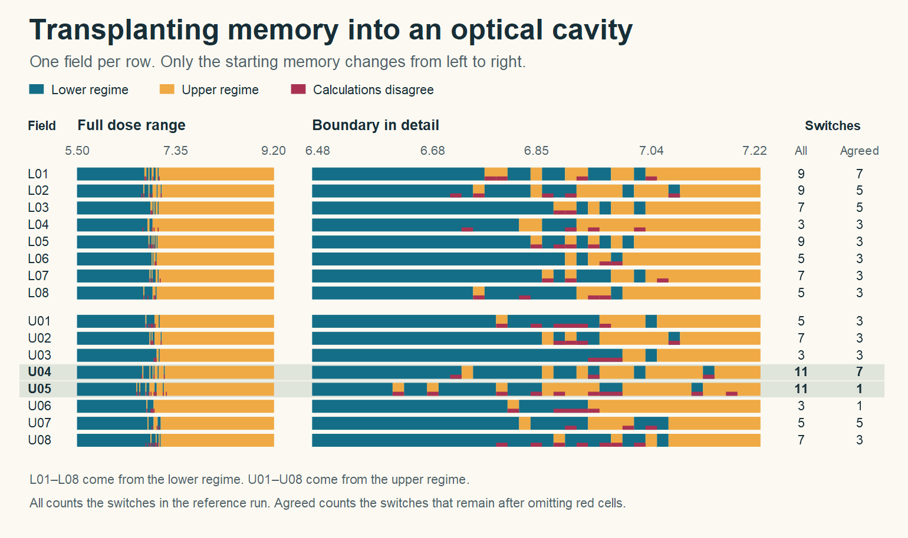

# Transplanting memory into an optical cavity

The same cavity can settle into two different detuning ranges. Take the instantaneous light field from one run and the cavity's slow memory from another. Across all 256 pairings of our 16 snapshots, the outcome followed the memory donor. Between the donors' memory values, two independent calculations found up to seven switches along a single row of agreed outcomes.



Follow a row from left to right. Each cell is a fresh run with a larger starting memory. Teal means the memory subsequently stayed low in both observation windows, amber means it stayed high. The right-hand panel enlarges the boundary. Red marks a disagreement between numerical implementations. The highlighted fields U04 and U05 each switch eleven times in the reference calculation. Read past the red cells and U04 still switches seven times. U05 switches only once.

## Experiment

The driven optical cavity map is

```math
u=\frac{|E|^2}{1+|E|^2},\qquad E^+=P+aE\exp[i(\delta+ku+T)],\qquad T^+=(1-h)T+hgu.
```

The squared magnitude of the complex field E is the light intensity. T is the slowly relaxing detuning. In Case 86780 the parameters (P, a, δ, k, g, h) are approximately (0.68380272, 0.47694415, 0.64927274, −17.94019890, 19.38252068, 0.00387439). The model follows the optical ring-cavity feedback studied by Ikeda. [Exact parameters](../../wow_search_20261122/orbit/case-86780.json) · [Model and earlier basin scan](../../wow_search_20261122/orbit/README.md) · [Ikeda (1979)](https://doi.org/10.1016/0030-4018(79)90090-7)

1. Start one trajectory in each observed regime. After 32,000 updates, take eight snapshots from each at 313-step intervals. L01–L08 are the lower-regime donors and U01–U08 are the upper-regime donors. [Starts, step numbers and snapshot coordinates](donors.json)
2. Form all 16 × 16 combinations of a snapshot's field and a snapshot's memory. For a second experiment keep each of the 16 fields and scan 193 evenly spaced starting memories from 5.5 through 9.2.
3. For every start, record the full memory range over updates 6,145–8,192 and again over 24,577–32,768. Assign the low or high regime only when both ranges lie wholly on the same side of 7.5. Repeat with an independent complex-exponential implementation of the field map. Both windows gave the same classification for every run within each implementation. [Outcomes for every run](outcomes.json)

The two implementations agree on all 256 donor pairings and 3,019 of 3,088 dose cells. Counting switches along the agreed cells gives three or more for 14 of the 16 fields. L01 and U04 each reach seven. The scan spacing is about 0.01927. A strip of one color can contain finer alternations, and the observation windows cannot establish infinite-time basin membership. The earlier, coarser scan already showed isolated reversals.

## Reproduce

From the repository root, run the following with Node.js 18 or later, ImageMagick 7 and Python with NumPy on the path. Set the environment variable `PYTHON` to use a specific interpreter.

```sh
node research/art_20261122/memory-transplant.mjs
```

Both calculations start from the stored binary64 donor coordinates. Node.js 18.16.0 supplied the reference labels, NumPy 2.5.5 supplied the replay. Divergence near the boundary can change individual cells across platforms. [Reference calculation and figure](../../../research/art_20261122/memory-transplant.mjs) · [Independent implementation](../../../research/art_20261122/memory_transplant_replay.py)
