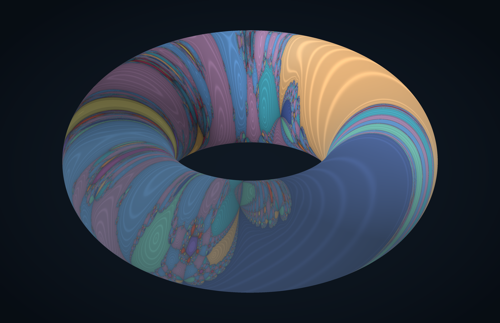
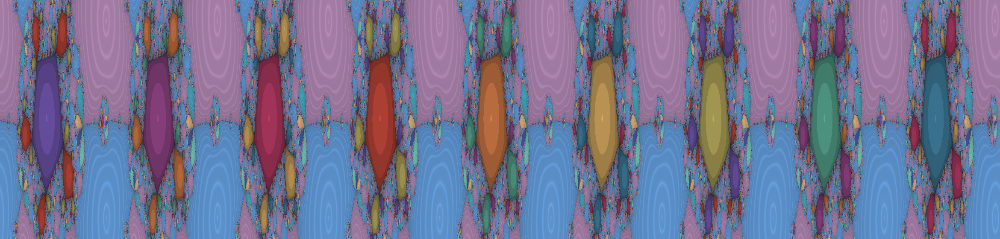

# Nine scales around a Newton torus

Six roots keep their colors as the microscope zooms in. Nine phases of an attracting cycle trade colors at each step and return to their starting colors after nine steps. Joining the ends of those nine logarithmic scales makes a torus. Its surface carries the Newton basins, and the fine contours follow their capture times.



<!-- drawing-date -->
*Drawn: **2026-11-22**.*
<!-- /drawing-date -->

Cut the surface open and follow one feature across the strip below. Each repeat moves one step around the nine-cycle. Every horizontal row gives exactly the same total length to each of the nine phase colors, even when individual colored intervals are too small to resolve.



## Five poles, five different roots

Take the same small displacement $`h`$ at each of the five poles. Its direction alone can send the five starts to **five different roots**, throughout two whole sectors. The root missed in the first sector is present in the second.

| Direction of $`h`$ from the positive real axis | Eventual root of poles 1, 2, 3, 4, 5 in order | Missing root |
| --- | --- | --- |
| 149° through 153° | 1, 2, 3, 5, 6 | 4 |
| 207° through 211° | 6, 1, 2, 4, 5 | 3 |

The sectors include both edges and every radius $`0\lt |h|\le1.79568\times10^{-14}`$. Poles are numbered counterclockwise from the principal pole. Root labels follow the archived certificate, with numbering starting at one. The two sector widths are certified lower bounds. [Sector certificate](sectors.json) · [Root coordinates and coefficient](../../wow_search_20261122/boundary/certificate.json)

## Equations and image coordinates

```math
p_a(z)=z^6-az+a,\qquad N(z)=\frac{5z^6-a}{6z^5-a},\qquad G=N^9.
```

Use $`a\simeq1.277961358032196+0.074550069827001i`$, the unique zero of $`N_a^9(0)`$ in the archived disk of radius $`10^{-142}`$. The colors label the six roots and the nine points of the cycle through zero under $`G`$. With $`q=5/6`$, set $`t=q^s e^{i\theta}/1000`$. The angular coordinate $`\theta`$ runs around a pole and increasing $`s`$ by one zooms in by $`6/5`$ in its linearizing coordinate. [Original map and proof](../../wow_search_20261122/boundary/README.md)

**Why the pattern closes.** Near $`t=0`$ the normalized Poincaré function $`\Psi`$ has $`\Psi(t)\sim1/t`$ and $`N(\Psi(qt))=\Psi(t)`$. At any pole $`\xi_j`$, choose the local solution $`z_j(t)`$ of $`N(z_j(t))=\Psi(t)`$. Its expansion is $`z_j(t)=\xi_j+A_jt+O(t^2)`$, with $`A_j=\xi_j(5\xi_j-6)/30`$. Decreasing $`t`$ to $`qt`$ adds one Newton step before reaching the same orbit. The root label stays fixed and phase $`k`$ becomes $`k-1\pmod9`$. The five poles therefore share one pattern in these coordinates, with different rotations and magnifications in the original plane. The identifications $`\theta\sim\theta+2\pi`$ and $`s\sim s+9`$ preserve every color. Every smaller positive integer shift moves all nine phase labels.

**Why each phase gets equal length.** Fix $`\theta`$ and cut any length-nine interval of $`s`$ into nine translates of a unit interval. Every point belonging to the cycle visits each phase label exactly once across the translates. Integrating its indicator proves equality on each angular slice, including slices where all nine lengths are zero. The equality uses logarithmic length in the exact coordinate.

**What the artist changed.** The torus uses the usual circular embedding with major radius 1.43 and tube radius 0.61. One turn around the large circle spans nine scales. A twist and an angular magnification bring the narrow phase bands onto the visible face. The flat strip keeps its angular coordinate uniform across 0.085 radians centered at $`-\pi-0.01`$. Hue comes from the basin label. Light, camera angle and capture-time contours set the shading. [Exact display coordinates and palette](render.json)

## Numerical checks and prior work

The five-pole test first screened directions and radii on one reference annulus. Each simple pole has a different residue $`A_j`$, so a common physical displacement samples five different angular positions. The search kept directions for which all five root labels were distinct throughout the sampled radii.

For each pole, write $`h=q^n|A_j|e^{i\phi}/R`$ with $`1000\le R\le1200`$. A binomial bound gives $`|N(\xi_j+h)-A_j/h|\lt 2`$. At $`|w|\ge989`$ the identity $`N(w)=qw+a(qw-1)/(6w^5-a)`$ bounds the nonlinear term by $`10^{-12}`$. The geometric sum puts $`N^{n+1}(\xi_j+h)`$ within $`10^{-8}`$ of $`R(A_j/|A_j|)e^{-i\phi}`$ for all $`n\ge120`$. The resulting bands cover every stated physical radius at each pole. Arb covers both angular sectors and the full reference annulus using **218,043 tiles**, each carried wholly into its root's capture disk. [Earlier single-pole estimate](../../attractor_followup_2/newton/README.md) · [Verification code](../../../research/art_20261122/newton/sectors.py)

The same exterior estimate bounds $`|\Psi(t)-1/t|`$ by $`6\times10^{-12}`$ for $`|1/t|\ge1000`$ by taking the limit of $`N^m(q^{-m}/t)`$. This allows direct interval checks at the full, unfolded scale. All 2,304 sampled labels agreed with the renderer. Direct iteration from the five displaced poles also certified 90 starts at the centers and edges of the two sectors, at radii $`10^{-14},10^{-15},10^{-16}`$. The torus classified 5,246,352 visible surface samples. In the flat strip each phase occupies 33,490 pixels, and the nine counts agree in each of its 560 rows by construction. [Independent checks](texture-check.json) · [Render counts](render.json)

Poincaré linearization and asymptotic similarity at eventually repelling points are classical. Hubbard, Schleicher and Sutherland used dynamical quotients of Newton channels to locate root basins. The five-root routing under a common Euclidean displacement and the sector widths above are specific to this coefficient. [Pakovich, *On algebraic dependencies between Poincaré functions*](https://arxiv.org/abs/2106.05770) · [Tan, *Similarity between the Mandelbrot set and Julia sets*](https://www.math.univ-angers.fr/~tanlei/papers/similarityMJ.pdf) · [Hubbard, Schleicher and Sutherland](https://www.math.stonybrook.edu/~scott/Papers/Newton-HSS.pdf)

From the repository root, use Python with python-flint 0.9.0, NumPy, Numba and Pillow.

```sh
python research/art_20261122/newton/sectors.py --workers 4 --verify
python research/art_20261122/newton/torus.py
python research/art_20261122/newton/check_texture.py
```
