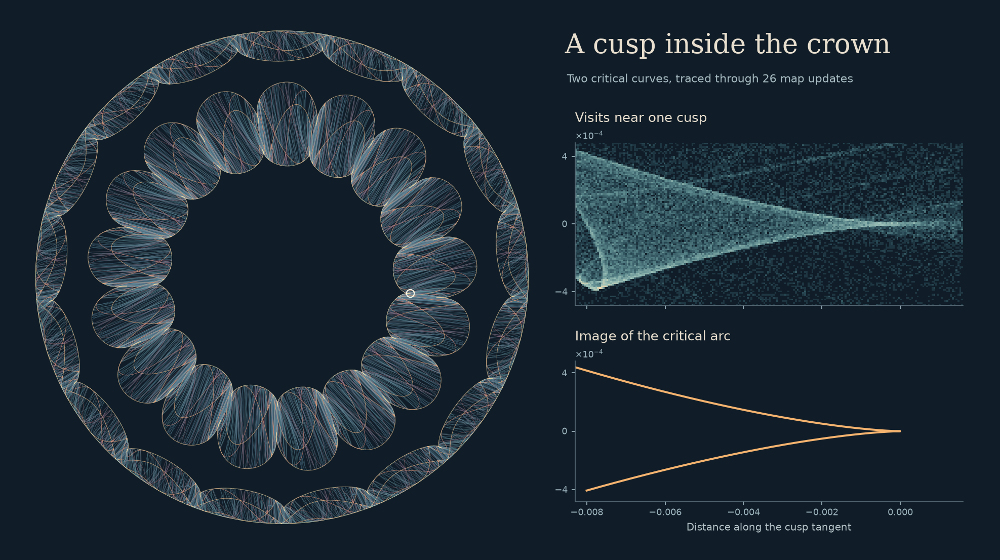

# Seventeen cusps inside a two-ring attractor

The critical curves of Case 13745 trace the outlines of its lobes and many of their interior filaments. Exactly **17 ordinary cusps** occur in the two trapping annuli, one per rotation sector. Each source lies in the interior of the attractor. At each tip, three nearby preimages on one side of the curve give way to one on the other. [Original orbit portrait](../../wow_search_20261122/symmetry/cyclic-13745.png)



The left panel traces 26 successive images of an inner critical loop and an outer critical arc with its rotations. Early images are gold, later images blue. The white circle locates the magnified tip. At upper right, 44,422 visits from the 17 sectors share a single coordinate frame. The lower panel shows the image of the outer critical arc on the same axes. Both panels stretch the normal direction to resolve the two sides.

## Where the cusp comes from

For the 17-fold rotationally equivariant polynomial icon map, write

```math
F(z)=(L+C|z|^2+\beta\mathrm{Re}(z^{17}))z+\gamma\bar z^{16}+E\bar z^{33}.
```

Here $`L=2.312147281840444+0.1358502756245434i`$, $`C=-2.979882064741105-0.3287479327991605i`$, $`\beta=0.00705638956278562`$, $`\gamma=1.2145798933692276`$ and $`E=-0.23178551886230708-0.11128116576001049i`$. The verifier reads the archived binary64 coefficients exactly. The trapping radii are $`[0.3535987,0.6263091]`$ and $`[0.6865459,0.784471]`$. [Coefficients and trapping certificate](../../wow_search_20261122/symmetry/annuli.json)

The source near $`(0.781400648401067,-0.003627058645665)`$ maps to $`(0.408131479918958,-0.050788081400498)`$. Let $`P=\mathrm{Re}F`$, $`J=\det DF`$ and $`H=P_xJ_y-P_yJ_x`$. An interval Newton test isolates a common zero of $`J,H`$ to a square of half-width $`10^{-15}`$, where $`P_x\lt -2`$ and $`\det D(J,H)\gt 95000`$. These are Whitney's ordinary cusp conditions. In suitable local coordinates the map is $`(u,v)\mapsto(u,v^3+uv)`$. Its critical image has a semicubical tip.

A complete sector check excludes any further common zeros of $`J`$ and $`F_xJ_y-F_yJ_x`$ in the two annuli outside the validated cusp neighborhood. At every other critical point the kernel crosses the critical curve transversely, giving a fold. Rotation supplies all 17 copies. The two interval evaluations use 306 and 344 boxes for the sector.

Twelve inverse covers trace a square of half-width $`10^{-8}`$ about the cusp source back 192 ordinary map updates to a rotated copy of a square already proved to lie in the attractor. Thus an entire neighborhood of the singularity belongs to it. The cusp normal form maps that neighborhood onto a neighborhood of the tip. [Source-square certificate](cusp-witness.json) · [Starting square](../../low_hanging_20261122/annuli/README.md)

## How bright is the fold?

We drew 2,048 starts uniformly in angle and in radius $`[0.36,0.62]`$, discarded 1,024 updates and kept 4,096 per start. In coordinates tangent and normal to the cusp at its tip, take tangent position from $`-0.0075`$ to $`-0.002`$. Count visits in matching strips of normal width $`0.00002`$ immediately inside and outside each branch. The curve comes from the polynomial alone.

| NumPy RNG seed | Inside, both branches | Outside, same area | Ratio |
|---:|---:|---:|---:|
| 13745 | 6,491 | 292 | 22.23 |
| 5109 | 6,318 | 299 | 21.13 |

These are finite ensemble counts. The certificate covers the number, type and location of the singularities.

## Replay and prior work

With Python 3.11, python-flint 0.9.0, NumPy, SciPy and Matplotlib, run from the repository root. [Cusp verifier](../../../research/art_20261122/rings/cusps.py) · [Curves, density and figure](../../../research/art_20261122/rings/figure.py)

```sh
python research/low_hanging_20261122/annuli/verify.py
python research/art_20261122/rings/cusps.py
python research/art_20261122/rings/figure.py
```

Field and Golubitsky drew symmetric polynomial icons from orbit density. Whitney classified folds and cusps of plane maps. Mira described how critical images organize absorbing areas of noninvertible maps. A search before this calculation found these mechanisms but no census or interior certificate for the cusps of this polynomial. [Field and Golubitsky](https://www.asc.ohio-state.edu/golubitsky.4/reprintweb-0.5/output/papers/symmetric_chaos.pdf) · [Whitney](https://doi.org/10.2307/1970070) · [Critical curves of noninvertible maps](https://doi.org/10.1016/S0960-0779(98)00291-4)
