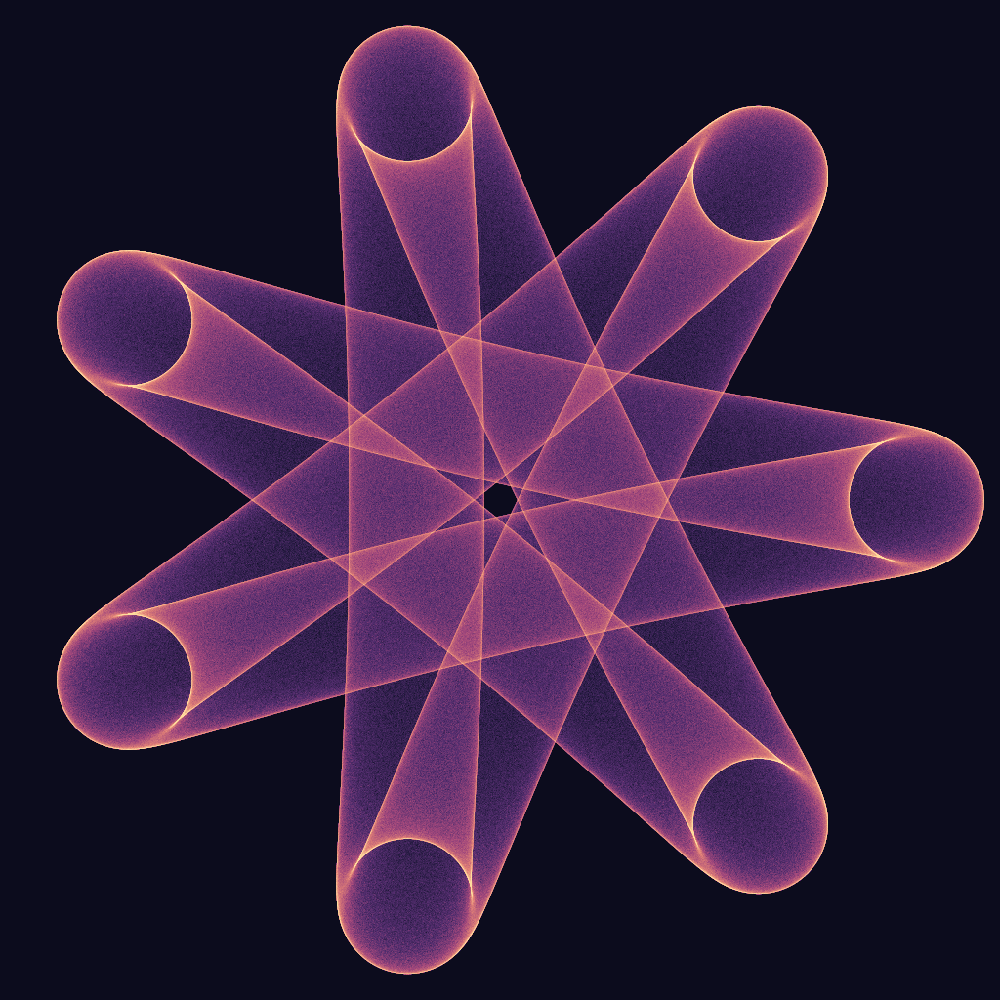
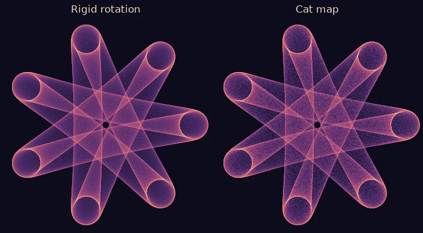
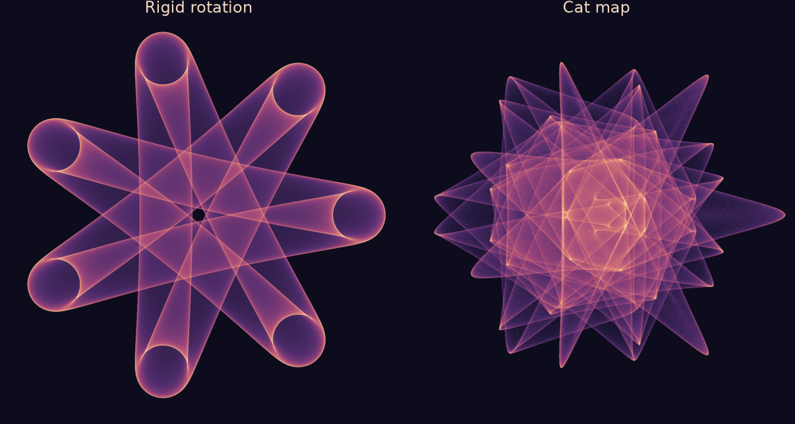

# One rosette, two incompatible motions

A rigid rotation and Arnold’s cat map produce exactly the same stationary distribution of light on this seven-lobed figure. Keep the order of just two successive points and the two motions become visible. The full-size exposure below accumulates one cat-map orbit. Brightness records visits to a pixel.



<!-- drawing-date -->
*Drawn: **2026-11-22**.*
<!-- /drawing-date -->

## Look between the samples

Move each recorded point the same fraction of the way towards its successor. The rotation keeps its rosette, while the cat map draws a second star through the center. Both panels use a fixed camera, the same timing and the same brightness scale. The straight segments interpolate successive observations of a discrete map.





## Two clocks on one torus

The angles $`u,v`$ are in radians modulo $`2\pi`$. Both maps feed the same complex observation $`Z`$:

```math
\begin{aligned}
R(u,v)&=(u+\alpha,v+\beta),&
(\alpha,\beta)&=\frac{2\pi}{100}(\sqrt2,\sqrt3),\\
A(u,v)&=(2u+v,u+v),&
Z(u,v)&=e^{3iu}+\tfrac23 e^{-4iu}+\tfrac{27}{100}e^{iv}.
\end{aligned}
```

Both maps preserve uniform area on the torus. Applying the same observation to that measure gives the same probability to **every** region of the picture. The rotation is uniquely ergodic because $`1,\sqrt2,\sqrt3`$ are rationally independent. The cat map is ergodic for area and has largest Lyapunov exponent $`\log((3+\sqrt5)/2)`$ per update. For the rotation the exponent is zero.

Time ordering gives an exact test. Define $`C_k=\mathbb E[Z_{t+k}\overline{Z_t}]`$ with respect to uniform area. The three Fourier frequencies of $`Z`$ lie on the coordinate axes. Any positive power of the cat matrix sends each of them off both axes. Orthogonality of the Fourier modes gives $`C_k=0`$ for every positive lag. For the rotation the same calculation gives

```math
C_k=e^{3ik\alpha}+\tfrac49e^{-4ik\alpha}+(27/100)^2e^{ik\beta}.
```

Consequently $`|C_k|/C_0\gt0.31`$ for **every** lag of the rotation. At one step the ratio is 0.96121. These are correlations of this particular observation. The picture and its lobes are a planar projection of two classical torus systems.

## Where the fourteen cusps come from

Hold $`u`$ fixed. Varying $`v`$ traces a circle of radius $`a=27/100`$ around $`B(u)=e^{3iu}+\tfrac23e^{-4iu}`$. The two envelopes of that moving circle are $`B\pm a\,iB'/|B'|`$. These are the folds visible as bright seams in the exposure. Shifting $`u`$ by $`2\pi/7`$ rotates the center curve by $`6\pi/7`$, which explains the sevenfold symmetry.

Put $`c=\cos(7u)`$. The signed curvature of the center curve is

```math
\kappa(c)=\frac{3(72c-13)}{(145-144c)^{3/2}}.
```

Its derivative has the sign of $`7632+5184c`$, positive throughout $`[-1,1]`$. The maximum is 177 and the minimum is $`-255/4913`$. An offset has a cusp at a simple crossing of $`a\kappa=\pm1`$. At the chosen radius, $`a\kappa=1`$ has one solution in $`(-1,1)`$ and the negative equation has none. Each of seven turns of the cosine crosses that value twice with nonzero derivative. These give fourteen ordinary cusps. Rational bisection and 144-bit interval arithmetic separate every pair of cusp images by more than 0.47 coordinate units. The first cusp pairs appear as the radius passes $`1/177`$.

## Reproduce

Across 16,777,216 consecutive steps per system the measured one-step correlation magnitudes, normalized by the stationary variance, were 0.00028 for the cat map and 0.96121 for the rotation. On a common 64-by-64 grid the two position histograms had total variation distance 0.00431.

Both numerical orbits start at $`(u_0,v_0)/(2\pi)=(15485863,32452843)/(2^{61}-1)`$. Each still uses $`2^{24}`$ consecutive states or pairs on a 1024-square grid spanning $`[-2,2]^2`$. The cat orbit uses exact modular integer updates. It is periodic on the rational grid and supplies a finite sampling check. The stationary-law proof uses continuous torus area. The animation uses the first $`2^{20}`$ successive pairs from each run. [Measurements and correlations](measurements.json) · [Code](../../../research/art_20261122/rosette/exposure.py)

Run `python research/art_20261122/rosette/exposure.py` with NumPy and python-flint 0.9.0 to recompute both orbits, the correlation comparison, the compact histograms and cusp separation. Add `--render --film` to rebuild the artwork with Matplotlib and Pillow.

Fourier correlation methods for cat maps and the curvature criterion for plane offsets are established results. Here they explain how two motions with the same projected measure draw this particular rosette and why recording successive points separates them. [Axenides, Floratos and Nicolis](https://arxiv.org/abs/2401.08521) · [Farouki and Neff](https://research.ibm.com/publications/analytic-properties-of-plane-offset-curves)
