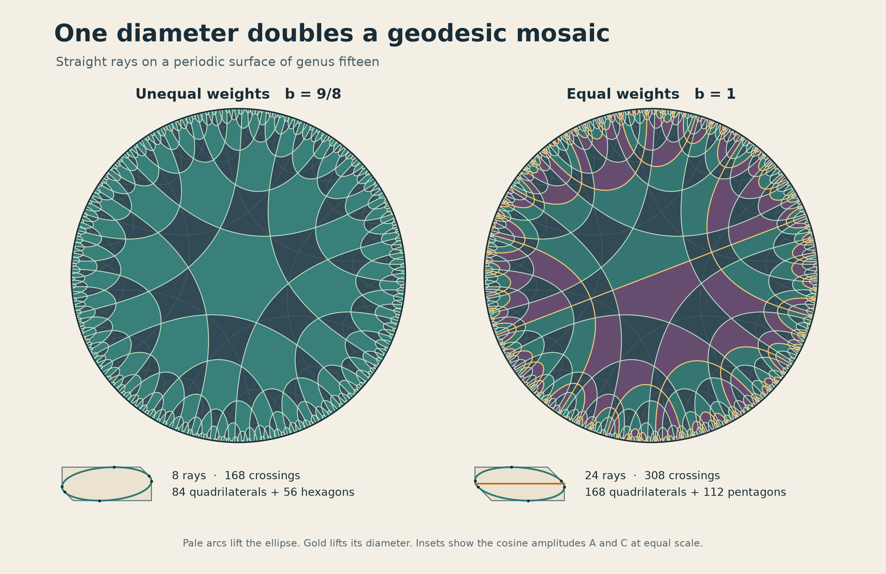

# One diameter doubles a geodesic mosaic

Eight straight geodesics cut a periodic surface of genus fifteen into **84 quadrilaterals and 56 hexagons**. When two wave amplitudes become equal, sixteen further geodesics appear. The surface then has **168 quadrilaterals and 112 pentagons**. Its genus stays fixed while the number of disk faces doubles, from 140 to 280.



Pale edges are the eight persistent geodesics. Gold edges appear at equal weights. Fine gray seams separate coordinate charts. Each disk shows a portion of the universal cover using regular right-angled hexagonal charts. This drawing preserves incidence and the straight-through continuation at crossings. The insets use the actual cosine amplitudes and a common scale. The finite-surface counts beneath the disks include all seven sheets.

## Folding the surface onto one ellipse

Take all three spatial coordinates modulo $`2\pi`$. Write $`w=x-y+7z`$ and

```math
A=\cos x,\qquad B=b\cos y,\qquad C=c\cos w,\qquad A+B+C=0,\quad c=3/8.
```

The analysis holds throughout $`\lvert b-1\rvert\lt c`$, with the exceptional case $`b=1`$. We compare that case with $`b=9/8`$. In the amplitude plane the three bounds $`\lvert A\rvert\le1`$, $`\lvert B\rvert\le b`$ and $`\lvert A+B\rvert\le c`$ cut out a hexagon. The signs of the three phase sines select eight copies of its interior on the base surface. Each copy has seven lifts. [Surface and straight-ray classification](../../low_hanging_20261122/geodesics/README.md)

Choose $`U,V`$ with $`1+be^{iU}+ce^{iV}=0`$ and $`\sin U\gt 0`$. The eight persistent rays are $`y=s(x+\epsilon U)`$, $`w=t(x+\epsilon V)`$, indexed by three independent signs. Eliminating $`x`$ from $`A=\cos x`$ and $`B=b\cos(x+\epsilon U)`$ gives the same ellipse for all eight.

```math
p=(c^2-1-b^2)/2,\qquad h^2=b^2-p^2\gt 0,\qquad
b^2A^2-2pAB+B^2=h^2 .
```

The amplitudes of $`A,B,C`$ along it are $`1,b,c`$, so it touches all six sides. The strict triangle inequalities make the six tangencies distinct. In the interior of each arc, the eight sign choices give precisely the eight preimages on the base surface. At a tangency, two rays cross transversely as the corresponding phase passes through zero or $`\pi`$.

## Counting the faces and intersections

Inside each of the 56 charts, the ellipse bounds a disk with six marked tangencies. Outside it lie six corner patches. Four patches around each physical corner glue into a quadrilateral disk. This gives 56 hexagons and $`56\cdot6/4=84`$ quadrilaterals. The six tangencies each have four sign lifts and seven sheet lifts, giving 168 crossings.

At $`b=1`$ the additional rays satisfy $`w=\pi/2`$ or $`3\pi/2`$ and $`y=\pm x+\pi`$. All project onto the segment $`C=0`$. It crosses the ellipse at $`A=\pm\sqrt{247}/16`$ and ends at the opposite hexagon corners $`A=\pm1`$. It splits every old hexagon into two pentagons. Of the old quadrilaterals, $`56\cdot2/4=28`$ contain one of these endpoint corners. Four lines of approach meet there and cut each such face into four quadrilaterals. The other 56 survive. The resulting graph has 308 transverse double points, 616 edges and 280 faces, with Euler characteristic $`308-616+280=-28`$.

The persistent rays have the **cube graph** as their intersection graph. Crossing the folds in $`y,w,x`$ changes the sign labels $`(s,t,\epsilon)`$ by flipping the first, the second, or all three signs, respectively. These independent involutions give the cube. Each adjacent pair meets twice on the base and fourteen times on the cover. The full pair census at equal weights follows.

| Intersecting ray families | Pairs | Crossings per pair |
|---|---:|---:|
| Two persistent rays | 12 | 14 |
| Short additional ray and persistent ray | 56 | 1 |
| Long additional ray and persistent ray | 8 | 7 |
| Short and long additional rays | 14 | 2 |

The fourteen short additional laps have length $`2\pi\sqrt2`$ and the two long ones have length $`2\pi\sqrt{102}`$. The integer verifier glues all 56 signed sheets, traces each ray through its crossing and counts pair intersections and face boundaries independently of drawing coordinates. A second calculation recovers the native phase triples by signed inverse cosines, lifts each point to all seven heights and tests all ray equations there. Both methods reproduce every pair multiplicity in the table. [Full cell and pair counts](cellulation.json)

## Prior work and replay

Kuznetsov studied chaotic geodesic flow in the three-rotator model. Gandy and coauthors studied nodal approximations to classical periodic minimal surfaces. Schoen described straight lines on periodic minimal surfaces. The earlier repository result counts the straight rays. Here we determine their arrangement on the weighted sevenfold cover. The disk drawing uses a regular hyperbolic reflection tiling with plotting radius $`\tanh(d/3)`$ at hyperbolic distance $`d`$ from the center. [Kuznetsov](https://arxiv.org/abs/1708.04493) · [Gandy et al.](https://doi.org/10.1016/S0009-2614%2800%2901418-4) · [Schoen](https://doi.org/10.1098/rsfs.2012.0023) · [Coxeter on hyperbolic tessellations](https://www.cambridge.org/core/journals/canadian-mathematical-bulletin/article/trigonometry-of-hyperbolic-tessellations/D0219653B540B3A893C4E3D2FDA5CD84)

From the repository root, run the integer verifier with Python and the renderer with NumPy and Matplotlib.

```sh
python research/art_20261122/weave/verify.py --out results/art_20261122/weave/cellulation.json
python research/art_20261122/weave/draw.py --out results/art_20261122/weave/geodesic-weave.png
```
