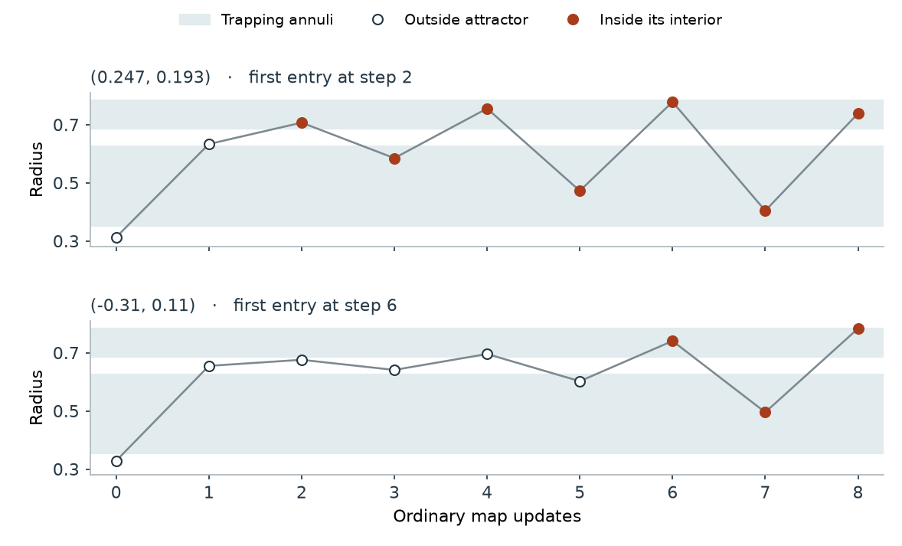

# The plotted orbit enters the two-ring attractor on step two

The portrait of Case 13745 starts at $`(0.247,0.193)`$. Its first update lands in the gap between the rings. Its second lands inside an open square contained in the attractor. The exact orbit stays in its interior forever and never visits any point twice. The six other archived starts also enter in at most six updates. All seven orbits are pairwise disjoint. [Original portrait](../../wow_search_20261122/symmetry/cyclic-13745.png) · [Earlier proof of an open set in each ring](../../low_hanging_20261122/annuli/README.md)



| Initial coordinates | First step in a trapping annulus | First step in the attractor |
|---|---:|---:|
| (0.247, 0.193) | 2 | **2** |
| (−0.31, 0.11) | 4 | **6** |
| (0.433, −0.173) | 0 | **0** |
| (0.64, 0.07) | 1 | **1** |
| (−0.216, 0.36) | 0 | **0** |
| (−0.72, −0.08) | 0 | **2** |
| (0.93, 0.04) | 1 | **1** |

Each attractor entry time also holds throughout the closed square of half-width $`10^{-12}`$ around that start. Orbit arithmetic below uses the original binary64 inputs as exact rational numbers and evaluates the map without rounding. Whether the portrait seed is dense in either component or has a positive Lyapunov exponent remains open.

## The map and the capture test

The 17-fold rotationally equivariant polynomial icon map is

```math
F(z)=(L+C|z|^2+\beta\mathrm{Re}(z^{17}))z
      +\gamma\bar z^{16}+E\bar z^{33}.
```

| Coefficient | Value |
|---|---|
| $`L`$ | $`2.312147281840444 + 0.1358502756245434\,i`$ |
| $`C`$ | $`-2.979882064741105 - 0.3287479327991605\,i`$ |
| $`\beta,\ \gamma`$ | $`0.00705638956278562,\quad 1.2145798933692276`$ |
| $`E`$ | $`-0.23178551886230708 - 0.11128116576001049\,i`$ |

The trapping annuli have radial ranges $`[0.3535987,0.6263091]`$ and $`[0.6865459,0.784471]`$. Writing $`T`$ for their union, the local attracting set is $`K=\bigcap_{j\ge0}F^j(T)`$. The earlier proof placed a square $`B_0`$ of half-width $`10^{-7}`$ inside $`K`$. Rotation by $`2\pi/17`$ commutes with $`F`$ and preserves $`T`$, so every rotated copy of $`B_0`$ also lies in $`K`$. [Exact coefficients and trapping certificate](../../wow_search_20261122/symmetry/annuli.json)

For each launch, we searched backwards from its candidate entry state along numerical inverse branches, steering toward the known period-306 orbit. On reaching a rotated copy of $`B_0`$, we enclosed the path by squares. A parametric Krawczyk test proves that **every** point in each target square has a preimage in the next square on the backwards path. The seven chains span 168–205 ordinary updates. Their 86 covers certify a square of half-width $`10^{-10}`$ around each entry state inside $`K`$. The largest inclusion ratio was below 0.946 across the two independent polynomial evaluations. [Witness squares](capture.json) · [Interval verifier](../../../research/attractor_followup_2/annuli/capture.py)

To check first entry, it suffices to exclude the preceding state, since $`F(K)=K`$. For starts 2 and 6 that state already lies in a trapping annulus. We cover its possible preimages in the alternate annulus by subdivision and interval Newton enclosures. For start 2 all possible histories disappear after three backwards updates, and for start 6 after five. Each point of $`K`$ must have a history of every length. The exclusions and capture checks both enclose the full launch neighborhood.

## Why the exact orbit never repeats

Every iterate of a dyadic start is a Gaussian rational. Let $`v(z)=v_2(z\bar z)`$ be its order at the Gaussian prime $`1+i`$. Conjugation preserves $`v`$, multiplication adds orders, and a unique lowest-order term determines the order of a sum. Every nonzero dyadic point in the open unit disk has $`v\le-1`$. Indeed, after writing both coordinates over their least common denominator $`2^D`$, $`D\ge1`$ and the numerator's Gaussian order is either 0 or 1.

In the expanded map, the coefficient orders in degrees $`1,3,18,18,16,33`$ are $`-110,-62,-112,-112,-102,-110`$. For $`v\le-1`$ the term $`E\bar z^{33}`$ has strictly lowest order. Thus

```math
v(F(z))=33v(z)-110\lt v(z).
```

The order drops forever, so a point can never reappear. For the portrait seed the exact common denominator at time $`t`$ is $`2^{D_t}`$ with $`D_t=(1783\cdot33^t-55)/32`$. It goes from $`2^{54}`$ to $`2^{1837}`$ to $`2^{60676}`$ while the real orbit moves into the rings.

The same comparison in the two Wirtinger derivatives leaves $`33E\bar z^{32}`$ as the unique lowest-order term, in $`F_{\bar z}`$. Thus $`F_z\overline{F_z}`$ and $`F_{\bar z}\overline{F_{\bar z}}`$ have different orders whenever both are nonzero. Their difference, the real Jacobian determinant, never vanishes on any of these orbits. After interior entry the inverse function theorem therefore keeps every subsequent state in the interior of $`K`$. This also gives a dense set of nonrepeating regular points in the interior, since dyadic pairs are dense there.

Different update times give disjoint order ranges across all seven starts. At the same update, different initial orders separate all pairs except (1, 4) and (2, 6). For these two pairs, reduce the real and imaginary coordinates modulo 5. Following their joint residues gives cycles without a collision after examining just 7 and 11 distinct pairs. [Exact integer verifier](../../../research/attractor_followup_2/annuli/arithmetic.py)

## Reproduce

From the repository root, with Python 3.11 and `python-flint==0.9.0` for the interval checks:

```sh
python research/wow_search_20261122/symmetry/certify.py --verify --case 13745
python research/low_hanging_20261122/annuli/verify.py
python research/attractor_followup_2/annuli/capture.py
python research/attractor_followup_2/annuli/arithmetic.py
```

The capture verifier uses the factored map at 192 bits and an independently differentiated monomial expansion at 256 bits. The arithmetic verifier needs only the Python standard library. [Figure source](../../../research/attractor_followup_2/annuli/figure.py)

## Prior work

Field and Golubitsky discuss rotating polynomial icons and the difficulty of inferring properties of an attractor from one observed trajectory. Krawczyk introduced the validated Newton method used here. Non-Archimedean orbit growth is an established tool in arithmetic dynamics, including results for regular polynomial automorphisms by Kawaguchi. Our 2026-11-22 search found no published capture times or arithmetic orbit certificates for these precise icon coefficients. [Field and Golubitsky](https://www.asc.ohio-state.edu/golubitsky.4/reprintweb-0.5/output/papers/notices1995.pdf) · [Krawczyk](https://doi.org/10.1007/BF02234767) · [Kawaguchi](https://msp.org/ant/2013/7-5/ant-v7-n5-p08-p.pdf)
