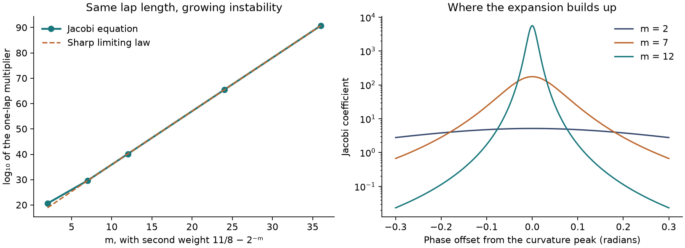

# A straight geodesic of fixed length and unbounded instability

The surface has seven sheets and fifteen handles. Keep the winding of a straight ray at (7, 7, 1) and change one wave amplitude. Its primitive lap always measures $`2\pi\sqrt{99}`$, about 62.517. Yet its unstable transverse multiplier can exceed **any prescribed number**. For one explicit regular surface it lies between $`10^{90.69}`$ and $`10^{90.80}`$. This measures linearized growth over a lap; finite separations eventually leave that regime. [Surface and straight-ray classification](../../low_hanging_20261122/geodesics/README.md)



## The normal keeps turning

Work in the flat three-torus with all three coordinates modulo $`2\pi`$. Set $`n=7`$, $`c=3/8`$, $`w=x-y+nz`$, and impose

```math
\cos x+b\cos y+c\cos w=0,\qquad 1-c\lt b\lt1+c .
```

Choose $`y=x+u`$ and $`w=x+v`$. The phases solve $`1+b e^{iu}+c e^{iv}=0`$, the closing condition for a triangle. Take the solution with $`h=b\sin u\gt0`$. These rays all have the same direction and length. Varying $`b`$ changes their offset and the way the surface normal turns around them.

Put $`p=(c^2-1-b^2)/2`$ and $`r=-1-p`$, so $`b e^{iu}=p+ih`$ and $`c e^{iv}=r-ih`$. Up to sign the unnormalized surface normal is the ellipse $`U\sin x+V\cos x`$, with

```math
U=(1+r,p-r,nr),\quad V=h(-1,2,-n),\quad
|U\times V|=h\sqrt{2n^2+1}.
```

The ellipse lies in a fixed plane perpendicular to the straight ray. Let $`k`$ be its major-to-minor semiaxis ratio. The product of its semiaxes is $`|U\times V|`$ and the sum of their squares is $`|U|^2+|V|^2`$. After a shift of the phase origin, the unit normal turns at the following angular speed with respect to $`x`$:

```math
|\theta'(x)|=\frac{k}{1+(k^2-1)\sin^2 x},\qquad
k+k^{-1}=\frac{|U|^2+|V|^2}{|U\times V|}.
```

The surface shape operator in a tangent frame aligned with the straight ray has first diagonal entry zero. Its off-diagonal entry has magnitude equal to the angular speed of the normal per unit arclength. Its determinant, the Gaussian curvature, is the negative square of that speed. Reparametrizing the scalar Jacobi equation by $`x`$ therefore gives $`J''=\theta'^2 J`$. The normal makes seven full turns per primitive lap. As the amplitude approaches $`1+c`$, each turn concentrates in two narrow curvature peaks.

## A sharp limiting law

Write $`\mu`$ for the larger transverse multiplier per primitive lap. As $`\delta=11/8-b`$ decreases to zero,

```math
k\sim\frac{379}{132\sqrt6}\,\delta^{-1/2},\qquad
\mu\sim(\pi^2 k)^{14}.
```

Thus halving the distance to the critical weight eventually multiplies one-lap amplification by about **128**. All surfaces in this limit sequence are regular. The endpoint itself is singular.

**Ellipse.** The phase height satisfies $`4h^2=(1+b+c)(1+b-c)(1+c-b)(b+c-1)`$. At the endpoint $`h^2/\delta\to 33/32`$, $`|U|^2\to379/32`$ and $`V\to0`$. The semiaxis formula gives the first limit.

**Curvature peak.** Let $`C,S`$ be the Jacobi solutions with initial data $`(1,0)`$ and $`(0,1)`$. In the stretched coordinate $`t=kx`$, both $`C(t/k)`$ and $`kS(t/k)`$ solve $`Y''=V_kY`$, where $`V_k=[1+(k^2-1)\sin^2(t/k)]^{-2}`$. On bounded intervals the two solutions converge to those of $`Y''=(1+t^2)^{-2}Y`$ with the same initial data:

```math
Y_C=\sqrt{1+t^2},\qquad Y_S=\sqrt{1+t^2}\arctan t .
```

Here is the control on the growing interval $`[0,T_k]`$, where $`T_k=k\pi/2`$. For $`k\ge2`$, the chord bound for sine gives $`V_k(t)\le(1+3t^2/\pi^2)^{-2}`$. Divide the twice-integrated Jacobi equation by $`1+t`$ and apply Grönwall with the integrable kernel $`(1+t)V_k(t)`$. Both solutions satisfy $`|Y(t)|\le M(1+t)`$ with a common constant independent of $`k`$. Dominated convergence now applies to the integral formulas for $`Y'_C(T_k)`$ and $`Y_S(T_k)/T_k`$ (the latter has the additional factor $`1-t/T_k`$). Their limits are the limiting slopes of the explicit solutions, respectively 1 and $`\pi/2`$. Returning to the original coordinate gives $`C'(\pi/2)/k\to1`$ and $`S(\pi/2)\to\pi^2/4`$.

**Full lap.** The coefficient is symmetric about $`\pi/2`$. Reflecting the quarter-period transfer matrix and using its unit determinant gives the half-period trace $`2+4S(\pi/2)C'(\pi/2)`$. Its larger eigenvalue is asymptotic to the trace, hence to $`\pi^2k`$. The primitive lap contains fourteen half periods.

## Numerical checks and prior work

For $`b=11/8-2^{-m}`$, each interval below encloses $`\log_{10}\mu`$. The verifier bounds the monotone coefficient between its endpoint values on 16,384 graded cells of a quarter period. Positive Jacobi data permit componentwise comparison to the exact constant-coefficient transfer on each cell. The second calculation uses the implicit surface’s curvature and integrates a full half period with DOP853. [Bounds and measurements](bounds.json) · [Verifier and figure](../../../research/attractor_followup_2/geodesics/verify.py)

| $`m`$ | Rigorous interval | Independent integration |
| ---: | ---: | ---: |
| 2 | (20.59, 20.62) | 20.6084 |
| 7 | (29.65, 29.69) | 29.6696 |
| 12 | (40.14, 40.18) | 40.1625 |
| 24 | (65.43, 65.49) | 65.4588 |
| 36 | (90.69, 90.80) | 90.7456 |

Kuznetsov studied chaotic geodesic dynamics on a three-cosine surface. Curvature estimates via Jacobi fields and growth from narrow pulses in Hill equations are classical. Searches under those descriptions, straight geodesics on periodic nodal surfaces, and concentrated curvature did not locate this fixed-winding multiplier law for the weighted sheared cover. [Kuznetsov](https://arxiv.org/abs/1708.04493) · [Osserman and Sarnak](https://www.cambridge.org/core/journals/ergodic-theory-and-dynamical-systems/article/entropy-estimates-for-geodesic-flows/2271EDA25C2A5B7EFA0E921C8F2073AA) · [Adams and Bloch on concentrated forcing](https://arxiv.org/abs/0906.1954)

Run `python research/attractor_followup_2/geodesics/verify.py` from the repository root with python-flint 0.9.0, NumPy and SciPy. Add `--figure instability.png` to draw the diagnostic with Matplotlib.
