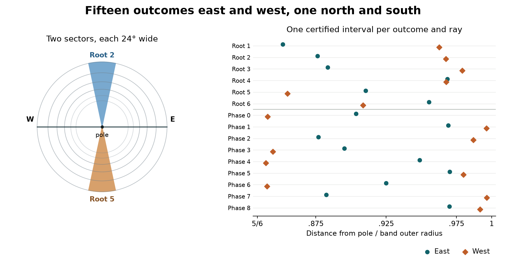

# Fifteen outcomes on a horizontal line through a Newton pole

Move a starting point towards a pole along either horizontal ray. Every time the distance shrinks by another factor of $`6/5`$ across one of the bands below, the ray passes through all fifteen basins. Turn north and an entire 24° sector leads to one root. Turn south and another 24° sector leads to a different root. Both statements hold down to arbitrarily small distances.



The circles mark successive bands. The dots and diamonds locate the midpoints of thirty certified intervals for band $`n=125`$, where the phase labels match those in the reference shell. The two colors on each row distinguish east and west.

## The system

```math
p_a(z)=z^6-az+a,\qquad N(z)=\frac{5z^6-a}{6z^5-a},\qquad G=N^9.
```

Use $`a\simeq1.277961358032196+0.074550069827001i`$, the unique solution of $`N_a^9(0)=0`$ in the archived parameter disk of radius $`10^{-142}`$. Under $`G`$, six roots and the nine phases of the cycle through zero are attracting fixed points. Center all rays on the principal pole $`\xi=(a/6)^{1/5}\simeq0.734161053096716+0.008556170353017i`$. The rounded numbers here identify the example. Use the dyadic center in the certificate for computation. [Original construction and capture disks](../../wow_search_20261122/boundary/README.md)

Write $`q=5/6`$, $`A=\xi(5\xi-6)/30`$, and $`r_n=|A|q^n/1000`$. For every integer $`n\ge120`$ the band is $`r_{n+1}\le |z-\xi|\le r_n`$. The outermost radius is approximately $`1.79568\times10^{-14}`$.

| Direction of $`z-\xi`$ | Certified outcome throughout these scales |
| --- | --- |
| East and west | Each ray meets an open interval of every basin in every band. This also holds for each ray within $`5\times10^{-10}`$ radians of either axis direction. |
| North, within 12° | Every start converges to root 2, near $`0.155655+1.088038i`$. |
| South, within 12° | Every start converges to root 5, near $`0.178242-1.082059i`$. |

Each basin also occupies at least $`6.9\times10^{-10}`$ of the length of **any** horizontal segment that begins at the pole and ends within $`r_{120}`$, east or west. This is a lower bound from witnesses chosen for certification. The north and south sectors each fill one fifteenth of every disk centered on the pole with radius at most $`r_{120}`$.

## How the proof reaches infinitely many scales

Parameterize a band by $`z=\xi+q^n|A|e^{i\theta}/R`$, where $`1000\le R\le1200`$. A single reference shell suffices for all bands. Set $`W=R(A/|A|)e^{-i\theta}`$.

1. At the simple pole, $`N(\xi+h)=A/h+E(h)`$. Expanding the two polynomials at $`\xi`$ and bounding the binomial tails gives $`|E(h)|\lt 1`$ for $`0\lt |h|\le10^{-3}`$. The first iterate therefore differs from $`q^{-n}W`$ by less than one.
2. At large modulus, $`N(w)=qw+a(qw-1)/(6w^5-a)`$. The second term has modulus below $`10^{-12}`$ for $`|w|\ge989`$. Over the next $`j\le n`$ steps, the deviation from $`q^{j-n}W`$ is at most $`10q^j+6\times10^{-12}`$ by induction. Every reference point has modulus at least 1000, so every input remains in the range of the estimate. In particular $`|N^{n+1}(z)-W|\lt 10^{-8}`$ for all $`n\ge120`$.
3. For each horizontal ray, 15 reference disks of radius $`10^{-6}`$ enter certified capture disks. A disk includes all starts with $`R`$ within $`10^{-7}`$ of its listed center and angle within $`5\times10^{-10}`$ radians, after allowing for the landing error. Along each vertical sector an adaptive cover of the entire shell gives 32,194 certified tiles in the north and 35,976 in the south. The cover includes the edges of both sectors. Ball arithmetic propagates a disk by bounding $`|N'|`$ on its enclosing square. [Interval certificate](certificate.json)
4. Carrying an outcome back $`n+1`$ steps fixes the root labels and subtracts $`n+1`$ modulo nine from a cycle phase. Thus all nine phases occur at each scale. The interval around each $`R`$ occupies at least $`12000\times10^{-7}/1200^2`$ of the length of its band, by the substitution $`r=|A|q^n/R`$. Complete bands fill at least a fraction $`5/6`$ of any segment from the pole of the stated length. Multiplying the fractions gives the density bound.

The witness search screened rays and radii numerically for the six roots and the nine phases. Both horizontal axes passed. Both vertical axes appeared monochromatic, prompting a check of every radius and angle in two sectors. Direct rational iteration in the original plane also reproduced the 30 witness labels at $`n=120,121,250`$.

## Related work and replay

Tan studied asymptotic similarity near eventually repelling Julia points. Hubbard, Schleicher and Sutherland used channels at infinity to construct starting sets that reach all polynomial roots. Campbell and Collins constructed attracting cycles of prescribed periods in this Newton family. The case-specific result here is the contrasting basin count along fixed perpendicular directions, with explicit radii, sector angles and a positive lower density for each horizontal outcome. [Tan](https://math.univ-angers.fr/~tanlei/papers/similarityMJ.pdf) · [Hubbard, Schleicher and Sutherland](https://www.math.stonybrook.edu/~scott/Papers/Newton-HSS.pdf) · [Campbell and Collins](https://arxiv.org/abs/1208.5687)

Run from the repository root. The directional proof uses Python and python-flint 0.9.0. The original certificate also imports NumPy, SciPy and Numba, and the plot uses NumPy and Matplotlib. The first command verifies the input parameter and capture disks, the second verifies the directional certificate, and the last regenerates the figure.

```sh
python research/wow_search_20261122/boundary/certificate.py --verify results/wow_search_20261122/boundary/certificate.json
python research/attractor_followup_2/newton/radial.py --workers 4 --verify
python research/attractor_followup_2/newton/figure.py
```
