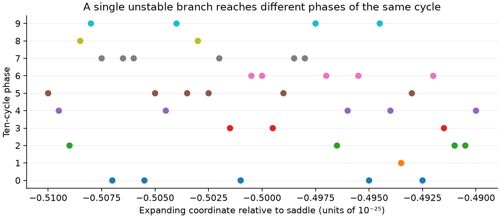

# Ten phases meet at one optical saddle

The optical cavity in Case 56729 has an attracting ten-cycle. Watch once every ten round trips and the field settles at one of ten distinct points. On a single outgoing branch of a saddle, 41 launches less than $`10^{-25}`$ from the saddle reach **all ten phases**. At least **36 distinct orbits** between them never settle onto that cycle. Their eventual destinations are open.



Each dot encloses a point on the true unstable curve. The horizontal coordinate is measured along its expanding frame vector. Phase 0 is the cycle point near $`(0.956799,-0.537008,-12.945671)`$. [Exact grid and capture steps](phase-slices.json)

## Model and parameters

The relaxing Ikeda-type cavity map $`F`$ updates the complex field $`E`$ and detuning $`T`$ each round trip. With $`s=|E|^2/(1+|E|^2)`$,

```math
E'=P+aE\exp(i(d+ks+T)),\qquad T'=(1-h)T+hgs.
```

The archived binary64 settings in the order $`(P,a,d,k,g,h)`$ are $`(2.070873498916626,\ 0.927621066570282,\ 2.818382501602173,\ 3.300971508026123,\ -17.03116226196289,\ 0.010126902721822262)`$. The saddle point $`p`$ lies near $`(0.31330529,0.54460938,-9.2223509)`$ and has period two. [Original parameters](../../wow_search_20261122/orbit/case-56729.json) · [Cycle and saddle certificates](../../low_hanging_20261122/optics/README.md)

## Why the gaps contain other orbits

1. **Enclose the unstable curve.** Use coordinates $`(u,v,w)`$ centered on $`p`$, with physical scales $`10^{-25},10^{-44},10^{-44}`$. On the unit cube the interval derivative $`J`$ of $`G=F^2`$ satisfies $`J_{11}-|J_{12}|-|J_{13}|\gt 1.13`$. The absolute row sums of the two remaining rows are below 0.83. The two end faces therefore map past opposite ends, and the stable coordinates of the whole image stay strictly inside. Repeatedly mapping a crossing path and retaining a crossing subarc gives arbitrarily long backward histories at each $`u`$. Compactness supplies an infinite history. Differences inside the cone $`|\Delta u|\geq\max(|\Delta v|,|\Delta w|)`$ stay inside and expand horizontally by at least 1.13. A difference outside it would have expanded backwards without bound in a stable coordinate. Thus the points with infinite histories form a single Lipschitz graph and converge to $`p`$ backwards.
2. **Certify the phase.** For $`u`$ from $`-0.5100`$ to $`-0.4900`$ in increments of $`0.0005`$, transport the *entire* transverse slice until it enters the certified trapping ellipsoid around phase 0. Entry after $`n`$ steps labels the launch $`-n\bmod 10`$. All ten labels occur. Cartesian and complex interval formulas independently check the transport. [Verifier](../../../research/attractor_followup_2/optics/verify.py) · [Grid replay](../../../research/attractor_followup_2/optics/scan.py)
3. **Count the gaps.** Among the 40 neighboring pairs, 36 change phase. The ten phase basins are disjoint open sets. A connected arc joining different labels must therefore contain a point outside every phase basin. To recover a previous state, $`|E|^2=|E'-P|^2/a^2`$ gives $`s`$, then $`T=(T'-hgs)/(1-h)`$, and undoing the rotation recovers $`E`$. Thus two orbits can share a tail only if they are iterates of each other. One backward $`G`$ step already takes each of the 36 gap points to $`|u|\leq0.51/1.13\lt 0.49`$ and further steps shrink it more. An odd iterate of $`F`$ has backward $`G`$-limit $`F(p)`$, the other saddle point. All 36 full orbits are distinct.

The closure of the stable manifold of the two-cycle lies on the boundary of **each** phase basin. For $`F^{10}`$, any neighborhood of a stable-manifold point contains a transverse arc. By the inclination lemma its forward images approach the unstable arc carrying the ten labels. The other saddle point has the same property because $`F`$ permutes the ten phases. Every original neighborhood therefore meets all ten basins. Whether their full boundaries coincide remains open. [Palis and de Melo, Chapter 2, §7](https://doi.org/10.1007/978-1-4612-5703-5_2)

## Earlier work and replay

Slow-response optical chaos, saddle manifolds in planar Ikeda maps, and shared basin boundaries have precedents. Our search found no earlier certificate for these ten phases and this unstable branch at the archived settings. [Ikeda and Akimoto](https://doi.org/10.1103/PhysRevLett.48.617) · [Osinga and Rankin](https://research-information.bris.ac.uk/ws/files/3019177/or-preprint.pdf) · [Nusse and Yorke](https://www.cambridge.org/core/journals/ergodic-theory-and-dynamical-systems/article/abs/structure-of-basins-of-attraction-and-their-trapping-regions/CCFDB19BA12CADBCA19E1F2923E082BF)

Run from the repository root. Add `--figure` to either scan to redraw the plot.

```sh
python -m pip install python-flint==0.9.0 numpy matplotlib
python research/attractor_followup_2/optics/verify.py
python research/attractor_followup_2/optics/scan.py
python research/attractor_followup_2/optics/scan.py --independent
```
