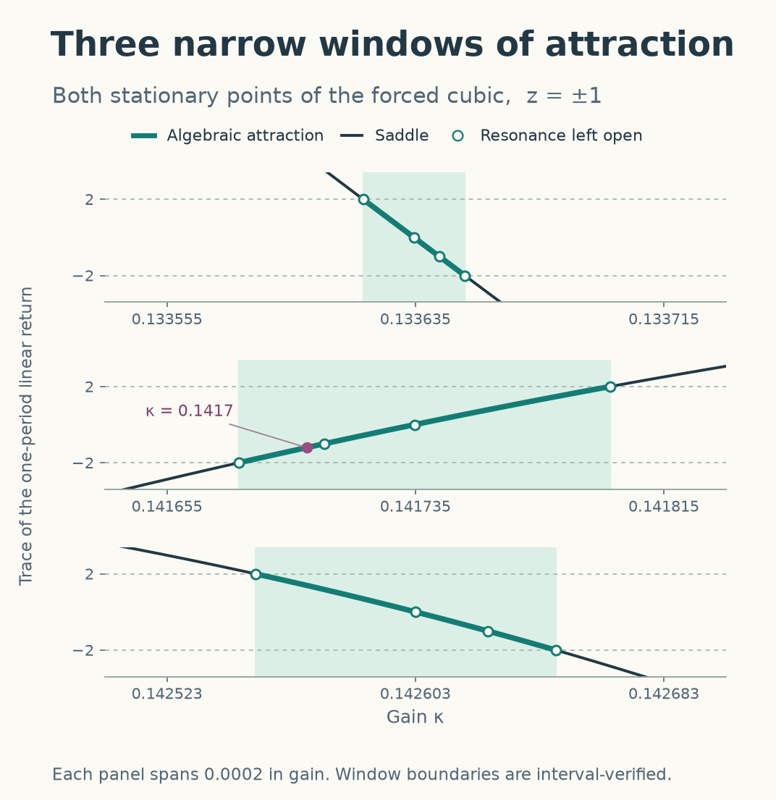

# Two stationary attractors with algebraic decay

The points $`z=\pm1`$ stay fixed throughout the forcing cycle. Both attract nearby solutions in three narrow gain windows, away from the marked resonances. The linearized return preserves area exactly. The nonlinear flow loses enough area near each point to pull trajectories inward.



At $`\kappa=1417/10000`$ the one-turn multipliers have modulus one. In the area-normalized elliptical radius defined below, every sufficiently close nonstationary start satisfies $`\sqrt n\,r_n\to0.009881722996957\ldots`$ after $`n`$ periods. [Window endpoints and enclosures for both sites](weak-foci.json)

<details>
<summary>Equation and proof of the decay rate</summary>

The [driven cubic](../shape_search_20261121/frontiers/cubic/#a-single-gradient-field) has period $`T=2\pi`$ and obeys

```math
p=z^3-3z+\tfrac14\sin t-4\sin(3t)+3i\sin(6t),\qquad
\dot z=-\kappa\,\overline{(3z^2-3)}\,p.
```

Write $`P`$ for the time-$`T`$ map, $`s=\pm1`$ and $`\Phi(t)`$ for the real variational matrix along $`s`$ starting at the identity. The divergence is $`-2\kappa|3z^2-3|^2`$. Liouville's formula gives

```math
\log\det DP(s+h)=-72\kappa\int_0^T|\Phi(t)h|^2\,dt+O(|h|^3).
```

Set $`A=\Phi(T)`$. When $`|\operatorname{tr}A|<2`$, $`\det A=1`$ gives a unique positive definite $`H`$ with $`AHA^\top=H`$ and $`\det H=1`$. The measured radius is $`r=|H^{-1/2}(z-s)|`$ in real coordinates. In these coordinates the linear return is a rotation.

For $`\operatorname{tr}A\ne-1,0`$ the rotation avoids all resonances through order four. The cubic normal form is $`w'=\lambda w(1+c|w|^2)+O(|w|^4)`$. Its log determinant starts at $`4\operatorname{Re}(c)|w|^2`$. A coordinate change adds a difference of log Jacobians evaluated before and after the map. Through quadratic order these terms have equal angular averages because the normalized map is a rotation plus cubic terms. Averaging the displayed divergence identity on the circle gives

```math
\gamma=-\operatorname{Re}(c)=9\kappa\int_0^T
\operatorname{tr}(\Phi(t)H\Phi(t)^\top)\,dt>0.
```

Thus $`|w'|=|w|-\gamma|w|^3+O(|w|^4)`$. Inverse squared radius increases by $`2\gamma+O(|w|)`$ each turn. The normal-form coordinate agrees with the linear one to first order, giving $`\sqrt n\,r_n\to(2\gamma)^{-1/2}`$. At the stated gain the checker encloses $`\gamma`$ between 5120.408 and 5120.410 for both sites. Cubic Birkhoff coefficients as stability tests for nonhyperbolic planar maps are established prior work. [Cima, Gasull and Mañosa](https://doi.org/10.3934/dcds.2018038)

</details>

The [verifier](../../research/shape_search_20261121/frontiers/cubic/elliptic_sites.py) bounds the Taylor tails of the fundamental matrix and its integrated Gramian by Cauchy estimates. For each gain window it bounds a degree-18 trace interpolant and its derivative on the entire displayed interval. Reflection $`z\mapsto-\overline z`$ combined with a half-period shift conjugates the two stationary returns. Other gain ranges remain open.

```bash
python research/shape_search_20261121/frontiers/cubic/elliptic_sites.py
```
