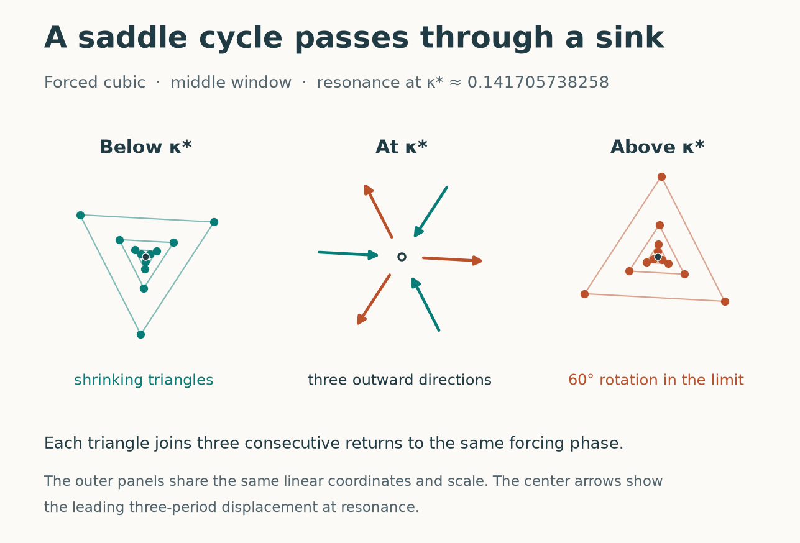
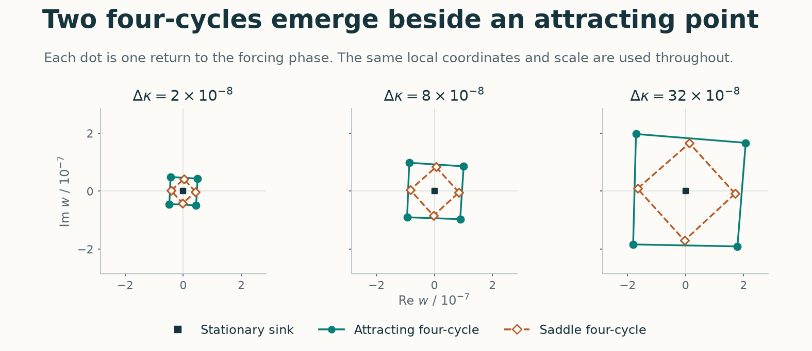

# A saddle cycle passes through a sink



The two stationary points of the [forced cubic](README.md#equation-and-proof-of-the-decay-rate) attract throughout each open gain window except at the unstable gains below. Each number rounds the unique root of the indicated trace equation in its window. [Interval enclosures](resonances.json)

| Window | One-third turn, trace −1 | One-quarter turn, trace 0 |
| --- | --- | --- |
| First | 0.133642692141 · unstable | 0.133634498338 · attracts |
| Middle | 0.141705738258 · unstable | 0.141734706307 · unstable |
| Last | 0.142626306990 · unstable | 0.142603078096 · attracts |

The figure follows a saddle orbit of least period three near the middle one-third resonance. Its three points merge into the stationary site and reappear on the other side, rotated by 60° in the limit. Both outer panels use the same linear frame at $`z=1`$. The four distances from the resonant gain are 5 × 10⁻⁷, 2 × 10⁻⁷, 8 × 10⁻⁸ and 3.2 × 10⁻⁸. Direct integration of the original field resolves all eight orbits. [Starting points, return errors and multipliers](three-cycle.json)

## Why the site changes stability

Write $`P`$ for one forcing period. Use a linear frame in which $`DP`$ rotates by angle $`\theta`$, with first basis vector $`(1,0)`$. At a one-third resonance $`P^3`$ is tangent to the identity and commutes with $`P`$. The only quadratic term compatible with the rotation is

```math
P^3(w)=w+C\bar w^2+O(|w|^3).
```

On three rays the leading displacement points outward and the angular drift points toward the ray on either side. An orbit starting in a sufficiently narrow sector stays between its sides until it grows out of the neighborhood. The checker encloses a nonzero $`C`$ in all three windows.

Set $`\delta=3\theta-2\pi`$ and $`w=\delta v`$ nearby, using a smoothly varying rotation frame. The rescaled fixed-point equation tends to $`iv+C\bar v^2=0`$. Its three nonzero roots have radius $`1/|C|`$ and Jacobian determinant −3. The implicit function theorem continues all three. One period cycles their labels and the three-period multipliers are $`1\pm\sqrt3\,\delta+O(\delta^2)`$. Their distance from the sink is $`|\delta|/|C|+O(\delta^2)`$. A disk centered at the sink which includes one of these points cannot lie wholly in its basin.

At a one-quarter resonance $`P^4`$ has no quadratic term. Rotational symmetry leaves two cubic coefficients,

```math
P^4(w)=w+A w|w|^2+B\bar w^3+O(|w|^4).
```

The divergence integral gives $`\mathrm{Re}(A)<0`$. When $`|A|>|B|`$, set $`D=-B/\bar A`$ and write $`w=r e^{it}`$. The positive function $`W=r^4[1+\mathrm{Re}(D e^{-4it})]`$ changes by $`4\mathrm{Re}(A)(1-|B/A|^2)r^6+O(r^7)<0`$, proving attraction. When $`|B|>|A|`$, a zero of $`\mathrm{Im}(A+B e^{-4it})`$ has positive radial drift and inward angular drift on either side, giving an escaping sector. [Kuznetsov and Meijer on strong resonances of maps](https://research.utwente.nl/en/publications/numerical-normal-forms-for-codim-2-bifurcations-of-fixed-points-w/)

## Two four-cycles near a sink

In the first and last windows the stationary site stays attracting at the one-quarter resonance. Just above that gain a second attractor appears nearby, an orbit of least period four. A smaller saddle four-cycle appears with it. The middle window has a saddle four-cycle on either side.



For $`\delta=4\theta-2\pi`$, put $`w=\sqrt{|\delta|}\,v`$, $`v=r e^{it}`$, and $`s=\mathrm{sign}(\delta)`$. The limiting fixed-point equation for a nonzero $`v`$ is

```math
is+r^2(A+B e^{-4it})=0.
```

Draw the circle of radius $`|B|`$ centered at $`A`$. An intersection with the imaginary axis at height $`y`$ gives four angles and $`r=1/\sqrt{|y|}`$ when $`sy<0`$. In the first and last windows both intersections are below zero. In the middle window they straddle zero. The lifted equations enclose all six heights away from zero.

At a crossing write $`q=\mathrm{Im}(B e^{-4it})`$. The limiting vector field in polar coordinates has trace $`4r^2\mathrm{Re}(A)<0`$ and determinant $`8sr^2q`$. Both crossings are transverse. The implicit function theorem continues the four phases and the sign of this determinant distinguishes a sink from a saddle. The linear term dominates at radii much smaller than $`\sqrt{|\delta|}`$. The cubic term dominates at radii much larger, since $`|A|\ne|B|`$. These exhaust the small nonstationary four-cycles.

The dots show integrations at the last window at gain offsets 2 × 10⁻⁸, 8 × 10⁻⁸ and 3.2 × 10⁻⁷. Quadrupling the offset approximately doubles both radii. At gain 0.14260309809624 the outer orbit's two four-period multipliers have modulus about 0.99999985. [Phases and independent stability checks](four-cycle.json)

## Reproduce

The checker integrates the linear system on all monomials of degrees one through two or three. On each time cell it bounds the Taylor tail of the local fundamental matrix by Cauchy's inequality on a complex disk of radius eight in rescaled time. The [existing trace monotonicity bounds](weak-foci.json) give uniqueness between the new endpoint sign checks. Half-period reflection conjugates the two stationary return maps.

```sh
python research/shape_search_20261121/frontiers/cubic/resonances.py
python research/shape_search_20261121/frontiers/cubic/resonant_cycle.py
python results/cubic-elliptic-sites/three_cycle_figure.py
python research/shape_search_20261121/frontiers/cubic/four_cycle.py
```
