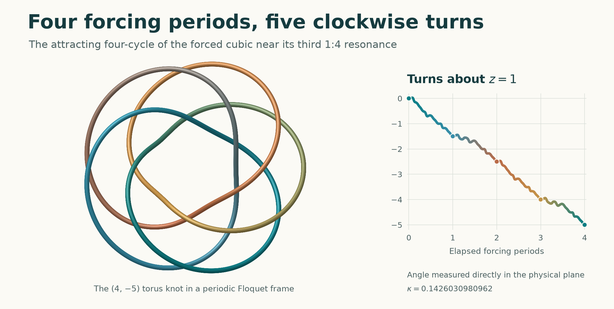

# An attracting four-period torus knot



<!-- drawing-date -->
*Drawn: **2026-11-23**.*
<!-- /drawing-date -->

At gain **0.14260309809624272** the [driven cubic](README.md#equation-and-proof-of-the-decay-rate) has an attracting periodic orbit tied in a $`(4,-5)`$ torus knot. A nearby saddle orbit has the same knot type. The two curves have **absolute linking number 20**. [Certified cycles and tube bounds](satellite-boxes.json)

The clock supplies one circle. Each time it completes a forcing period the state advances to the next of [four distinct points](resonances.md#two-four-cycles-near-a-sink). By the time it returns to the first point the orbit has turned five times clockwise around $`z=1`$. In the left panel a periodic change of coordinates opens up the strongly flattened orbit. The curve and the angle on the right come from integration of the original equation. [Figure code and starting data](../../research/shape_search_20261121/frontiers/cubic/knot_figure.py)

## Recognizing the knot

Take the standard phase tube with coordinates $`(t,h)`$, $`h=z-1`$, embedded as

```math
(t,h)\longmapsto ((R+\mathrm{Re}\,h)\cos t,\ (R+\mathrm{Re}\,h)\sin t,\ \mathrm{Im}\,h).
```

Near each resonance, shrink the satellite toward the stationary point. Its first-order strands are the linear variational flow $`X(t)`$ applied to the vertices of a regular polygon in rotation coordinates. Write the orientation-preserving change of basis as $`B`$. The polar decomposition of $`X(t)B`$ continuously removes stretching. Its endpoint differs from its start by the polygon's cyclic rotation, so this straightening respects the joins between periods. The resulting braid is the rotation of the polygon. The winding of one closed strand distinguishes its full twists.

| Resonance | First window | Middle window | Last window |
| --- | ---: | ---: | ---: |
| Three-period saddle | (3, −1) | (3, −2), a trefoil | (3, −4) |
| Four-period satellites | (4, −1) | (4, −3) | **(4, −5)** |

The variational determinant is one. The checker encloses each change in angle between adjacent time samples, with a strict angular-speed bound preventing a missed turn. At exact resonance the variational vector returns after three or four periods. Each total winding enclosure isolates one integer. [Winding certificate](knot-windings.json)

## Checking the plotted gain

Interval Newton on 32 shooting segments encloses two distinct orbits of least period four near $`z=1`$. The outer orbit's return multipliers form a complex pair. Its determinant is strictly below one by the divergence formula. The inner orbit has one multiplier on either side of one.

Let $`T=2\pi`$. Choose $`B`$ so that the one-period linear return is rotation by $`-\theta`$ in this basis. In the last window the moving frame $`X(t)B R((2\pi+\theta)t/T)`$ is periodic with zero net twist. At the plotted gain the first variational vector turns −1.285101 times in one period. The closing rotation in the orientation-preserving basis returns that vector through the opposite angle, including its full turn. In that frame the checker compares each entire strand to a circle turning through $`-5t/4`$. The interval radius is below 0.056 times the reference radius for the attracting orbit and below 0.062 for the saddle. At every clock phase the four disks on each circle are disjoint. The two circles' annuli are disjoint as well. Straight-line interpolation inside these disks is an isotopy of the pair to two parallel $`(4,-5)`$ curves. Their linking magnitude is $`4\cdot5`$. [Cabling and the torus framing](https://www.math.cuhk.edu.hk/~ztwu/Cabling.pdf) · [Braids in driven oscillators](https://doi.org/10.1142/S0218127493001100)

```sh
python research/shape_search_20261121/frontiers/cubic/knot_windings.py
python research/shape_search_20261121/frontiers/cubic/satellite_boxes.py
python research/shape_search_20261121/frontiers/cubic/knot_figure.py
```
