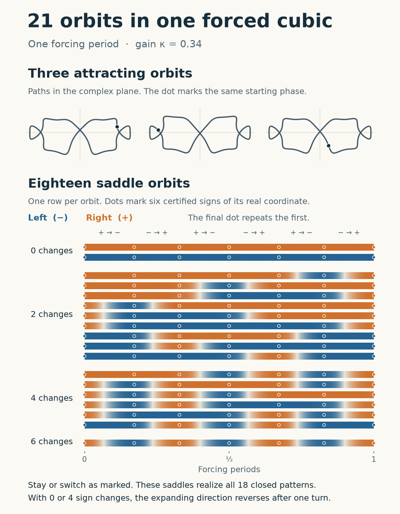

# Three sinks and eighteen saddles in a driven cubic

At gain 0.34, three attracting motions repeat every forcing period. The way they wind around one another forces chaos elsewhere in the same differential equation. We located **18 saddle motions of the same period** and certified each one. Further orbits are possible.



Read each colored row from left to right. At six phases a saddle can stay on its side or switch in the direction of the arrow. The eighteen certified saddles realize every closed six-sign pattern allowed by those arrows. The dots have interval-certified signs. The color between dots comes from numerical trajectories. The [passage proof](../cubic-saddle-passages/) extends this rule to arbitrarily many periods. [Six-frame check](itineraries.json) · [Watch a loop fold](../cubic-material-lines/loop.webp)

## System

```math
\dot\theta=1,\qquad
\dot z=-\kappa\,\overline{(3z^2-3)}\,[z^3-3z+b(\theta)],\qquad
b(\theta)=\tfrac14\sin\theta-4\sin(3\theta)+3i\sin(6\theta).
```

The forcing period is $`2\pi`$. Case 48000001 uses $`\kappa=0.34`$ here and $`0.03`$ in the unlinked control. The time map at phase zero has entropy at least $`\log(9+4\sqrt5)\approx2.88727`$ per period. The braid already requires at least 21 one-turn fixed points and 325 points fixed after two turns. The same three-harmonic family admits arbitrarily large certified entropy per period as gain and bandwidth increase. [Proof and prior work](proof.md) · [Exact counts](bounds.json)

## Finding and verifying the orbits

Two searches stitched trial curves together from the three known sinks, the fixed sites $`z=\pm1`$ and zero. Of 600 starts on each of two meshes, 36 and 37 converged to periodic midpoint solutions. Refinement, half-period reflection and comparison over a whole period yielded the same 21 motions on replay. [Search code and seeds](../../research/shape_search_20261121/frontiers/cubic/find_periodic_seeds.py)

Each orbit proposal contains 64 complex phase nodes. The verifier encloses the exact flow between adjacent nodes and its two real derivative columns. It computes polynomial defects in Arb, bounds their propagation by the Euclidean logarithmic norm and applies interval Newton to all cyclic matching equations at once. Each product of boxes, with coordinate half-width $`2^{-40}`$, maps strictly inside itself under the preconditioned Newton operator. Each pair of orbits has disjoint boxes at one or more common phases. [Input nodes](shooting-nodes.npz) · [Interval results](orbits.json) · [Verifier](../../research/shape_search_20261121/frontiers/cubic/periodic_boxes.py)

Three return derivatives have norm below one. For the other eighteen the enclosed trace lies outside $`[-2,2]`$. Since the divergence is $`-2\kappa|3z^2-3|^2`$, the return determinant lies in $`(0,1]`$. These eighteen orbits are saddles. Ten preserve the expanding direction's orientation after a turn and eight reverse it.

From the repository root, with NumPy and python-flint 0.9.0 installed:

```sh
python research/shape_search_20261121/frontiers/cubic/periodic_boxes.py results/cubic-forced-orbits/shooting-nodes.npz --out verification.json --workers 4
python research/shape_search_20261121/frontiers/cubic/forced_entropy.py results/shape_search_20261121/frontiers/cubic/finite-gains.json --out counts.json
```

To repeat the search with SciPy, run `python find_periodic_seeds.py --workers 2 --out fresh-nodes.npz` from its script directory. The verifier also accepts those fresh proposals.
