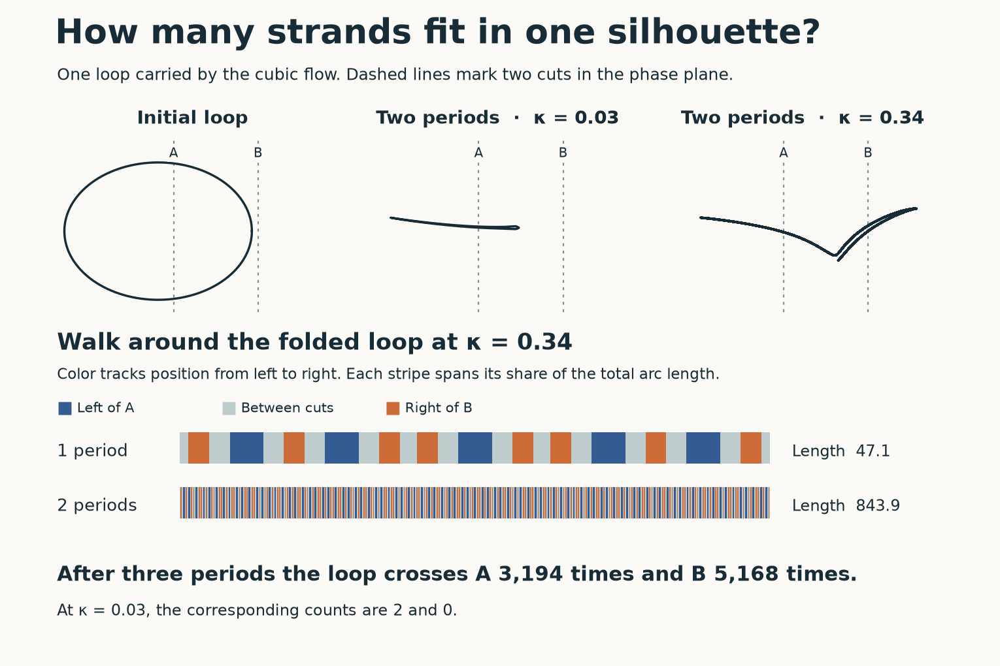

# One loop through the driven cubic



At gain 0.34, an ellipse folds into a narrow silhouette. Count the crossings of two vertical lines and the hidden multiplicity becomes visible. [Watch two periods with the three sinks marked](loop.webp)

| Forcing periods | Length, κ = 0.03 | Length, κ = 0.34 | Crossings of A, κ = 0.34 | Crossings of B, κ = 0.34 |
| ---: | ---: | ---: | ---: | ---: |
| 0 | 8.22 | 8.22 | 2 | 0 |
| 1 | 4.52 | 47.13 | 10 | 16 |
| 2 | 4.13 | 843.87 | 178 | 288 |
| 3 | 4.05 | 15,142.5 | 3,194 | 5,168 |

The [certified three-cycle braid](../shape_search_20261121/frontiers/cubic/#finite-gain-orbit-checks) acts on slopes by $`M(a,b)=(5a-8b,-8a+13b)`$. Through all three periods the measured counts match twice the absolute coordinates of $`M^n(1,0)`$. At gain 0.03 the word is empty and the measured counts stay at 2 and 0. [Entropy bound and hidden periodic orbits](../cubic-forced-orbits/) · [Periodic orbits as moving obstacles](https://doi.org/10.1103/PhysRevE.73.036311)

**Reproduce.** The [forced cubic gradient flow](../shape_search_20261121/frontiers/cubic/#a-single-gradient-field) starts at phase zero with the loop $`z(s)=-0.75-0.10i+1.50\cos s+1.10i\sin s`$. A and B are at real coordinates −0.50 and 0.85. The RK4 solver advects polygon vertices and chord midpoints, inserting points where edges stretch or bend. Doubling the time and initial polygon resolution, halving the target edge length, and shifting either cut by ±0.05 gave the same counts. With 32,768 uniformly spaced tracers and no midpoint insertion, the polygon registered just four crossings of B after three turns at gain 0.34. Lengths are finite-time numerical estimates. [Both grids and all six cuts](measurements.json)

```sh
python research/shape_search_20261121/frontiers/cubic/cubic_material_lines.py
```
