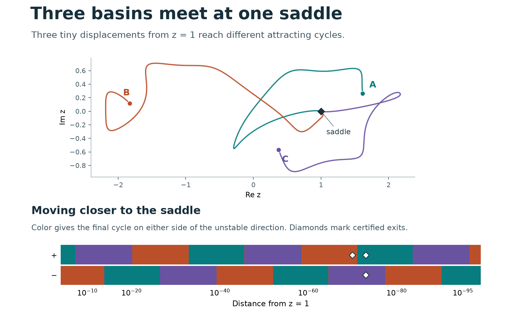

# Two saddles on the boundary of three basins



Every neighborhood of $`z=1`$ contains initial states that converge to each of the three known attracting cycles. The same holds at $`z=-1`$. The equation, forcing phase and gain $`\kappa=17/50`$ are fixed throughout. The [stable arc](stable-crossing.md) connects this result to [chaotic itineraries on the common boundary](../cubic-saddle-passages/). [Equation and three trapping disks](../shape_search_20261121/frontiers/cubic#finite-gain-orbit-checks)

The curves show the fourth driving period for three initial displacements along the unstable direction. The strips show 3,802 numerical starts, using logarithmic distance on either side of the saddle. Halving the integration step preserved every label. The diamonds mark three rigorously enclosed exits. The result concerns these two boundary points. A Wada boundary requires the common-boundary property at every boundary point. [Kennedy and Yorke, *Basins of Wada*](https://doi.org/10.1016/0167-2789(91)90234-Z)

## Three exits at arbitrarily small scales

Write $`w=z-1`$ and let $`P`$ be the one-period map in this coordinate. Its derivative $`M=DP(0)`$ has a unit unstable eigenvector $`v`$ for a multiplier $`\lambda<-2^{63}`$. For each signed scale $`s`$ below, [interval integration](certificate.json) sends an entire disk around $`sv`$ inside the selected cycle's phase-zero trapping disk after four periods. The trapping radius is 0.0055.

| $`s`$ | Cycle | Upper bound on the distance to its disk center |
| ---: | :---: | ---: |
| $`10^{-73}`$ | A | 0.002513 |
| $`-10^{-73}`$ | C | $`7.2\times10^{-12}`$ |
| $`10^{-70}`$ | B | $`1.2\times10^{-11}`$ |

Set $`H=2^{78}`$, $`C=2^{164}`$ and $`K=C/(2^{126}-H)`$. On the disk $`|w|\le2^{-84}`$, the estimates below give

```math
\operatorname{Lip}(P)\le H,\qquad |P(w)-Mw|\le C|w|^2.
```

For any $`n\ge0`$, start at $`s\lambda^{-n}v`$. Compare its first $`n`$ iterates with $`u_j=s\lambda^{j-n}v`$. An error $`E_j\le K|u_j|^2`$ gives $`E_{j+1}\le HE_j+C|u_j|^2\le K|u_{j+1}|^2`$. All these points stay inside the stated disk. The $`n`$th iterate therefore lies within $`K|s|^2`$ of $`sv`$, exactly the disk included in the four-period check. The starts tend to the saddle as $`n`$ grows. This proves the common-boundary claim.

The substitution $`z(t)\mapsto-\overline{z(t+\pi)}`$ exchanges the saddles. Reflecting each [certified sink's half-period box](../cubic-forced-orbits/orbits.json) places it back inside its own trapping disk, so the same three basins reach $`z=-1`$.

The same approximants converge to points of the unstable manifold by the [geometric-series argument](stable-crossing.md#building-the-arc-in-reverse-time), applied in forward time. Each certified disk thus contains an unstable-manifold point in its assigned basin. The [stable arc](stable-crossing.md) of this saddle crosses the entire height of the phase-zero passage box.

### Local bounds

Take $`\delta=1/64`$. On $`|w|\le\delta`$ an upper bound on the logarithmic norm of the field derivative is $`\eta(t)=6\kappa(1+\delta)(|b(t)-2|+3\delta^2+\delta^3)`$. The root-mean-square of $`b-2`$ is $`\sqrt{529/32}`$. With $`H(t)=\exp\int_0^t\eta(u)\,du`$, this gives $`H(2\pi)<H`$. Initial states in $`|w|\le\delta/H`$ stay in the $`\delta`$-disk for one period by Grönwall's inequality, giving the Lipschitz bound.

On the same tube, the Hessian norm is at most $`L=\kappa[18(1+\delta)(6\delta+3\delta^2)+6(37/4+3\delta^2+\delta^3)]`$. Variation of constants bounds the quadratic remainder by $`\pi L H^2 |w|^2`$, since linear propagation from $`t`$ to the endpoint has norm at most $`H(2\pi)/H(t)`$ and the state size at $`t`$ is at most $`H(t)|w|`$. The verifier checks $`\pi L<256`$.

At the saddle the variational equation is $`v'=-6\kappa(b-2)\bar v`$, and the monodromy determinant is one by zero divergence there. The verifier encloses both columns by Taylor polynomials and bounds their defects in Euclidean norm, then encloses the expanding eigenvalue and its normalized eigenvector. Forward integration of the three disks uses the [same interval flow enclosure as the periodic-orbit proof](../../research/shape_search_20261121/frontiers/cubic/periodic_boxes.py).

```sh
python research/shape_search_20261121/frontiers/cubic/saddle_basins.py --out certificate.json
python results/cubic-saddle-basins/figure.py certificate.json basin-exits.png
```
