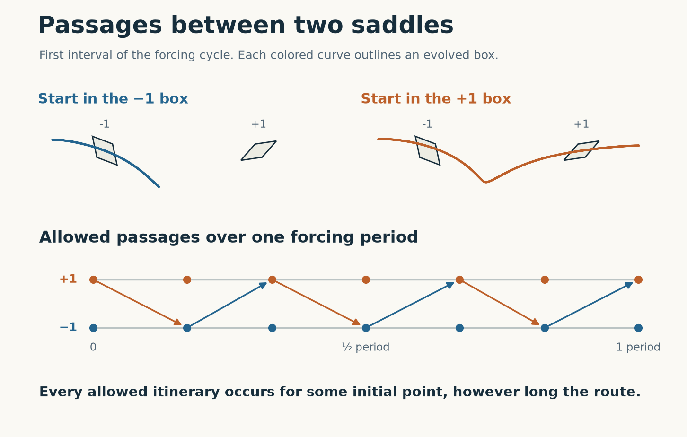

# Six passages between two saddles



In the [forced cubic gradient flow](../shape_search_20261121/frontiers/cubic/#a-single-gradient-field) at gain 0.34, sample an orbit at fractions 0, 11/64, 21/64, 32/64, 43/64 and 53/64 of each forcing period. Among orbits that visit the two boxes at these phases, **the diagram gives exactly the possible routes**. Every two-sided itinerary occurs. A repeating itinerary has a periodic realization.

The one-period counts, in left/right order, are five left-to-left routes, eight in each direction between sites, and thirteen right-to-right. There are 18 closed one-period words and 322 closed two-period words. Removing the 18 repeated words and pairing the two possible starting periods gives **at least 152 distinct orbits of least period two**. The graph gives an entropy lower bound of $`\log(9+4\sqrt{5})`$ per forcing period inside the sampled boxes. All [18 certified one-period saddles](../cubic-forced-orbits/) lie on the common boundary of the three basins. The unstable manifold of each saddle meets all three basins. [Proof for all 18](boundary-orbits.md)

**Every route in the diagram also occurs on the common boundary of the three sink basins.** For example, choose the right box at every even sample. At every odd sample choose left or right freely, forever in both directions. Some initial state on the common boundary follows that prescription. Whether the three entire basin boundaries coincide remains open.

The compact set of all full orbits visiting the boxes is Lyapunov unstable. It contains +1, with starts arbitrarily close that approach each [known sink](../cubic-saddle-basins/). All three sinks lie more than 0.46 away from both phase-zero boxes along the real axis.

<details>
<summary>Why the common boundary carries the full graph</summary>

Write $`p=+1`$ on the phase-zero section. Each of the [three certified exit disks](../cubic-saddle-basins/) meets its unstable manifold. In the notation of that proof, take an accumulation point of $`P^n(s\lambda^{-n}v)`$ in the certified disk, using coordinates centered at $`p`$. Its $`m`$th backward iterate lies within $`K|s\lambda^{-m}|^2`$ of $`s\lambda^{-m}v`$, by the same uniform error estimate. Thus it tends to $`p`$ backward. Forward it reaches the corresponding open basin. This works for each sink.

Every point of the stable manifold now lies on all three basin boundaries. Indeed, any neighborhood of that point contains an arc transverse to the stable manifold. By the inclination lemma its forward iterates approach compact pieces of the unstable manifold and meet all three open basins. Their preimages lie in the original neighborhood. [Nusse and Yorke on unstable manifolds and basin boundaries](https://www.cambridge.org/core/journals/ergodic-theory-and-dynamical-systems/article/abs/structure-of-basins-of-attraction-and-their-trapping-regions/CCFDB19BA12CADBCA19E1F2923E082BF)

The [validated stable arc](../cubic-saddle-basins/stable-crossing.md) joins the top and bottom of the right phase-zero box. Each covering carries a subarc of any left-to-right crossing of its source into a left-to-right crossing of its target, allowing reversed orientation. Follow a finite graph path ending in the right phase-zero box this way. The last horizontal crossing meets the stable arc. Pull that point back to realize the path on the stable manifold.

Given a two-sided itinerary, match it from period $`-n`$ to $`n`$ and extend to the right phase-zero box. The one-period transition matrix has all entries positive, so one extra period suffices. Compactness gives a limiting point at phase zero as $`n`$ increases. The boxes and the common boundary are closed. The limit realizes the whole itinerary on their intersection. On this compact invariant intersection the itinerary map is continuous, since the two boxes at each sampling phase are separated. It maps onto the graph shift, so the common boundary carries at least $`\log(9+4\sqrt5)`$ entropy per forcing period. The periodic-orbit count above applies to the full box system.

</details>

<details>
<summary>How the covering is certified</summary>

Each box has half-width 0.14 in a rational, phase-dependent frame. For every claimed source-to-target passage the two exit sides map strictly beyond opposite target ends. In target coordinates, the image of the full source boundary also avoids both vertically unbounded regions with $`|x|\leq0.14`$ and $`|y|\geq0.14`$. The flow embeds the closed source rectangle. Any point in either forbidden region can escape vertically to infinity without meeting the boundary image, so the interior image also avoids both regions. Collapsing the transverse coordinate and straightening the longitudinal map now gives a horizontal covering of degree +1 or −1. Chaining these coverings gives periodic orbits, and compactness gives realizations of bi-infinite paths. Distinct codes are separated at a sampled phase. [Zgliczyński and Gidea, covering relations](https://ww2.ii.uj.edu.pl/~zgliczyn/papers/wts/cov.pdf)

For each missing arrow the entire source boundary image lies in a real-coordinate half-plane disjoint from the destination box. The embedded disk stays in the same half-plane. The checker partitions the boundary edges into 4,246 dyadic intervals. A moving Taylor polynomial and a Euclidean logarithmic-norm bound enclose the flow of every point in each interval. The second half-period follows from the exact symmetry $`z(\theta)\mapsto-\overline{z(\theta+\pi)}`$. The colored outlines in the figure are numerical drawings. [Interval clearances, frames and sink separation](coverings.json) · [Checker](../../research/shape_search_20261121/frontiers/cubic/saddle_passages.py)

</details>

```sh
python research/shape_search_20261121/frontiers/cubic/saddle_passages.py --workers 6
```
