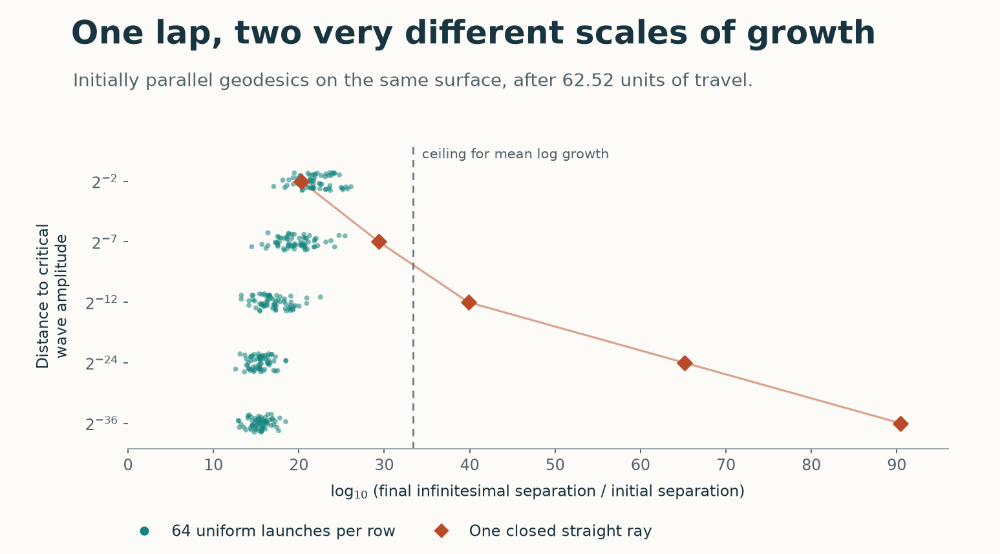

# A straight ray and a surface-wide average

After the same 62.52 units of travel, initially parallel rays can have vastly different transverse separation. On the fifteen-handle surface at $`b=11/8-2^{-36}`$, one straight geodesic amplifies an infinitesimal separation by **more than $`10^{90.38}`$**. The geometric mean over uniform positions and headings is **less than $`10^{33.40}`$** for every $`9/8\le b<11/8`$. The sample median at this setting was about $`10^{15.48}`$.



The surface is $`\cos x+b\cos y+(3/8)\cos(x-y+7z)=0`$ in the flat three-torus. The observation length $`L=2\pi\sqrt{99}`$ is one lap of the [closed straight ray](../attractor_followup_2/geodesics/). Every launch uses the same transverse Jacobi data $`J(0)=1,\ J'(0)=0`$.

**The uniform bound.** Gaussian curvature $`K`$ is nonpositive. Indeed, with $`A=\cos x`$, $`B=b\cos y`$ and $`c=3/8`$, the curvature numerator divided by $`-49`$ is $`b^2A^2+B^2+(1+b^2-c^2)AB`$, positive definite under the strict triangle inequalities. Thus $`u=J'/J\ge0`$ and $`u'+u^2=-K`$. The unit-speed flow preserves Liouville probability. Gauss–Bonnet on the genus-fifteen surface gives $`-\mathbb E K=56\pi/\mathrm{Area}`$. Integrating the Riccati equation and using Cauchy–Schwarz gives a finite-time bound,

```math
\mathbb E[\log J(L)]\le L\sqrt{56\pi/\mathrm{Area}}.
```

The projection onto $`(x,y)`$ has fourteen preimages wherever $`|\cos x+b\cos y|<3/8`$. The checker integrates a common subset of these projections for the full parameter interval. For $`0\le y\le\pi/2`$ it retains $`(11/8)\cos y-3/8\le-\cos x\le(9/8)\cos y+3/8`$ and uses quadrant symmetry. Outward-rounded bounds on 4,096 cells give area greater than 116.2557 and the dotted-line bound in decimal units.

**The straight ray.** Its Jacobi coefficient is reflection-symmetric about a principal axis of the normal ellipse. Starting at that phase gives equal diagonal entries in the one-lap transfer matrix. Thus $`J(L)=(\mu+\mu^{-1})/2`$ for the [certified expanding multiplier](../attractor_followup_2/geodesics/bounds.json). Its divergence as $`b\uparrow 11/8`$ gives an unbounded gap at fixed travel distance.

**The dots.** Each row uses two independent sets of 32 uniform positions and headings. Intersection sampling along coordinate lines is corrected for the surface normal. The cohorts use different solver tolerances. A separate short integration checks the scalar Jacobi equation against curvature computed directly from the ambient Hessian. [Measurements and bounds](growth.json) · [Reproduce the experiment](../../research/geodesic_typical.py)

[Kuznetsov](https://arxiv.org/abs/1708.04493) studied geodesic chaos on a three-cosine surface. The Riccati argument follows the classical relation between average curvature and growth of geodesics. [Katok, *Entropy and closed geodesics*](https://doi.org/10.1017/S0143385700001656)

```sh
python research/geodesic_typical.py --out results/geodesic-typical-growth
```
