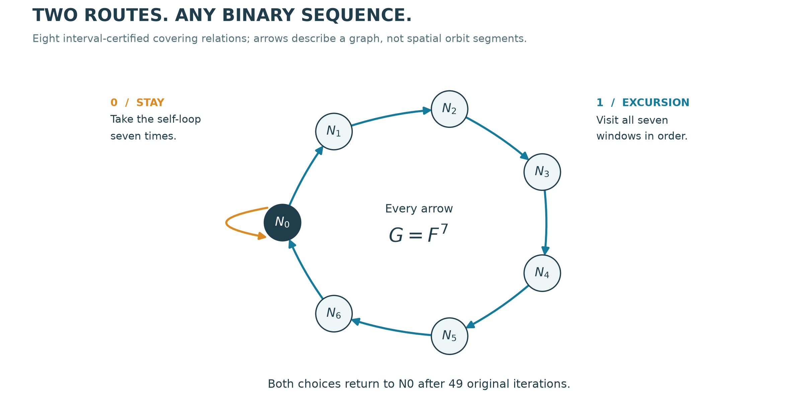

# A full ladder of periods in spatial-circle RAAR

In Case 1051, the attracting set contains a periodic orbit of **every least period 49, 56, 63, …**. At period 350 it contains at least **1,734 distinct orbits**. At period 700 the lower bound is **75,683,050**. These orbits belong to one attracting set. Their individual stability is undetermined except in separately studied cases.

The map is relaxed averaged alternating reflections (RAAR) between two disjoint circles in three dimensions. The existing proof gave eight verified transitions between seven small windows and located a period-49 saddle. The new calculation distinguishes every window and separates the ordinary iterations *between* successive visits. [Equation, exact settings and archived windows](../../../docs/raar-symbolic-dynamics.md#exact-model-and-windows) · [Proof of attraction](../../../docs/raar-trapping.md)



## Why the listed periods are exact

Each graph step is seven applications of the original map $`F`$. At window 0 there are two choices. One returns immediately to 0. The other follows 0 → 1 → 2 → 3 → 4 → 5 → 6 → 0. A closed route with one long excursion and any number of immediate returns has graph length $`n`$ for any $`n\ge7`$. Window 1 occurs exactly once in that cyclic word.

The covering theorem realizes each closed route by a periodic point. Exact rational projections separate all 21 pairs of window parallelepipeds. Thus the word with a single visit to window 1 has least period $`n`$ for $`F^7`$. To establish its period under $`F`$, the interval calculation encloses each of the next six images of every window. All six stay more than 0.01 away from the union of the seven windows in the maximum norm. Every return to a window on the coded orbit occurs at a multiple of seven ordinary steps. Its least period under $`F`$ is therefore exactly $`7n`$. The same argument applies to every primitive closed route. The archived trapping region contains all these periodic orbits. [Covering theorem, Theorem 9](https://ww2.ii.uj.edu.pl/~zgliczyn/papers/wts/cov.pdf) · [Separation certificate](certificate.json)

## Counting distinct orbits

Write $`A`$ for the adjacency matrix of the pictured graph. The trace of $`A^n`$ counts closed routes with a marked start. Subtract the counts for proper divisors to retain primitive routes, then divide by $`n`$ to remove cyclic relabelings. Two inequivalent primitive routes cannot represent the same physical orbit. The intermediate-phase check ensures that two different choices of the ordinary step at which to start observing cannot merge them.

| Least period in original updates | Distinct orbits guaranteed |
| ---: | ---: |
| 49 | 1 |
| 140 | 4 |
| 210 | 29 |
| 350 | 1,734 |
| 490 | 117,504 |
| 700 | 75,683,050 |

The short and long returns have lengths one and seven in graph time. Their path counts grow with the positive root of $`\lambda^7=\lambda^6+1`$. Indeed the number of marked paths from window 0 back to 0 satisfies the corresponding renewal recurrence. Any two different such paths of the same length have a visit to disjoint windows and hence give separated points. The resulting entropy lower bound per original update is $`\log(\lambda)/7>0.032496066`$. The previous bound $`\log(2)/49`$ used only two equal-length routes. [Earlier entropy proof](../../../docs/raar-symbolic-dynamics.md#consequence-arbitrary-binary-itineraries-and-positive-entropy) · [Entropy of finite graph shifts](https://sites.math.washington.edu/~lind/Papers/EntropiesFactorizationsTMS.pdf)

## Prior work and scope

Luke introduced RAAR. Elser studied dynamics of iterated projections. Borwein and coauthors reported higher periods for planar Douglas–Rachford iteration with an ellipse and a line. Covering relations and graph entropy are classical. On 2026-11-22 we searched under RAAR, relaxed Douglas–Rachford, projection-reflection dynamics, spatial circles, symbolic dynamics and the numerical relaxation parameter. The reviewed sources did not identify this period ladder or count for this pair of spatial circles. Priority among all equivalent systems remains open. [Luke](https://arxiv.org/abs/math/0405208) · [Elser](https://arxiv.org/abs/math/0111080) · [Borwein et al.](https://carmamaths.org/brailey/Research_papers/Ellipse_p-sphere-published.pdf) · [Existing literature audit and coverage limits](../../../docs/raar-priority.md)

## Reproduce

From the repository root, use Python 3.11 with `python-flint==0.9.0` and `mpmath==1.3.0`.

```sh
python research/low_hanging_20261122/algorithms/verify_periods.py
python research/low_hanging_20261122/algorithms/independent_phases.py
```

The first checker uses exact binary64 lifts, rational projections and 128-bit Arb intervals. It verifies the Perron-root bracket and recomputes the orbit counts both by matrix powers and by the trace recurrence. The second checks the six phases using 60-decimal interval arithmetic and the archived normal-vector projector formula on a fixed subdivision of each window. The two original covering certificates supply the graph edges. [Original interval runs](../../raar-symbolic-dynamics/README.md)
