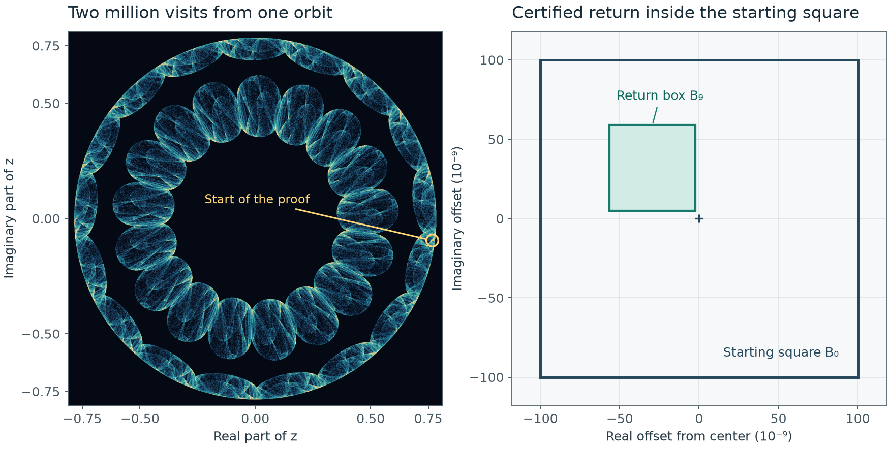
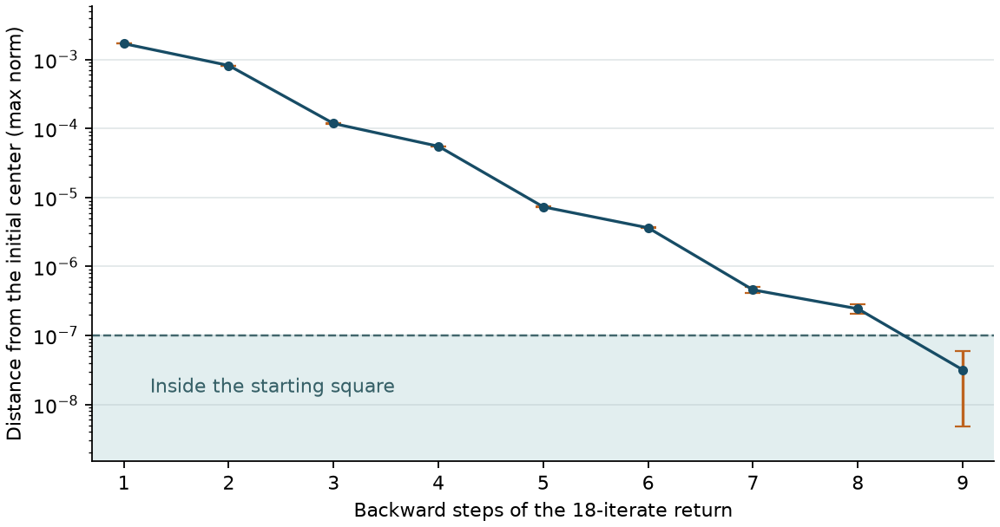

# A binary shift inside the two-ring attractor

The two rings of Case 13745 both contain an open set. Inside the outer ring, two contracting inverse branches code every infinite binary sequence. This gives the local attracting set topological entropy of at least **log(2)/162 ≈ 0.004279 per step**. Which part of this set the pictured trajectory samples remains open. [Original portrait](../../wow_search_20261122/symmetry/cyclic-13745.png) · [Polynomial, coefficients and annular trapping proof](../../wow_search_20261122/symmetry/README.md)



The gold marker locates the center of the starting square on the observed density. The right panel shows offsets in billionths of a coordinate unit. The complete ninth box fits inside the original square.

## The two ways back

Let $`F`$ be the original polynomial, $`R(z)=e^{2\pi i/17}z`$ and $`H=R\circ F^{18}`$. After 18 steps a particular orbit has rotated backwards by one sector. The rotation in $`H`$ puts it back in place. Its least period under $`F`$ is 306.

Start with the square $`B_0`$ of half-width $`10^{-7}`$ centered at (0.7654889343566528, −0.09473530641366687). Every point in the square has two certified ways to trace nine steps of $`H`$ backwards:

- The first takes the same local inverse nine times and stays in the square.
- The second goes out to $`B_1`$, about 0.0017 from the original center, and passes through eight more boxes. Its last box $`B_9`$ lies strictly inside the starting square.



Dots mark the centers. The whiskers enclose the distance of every point in each box in the maximum norm. [Box centers and widths](witness.json)

The two inverse branches of $`H^9`$ have Lipschitz constants below $`0.60^9`$ and 0.035. Their images are disjoint: eight forward applications of $`H`$ put one image inside $`B_0`$ and the other inside the disjoint $`B_1`$. For any infinite binary word, its successive inverse branches give nested compact sets shrinking to a single point. Disjointness distinguishes words. Applying $`H^9`$ deletes the first symbol. Thus its restriction to the resulting Cantor set is conjugate to the full one-sided shift.

## Why the shift is in the attractor

Write $`A`$ for the outer trapping annulus and $`K_o=\bigcap_{j\ge0} F^{2j}(A)`$ for its attracting component. The primary inverse gives $`B_0\subset H(B_0)`$. Rotation commutes with $`F`$, so $`H^{17}=F^{306}`$. Consequently $`B_0\subset F^{306j}(A)`$ for all $`j`$. These nested images have the same intersection as all even iterates. The entire square, including the shift, belongs to $`K_o`$. The derivative of $`F`$ is nonsingular at the periodic point. The image of a neighborhood in the square therefore gives an open subset of the inner component. Both components have positive area and Hausdorff dimension two.

**In the original coordinates.** Let $`C`$ be the Cantor set just coded. Its seventeen rotated copies lie in disjoint squares: the nearest centers are more than 0.28 apart, while each square has half-width $`10^{-7}`$. Since $`H^9=R^9 F^{162}`$, one block of 162 ordinary updates deletes the first binary symbol and moves the point nine sectors backwards. On the union of the seventeen copies, $`F^{162}`$ is conjugate to the product of the binary shift and the cyclic sector permutation. Its entropy there is $`\log 2`$. Iteration therefore gives the stated bound $`\log(2)/162`$ on the full local attracting set.

## Interval verification

For each source square of center $`c`$ and half-width $`s`$, compute a dyadic matrix $`A`$ approximating the inverse of $`DH(c)`$. For any target $`t`$ in the preceding square, the verifier bounds the displacement at the center and the derivative of $`x\mapsto x-A(H(x)-t)`$. This map sends the entire source square into its interior and contracts there. The unique fixed point is a preimage of $`t`$. A bound $`q`$ on the maximum row-sum norm of $`I-A\,DH`$ gives the inverse Lipschitz bound $`\|A\|_\infty/(1-q)`$.

All ten covers pass with the source displacement below 0.90 of its allowed radius. The primary inverse has a fixed point in the concentric square of half-width $`10^{-12}`$. The two eigenvalues of $`DH`$ there lie in (4.2980, 4.2982) and (−3.6754, −3.6752). The least period divides 306. Dividing 306 by each distinct prime factor leaves 153, 102 and 18, so ruling out these three rules out every proper divisor. At step 153 the point is in the opposite annulus. At step 102 its radius equals the step-12 radius, below 0.74, whereas it starts above 0.77. At step 18 it occupies a different rotation sector.

The witness centers came from ordinary numerical root solves for relative periodicity and backward preimages. The certificate reads their decimal coordinates as rationals and the archived coefficients as exact binary rationals. It checks the polynomial in factored form at 160 bits and in expanded monomials with separately differentiated terms at 256 bits. Run from the repository root using Python 3.11 and python-flint 0.9.0. [Verifier](../../../research/low_hanging_20261122/annuli/verify.py) · [Distance plot](../../../research/low_hanging_20261122/annuli/plot.py) · [Orbit and box location](../../../research/low_hanging_20261122/annuli/figure.py)

```sh
python research/wow_search_20261122/symmetry/certify.py --verify --case 13745
python research/low_hanging_20261122/annuli/verify.py
```

Rebuild the two diagnostics with Matplotlib.

```sh
python research/low_hanging_20261122/annuli/figure.py
python research/low_hanging_20261122/annuli/plot.py
```

## Prior work

Field and Golubitsky studied rotating polynomial icons and explained why periodicity up to a finite rotation implies ordinary periodicity. Earlier work classified symmetry constraints on connected components. Glendinning and Wong proved existence of full-dimensional chaotic attractors for a piecewise-affine border-collision map. The inverse-branch argument is related to classical snapback-repeller theory and uses Krawczyk's validated Newton method. Searches on 2026-11-22 covered symmetric polynomial icons, planar equivariant attractors with interior, rotational periodic points, and snapback repellers. The sources checked establish these mechanisms. They did not yield inverse boxes, a period-306 witness or an entropy bound for these coefficients. Priority beyond that search is open. [Field and Golubitsky](https://www.asc.ohio-state.edu/golubitsky.4/reprintweb-0.5/output/papers/notices1995.pdf) · [Symmetry of attractors](https://www.asc.ohio-state.edu/golubitsky.4/reprintweb-0.5/output/papers/symmetric_attractors.pdf) · [Glendinning and Wong](https://research.manchester.ac.uk/en/publications/two-dimensional-attractors-in-the-border-collision-normal-form/) · [Snapback criteria](https://www.aimsciences.org/article/doi/10.3934/jcd.2018004) · [Krawczyk](https://doi.org/10.1007/BF02234767)
