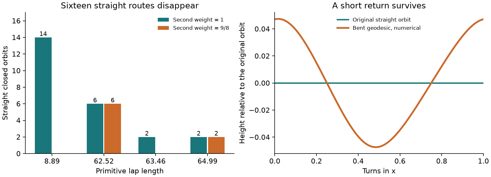

# A sevenfold jump in the shortest straight geodesic

The fifteen-handle surface in the [original study](../../wow_search_20261122/lattice/README.md) contains exactly 24 straight closed orbits. An arbitrarily small change in one weight leaves eight. The shortest straight lap jumps from 8.886 to 62.517 length units, although a curved geodesic still closes in less than 8.891 at the settings below. Counts identify an orbit with its reverse and its time shifts.



## Which straight lines survive?

Work in the flat three-torus of period $`2\pi`$ in each coordinate, with its ordinary Euclidean metric. The original surface has $`b=1`$. Compare it with $`b=9/8`$.

```math
\cos x+b\cos y+c\cos w=0,\qquad w=x-y+nz,\qquad n=7,\quad c=3/8.
```

| Exact straight lap length | Orbits at equal first two weights | Orbits after changing the second weight |
| --- | ---: | ---: |
| $`2\pi\sqrt2`$ | 14 | 0 |
| $`2\pi\sqrt{99}`$ | 6 | 6 |
| $`2\pi\sqrt{102}`$ | 2 | 0 |
| $`2\pi\sqrt{107}`$ | 2 | 2 |

On any straight line, each of the three cosines has a constant temporal frequency. A nonzero frequency that occurs just once cannot cancel, by linear independence of the complex exponentials. This leaves two possibilities.

1. **One constant phase.** The other two cosines must have equal amplitudes, equal absolute frequencies and opposite phases after accounting for direction. Near $`b=1`$ the only possible equal pair is $`x,y`$, requiring $`b=1`$. Thus $`y=\pm x+\pi`$ and $`w=\pi/2`$ or $`3\pi/2`$.
2. **Three moving phases.** After orienting the line and using $`x`$ as parameter, write $`y=sx+u`$, $`w=tx+v`$ with $`s,t\in\{-1,1\}`$. The coefficient of the positive frequency vanishes exactly when $`1+b e^{isu}+c e^{itv}=0`$. The three lengths form a strict triangle for $`|b-1|\lt c`$. Each sign pair therefore has exactly two solutions modulo a full turn, corresponding to the two reflected triangles.

These are all the lines, including any that might initially have been sought with irrational slope. To count their lifts, use $`z=(w-x+y)/n`$. One full turn in $`x`$ shifts the sheet index by $`m=t-1+s`$, with $`t=0`$ for a constant phase. Translation by $`m`$ on $`n`$ sheets has $`g=\gcd(n,|m|)`$ cycles. Each closes after $`n/g`$ turns and has winding vector $`(n,sn,m)/g`$. Its Euclidean norm times $`2\pi`$ gives the primitive length in the table. Every ambient straight line on the surface is a geodesic.

For every positive $`n`$ coprime to six, the same argument gives $`2n+10`$ straight orbits at $`b=1`$ and eight for $`0\lt |b-1|\lt c`$. The shortest surviving straight length is $`2\pi\sqrt{2n^2+1}`$. The length jump can thus be made arbitrarily large.

## Where did the short orbit go?

The perturbed surface still has Anosov geodesic flow. Put $`A=\cos x`$ and $`B=b\cos y`$. On the level surface, the Gaussian-curvature numerator is

```math
-n^2\big[b^2 A^2+B^2+(1+b^2-c^2)AB\big].
```

This follows by taking the gradient times the adjugate Hessian times the gradient in the three phase coordinates, then applying the shear. The bracket is positive definite by the strict triangle inequalities. Thus curvature is negative except at the finitely many points where all three cosines vanish. The [Jacobi cone argument](../../wow_search_20261122/lattice/README.md#why-the-geodesic-dynamics-is-hyperbolic) applies throughout this range. In particular, for sufficiently small perturbations every original periodic geodesic has a local continuation: its transverse return is hyperbolic, so the fixed point of a local return map continues by the implicit function theorem. The sixteen missing straight routes bend.

Write $`r=(b-1)/c`$. There is an explicit comparison *loop* in the old winding class $`(1,1,0)`$:

```math
y=x+\pi,\qquad z=\frac1n\arccos(-r\cos x),\qquad 0\le x\le 2\pi .
```

Direct substitution puts it on the surface. Its slope satisfies $`|dz/dx|\le |r|/n`$. The level is compact and regular because the strict triangle inequality excludes every possible critical point on it. Its nontrivial free homotopy class has a length-minimizing closed geodesic (minimize among loops parametrized at constant speed on the compact surface). Ambient winding gives the lower bound. Equality would require a straight line in the missing direction. At $`b=9/8`$, its length $`L`$ therefore obeys

```math
2\pi\sqrt2 \lt L \le 2\pi\sqrt{2+1/441}.
```

The right panel shows a numerical geodesic with that winding. A periodic boundary-value solve gave length 8.888250149. An independent unit-speed integration in Cartesian coordinates returned to its starting position and velocity, modulo the winding, within $`2\times10^{-13}`$. The analytic length bound uses only the comparison loop. [Numerical settings and checks](measurements.json)

## Prior work and replay

Kuznetsov studied Anosov geodesic dynamics on the equal-amplitude three-cosine surface. In the geometry literature, its unsheared level set is a nodal approximation of the Schwarz P minimal surface. Straight lines on the minimal surface already appear as a geometry exercise. Searches for the weighted nodal surface, three coupled rotators, tight-binding Fermi surfaces, torus translates, and straight closed geodesics did not locate the count or length jump above for this sheared cover. Fourier frequency cancellation and minimization in a free homotopy class are standard. [Kuznetsov, 2017](https://arxiv.org/abs/1708.04493) · [Nodal surface approximations](https://doi.org/10.1016/S0009-2614(00)01418-4) · [Polthier and Kleiner, exercise 2](https://www.mi.fu-berlin.de/en/math/groups/ag-geom/teaching/2425_WiSe/DifferentialGeometryIII/DG3_HA05_v2.pdf)

From the repository root, run the [verification script](../../../research/low_hanging_20261122/geodesics/verify.py) with NumPy and SciPy. Add `--figure path.png` to regenerate the diagnostic with Matplotlib.

```sh
python research/low_hanging_20261122/geodesics/verify.py
```
