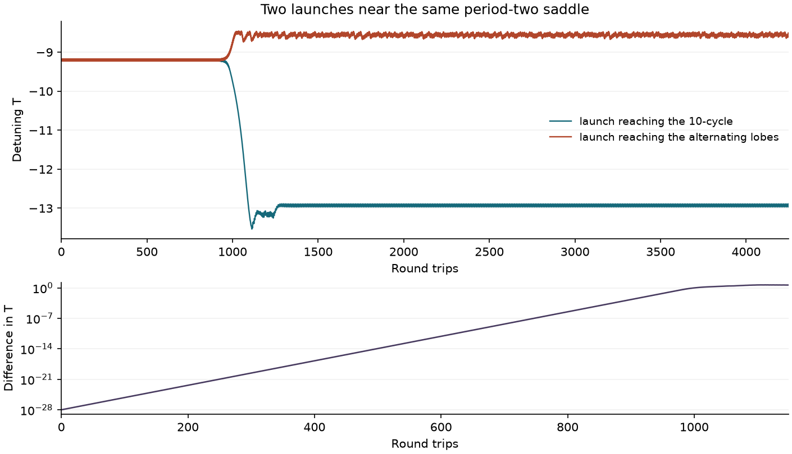

# A ten-cycle and two saddles in one optical cavity

Twelve starts in the original search settled into regular motion without a known period. All twelve converge to the same attracting **period-ten orbit**. At the same parameters the map has two different period-two orbits, one with a single expanding direction and one with two. Changing a launch by about 2 × 10⁻²⁸ near the first saddle sends it into a different detuning range.



The upper trace records 4,247 round trips. The lower panel resolves the first 1,150 on a logarithmic scale. Both launches start within 1.01 × 10⁻²⁸ of the same saddle point. The lower branch enters a proven basin of the ten-cycle at step 2,565. For the upper branch, interval arithmetic certifies every one of 2,048 alternating visits at steps 2,200–4,247. Its eventual fate and the location of the basin boundary remain open. [Exact starts and certificate](certificate.json)

## Orbits at Case 56729

The stable surface of the gap saddle lies on the boundary of all ten phase basins. On one branch leaving the saddle, 41 certified starting slices reach all ten phases. [Proof and phase diagram](../../attractor_followup_2/optics/README.md)

The state is a complex field E and a relaxing detuning T. Each step adds the pump to a rotated, damped field. We used the archived binary64 parameters exactly. [Cavity equation](../../wow_search_20261122/orbit/README.md#the-cavity-map) · [Six coefficients and original starts](../../wow_search_20261122/orbit/case-56729.json)

| Orbit | Detuning across the full cycle | Real return multiplier | Modulus of the conjugate pair |
| --- | --- | --- | --- |
| Attracting ten-cycle | (−12.97, −12.88) | (0.26269, 0.26270) | (0.8745, 0.8749) |
| Two-cycle in the detuning gap | (−9.23, −9.17) | (1.13826, 1.13828) | (0.7982, 0.7985) |
| Two-cycle at the alternating lobes | (−8.54, −8.46) | (0.47526, 0.47528) | (1.235, 1.237) |

The twelve regular starts enter the ten-cycle's local basin between steps 1,389 and 1,663. The other four sampled starts had two positive finite-time exponents in the original survey. The index-two saddle has a true periodic orbit in their detuning range. Membership in a chaotic attractor would require further proof. [Original orbit measurements](../../wow_search_20261122/orbit/README.md#alternating-lobes)

## Verification

We located the ten-cycle from a regular trajectory and the two shorter cycles by solving the two-step return equation from sampled field states. For each candidate a preconditioned Newton map sends a closed cube of half-width 10⁻⁶⁰ strictly inside itself and contracts there. Interval enclosures separate the successive phases. A negative cubic discriminant and sign changes at the endpoints bracket the real return multiplier. The exact determinant gives the squared modulus of the conjugate pair. All three cycles are hyperbolic, so each persists under sufficiently small parameter changes.

For the ten-step return, a positive quadratic form H defines a local trapping ellipsoid. The verifier checks H ≻ I and H − MᵀHM ≻ 0.3I for every matrix in the return derivative enclosure on a containing cube. This proves contraction toward the true cycle point throughout the ellipsoid. Direct interval iteration then checks entry for the twelve archived starts and the lower launch.

The two new launches use opposite offsets along a numerical approximation to the gap saddle’s expanding direction. Their exact coordinates are dyadic rationals. A 16,384-bit Cartesian interval replay checks the two trajectories. An independent 170-decimal-digit complex-exponential calculation reproduces the capture and alternating visits and draws the figure. [Interval verifier](../../../research/low_hanging_20261122/optics/verify.py) · [Complex replay and plot](../../../research/low_hanging_20261122/optics/independent.py)

## Earlier results

Before computing the orbits we searched for Ikeda-map multistability, periodic windows, basin-boundary saddles, and cavities with delayed nonlinear response. Ikeda and Akimoto established periodic and chaotic self-pulsations with slow relaxation in 1982. The 1984 plane-wave study already describes coexisting cycles and crises in a planar cavity map. Robert and collaborators identify a fixed-point saddle on a basin boundary of a planar Ikeda map. These precedents cover the general mechanisms. The sources checked did not report the period-ten sink, the two different saddle indices and the paired trajectory checks at this setting of the three-state map. [Ikeda and Akimoto](https://doi.org/10.1103/PhysRevLett.48.617) · [Global dynamics of the plane-wave map](https://opg.optica.org/abstract.cfm?uri=IQEC-1984-WEE5) · [Robert et al., Section 2.7](https://yorke.umd.edu/Yorke_papers_most_cited_and_post2000/2000_05_Robert_Alligood_Ott_PhysicaD_Chaos_Explosions.pdf)

## Reproduce

From the repository root, run on a CPU. The verifier checks the proof against the stored receipt. The complex replay checks the trajectories independently and redraws the diagnostic.

```sh
python -m pip install python-flint==0.9.0 mpmath==1.3.0 matplotlib
python research/low_hanging_20261122/optics/verify.py
python research/low_hanging_20261122/optics/independent.py --figure
```
