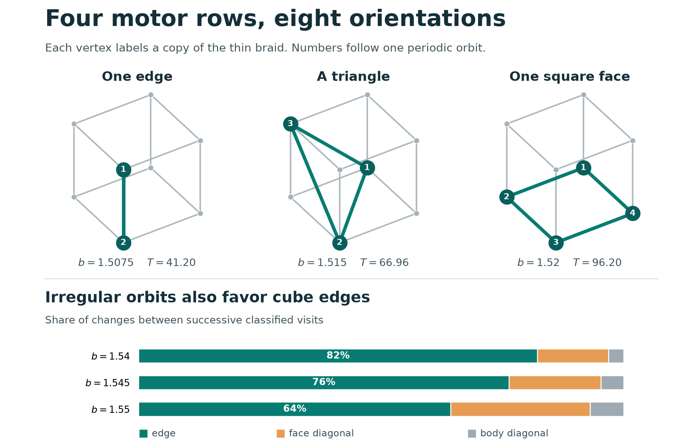

# Three periodic routes through eight motor orientations



Changing one coefficient in the [four-row motor equations](../../docs/motor-four-geometry.md#model-and-coordinates) selects three numerically attracting cycles. Two rows exchange roles after half a period in the first cycle. Three rows rotate roles every third of a period in the second, and all four every quarter-period in the third. A second integration of the original force equations recovers each relabeling within 6 × 10⁻¹¹ in every coordinate.

| Rate asymmetry $`b`$ | Route | Period | Largest transverse multiplier modulus |
| ---: | --- | ---: | ---: |
| 1.5075 | Edge and back | 41.19809 | 0.53730 |
| 1.515 | Triangle of face diagonals | 66.95911 | 0.69685 |
| 1.52 | Square face | 96.20199 | 0.50701 |

**How to read the cube.** At $`b=1.5`$, 32 independent starts gave [eight orientations of a thin braid](../../docs/motor-four-geometry.md#fresh-starts-and-nearby-parameters). The four body diagonals stand for the four possible distinguished rows. Their two ends distinguish even and odd relabelings of a reference braid. The cube records which orientation a trajectory visits next. The equation has eleven independent state coordinates.

**Which visits count?** Sample each upward crossing of mean cosine occupancy zero. Compare its full state with the eight permuted reference clouds, using [the scaled physical metric](../../docs/motor-four-b-study.md#full-state-permutation-comparison) fixed at $`b=1.5`$. Keep the closest label when its distance is below 0.075 and the runner-up is over twice as far. Repeated labels count as one visit. All 3,441 held-out crossings of the reference braid keep one label.

The three periodic routes persist across three section levels and three separation thresholds. In the three 60,000-unit irregular histories, all eight labels recur. Cube edges account for **1,232/1,498**, **785/1,028** and **385/598** label changes. The classifier retained 10.3%, 4.9% and 2.4% of crossings, respectively. Unclassified intervals can hide intermediate visits. The bifurcation connecting these regimes remains open.

### Reproduce

The fixed parameters are $`\rho=2.0238144033191343`$ and $`r=5.193274038098629`$. The [two-direction scout](selection.json) selected the three periodic windows after 34 runs. [Cycle states, two starts per window and full-state checks](cycles.json) reproduce the orbits above. [Archived DOP853 histories](historical.json) and independent RK4 runs at [step 0.01](rk4.json) and [step 0.005](half-step.json) include section and threshold controls.

```sh
python research/motor_symmetry_passages.py --step .01 --output comparison.json
python research/motor_symmetry_cycles.py --scout --output selection.json
python research/motor_symmetry_cycles.py --output cycles.json
python research/motor_symmetry_figure.py results/motor-symmetry-passages
```

The original model is due to [Alouges et al.](https://doi.org/10.1142/S0218202525500423). [Chossat and Golubitsky](https://doi.org/10.1016/0167-2789(88)90066-8) studied symmetry-increasing bifurcations of chaotic attractors. [Haugland and Krischer](https://arxiv.org/abs/2102.10138) connected differently symmetric solutions in four coupled oscillators.
