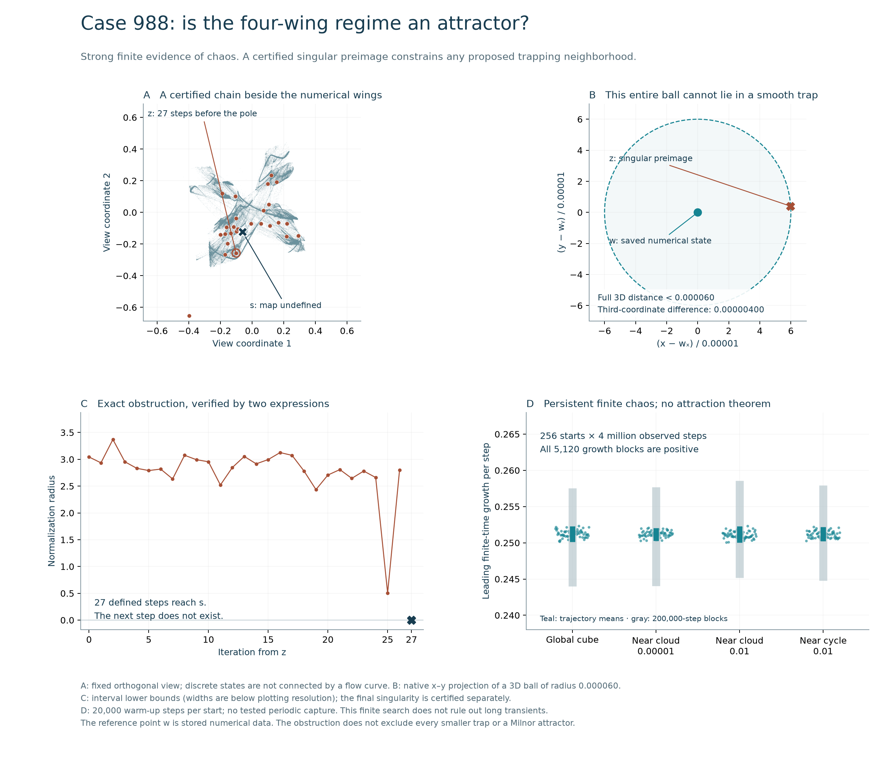

# Case 988: attraction status and a nearby singular preimage

**The complete four-wing numerical regime remains an attractor candidate.**
The already certified core C is not Lyapunov stable. This follow-up finds
strong finite chaotic survival and proves a specific obstruction to a
trapping neighborhood; it does not settle all possible larger attractors.
The proof and definitions are in
[Section 6.7 of the article](../../docs/product-alphabet/manuscript.md#67-attraction-status-and-a-nearby-singular-preimage).



## Results and scope

| Test | Result | What follows |
| --- | --- | --- |
| 256 starts, four million observed steps each | All 5,120 growth blocks positive; minimum 0.244015689; no tested periodic capture | Strong finite evidence of chaotic survival; no asymptotic attraction theorem |
| Backward preimage search | 45,792 nodes in the extended search; selected node 28,333 has depth 27 | A proposal for rigorous certification; no exhaustive or density claim |
| Two interval expressions | An exact z within 0.000060 of saved reference state w satisfies F^27(z) = s, where F(s) is undefined | No forward-invariant subset of the smooth domain can contain the entire radius-0.000060 ball about w |
| Wider nonuniform grid | 3,368,148 occupied cells; the union contains the previously certified central pole | This particular proposed union is not a smooth-domain trap |

The exact reference point w is the dyadic lift of Float64 row 1,841,277
(zero-based) in the two-million-state source, SHA-256
`31a9e83b0148e4a45f4b1c8e146a550bea464efd41942af735659e334405e0b8`.
Its round-trip decimal coordinates are
`[-0.25879391877434177, 0.21557237408465196, -0.13702406819774227]`.
This is numerical data, not a certified point of the asymptotic attractor.
All 27 source boxes have normalization greater than 0.50674007. The
28th update from z is undefined. These facts neither place the singular
chain on an attractor nor exclude every thinner/perforated trapping region.
An isolated terminating orbit also does not exclude positive-measure
attraction. No historical uniqueness is claimed.

## Validation and preserved attempts

- `product-attractor988-fate01`: four cohorts of 64 starts, each with
  20,000 warm-up and four million observed steps. Global-cube half-width
  2.2; cloud perturbation half-widths 0.00001 and 0.01; cycle perturbation
  half-width 0.01. These offsets are coordinate bounds, not Euclidean radii.
- `product-attractor988-fate-verification01`: sixteen complete selected
  trajectories replay, totaling 64 million observed steps; all saved
  batch concatenations, normalization minima and terminal-period tests
  are checked. The full eight-site formula and AD tangents agree at 640
  states within 2.28 × 10⁻¹⁵. This validates the declared finite calculation.
- `product-attractor988-preimages01`: exploratory depth 12, width 12;
  proximity to one cycle phase is the second selection objective.
- `product-attractor988-preimages02`: depth 40, width 128, 32 nearest-cloud
  predecessor seeds; the second objective uses the nearest of all four
  cycle phases. Both searches retain every node and attempted solve.
- `product-attractor988-chain-certificate01`: factorized posterior,
  140 digits; `product-attractor988-chain-independent01`: full eight-site
  formula, 180 digits. Both import the exact central-singularity enclosure
  and certify all 27 links with uniform-target Krawczyk inclusions.
- `product-attractor988-chain-audit01` and `02` retain the initial audit
  source, which required exact equality of target intervals. Importing a
  160-digit enclosure at 140 digits rounds it outward, so containment is
  the appropriate check. Attempt 02 records the confirmed assertion
  failure; attempt 01 has no final report. Audit `03` passes with target
  containment; audit `04` additionally verifies strict inclusion in the
  exact rational radius-10⁻⁴⁰ boxes. Both passing audits reproduce the
  frozen chain files exactly and check that the wide grid contains s.
- `product-attractor988-render01` and `02` preserve both renders. The
  second improves cloud contrast and separates the zoom annotation from
  the ball boundary. It is the published diagnostic.

Both interval expressions use mpmath; this is expression diversity, not
independent interval libraries. The wide-grid expansion is sampled and
does not prove actual-orbit escape. The 256 cohorts are not independent
random basin samples. Period tests cover lags 1–128, 256 and 512 only,
with 512 comparisons at tolerance 0.000000001.

## Storage and reproduction

[inventory.json](inventory.json) preserves the complete raw-file inventory,
[omissions.json](omissions.json) registers external full arrays and explicitly
partial compact inputs, and [manifest.json](manifest.json) hashes all retained
packet files. The full preimage-node selection graphs are retained as
essential replay inputs, with explicit reasons in the data registry.
Earlier frozen packets are unchanged.

The [validation receipt](validation.json) identifies the accepted exact
audit and finite numerical checks. The [reading receipt](literature-review.json)
records the limited source review: Milnor's established probabilistic
view of attraction and established adaptive subdivision methods. Only
abstracts and metadata were read in this follow-up; no general existence
theorem or historical priority conclusion is imported from them.

Environment: Python 3.12.14, NumPy 2.5.4, Numba 0.68.1, SciPy 1.18.1,
Matplotlib 3.11.2, mpmath 1.3.0. Use fresh external output directories.
In the commands below, replace the source-array and mpmath paths with
your verified local copies. The fixed exact-model input and singularity
certificate are retained in the repository.

```text
python research/search_product_attractor_fate.py --source D:/Codex/case-988-states.npz --cycle results/product-symbolic/runs/product-cycles988-01/cycle-14.npz --out D:/Codex/new-fate
python research/probe_product_wide_trap.py --source D:/Codex/case-988-states.npz --out D:/Codex/new-wide-trap
python research/search_product_singular_preimages.py --source D:/Codex/case-988-states.npz --cycle results/product-symbolic/runs/product-cycles988-01/cycle-14.npz --mechanism results/product-mechanism/runs/product-mechanism988-probe01/report.json --depth 40 --width 128 --neighbors 32 --out D:/Codex/new-preimages
python research/certify_product_singular_chain.py --input results/product-symbolic/runs/product-coverings988-certificate04/input.json --singular results/product-horizon/runs/product-singularity988-primary01/report.json --nodes results/product-attractor-status/runs/product-attractor988-preimages02/nodes.json --source D:/Codex/case-988-states.npz --mpmath-path D:/Codex/mpmath-environment/Lib/site-packages --node 28333 --engine factorized --digits 140 --out D:/Codex/new-chain
```

Repeat the last command with `--engine full --digits 180` and a new output
directory. Then audit the two certificate runs:

```text
python research/audit_product_singular_chain.py --input results/product-symbolic/runs/product-coverings988-certificate04/input.json --singular results/product-horizon/runs/product-singularity988-primary01/report.json --nodes results/product-attractor-status/runs/product-attractor988-preimages02/nodes.json --source D:/Codex/case-988-states.npz --grid D:/Codex/new-wide-trap/proposal.npz --mpmath-path D:/Codex/mpmath-environment/Lib/site-packages --runs D:/Codex/new-chain D:/Codex/new-chain-full --out D:/Codex/new-chain-audit
python research/verify_product_attractor_fate.py --input results/product-symbolic/runs/product-coverings988-certificate04/input.json --source D:/Codex/case-988-states.npz --run D:/Codex/new-fate --mpmath-path D:/Codex/mpmath-environment/Lib/site-packages --out D:/Codex/new-fate-verification
python research/render_product_attractor_status.py --source D:/Codex/case-988-states.npz --metadata results/product-attractor-status/reference-camera.json --fate D:/Codex/new-fate --chain D:/Codex/new-chain --singular results/product-horizon/runs/product-singularity988-primary01/report.json --out D:/Codex/new-status-render
```

The first preimage search used its own frozen source; the current search
uses all four cycle phases. The accepted chain may be replayed directly
from the retained `nodes.json`, without repeating proposal discovery.
The reference cloud is used to identify and verify the recorded closest
state; the mathematical distance claim itself uses only the retained w
and interval chain. Exact byte replay requires the recorded environment.
