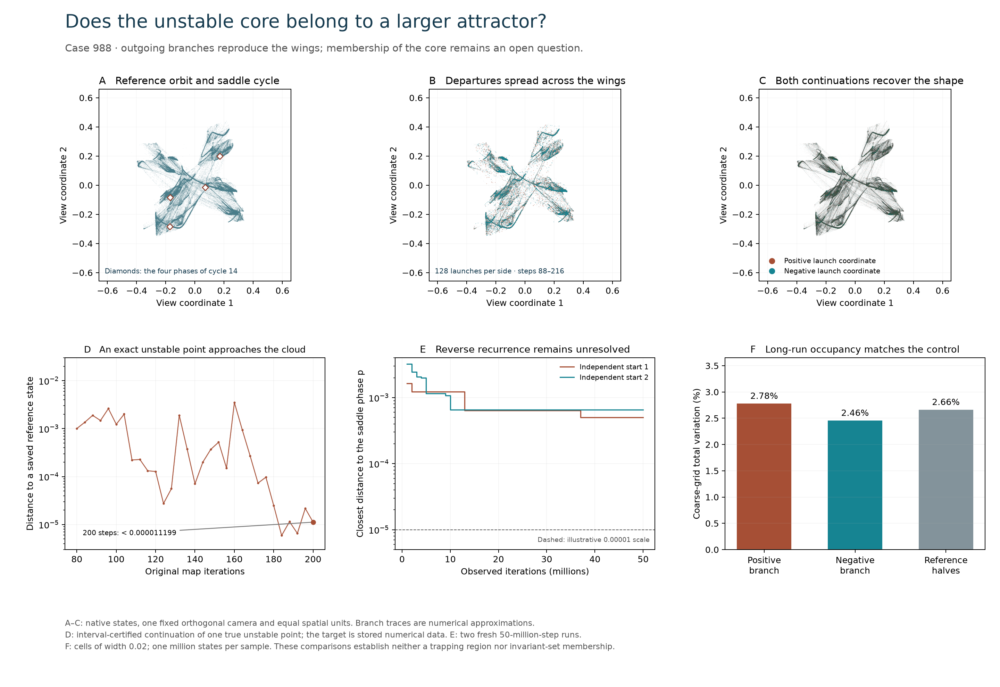

# Does the unstable core belong to a larger attractor?

For the exact binary Case 988, the positive-entropy core C is not Lyapunov
stable. This packet tests whether it belongs to a larger attracting set.
**The outgoing connection is supported; embedded membership remains open.**
An external saddle feeding an attractor is still an alternative.
See [Section 6.6 of the article](../../docs/product-alphabet/manuscript.md#66-testing-containment-in-a-larger-attracting-set)
for the full argument and numerical limitations.



## Evidence

| Test | Result | Scope |
| --- | --- | --- |
| Exact unstable-graph point from the earlier escape certificate | Both interval expressions continue it through 200 original iterations; final distance to a retained reference state is below 0.000011199 | Validated finite proximity to numerical data, not invariant membership |
| 128 numerical launches on each side of cycle 14 | Both outgoing fans spread across the wings | Eigenline approximations, not a certified global unstable set |
| One million late states from each selected branch | Leading growth 0.253499 and 0.251242; all ten blocks positive | Finite trajectory statistics |
| Fixed physical grid, side 0.02 | Frequency total variation 2.7792% and 2.4554%; reference-halves control 2.6623% | Coarse distribution agreement, not equality of invariant measures |
| 256 nearby starts at four radii | All ten leading-growth blocks positive for every start | Finite local-basin evidence |
| Two fresh 50-million-step recurrence searches | Closest p distances 0.000503336 and 0.000650731; no visit to N_0 | Reverse containment remains unresolved; no exclusion theorem |

The two selected branch clouds have rare excursions: their largest distances
from the two-million-state reference are 0.37856 and 0.10352. Median agreement
must not be presented as a uniform enclosure. The outgoing tests concern
the unstable directions of one certified cycle in C, not every point of C.

## Validation and retained attempts

`product-larger988-continuation02` uses the factorized posterior at 120 digits;
`product-larger988-independent02` uses all eight sites and automatic derivatives
at 160 digits. Both import the previously certified local graph. An exact
rational audit checks the moving charts, initial and propagated errors,
all 92 atlas separations at step 80, and squared-distance upper bounds.
Frozen-source replays reproduce every saved trajectory byte. The expressions
share mpmath interval arithmetic.

The first continuation attempt uses one-step moving charts and stops after
129 validated steps because interval width exceeds 0.01. It is retained;
this computational stop is not an orbit escape. The accepted construction
uses four-step returns and preserves the eigenvector chart during the local
departure before changing charts.

All four branch/perturbation arrays replay bit for bit. The first million
steps of each long recurrence search replay, all saved closest-state distances
and cumulative counts are checked, and 180 independent full-site expression
probes agree within 3.47e−15. The two figure renders are retained; the second
fixes footer spacing. The final image has been visually inspected.

[inventory.json](inventory.json) preserves each source snapshot and raw result;
[omissions.json](omissions.json) identifies optional large arrays and their
compact inputs. The original two-million-state cloud is identified by SHA-256
in every relevant report. The proof endpoint's reference coordinate is retained
in the trajectory JSON, so reading the finite proximity result requires no
large cloud download. [manifest.json](manifest.json) covers all retained packet
files. No earlier frozen packet is changed.

## Interpretation and prior art

A compact nonsingular trapping region containing C would prove containment
in its attracting set by invariance of C. Such a trap has not been found.
Any compact Lyapunov-stable attracting set containing the cycle must also
contain its defined outgoing unstable set; the article gives the short
stability argument. Neither that fact nor the outgoing numerical association
proves that the observed recurrent component contains C.

[Jelleyman and Osinga (2022)](https://link.springer.com/article/10.1140/epjs/s11734-022-00440-w)
provide a relevant established distinction: saddle branches approaching
separate attractors versus an unstable set participating in a merged
attractor after a homoclinic transition. Sections 1–3 and Equation (1) were
read; figures were not visually audited in this follow-up, and their model
was not reproduced here. No equivalence, bifurcation identification or
wild-chaos claim is inferred. The [reading receipt](literature-review.json)
records this limited scope.

## Reproduction

Recorded environment: Python 3.12.14, NumPy 2.5.4, Numba 0.68.1, SciPy 1.18.1,
Matplotlib 3.11.2, mpmath 1.3.0. Run from the repository root and use new external
output directories. Replace `D:/Codex/case-988-states.npz` with the exact optional
payload SHA-256 `31a9e83b0148e4a45f4b1c8e146a550bea464efd41942af735659e334405e0b8`.
The mpmath path should name an environment containing that package.

```text
python research/probe_product_larger_attractor.py --input results/product-symbolic/runs/product-coverings988-certificate04/input.json --certificate results/product-mechanism/runs/product-unstable-escape988-certificate06/report.json --source D:/Codex/case-988-states.npz --mpmath-path D:/Codex/mpmath-environment/Lib/site-packages --out D:/Codex/new-larger-probe
python research/probe_product_core_recurrence.py --input results/product-symbolic/runs/product-coverings988-certificate04/input.json --cycle results/product-symbolic/runs/product-cycles988-01/cycle-14.npz --out D:/Codex/new-larger-recurrence
python research/continue_product_unstable_graph.py --input results/product-symbolic/runs/product-coverings988-certificate04/input.json --certificate results/product-mechanism/runs/product-unstable-escape988-certificate06/report.json --source D:/Codex/case-988-states.npz --mpmath-path D:/Codex/mpmath-environment/Lib/site-packages --engine factorized --digits 120 --out D:/Codex/new-larger-continuation
```

Repeat the last command with `--engine full --digits 160` and a different output
directory. The exact audit accepts those two directories:

```text
python research/audit_product_unstable_continuation.py --input results/product-symbolic/runs/product-coverings988-certificate04/input.json --certificate results/product-mechanism/runs/product-unstable-escape988-certificate06/report.json --source D:/Codex/case-988-states.npz --mpmath-path D:/Codex/mpmath-environment/Lib/site-packages --runs D:/Codex/new-larger-continuation D:/Codex/new-larger-independent --out D:/Codex/new-larger-audit
```

Repeat the numerical probe in a new directory, then pass both to
`research/verify_product_larger_attractor.py` with `--probe`, `--replay`,
`--recurrence`, `--input`, `--source` and `--out`. To redraw the comparison,
use `research/render_product_larger_attractor.py` with `--source`, `--metadata`,
`--probe`, `--recurrence`, `--continuation` and `--out`; the exact original
camera metadata is retained as `reference-camera.json` in this packet.
New environments may generate different chaotic floating trajectories.
