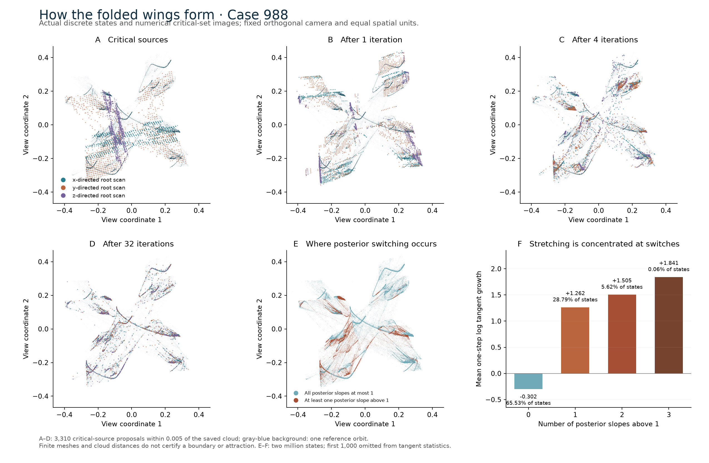
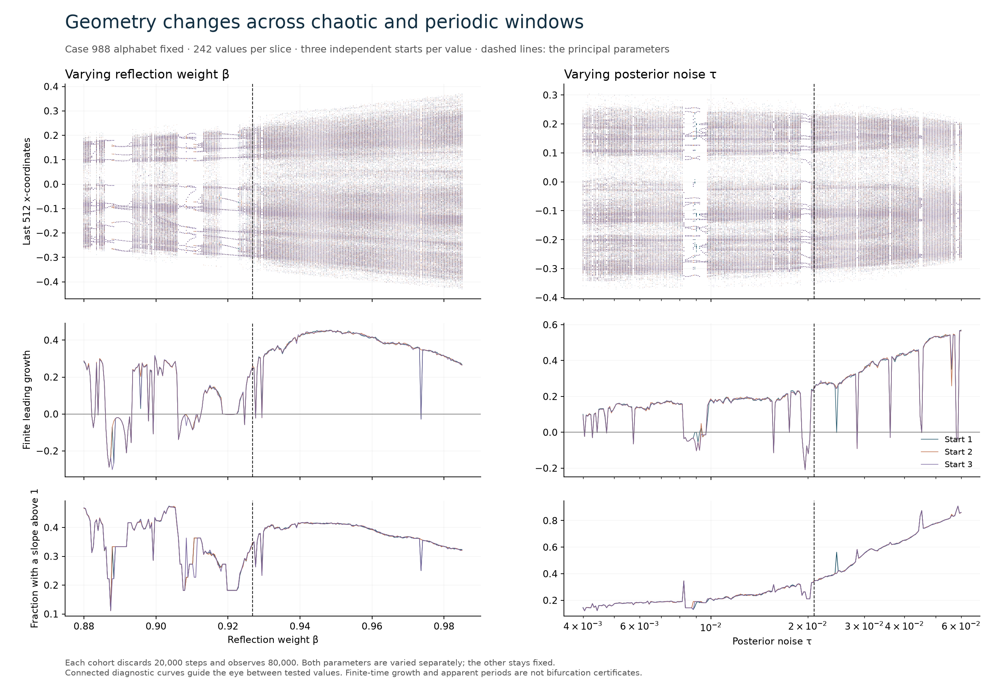

# Instability, folds and geometric mechanism of the product-posterior core

This packet supplements the [product-posterior article](../../docs/product-alphabet/manuscript.md)
for the exact binary Case 988. It does not replace the frozen entropy,
orientation or long-horizon packets.

**Principal result:** the positive-entropy set C constructed from the
covering graph is **not Lyapunov stable**. A larger attracting set containing
C is not excluded or established. The proof is in
[Section 6.3](../../docs/product-alphabet/manuscript.md#63-the-certified-subsystem-is-not-lyapunov-stable).

## Certified results

| Result | Factorized calculation | Full eight-site calculation | Exact audit |
| --- | --- | --- | --- |
| Unique self-loop point in the complete window N_0; unstable graph and escape from the entire atlas | `product-unstable-escape988-certificate06`, 120 digits | `product-unstable-escape988-independent06`, 160 digits | `product-unstable-escape988-audit07` |
| Six ordinary rank-two folds and two exact preimages of the normalization singularity | `product-local-geometry988-certificate03`, 120 digits | `product-local-geometry988-independent03`, 160 digits | `product-local-geometry988-audit01` |

The self-loop uniqueness test covers N_0 with two and sixteen subcells.
The same period-four point belongs to every C selected as in the article.
A local unstable graph contains a point at horizontal coordinate 1e−25.
After 80 original iterations its validated image is separated from all
92 enclosing atlas boxes by a coordinate gap exceeding 0.00011729734758437.
Backward graph iterates approach the cycle, proving failure of stability.
This is a finite certificate of an infinite-time instability statement,
not merely a trajectory started near a numerical saddle.

The fold certificates use fixed-coordinate determinant brackets, a nonzero
Jacobian row cross product and a nonzero derivative of the determinant
in that kernel direction. The independent expression propagates second
derivatives through all eight Gaussian weights and nested reflections.
The two inverse-root certificates use the complete certified interval
target for the singularity, rather than a rounded target. Neither local
folds nor singular preimages are proved to lie on the observed invariant
set. Both expression engines share mpmath; they are not independent
interval libraries.

The audits use exact rational lifts of binary interval endpoints and
replay the frozen source calculations. The full mathematical argument,
including the graph-transform inequalities, is in the article.

## Numerical mechanism and comparison





The mesh has 30,017 critical-source proposals; 3,310 start within 0.005 of
the two-million-state reference cloud. Ten checkpoints extend through
1,024 iterations. This is a sampled postcritical geometry, not a certified
surface or trapping boundary. The tangent diagnostics find negative
conditional mean growth outside the posterior switching strips and
positive conditional mean growth inside them.

Two independent parameter slices contain 242 values each, with three
declared starts per value, 20,000 discarded steps and 80,000 observed
steps. Among 1,452 cohorts, 1,193 have all ten leading blocks positive,
254 meet a finite period test, and five meet neither classification.
There are no execution flags. No continuation path, basin volume or
exact bifurcation location is inferred.

`product-mechanism988-verification01` replays both complete parameter
slices and the critical mesh byte for byte, checks 128 independent
formula/Jacobian probes and 2,048 full-site tangent updates, and verifies
an exact absorbing norm bound. Every indefinitely defined forward orbit
eventually enters radius 40, but that ball includes singularities and
does not establish a smooth-domain compact trap.

The targeted Lotka–Volterra comparison reproduces five published parameter
values from Bischi and Tramontana (2010), with a declared initial state,
100,000 discarded steps and one million observed steps per value. Similarity
and affine-whitened local alignments do not identify their saved clouds
with Case 988. Their residuals are finite numerical comparisons, not
inequivalence proofs. The [reading receipt](literature-review.json)
records the inspected primary sources and visual scope. Critical-surface
folding and postcritical boundaries are established concepts.

## Inventory and unsuccessful runs

[inventory.json](inventory.json) lists all 246 research files in the
declared run directories. Nineteen arrays, totaling 281,880,177 bytes,
remain outside Git with exact hashes and compact inputs in
[omissions.json](omissions.json). The large arrays are optional for reading
the proofs; replaying the numerical diagnostics requires the exact retained
cache payloads or a documented recomputation. Runtime bytecode caches are
explicitly excluded from the scientific inventory and retained externally.

All attempted unstable-escape certificate versions 01–06, independent
versions 03–06 and their available audits are retained. Versions before
06 do not prove the final theorem: they lack the complete self-loop
uniqueness argument or stop on interval-width or implementation failures.
Failed local-geometry and reference-comparison drivers are also retained.
Post-run failure receipts identify their scope without changing the
executed source snapshots. Replays are nested under their own run folders;
their numerical equality is recorded by the corresponding audits.

The source figure render was improved for label spacing and contrast.
Both renders and their exact inputs are retained. The final diagnostic
assets are the `render02` figures; their actual first drawing date is in
the common registry. Existing main-page portraits and rotations are
unchanged.

## Reproduction

Use Python 3.12.14, NumPy 2.5.4, Numba 0.68.1, SciPy 1.18.1,
Matplotlib 3.11.2 and mpmath 1.3.0 for the recorded same-environment
replays. A new environment need not reproduce chaotic binary64 bytes.
Keep every new output directory separate from this frozen packet.
Commands below run from the repository root; replace external locations
with the exact payloads listed in the inventory and data registry.

The instability audit uses only retained proof inputs:

```text
python research/audit_product_unstable_escape.py --windows results/product-symbolic/runs/product-coverings988-certificate04/input.json --cycles results/product-orientation/runs/product-cycles988-certificate03/report.json --mpmath-path D:/Codex/mpmath-environment/Lib/site-packages --runs results/product-mechanism/runs/product-unstable-escape988-certificate06 results/product-mechanism/runs/product-unstable-escape988-independent06 --out D:/Codex/new-product-instability-audit --replays D:/Codex/new-product-instability-replays
```

The local-geometry audit additionally uses the cached critical proposals:

```text
python research/audit_product_local_geometry.py --input results/product-symbolic/runs/product-coverings988-certificate04/input.json --singular results/product-horizon/runs/product-singularity988-primary01/report.json --proposals results/product-mechanism/runs/product-mechanism988-probe01/report.json --critical D:/Codex/critical-images.npz --mpmath-path D:/Codex/mpmath-environment/Lib/site-packages --runs results/product-mechanism/runs/product-local-geometry988-certificate03 results/product-mechanism/runs/product-local-geometry988-independent03 --out D:/Codex/new-product-local-audit --replays D:/Codex/new-product-local-replays
```

To regenerate the numerical stages, use the original dense Case 988 states,
the numerical cycle-14 archive and the 70-cycle report identified by their
hashes in the saved reports:

```text
python research/analyze_product_mechanism.py --source D:/Codex/case-988-states.npz --cycles results/product-symbolic/runs/product-cycles988-01/report.json --out D:/Codex/new-product-mechanism
python research/trace_product_critical_surfaces.py --source D:/Codex/case-988-states.npz --cycle results/product-symbolic/runs/product-cycles988-01/cycle-14.npz --diagnostics D:/Codex/new-product-mechanism/diagnostics.npz --out D:/Codex/new-product-critical
python research/scan_product_mechanism.py --source D:/Codex/case-988-states.npz --out D:/Codex/new-product-parameter-slices
python research/verify_product_mechanism.py --source D:/Codex/case-988-states.npz --cycle results/product-symbolic/runs/product-cycles988-01/cycle-14.npz --diagnostics D:/Codex/new-product-mechanism --critical D:/Codex/new-product-critical --scan D:/Codex/new-product-parameter-slices --out D:/Codex/new-product-mechanism-check --replays D:/Codex/new-product-numerical-replays
python research/compare_product_lotka_volterra.py --source D:/Codex/case-988-states.npz --out D:/Codex/new-product-lv-comparison
```

The accepted proof runs and exact audit reports are the authority for the
rigorous claims. Numerical meshes, local alignment scores and figure
resemblances are not substitutes for those certificates.
