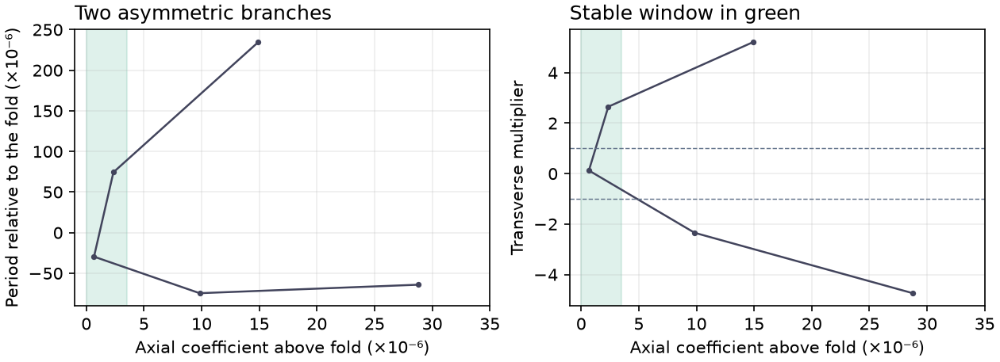

# Seven coexisting cycles in the Case 180844 angular flow

Two branches of asymmetric period-two orbits meet near axial coefficient −0.356574826410. One branch has a stable interval ending in a period doubling near −0.356571312071. The interval is about 3.51434 × 10⁻⁶ wide. Seven symmetry-related cycles are numerically attracting inside it. The seven rotating-frame nodes stay separated at the turn, with a maximum distance of 0.04732 from their centroid. The branch curvature, unit multiplier and change of stability support a numerical saddle-node interpretation. The separate symmetric orbit remains unstable at the sampled interior coefficient. [Event refinements](bifurcations.json) · [Continuation](continuation.csv) · [Independent Poincaré sections](orbit-controls.json)



| Axial coefficient or event | Period | Dominant transverse multiplier |
| --- | ---: | ---: |
| Saddle-node, −0.356574826410 | 53.37208 | +1 |
| Attracting orbit, −0.356572981504 | 53.37204 | −0.45000 |
| Unstable partner at the same coefficient | 53.37215 | +2.46156 |
| Symmetric orbit at the same coefficient | 53.37873 | −48.36367 |
| Unstable partner at the original chaotic coefficient, −0.353834134784 | 53.38447 | −210.74352 |

At the interior sample, all 28 tested perturbations returned within 1.25 × 10⁻⁶ RMS of some family member. Ten returned to the starting copy. The trials covered seven rotations, two initial displacement radii and two RK4 steps. Every pair of positive y = 0 section sets had a nonzero Hausdorff distance. The smallest was 0.00387 in native coordinates. State-only DOP853 and RK45 section derivatives at a displacement of 10⁻⁷ RMS gave multipliers −0.450003 and −0.450012. [Basin tests](basins.json) · [Section checks](orbit-controls.json)

Two other initial states at exactly this coefficient retained positive growth in all fifteen windows of 4,000 time units. An independent adaptive integration of one start gave a spectrum of (0.03977, 0.00165, −1.88706). A third start gave regular dynamics in one of the long replays. Initial conditions and step size matter for assigning a basin in this narrow interval. The finite-time calculations leave asymptotic chaotic attraction unresolved. [Long runs and adaptive spectrum](chaotic-replays.json) · [Matched-step replays](long-fates.json)

At the original chaotic coefficient, the unstable partner has seven distinct rotations. Two solvers give a minimum pairwise section-set Hausdorff distance of 0.00416. Its period and multiplier differ from both the seven earlier asymmetric copies (+220.09) and the symmetric order-two orbit (−236.51). Including the earlier order-one, order-four, order-eight and order-sixteen cores gives numerical evidence for at least **19 distinct periodic orbits** at the same parameters. The registry stores one representative per new rotational family. [Cloud registry](manifest.json) · [Earlier symmetry controls](../../flows/final-link-crosscheck.json)

## Period doubling

At an axial coefficient 10⁻⁷ above the asymmetric flip, direct integration and independent shooting gave a period-four daughter with period 106.74405 and multiplier +0.88635. The cloud and diagnostics include the fractional-period test and the full return residual. [Post-flip trials](postflip.json)

The symmetric main cascade also continues beyond the 16T stage. At axial coefficient approximately −0.3574933891, the order-sixteen orbit passes a transverse multiplier of −1. At −0.357491110988 the next attracting orbit has period 853.85685 and multiplier +0.34439. A state-only RK45 control closed the rotated sector to 2.1 × 10⁻¹¹ native units. The order-thirty-two trace contains 65,536 native points. The smallest all-phase separation for a candidate repeated traversal occurred at half its period and was 0.00179 orbit RMS. [32T continuation and orbit](period-32.json)

The order-thirty-two branch then crosses −1 near coefficient −0.35746338265. At −0.357462927026, its attracting order-sixty-four daughter has period **1707.71796**, dominant multiplier **+0.37162**, a DOP853 sector closure of 4.32 × 10⁻¹² and an independent RK45 closure of 6.80 × 10⁻¹¹. The most competitive repeated-traversal test was again half the period, with a maximum 19-phase separation of 0.0005614 orbit RMS. The 65,536-point cloud replayed bit for bit. [64T continuation, controls and cloud reference](period-64.json)

## Equations and checks

All runs use the same angular-resonance equation and coefficient ordering as the earlier study. Only the ninth coefficient, the axial drive, varies. The continuation coordinate f is related to that coefficient by e = −0.4297716347835525 + 0.0759375 f. For seven rotating-frame nodes and one fixed coordinate section, the shooting equations are

```math
R^{-1}\Phi_{\tau,e}(u_j)=u_{j+1},\qquad u_7=u_0,\qquad T=7\tau.
```

Here R rotates by 8π/7, and the seven nodes are independent unknowns on the asymmetric branch. A symmetric branch needs one node. Pseudo-arclength continuation follows the curve around the parameter turn. The state transition matrix and coefficient derivative are integrated over each sector. Independent Poincaré maps use state-only event localization near one full period and two mutually perpendicular transverse displacements. Two event refinements used relative solver tolerances of 8 × 10⁻¹¹ and 9 × 10⁻¹³. Numerical convergence and the independent return estimates support the bifurcation interpretation. Rigorous smooth-orbit and basin enclosures remain open. [Earlier equation](../../flows/README.md) · [Source code](../../../../research/shape_search_20261121/extension/flows)

## Reproduction

```powershell
$flow = 'research/shape_search_20261121/extension/flows'
$packet = 'results/shape_search_20261121/extension/flows'
python "$flow/replay.py" --manifest "$packet/manifest.json" --id stable --out D:/attractor-replay/seven-stable.npz
python "$flow/replay.py" --manifest "$packet/manifest.json" --id final_partner --out D:/attractor-replay/partner.npz
python "$flow/replay.py" --manifest "$packet/manifest.json" --id coexisting_chaotic_cloud --out D:/attractor-replay/second-basin.npz
python "$flow/replay.py" --manifest "$packet/manifest.json" --id period_32 --out D:/attractor-replay/order-32.npz
```

Each registered case has a cloud-relative cache location, SHA-256, coefficients, initial state or sector nodes, and a reconstruction method. The NPZ files contain an N × 3 float64 array named `points`. All relative cloud locations resolve from the campaign cache root. Branch identifiers refer to the Case 180844 parameter path. Individual physical coefficients are recorded with each cloud.
