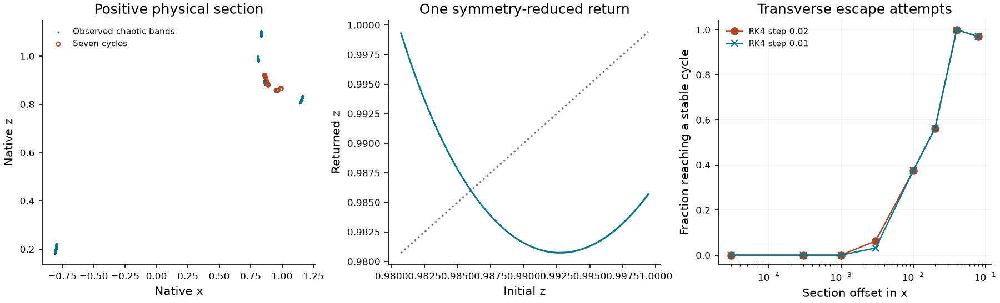

# Searching for an eighth attractor in Case 180844

The seven stable cycles persist at axial coefficient −0.356572981503573. A separate cloud at the same coefficient produces five bands on the physical section $`y=0`$, $`\dot y>0`$. Its fifth return sends all 69,649 tested points of an explicit two-dimensional region strictly inside that region. Shorter symmetry-reduced returns have outward-rounded enclosures for individual small input boxes. Establishing attraction and sustained chaos across the region still requires bounds on entire cells and their returns. [Return map and independent controls](return-map.json) · [Local interval certificates and failed enclosures](interval-returns.json)

## Return geometry

On the first band, use coordinates $`(z,d)`$ with $`d=x-g(z-0.99)`$. The registered quintic $`g`$ is fitted once to native crossings of an earlier trajectory. The broad chart has $`0.98045\leq z\leq0.99945`$ and $`|d|\leq3\times10^{-5}`$. Exact rational interval arithmetic gives $`0.62098<\dot y<0.65516`$ over this whole chart. The Euclidean separation of its rectangular outer bound from the 28 numerically located section points of the seven cycles is at least 0.07714 in native coordinates.

Across the 4,097 by 17 return mesh, the fifth crossing has $`z`$ between 0.98073773 and 0.99920256, transverse displacement below $`5.1\times10^{-8}`$, and elapsed time between 46.4194 and 46.6085. Two different RK4 meshes and two independent adaptive integrations agree. In 80 DOP853 tests the least positive crossing speed at any intermediate hit exceeded 0.4059. Eighteen shared starts also used RK45. The mesh constrains measured margins while leaving the values between its nodes unresolved. [Coefficients, ranges and checks](return-map.json)

A shorter map rotates each initial state by $`8\pi/7`$, then locates a positive crossing of the same chart. Seven compositions agree with the fifth native return to $`2.6\times10^{-9}`$ in section coordinates in the 71-point composition test. In the smaller tube $`0.98071\leq z\leq0.99943`$, $`|d|\leq10^{-6}`$, every one of 26,129 tested returns has transverse displacement below $`5.1\times10^{-8}`$. The sampled return takes 6.5622 to 6.7073 time units. The reduced centerline map has a turning point near $`z=0.99274`$. The five-return map folds 23 times along the broader sampled centerline. [Reduced-domain controls](reduced-tube.json)

## What the interval calculation establishes

The proof runs use Arb arithmetic, the registered binary64 coefficients interpreted as exact real numbers, and the analytical trigonometric phase. Each time step encloses a Picard tube and verifies its contraction. The Taylor method encloses the final term over the whole step. Separate endpoint signs and a strictly positive normal speed localize a unique crossing inside the designated gate while the preceding portion of the gate is checked step by step. Four small boxes passed the direct Taylor test. A second implementation encloses the time-step Jacobian by an interval Peano series and transports error bounds in a moving basis. It certifies two additional native section boxes with halfwidths of 1e-12 and 3e-12 in both x and z. The broader 1e-9 test remained inconclusive. The records store lossless dyadic balls and the full starting specifications. Their scope is the stated boxes and a single reduced return. [Recheckable enclosures](interval-returns.json)

The 23 separated lap rectangles yield 161 sampled covering relations. The largest relevant strongly connected component has 16 rectangles and adjacency spectral radius 6.301206. If full vertical faces satisfy their tested inequalities, all intervening returns are continuous and transversely interior, and the maximal return time stays below the sampled bound, this graph would give an entropy lower bound near 0.03949 per unit flow time. Each covering edge uses a native-coordinate margin above $`4\times10^{-5}`$. Turning points defeat a simple uniformly expanding scalar description on the whole tube. Proving the graph would establish positive topological entropy for an invariant subset. A positive Lyapunov exponent for typical initial points would require further evidence. [Rectangles, margins and adjacency](coverings.json)

## Escape and basin tests

None of 64 distinct restarts taken from the earlier cloud approached a stable cycle by the capture test. The first 32 phases ran 90,000 units at each of two steps. The other 32 ran 360,000 units each. These 96 trajectories cover 17.28 million time units. Their minimum section distance to any of the 28 points of the seven cycles exceeded 0.0127644. Across 12 broader matched initial states, six captures occurred at step 0.02 and nine at step 0.0125, including late assignments after thousands of time units. These counts describe those initial states.

A second experiment moved 16 section starts by prescribed positive and negative offsets in native $`x`$. Each ran 14,000 units at steps 0.01 and 0.02. At offsets through 0.001, every tested start returned to the cloud. At 0.003, one or two of the 32 signed starts reached stable cycles, depending on the step. At 0.01, 12 reached cycles at each step. At 0.04 all 32 reached cycles at both steps. The cloud thus has a sampled neighborhood of persistent returns and lies near readily reachable basins of the stable cycles. Survival times from these correlated phase restarts cannot exclude later escape. [Capture definition, section nodes, seeds and all counts](fates.json)

## Reproduction

Run the following from the repository root with NumPy, SciPy, Numba and Matplotlib. The locally checked proof dependency is python-flint 0.9.0. Cached dense events, fitted maps and independent controls are listed with their paths and SHA-256 digests. [Raw-data inventory](manifest.json) · [Implementation](../../../../research/shape_search_20261121/frontiers/flows)

~~~powershell
$s = 'research/shape_search_20261121/frontiers/flows'
foreach ($h in 0.02,0.0125) {
    python "$s/ensemble.py" --step $h --duration 90000 --indices ((64..75)+(0..31))
}
python "$s/ensemble.py" --step 0.015625 --duration 360000 --indices (32..63)
python "$s/summary.py"
python "$s/return_tube.py" --n 601 --levels 9 --h 0.0125
python "$s/return_tube.py" --n 4097 --levels 17 --h 0.00625
python "$s/reduced.py"
python "$s/compact_tube.py"
python "$s/adaptive_controls.py"
python "$s/coverings.py"
python "$s/stress.py"
python "$s/interval_return.py" --id center --steps 1200 --order 28
python "$s/interval_return.py" --id edge --steps 800 --order 32 --z .98071 --delta 1e-6
python "$s/interval_return.py" --id fold --steps 900 --order 29 --z .99274
python "$s/interval_return.py" --id right --steps 900 --order 29 --z .99943
python "$s/affine_return.py" --id center-positive-area --rx 1e-12 --rz 1e-12 --steps 8192 --order 10 --width 8e-8
python "$s/affine_return.py" --id right-positive-area --rx 3e-12 --rz 3e-12 --steps 16384 --order 9 --width 8e-8 --z .9985
python "$s/packet.py"
python "$s/plot.py"
~~~
